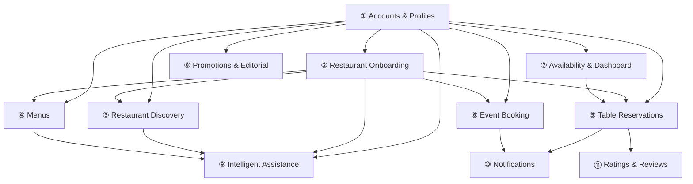

## Summary

<!-- What changed and why? -->

## Task / evidence

<!-- Link the Scrum task and relevant report evidence. -->

## Verification

- [ ] Backend checks (`ruff check backend`, `pytest`) when relevant
- [ ] Frontend build (`cd frontend && npm run build`) when relevant
- [ ] Screenshots attached for visible UI changes
- [ ] No secrets or real customer data included

## Functional Groups

| # | Functional Group | Main Actors | Stage |
|---|-----------------|-------------|-------|
| 1 | Accounts and profiles | Customer, Partner, Admin | Release 1 |
| 2 | Restaurant onboarding | Partner, Admin | Release 1 |
| 3 | Restaurant discovery | Customer | Release 1 |
| 4 | Menus | Partner, Customer | Release 1 |
| 5 | Table reservations | Customer, Partner | Release 1 |
| 6 | Event booking | Customer, Partner | Release 2 |
| 7 | Availability and partner dashboard | Partner | Release 1 (basic), Release 2 (full) |
| 8 | Promotions and editorial | Partner, Admin, Customer | Release 2 |
| 9 | Intelligent assistance | Customer, Admin | Release 3 |
| 10 | Notifications | Customer, Partner | Release 1 |
| 11 | Ratings and reviews | Customer, Admin | Release 2 |
| — | Cancellation policy | Customer, Partner | Release 1 (rules only) |

### Group Dependencies

## Scope

| Category | Items |
|----------|-------|
| **Release 1** | Groups 1–5, basic group 7, notifications (10), cancellation policy |
| **Release 2** | Event booking (6), full dashboard (7), promotions and editorial (8), ratings and reviews (11) |
| **Release 3** | Intelligent assistance (9) |
| **Out of scope** | Online payment, deposits, full restaurant accounting, native mobile applications |

## Additional Notes

Add any additional notes or information about the changes here.
