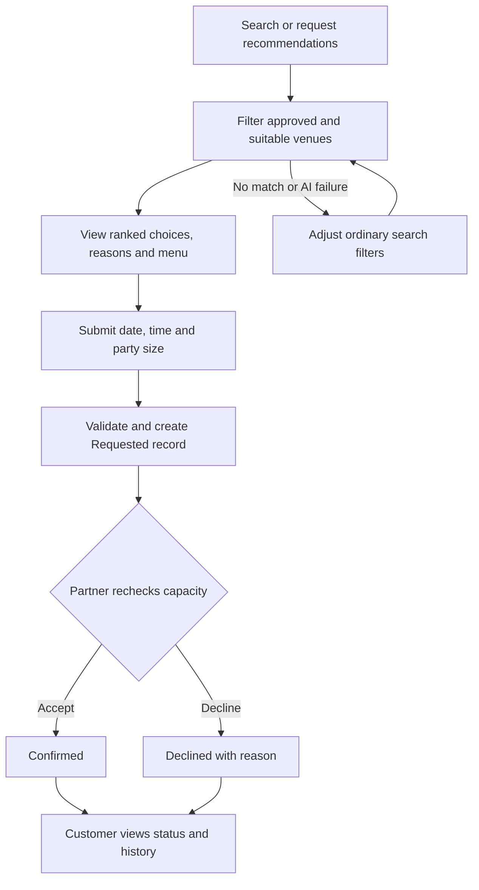
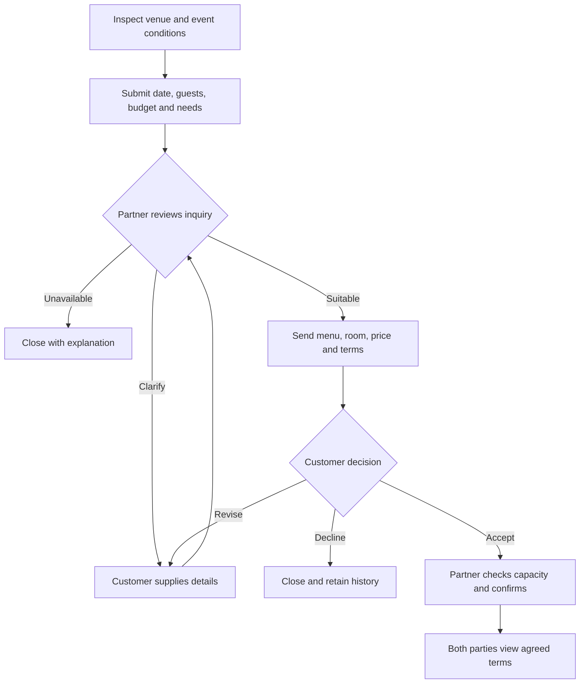
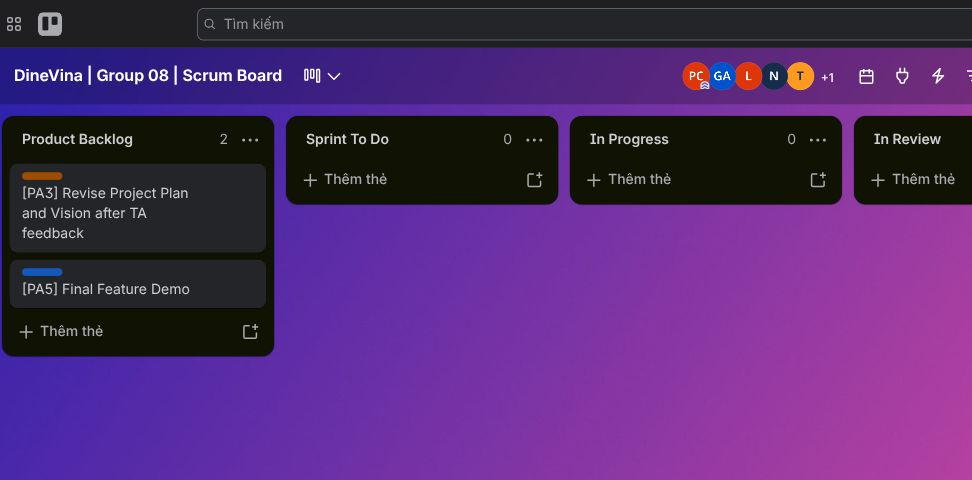
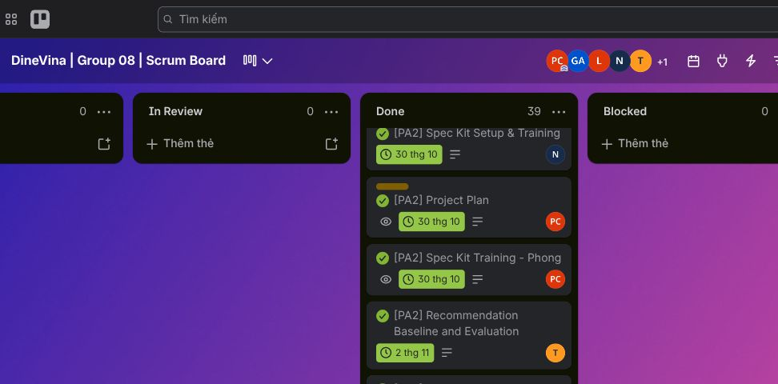
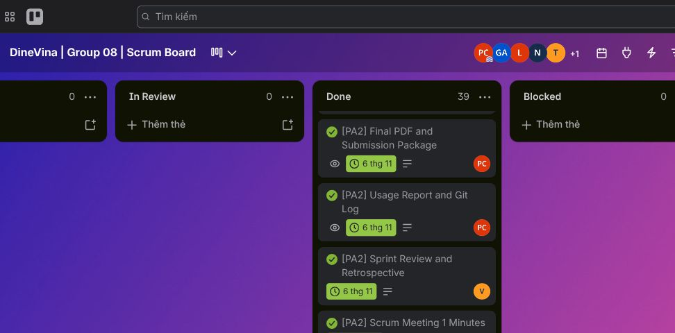

# DineVina - PA2 Report
**Performed by:** Group 08; Hoàng Cao Phong | **Reviewed by:** Peer reviewers named in each chapter | **Edited by:** Hoàng Cao Phong

**CS300 / CSC13002 - Introduction to Software Engineering**

**University of Science, VNU-HCM | Group 08 | 31 October 2026 | PA2 submission package**

This reading copy combines the individual reports and source-backed meeting archive. Editable originals, project Spec Kit artifacts and evidence accompany this PDF. The requirement/evidence matrix identifies what each record establishes.

## Contents
**Performed by:** Hoàng Cao Phong | **Reviewed by:** Võ Mỹ Ngọc | **Edited by:** Hoàng Cao Phong

- Project-Plan
- Vision
- Spec-Kit-Training
- AI-Usage-Report
- Weekly-Report
- Meeting archive: PA1-History (Sprint 1 context)
- Meeting archive: Sprint-Planning-Record
- Meeting archive: Scrum-Meetings
- Meeting archive: Sprint-Review-Minutes
- Evidence: Trello-Task-Index
- Source-Register
- Submission-Checklist

# DineVina - Project Plan (PA2)
**Performed by:** Hoàng Cao Phong | **Reviewed by:** Võ Mỹ Ngọc | **Edited by:** Hoàng Cao Phong

**Group 08 · initial plan · 31 October 2026 · Version 1.1**

Attribution lines identify source contributors, review assignments and editors. The AI usage report records the tools used for consolidation and technical checks. Review assignments do not constitute signed approval.

## 1. Introduction
**Performed by:** Hoàng Cao Phong | **Reviewed by:** Võ Mỹ Ngọc | **Edited by:** Hoàng Cao Phong

DineVina is a responsive restaurant discovery and reservation-request platform. Customers find venues and send table requests or event inquiries; restaurant partners manage listings and respond; administrators review venue information. This initial PA2 plan defines scope, people, risks, five Scrum sprints, the next sprint's assignments and dates, build checkpoints, reporting and submission controls. It will be revised in PA3 after teaching-assistant feedback. The course's RUP template phases are not used because PA2 explicitly requires Scrum.

## 2. Project overview
**Performed by:** Hoàng Cao Phong | **Reviewed by:** Võ Mỹ Ngọc | **Edited by:** Hoàng Cao Phong

### 2.1 Goals and success criteria
**Performed by:** Hoàng Cao Phong | **Reviewed by:** Võ Mỹ Ngọc | **Edited by:** Hoàng Cao Phong

1. Help a customer discover a suitable restaurant from searchable, approved venue information and inspect its menu and conditions.
2. Let a customer submit a table reservation request and distinguish **requested**, **confirmed**, **declined** and **cancelled** states. A request is never represented as a confirmed booking before partner confirmation.
3. Give a partner a clear queue for listing updates, availability, reservation requests and event inquiries.
4. Demonstrate an explainable recommendation baseline using only approved venue data, with a manual search/filter fallback.
5. Produce a tested, traceable increment at each planned build checkpoint, with limitations documented rather than hidden.

### 2.2 Scope, deliverables and assumptions
**Performed by:** Hoàng Cao Phong | **Reviewed by:** Võ Mỹ Ngọc | **Edited by:** Hoàng Cao Phong

The planned functional groups are accounts and profiles; venue onboarding; discovery and details; menus; table requests; event inquiries and proposals; availability and partner dashboard; promotions and editorial content; and intelligent assistance. Native mobile apps, payment processing, POS, inventory and accounting are outside the current scope. Event inquiries are a negotiation flow, not table reservations.

PA2 deliverables are the initial Project Plan and Vision in English Markdown and PDF, Spec Kit files under `src/`, individual tutorial evidence, AI usage declaration and log, weekly meeting report, board screenshots, Git log and the `PA2-Group08.zip` package. Coding and self-training may be scheduled as Scrum tasks, but a feature descriptions define the intended product. The submission package contains the initial project plan, Vision, Spec Kit artifacts, usage and weekly reports, evidence, and PDF exports.

Planning assumptions: five members remain available; the team can use GitHub and Trello; restaurant data may initially be clearly marked samples; publication and personal-data policy need team agreement. The team representative confirms that the instructor permits this group to use Trello instead of Jira. The team-confirmed Sprint 2 / PA2 window is 19–31 October 2026. The Notion allocation and first weekly meeting are dated 23 October; the second weekly meeting is dated 29 October; the Sprint Review was held 31 October. Some Trello due dates still reflect an older 24 October–6 November board schedule. Card due dates are recorded as board metadata, not as the sprint boundary or meeting dates.

## 3. Project organization
**Performed by:** Hoàng Cao Phong | **Reviewed by:** Võ Mỹ Ngọc | **Edited by:** Hoàng Cao Phong

| Member | Scrum role and primary work in the current plan |
| --- | --- |
| Hoàng Cao Phong | Leader/Scrum Master; full Project Plan, schedule, risk register, weekly report integration, submission integration; coordination and review of technical evidence. |
| Võ Mỹ Ngọc | Product Owner; Vision, requirements and UX; reviewer of Phong's deliverables. |
| Lương Thiện Nhân | Stakeholder/user needs and environment, competition and venue/menu data; designated minute taker for Scrum 1. The current Scrum 2 card is assigned to Phong. |
| Nguyễn Trung Kiên | Product overview, measurable quality requirements, API/persistence design, Spec Kit initialization and integration build. |
| Trương Khánh Duy | AI feature feasibility, two workflow designs, recommendation evaluation and technical peer review. |

Each task has one accountable performer and a different reviewer. A Trello membership assignment identifies the performer; the reviewer is recorded in the card description until the team establishes a review convention. The Product Owner prioritizes backlog items with the team. Work moves through `Sprint To Do → In Progress → In Review → Done` only as evidence supports it. Changes should be reviewed into `dev` and promoted to `main` through the team's normal GitHub review process.

## 4. Risk management
**Performed by:** Hoàng Cao Phong | **Reviewed by:** Võ Mỹ Ngọc | **Edited by:** Hoàng Cao Phong

Probability and impact are planning judgments (Low/Medium/High), not measured frequencies. At each weekly Scrum, Phong checks triggers, records an owner and action in Trello, and revises this register. The Product Owner accepts scope changes; technical owners verify the relevant mitigation.

| ID | Risk and trigger | Probability / impact | Prevention and response | Owner / review |
| --- | --- | --- | --- | --- |
| R1 | A member misses a check-in or a task's proposed date. | Medium / High | Ask for an early status update; split critical work, record a new owner/date and reduce Sprint 2 scope before the deadline. | Phong / Ngọc |
| R2 | Venue or menu records are incomplete, unapproved or inconsistent. | High / High | Nhân defines required fields and validation; label sample records; block unapproved venues from search and recommendation output. | Nhân / Kiên |
| R3 | The nine feature groups exceed the available sprint capacity. | High / High | Ngọc prioritizes the customer search → request → partner response path; reduce optional RAG/OCR and polish before reducing committed groups. Any approved core scope change must update the Vision and change log. | Ngọc / Phong |
| R4 | UI, API and database contracts diverge at integration. | Medium / High | Kiên publishes request/response shapes, status transitions and migration notes; run tests and an integration smoke check before the review. | Kiên / Phong |
| R5 | A request is displayed as confirmed or private customer data is exposed. | Medium / High | Use explicit state transitions, role checks and minimum necessary data; review negative cases before a demo. | Kiên / Ngọc |
| R6 | Tutorial, meeting, board or AI-use evidence is missing at packaging. | High / Medium | Keep a submission matrix, ask members for genuine records at each Scrum, capture dated screenshots and export the final Git log near submission. Never manufacture evidence. | Phong / Ngọc |
| R7 | A PDF or ZIP is unreadable, stale, or omits a required file. | Medium / High | Render from reviewed Markdown, inspect PDF pages, check the ZIP file list and extraction test, and record the exact revision packaged. | Phong / Ngọc |

Escalation rule: a High-impact risk with an active trigger is raised at the next Scrum check-in or immediately if it blocks the build. Record the decision, assignee and next check date on the relevant Trello card. Release decisions are recorded against the corresponding acceptance evidence.

## 5. Scrum plan and sprint schedule
**Performed by:** Hoàng Cao Phong | **Reviewed by:** Võ Mỹ Ngọc | **Edited by:** Hoàng Cao Phong

The instructor recommends five sprints of roughly 2-3 weeks, one per PA. Exact PA3-PA5 calendar dates depend on course announcements and will be set at each Sprint Planning. The team confirms the PA2 window as 19–31 October; this is the group's sprint calendar, not a statement about the Moodle upload deadline.

The PA2 rhythm was one progress check-in per sprint week: Week 1 (19–25 October) met on 23 October at 21:30–22:00; Week 2 (26–31 October) met on 29 October. The Sprint Review/retrospective took place on 31 October at 21:30–22:00. The meeting archive records attendees, work summaries and follow-up actions.

| Sprint | Target window | Outcome and acceptance checkpoint |
| --- | --- | --- |
| Sprint 1 / PA1 | 9-17 Oct 2026 (prior work) | Proposal, competitor survey, team contract and process/repository setup. PA1 baseline retained as scope input. |
| Sprint 2 / PA2 | 19–31 Oct 2026 (team-confirmed) | Initial Plan and Vision, Spec Kit and training records, usage and weekly reports; reviewed data/API contracts and B1 integration prototype. |
| Sprint 3 / PA3 | Next course window, to be announced | Revise Plan/Vision with Changes.md; complete use-case model/specifications and all corresponding UI prototypes; demonstrate at least one full-stack group with Spec Kit and narrated video; B2. |
| Sprint 4 / PA4 | Next course window, to be announced | Revise use cases with Changes.md; C4 levels 1-3 and deployment diagrams; at least two additional full-stack groups with Spec Kit, generated tests and narrated video; B3. |
| Sprint 5 / PA5 | Final course window, to be announced | All nine groups working on B4; at least 50 test cases across five use cases, execution/bug reports, reflective report and a live demo involving all members; final PA1-PA5 documents and source package. |

### 5.1 Detailed Sprint 2 backlog
**Performed by:** Hoàng Cao Phong | **Reviewed by:** Võ Mỹ Ngọc | **Edited by:** Hoàng Cao Phong

The dates in the last column are the Trello board's recorded due dates, including dates after the team-confirmed 31 October sprint close. They are preserved here for traceability and do not redefine the PA2 calendar. The actual weekly meetings were held on 23 and 29 October. The team uses the source allocation for document responsibilities and the live board for current task ownership.

| ID | Task and acceptance result | Performer | Reviewer | Board due (local) | Trello |
| --- | --- | --- | --- | --- | --- |
| P2-01 | Sprint Planning: actual attendance, goal, scope, assignments, dates and decisions recorded. | Phong | Ngọc | 24 Oct | [Card](https://trello.com/c/qIeNe7Ff/26-pa2-sprint-planning-tonight-minutes) |
| P2-02 | Complete Project Plan: scope, organization, risks, five sprints, detailed PA2 tasks and build plan; reviewed Markdown/PDF. | Phong | Ngọc | 30 Oct (revised proposal) | [Card](https://trello.com/c/XEw1Ez1p/21-pa2-project-plan) |
| P2-03 | Vision: position, stakeholders, nine feature paragraphs, workflows and measurable quality requirements; reviewed Markdown/PDF. | Ngọc | Phong | 30 Oct | [Card](https://trello.com/c/yKrHhDLc/22-pa2-vision-document) |
| P2-04 | Initialize Spec Kit under `src/`, prepare constitution and verify generated Markdown; collect training register. | Kiên | Duy | 30 Oct | [Card](https://trello.com/c/sr54a5Ig/23-pa2-spec-kit-setup-training) |
| P2-05 | Each member completes the official Spec Kit tutorial and supplies a genuine dated learning record. | Five individual cards | Different member | 30 Oct | [Phong](https://trello.com/c/ed6FonQx/37-pa2-spec-kit-training-phong) and four peer cards |
| P2-06 | Venue/menu data fields, validation rules and labeled sample records reviewed. | Nhân | Kiên | 31 Oct | [Card](https://trello.com/c/5P6lzQLJ/27-pa2-venue-and-menu-data-contract) |
| P2-07 | Discovery and reservation API shapes, states and scenarios reviewed. | Kiên | Ngọc | 2 Nov | [Card](https://trello.com/c/NTsppxiL/28-pa2-discovery-and-reservation-api-contract) |
| P2-08 | Recommendation eligibility, ranking baseline, fallback and offline evaluation cases reviewed. | Duy | Phong | 2 Nov | [Card](https://trello.com/c/Zn4Yltxp/29-pa2-recommendation-baseline-and-evaluation) |
| P2-09 | First weekly Scrum: held 23 October; shared minutes cover progress, issues and actions. | Phong | Ngọc | 30 Oct | [Card](https://trello.com/c/ghXX7Icx/30-pa2-scrum-meeting-1-minutes) |
| P2-10 | Second weekly Scrum: held 29 October; same shared document records the second week's review. | Phong | Ngọc | 5 Nov | [Card](https://trello.com/c/4PT0Ydmy/31-pa2-scrum-meeting-2-minutes) |
| P2-11 | Integration build: revision, test/build results, browser check and known gaps. | Kiên | Phong | 4 Nov | [Card](https://trello.com/c/mOAsL53w/35-pa2-integration-build-and-tests) |
| P2-12 | Sprint Review/retrospective: held 31 October; outcomes and improvement actions are recorded in the meeting archive. | Ngọc | Phong | 6 Nov | [Card](https://trello.com/c/xZPpe4D7/32-pa2-sprint-review-and-retrospective) |
| P2-13 | Integrated Weekly Report with linked minutes and genuine dated board screenshots. | Phong | Ngọc | 6 Nov | [Card](https://trello.com/c/MOAReCbM/33-pa2-weekly-report-and-trello-evidence) |
| P2-14 | Collect verified AI-use entries and export final Git history. | Phong | Ngọc | 6 Nov | [Card](https://trello.com/c/1GENoiql/34-pa2-usage-report-and-git-log) |
| P2-15 | Review PDFs and evidence, package and verify `PA2-Group08.zip`. | Phong | Ngọc | 6 Nov | [Card](https://trello.com/c/azebtYam/36-pa2-final-pdf-and-submission-package) |

### 5.2 Build and test checkpoints
**Performed by:** Hoàng Cao Phong | **Reviewed by:** Võ Mỹ Ngọc | **Edited by:** Hoàng Cao Phong

Four tested builds are planned after the PA1 scaffold. **B1 (end of PA2):** data/API contract prototype and integration baseline. **B2 (end of PA3):** accounts/onboarding/discovery slice, with at least one group complete across UI, API and persistence. **B3 (end of PA4):** menus, availability, request and event workflow integration; at least two additional complete groups. **B4 (before PA5 final demo):** all nine functional groups, including promotions and the primary recommender, with full customer-to-partner demonstrations. Optional RAG/OCR remain outside the committed primary slice unless formally added to scope. For each build, record commit SHA, included behavior, test commands/results, frontend build, manual browser smoke path and known limitations. A successful compile alone does not certify a working product flow.

## References
**Performed by:** Hoàng Cao Phong | **Reviewed by:** Võ Mỹ Ngọc | **Edited by:** Hoàng Cao Phong

- Course *Project Assignment 2 (PA2-2026)* and *Weekly Reports* instructions.
- Group 08 PA1 report and the [PA2 Trello board](https://trello.com/b/cE6KYEGR/dinevina-group-08-scrum-board).
- Source contribution: `research/PA2_Phong_PjPlan`, `docs/weekly-reports/PA2_Week3-4/Phong_PjPlan/phong.md`.

## 6. Detailed upcoming Sprint 3 plan
**Performed by:** Hoàng Cao Phong | **Reviewed by:** Võ Mỹ Ngọc | **Edited by:** Hoàng Cao Phong

The next sprint starts after PA2 review. Relative due days are measured from Sprint 3 day 1; calendar targets are set when the course announces its window. Each item has one performer and a different reviewer. These are planning proposals for the next Sprint Planning and are kept distinct from current committed PA2 cards.

| ID | Task / acceptance result | Performer | Reviewer | Due | Dependency |
| --- | --- | --- | --- | --- | --- |
| P3-01 | Record TA comments and reconcile Plan/Vision changes | Phong | Ngọc | Day 2 | PA2 feedback |
| P3-02 | Describe customer, partner and admin use cases with main/alternative paths | Ngọc | Phong | Day 4 | P3-01 |
| P3-03 | Validate a labeled venue/menu fixture and required-field dictionary | Nhân | Kiên | Day 4 | Data contract |
| P3-04 | Implement customer authentication and server role checks with negative tests | Kiên | Duy | Day 7 | API contract |
| P3-05 | Implement discovery/list/detail vertical slice and browser form integration | Phong | Kiên | Day 9 | P3-03, P3-04 |
| P3-06 | Prepare 30 labeled preference queries and explainable ranker baseline | Duy | Nhân | Day 9 | P3-03 |
| P3-07 | Review mobile layouts and request-state wording against use cases | Ngọc | Nhân | Day 10 | P3-02, P3-05 |
| P3-08 | Run B2 backend tests, frontend build and browser smoke check | Kiên | Phong | Day 12 | P3-04, P3-05 |
| P3-09 | Record Sprint Review, retrospective, AI log and PA3 package | Phong | Ngọc | Day 14 | B2 |

All five students work across specification, implementation and testing. Primary roles indicate leadership rather than exclusive technical ownership. Scope changes enter the backlog with an owner, reviewer, estimate and acceptance criterion before implementation.

## 7. Delivery coverage and course milestones
**Performed by:** Hoàng Cao Phong | **Reviewed by:** Võ Mỹ Ngọc | **Edited by:** Hoàng Cao Phong

| Build | Planned functional-group coverage | Course deliverable check |
| --- | --- | --- |
| B1 / PA2 | Source/API/data contracts and scaffold validation | Initial Plan/Vision and Spec Kit initialization; no full product claim |
| B2 / PA3 | F1 accounts, F2 onboarding and F3 discovery vertical slices; F3 is the minimum complete group | All use-case specifications/prototype screens, Changes.md, Spec Kit artifacts and narrated demonstration link |
| B3 / PA4 | Add F4 menus, F5 table requests, F6 event proposals and F7 availability/dashboard; F5/F7 are minimum two added groups | C4 context/container/frontend-backend component diagrams, deployment, source and narrated demo; generated tests included |
| B4 / PA5 | Complete F1-F9 including F8 promotions and F9 primary recommender; regression across all groups | At least 5 use cases x 10 test cases, actual results and linked bugs, all-member live demo, reflection and final consistent PA1-PA5 package |

The roadmap targets all nine groups by PA5 rather than carrying unfinished core features into the final demo. Early foundations share one thin data model and avoid optional integrations. Capacity and scope are reviewed at each Scrum; core scope changes require product approval and documented revisions. The source recommendation prototype is a baseline, not a substitute for UI/API/persistence acceptance.

Additional upcoming Sprint 3 documentary tasks, with dates relative to Sprint 3 day 1:

| ID | Acceptance result | Performer | Reviewer | Due |
| --- | --- | --- | --- | --- |
| P3-10 | Mermaid use-case diagrams cover all Vision requirements; every use case has basic/alternative flows and matching prototype screenshots | Ngọc | Nhân | Day 7 |
| P3-11 | Narrated video demonstrates the implemented F3 group and records the course-required YouTube link after team upload | Kiên | Phong | Day 13 |
| P3-12 | One Changes.md records Plan and Vision revisions against PA2; archive excludes dependency/build caches | Phong | Ngọc | Day 14 |
| P3-13 | F3 Spec Kit spec/plan/tasks align UI, API and persistent venue records | Duy | Kiên | Day 3 |

These are proposed next-sprint tasks, not claims that the PA3 artifacts or video already exist.

# DineVina - Vision Document (PA2)
**Performed by:** Group 08 source contributors; Hoàng Cao Phong | **Reviewed by:** Peer reviewers by section | **Edited by:** Hoàng Cao Phong

**Group 08 · initial Vision · 31 October 2026**

## 1. Introduction
**Performed by:** Võ Mỹ Ngọc | **Reviewed by:** Hoàng Cao Phong | **Edited by:** Hoàng Cao Phong

This Vision Document defines the high-level needs, market position, and product capabilities of DineVina, a responsive web marketplace for restaurant discovery, table reservation requests, and event inquiries. It gives the project team and stakeholders a shared understanding of what the product should achieve, why its capabilities are needed, and which users benefit from them. Detailed functional behavior, acceptance criteria, and implementation decisions will be refined in the use-case model, supplementary specifications, and product backlog.

DineVina follows a B2B2C model in which restaurant partners publish and manage dining services, customers find suitable venues and submit requests, and the platform connects both sides through visible request states. An ordinary table reservation remains a request until the restaurant partner confirms it, while event inquiries follow a separate clarification and proposal process. The current product scope excludes a complete restaurant point-of-sale, inventory, accounting, and payment system, and it does not include native mobile applications.

### 1.1 References
**Performed by:** Võ Mỹ Ngọc | **Reviewed by:** Hoàng Cao Phong | **Edited by:** Hoàng Cao Phong

| Reference                                                                        | Date                     | Publishing organization or source                      | Use in this document                                                                                                                      |
| -------------------------------------------------------------------------------- | ------------------------ | ------------------------------------------------------ | ----------------------------------------------------------------------------------------------------------------------------------------- |
| *PA1 Report - DineVina: Smart Restaurant Reservation and Event Booking System* | 17 October 2026          | Group 08, Introduction to Software Engineering         | Defines the agreed product idea, boundaries, actors, nine functional groups, AI direction, and PasGo/Eatigo survey findings.              |
| *Project Assignment 2 (PA2-2026)*                                              | 15 October 2026          | CS300/CSC13002, University of Science, VNU-HCM         | Defines the required Vision Document sections, paragraph depth for product features, Mermaid workflow requirement, and submission format. |
| *Vision Document for a Small Project* (`rup_vision_sp.docx`)                 | Course-provided template | Rational Unified Process template distributed with PA2 | Provides the required section structure and the formats for the Problem Statement and Product Position Statement.                         |
| *Vision Document Example* (`rup_vision_sp-example.docx`)                     | Course-provided example  | Distributed with PA2                                   | Illustrates how the positioning tables and product feature section may be completed.                                                      |

## 2. Positioning
**Performed by:** Võ Mỹ Ngọc | **Reviewed by:** Hoàng Cao Phong | **Edited by:** Hoàng Cao Phong

### 2.1 Problem Statement
**Performed by:** Võ Mỹ Ngọc | **Reviewed by:** Hoàng Cao Phong | **Edited by:** Hoàng Cao Phong

|                                          | Statement                                                                                                                                                                                                                                                                                                 |
| ---------------------------------------- | --------------------------------------------------------------------------------------------------------------------------------------------------------------------------------------------------------------------------------------------------------------------------------------------------------- |
| **The problem of**                 | finding a restaurant that fits a customer's location, cuisine, budget, party size, capacity, and event needs while keeping restaurant information and request status clear and traceable                                                                                                                  |
| **affects**                        | customers planning ordinary meals or group events, restaurant partners receiving and managing requests, and platform administrators responsible for trustworthy listings                                                                                                                                  |
| **the impact of which is**         | customers spend time comparing fragmented or uncertain information, may confuse a submitted request with a confirmed booking, and must coordinate complex events through unstructured channels; restaurant partners face incomplete requests, conflicting capacity commitments, and inefficient follow-up |
| **a successful solution would be** | a responsive marketplace that presents attributable venue and menu information, supports relevant search criteria, separates requested and confirmed states, provides a structured event proposal path, and gives restaurant partners a single workspace for availability and incoming demand             |

### 2.2 Product Position Statement
**Performed by:** Võ Mỹ Ngọc | **Reviewed by:** Hoàng Cao Phong | **Edited by:** Hoàng Cao Phong

|                            | Statement                                                                                                                                                                                                       |
| -------------------------- | --------------------------------------------------------------------------------------------------------------------------------------------------------------------------------------------------------------- |
| **For**              | diners looking for suitable restaurants, customers planning group events, restaurant partners seeking qualified demand, and platform administrators maintaining listing quality                                 |
| **Who**              | need a clearer way to discover venues, evaluate dining or event suitability, submit complete requests, and track responses without confusing a request with a confirmed commitment                              |
| **The product name** | DineVina is a responsive B2B2C web marketplace for restaurant discovery, table reservation requests, and event inquiries                                                                                        |
| **That**             | connects customers and restaurant partners through approved venue information, menus, availability, explicit request states, structured event briefs and proposals, promotions, and preference-based assistance |
| **Unlike**           | relying on separate search, social, messaging, and booking tools, or the limited PasGo and Eatigo interface flows observed in the PA1 survey                                                                    |
| **Our product**      | combines a traceable booking state, a dedicated event negotiation workflow, and explainable recommendations grounded in partner-verified venue data, while keeping ordinary filters available as a fallback     |

## 3. Stakeholder and User Descriptions
**Performed by:** Lương Thiện Nhân | **Reviewed by:** Nguyễn Trung Kiên | **Edited by:** Hoàng Cao Phong

### 3.1 Stakeholder summary
**Performed by:** Lương Thiện Nhân | **Reviewed by:** Nguyễn Trung Kiên | **Edited by:** Hoàng Cao Phong

| Stakeholder | Interest | Responsibility / representation |
| --- | --- | --- |
| Restaurant business owners | Accurate listing and qualified customer demand | Authorize venue publication, set policies and nominate partner staff. |
| Dining groups and event organizers | A suitable venue and clear commitment | Represent party size, budget, accessibility and event requirements. |
| Platform operator | Trustworthy marketplace and reliable service | Moderate listings, support disputes and operate access/audit controls. |
| Group 08 and course reviewers | A feasible, traceable academic product | Maintain the backlog, assess increments and review documented assumptions. |

### 3.2 User summary
**Performed by:** Lương Thiện Nhân | **Reviewed by:** Nguyễn Trung Kiên | **Edited by:** Hoàng Cao Phong

| User | Responsibilities | Represented interest |
| --- | --- | --- |
| Customer | Search venues, inspect menus, submit complete table/event requests, track responses and cancel within policy | Diners and event organizers |
| Restaurant partner staff | Maintain their venue/menu/availability, decide requests, prepare event proposals and update state history | Restaurant owner |
| Platform administrator | Review onboarding, return corrections, moderate published information and investigate support cases | Platform operator |

### 3.3 User environment
**Performed by:** Lương Thiện Nhân | **Reviewed by:** Nguyễn Trung Kiên | **Edited by:** Hoàng Cao Phong

Customers use a responsive browser on a phone or desktop and may have intermittent mobile data. Discovery supports manual district/location filters without mandatory geolocation permission. A request cycle involves one customer and authorized staff of the selected restaurant; the administrator participates in onboarding and exceptions. Partner staff use a desktop dashboard during service and may check incoming requests by phone. Clear state labels and retry-safe submission reduce confusion when the connection is interrupted. The initial interface targets Vietnamese restaurant data; language and localization expansion are later backlog decisions.

### 3.4 Summary of key stakeholder or user needs
**Performed by:** Lương Thiện Nhân | **Reviewed by:** Nguyễn Trung Kiên | **Edited by:** Hoàng Cao Phong

| Need / cause | Priority | Current workaround | Product response |
| --- | --- | --- | --- |
| Fragmented venue, menu and condition information | High | Compare websites/social pages and call venues | Approved profiles, structured menus, update context and filters (F3, F4) |
| Unclear distinction between a request and a commitment | High | Follow-up calls or messages | Explicit requested/confirmed/declined states and history (F5) |
| Complex group-event requirements | High | Phone consultations and separate message threads | Structured brief, clarification and proposal history (F6) |
| Changing capacity and incoming demand | High | Manual reservation books/spreadsheets | Venue-owned availability and partner queue (F7) |
| Difficulty choosing among many venues | Medium | Manually compare a shortlist | Eligible recommendations with attributable reasons and filter fallback (F9) |
| Consistent listing quality | High | Staff inspect each submission | Administrator approval and partner corrections (F2) |

### 3.5 Alternatives and competition
**Performed by:** Lương Thiện Nhân | **Reviewed by:** Nguyễn Trung Kiên | **Edited by:** Hoàng Cao Phong

The following comparison is anchored to the PA1 survey and its dated interface captures, rather than new market measurements.

| Alternative | Observed strength / existing approach | Design implication for DineVina |
| --- | --- | --- |
| PasGo | Venue discovery, detail pages, booking form and consultation entry | Adopt clear venue detail and request forms; connect event briefs to an explicit proposal history. |
| Eatigo | Time-based search, discount presentation and visible offer conditions | Keep date/time and eligibility conditions visible; separate offers from reservation confirmation. |
| Phone and messaging | Flexible human clarification | Preserve clarification while keeping requests and decisions attributable in one history. |
| Internal spreadsheet or restaurant management software | Staff track operations internally | DineVina connects multiple restaurants to customers; POS, inventory and accounting remain outside scope. |

See `evidence/pa1-survey/` for the survey Markdown and original screenshots. No new competitor booking was performed during PA2 consolidation.

## 4. Product Overview
**Performed by:** Nguyễn Trung Kiên | **Reviewed by:** Trương Khánh Duy | **Edited by:** Hoàng Cao Phong

### 4.1 Product perspective and interfaces
**Performed by:** Nguyễn Trung Kiên | **Reviewed by:** Trương Khánh Duy | **Edited by:** Hoàng Cao Phong

DineVina is a B2B2C marketplace with responsive customer, partner and administrator interfaces. The checked repository uses React, TypeScript and Vite for the frontend and FastAPI for the backend; PostgreSQL is the planned persistent store. Browser presentation, API business rules and persistence are separate responsibilities. The API contract governs discovery, venue details, request creation and lifecycle transitions. Partner/admin operations require server authorization and ownership checks. Notification and mapping integrations are replaceable external dependencies, with in-app status history and manual location filters as baseline behavior.

The source Product Overview discusses a separate Supabase/GCP prototype branch. That description is preserved in the supporting source; the packaged source revision is identified in the Git evidence. This Vision defines product requirements and does not certify a separate deployment. Full POS, kitchen management, inventory, accounting, payment processing and native mobile apps are excluded. Menu selection supplies event preferences; it does not add a separate food-order checkout flow.

### 4.2 Assumptions and dependencies
**Performed by:** Nguyễn Trung Kiên | **Reviewed by:** Trương Khánh Duy | **Edited by:** Hoàng Cao Phong

Partner data must be complete and approved before public discovery or AI ranking. Sample data are labeled. A 30-minute partner response window, two-hour cancellation cutoff and 30-minute slot granularity are planning defaults from Kiên's contribution; final policy values are configured and checked before release. Capacity updates and confirmation require a persistent atomic check. If persistent storage fails, writes return an explicit retryable error; a demo memory store must never silently replace live booking records. Provider quotas, network access, source freshness, role permissions and the agreed API schema constrain delivery. The primary recommendation slice uses deterministic filtering and scoring, so external LLM availability does not block ordinary discovery.

## 5. Product Features
**Performed by:** Võ Mỹ Ngọc | **Reviewed by:** Hoàng Cao Phong | **Edited by:** Hoàng Cao Phong

The following features refine the nine functional groups established in the PA1 project proposal. They describe externally visible product capabilities and user value without committing the team to a particular implementation design.

### 5.1 Accounts and Profiles
**Performed by:** Võ Mỹ Ngọc | **Reviewed by:** Hoàng Cao Phong | **Edited by:** Hoàng Cao Phong

DineVina allows customers and restaurant partners to create accounts and maintain the contact and preference information needed for their activities. Role-aware access separates customer, partner, and administrator actions so that each user sees only the functions and records relevant to that role. Customers benefit from reusable booking details and preferences, while partners and administrators benefit from attributable actions and controlled access to operational data.

### 5.2 Restaurant Onboarding
**Performed by:** Võ Mỹ Ngọc | **Reviewed by:** Hoàng Cao Phong | **Edited by:** Hoàng Cao Phong

Restaurant partners can submit a venue profile containing its identity, location, cuisine, photos, amenities, capacity, and contact details. A platform administrator reviews the submission and either approves it or returns it for correction before it becomes an attributable source for customer discovery. This feature gives customers more trustworthy venue information and helps partners present their restaurants consistently on the marketplace.

### 5.3 Restaurant Discovery and Venue Details
**Performed by:** Võ Mỹ Ngọc | **Reviewed by:** Hoàng Cao Phong | **Edited by:** Hoàng Cao Phong

Customers can search and filter restaurants by criteria such as location, cuisine, budget, party size, capacity, and amenities, then open a venue page for more detail. The feature shortens the path from a dining or event need to a manageable set of suitable options instead of forcing users to compare fragmented information manually. Customers benefit from more relevant choices, while approved restaurant partners gain visibility among users whose needs match their offerings.

### 5.4 Menu Management and Viewing
**Performed by:** Võ Mỹ Ngọc | **Reviewed by:** Hoàng Cao Phong | **Edited by:** Hoàng Cao Phong

Restaurant partners can maintain menu items with approved names, descriptions, and prices, and customers can review this information before submitting a request. Menu visibility is needed because price and dish suitability influence whether a venue fits a customer's budget, dietary preferences, and occasion. Customers make better-informed decisions, and partners receive requests from people who have already reviewed the relevant offering.

### 5.5 Table Reservation Requests
**Performed by:** Võ Mỹ Ngọc | **Reviewed by:** Hoàng Cao Phong | **Edited by:** Hoàng Cao Phong

Customers can choose a date, time, and party size and submit a table reservation request to a restaurant partner. The partner can confirm or reject the request, while both sides can see its status history and applicable cancellation conditions; submitting a request does not itself create a confirmed reservation. This feature gives customers a clear path from venue selection to a visible outcome and helps restaurant staff respond to demand without making ambiguous promises.

### 5.6 Event Inquiries and Proposals
**Performed by:** Võ Mỹ Ngọc | **Reviewed by:** Hoàng Cao Phong | **Edited by:** Hoàng Cao Phong

Customers planning an event can submit a structured brief containing the occasion, expected headcount, preferred date, budget, and special needs. Restaurant partners can request clarification, propose terms, and track the customer's response in one conversation rather than treating a complex event like an ordinary table request. Customers benefit from a clearer planning process, and partners benefit from receiving the information required to prepare realistic proposals.

### 5.7 Availability and Partner Dashboard
**Performed by:** Võ Mỹ Ngọc | **Reviewed by:** Hoàng Cao Phong | **Edited by:** Hoàng Cao Phong

Restaurant partners can maintain operating hours, capacity, and blocked slots while viewing incoming reservation and event requests in a role-specific dashboard. Keeping availability and demand together is needed to reduce conflicting commitments and give staff a practical queue for daily work. Partners benefit from better operational control, while customers benefit from choices and responses based on more current partner-provided information.

### 5.8 Promotions and Editorial Content
**Performed by:** Võ Mỹ Ngọc | **Reviewed by:** Hoàng Cao Phong | **Edited by:** Hoàng Cao Phong

Restaurant partners can submit time-bound promotions and venue content under platform rules, with eligibility conditions and expiry information visible to customers. Clear conditions are needed so that an offer can support discovery without creating uncertainty about when or to whom it applies. Customers benefit from understandable value, partners gain a controlled promotional channel, and administrators can moderate content quality without turning DineVina into a full merchant accounting or payment system.

### 5.9 Intelligent Assistance
**Performed by:** Trương Khánh Duy | **Reviewed by:** Lương Thiện Nhân | **Edited by:** Hoàng Cao Phong

F9 is one functional group with one primary capability and two optional candidate slices. The explainable recommender is the core scope; RAG and OCR enter a sprint only after the core request path meets its acceptance criteria.

#### 5.9.1: Explainable Restaurant Recommendation Engine (Primary Slice)
**Performed by:** Trương Khánh Duy | **Reviewed by:** Lương Thiện Nhân | **Edited by:** Hoàng Cao Phong

The Explainable Restaurant Recommendation Engine matches diners with suitable venues by evaluating their stated preferences (cuisine, budget, location, party size, and dining occasion) against partner-verified restaurant attributes and published capacity, revalidated at confirmation. Unlike black-box algorithms or static directory filters, this feature generates a transparent justification badge for every suggested venue (e.g., *"Recommended because it matches your Vietnamese cuisine preference, fits your 200k-400k VND budget, and has a private room available for 10 guests"*). This capability is needed to reduce decision fatigue for customers navigating large restaurant catalogs while preventing false expectations caused by unverified recommendations. Customers benefit from faster, higher-confidence booking decisions, while restaurant partners benefit from receiving high-intent reservation requests that accurately fit their operational capacity.

#### 5.9.2: Source-Grounded Menu & Policy Assistant (Candidate Slice - RAG)
**Performed by:** Trương Khánh Duy | **Reviewed by:** Lương Thiện Nhân | **Edited by:** Hoàng Cao Phong

The Source-Grounded Menu & Policy Assistant is a retrieval-augmented generation (RAG) conversational tool embedded on venue detail pages to answer specific diner questions regarding ingredients, allergy accommodations, corkage fees, parking, and cancellation rules. The assistant retrieves answers strictly from administrator-approved restaurant profiles, structured menus, and published venue policies, appending direct citations to its responses. This feature is needed to eliminate the operational bottleneck of manual call centers and live-chat agents while ensuring diners receive instant, reliable answers outside standard business hours. Diners benefit from immediate clarity on complex dining conditions before submitting a table or event request, and restaurant staff benefit from a significant reduction in repetitive pre-booking inquiries.

#### 5.9.3: Automated Menu Digitization via OCR (Candidate Slice - Partner Onboarding)
**Performed by:** Trương Khánh Duy | **Reviewed by:** Lương Thiện Nhân | **Edited by:** Hoàng Cao Phong

The Automated Menu Digitization feature provides restaurant partners with an optical character recognition (OCR) and structured extraction pipeline that converts uploaded menu photographs or PDF documents into editable digital menu drafts. The system automatically parses dish names, descriptions, categories, and prices into DineVina's database schema, flagging low-confidence text for human review prior to publication. This capability is needed because manual dish-by-dish data entry creates severe onboarding friction for restaurants and leads to outdated menu catalogs on the platform. Restaurant partners benefit from a streamlined onboarding process that reduces repeated manual entry, while the platform and customers benefit from rich, structured menu data that directly powers search filters and AI recommendations.

### 5.10 Key user workflows
**Performed by:** Trương Khánh Duy | **Reviewed by:** Lương Thiện Nhân | **Edited by:** Hoàng Cao Phong

These two design workflows combine Duy's AI and event paths with Ngọc's request-state boundary. Optional RAG and OCR are excluded from the core acceptance path.

#### Workflow 1 - Discovery to reservation decision
**Performed by:** Trương Khánh Duy | **Reviewed by:** Lương Thiện Nhân | **Edited by:** Hoàng Cao Phong

#### Workflow 2 - Event inquiry and proposal
**Performed by:** Trương Khánh Duy | **Reviewed by:** Lương Thiện Nhân | **Edited by:** Hoàng Cao Phong

## 6. Non-Functional Requirements
**Performed by:** Nguyễn Trung Kiên, Trương Khánh Duy | **Reviewed by:** Trương Khánh Duy, Lương Thiện Nhân | **Edited by:** Hoàng Cao Phong

The following are initial acceptance targets, not benchmark results. They consolidate the two technical contributions into one testable baseline. Performance checks identify dataset size, hardware, concurrency, sampling period and p95 values. Detailed test cases are refined in later assignments.

| ID | Requirement / target | Verification |
| --- | --- | --- |
| PERF-01 | Search p95 <= 300 ms at 50 requests/s against 1,000 labeled fixture venues for a 5-minute steady period | Load-test API and record environment, error rate and response distribution |
| PERF-02 | Request submission p95 <= 500 ms on the same environment; capacity decision and mutation are atomic | API load test plus transaction/concurrency checks |
| PERF-03 | Initial FCP < 1.5 s on a documented mid-range mobile/4G profile; reserve form usable by 2.5 s | Production build Lighthouse trace and manual interaction |
| PERF-04 | List APIs default to 20 and cap at 50 items per page | Boundary/schema tests |
| SEC-01 | Public deployment uses HTTPS; every partner/admin mutation verifies role and venue ownership | Redirect and cross-role authorization tests |
| SEC-02 | Passwords are salted hashes using the selected maintained library; no plaintext credentials or secrets in Git/logs | Hash verification and repository scan |
| SEC-03 | Access token lifetime is 15 minutes; refresh lifetime is 7 days with rotation if JWT sessions are adopted | Expiry, rotation and revoked-token tests |
| REL-01 | Zero over-capacity confirmed bookings during 20 concurrent overlapping requests; illegal state changes are rejected | Concurrency and state-transition tests |
| REL-02 | Cancellation respects configured cutoff; status changes retain actor, time and reason | Boundary tests before/at/after cutoff |
| REL-03 | Persistent storage outage rejects writes safely and explains retry; no silent switch to separate booking records | Fault injection against booking writes |
| REL-04 | Target 99.5% availability during defined 07:00-23:00 service hours, measured after deployment | Monitoring record and incident log |
| STD-01 | OpenAPI schema and ISO 8601 timestamps; structured errors with stable code, message and request ID | Schema and negative request tests |
| PLAT-01 | Responsive core flows at 360 px and 1280 px in Chrome, Firefox, Edge and Safari, recording tested versions | Browser/device matrix |
| A11Y-01 | Keyboard operability, labels, visible focus and contrast checked against WCAG 2.2 AA for core flows | Manual checklist and automated accessibility scan |
| AI-01 | Ranking/explanations p95 < 2.5 s with 50 concurrent users; fallback activated within 500 ms of detected failure | Stubbed provider failure and latency test |
| AI-02 | All explanation facts match approved data; no ineligible venue in 30 labeled scenarios | Attribute audit; report Precision@3, coverage and unsuitable-result count |
| PRIV-01 | Session preferences require explicit input; no customer identifiers sent to external model training or committed in fixtures | Request inspection and fixture review |
| REC-01 | Test backup can be restored before the final demo; record elapsed recovery and restored record counts | Restore exercise on a test database |

## 7. Traceability and references
**Performed by:** Hoàng Cao Phong | **Reviewed by:** Võ Mỹ Ngọc | **Edited by:** Hoàng Cao Phong

Nine functional groups remain aligned to PA1. The stakeholder source refines the customer/partner/admin boundary; the AI source adds feasibility, fallback and evaluation; Kiên's product overview supplies system dependencies and measurable platform targets. Scope corrections in this integration remove ambiguous Vue/React options, food-order checkout, automatic production memory fallback, and unverified deployment/benchmark claims. Original contributions are preserved under `evidence/sources/`.

- Course *PA2-2026*, Vision template and example; Group 08 PA1 report and dated survey.
- Nhân: `evidence/sources/Nhan_StakeHolders/nhan.md`.
- Kiên: `evidence/sources/Kien_ProductOverview/kien.md` and its API contract.
- Duy: `evidence/sources/Duy_AIFeature/duy.md`.
- Ngọc: `evidence/sources/Ngoc_VisionDocs/ngoc.md`.
- [WCAG 2.2](https://www.w3.org/TR/WCAG22/).

# DineVina - Spec Kit Initialization and Training
**Performed by:** Nguyễn Trung Kiên | **Reviewed by:** Trương Khánh Duy | **Edited by:** Hoàng Cao Phong

## 1. Project artifacts
**Performed by:** Hoàng Cao Phong | **Reviewed by:** Võ Mỹ Ngọc | **Edited by:** Hoàng Cao Phong

The committed project artifacts are `src/constitution.md` and `src/specs/001-reservation-api/{spec,plan,tasks}.md`. Generated `src/.specify/` commands, workflow metadata, templates and scripts retain their original initialization settings. Kiên's Windows/PowerShell tutorial log and the generic shell infrastructure describe separate setup records.

The committed backend constitution is version 1.0. The earlier project-wide constitution in `src/.specify/memory/constitution.md` retains its draft approval status. Both are included transparently; the source register explains the state-vocabulary reconciliation.

## 2. Individual tutorial completion and learning summary
**Performed by:** Hoàng Cao Phong | **Reviewed by:** Võ Mỹ Ngọc | **Edited by:** Hoàng Cao Phong

On 31 October 2026, the team representative confirmed that all five members completed the official Spec Kit tutorial. This is a team-level completion declaration. Kiên also supplied a dated individual command and artifact log; the other learning summaries below are editorial summaries of how the tutorial method applies to each member's assigned PA2 work, not quotations or fabricated screenshots.

| Member | Completion declaration | Learning summary and related PA2 work |
| --- | --- | --- |
| Hoàng Cao Phong | Completed, per team representative | Use the constitution and feature specification to keep the plan, acceptance criteria, tasks and build checkpoints consistent; integrated the package and source artifacts. |
| Võ Mỹ Ngọc | Completed, per team representative | Turn user problems and feature descriptions from the Vision into testable scenarios and acceptance criteria. |
| Lương Thiện Nhân | Completed, per team representative | Describe stakeholder needs, venue data rules and role interactions before implementation tasks are assigned. |
| Nguyễn Trung Kiên | Completed; dated 25–28 October personal log included | Initialized the toolchain; wrote the constitution, reservation feature specification, technical plan and tasks; recorded commands and lessons in the original log. |
| Trương Khánh Duy | Completed, per team representative | Specify the recommender's inputs, fallback behavior and evaluation criteria before coding the optional AI workflows. |

Kiên's original log is `evidence/sources/Kien_ProductOverview/Kien_SpecKit/Spec-Kit-Training.md`. No screenshots are represented as existing for the other four members. The course accepts a training log or a brief learning summary as examples of evidence; the declaration and summaries above are included for that purpose.

## 3. Technical takeaway and source
**Performed by:** Nguyễn Trung Kiên; Hoàng Cao Phong | **Reviewed by:** Trương Khánh Duy | **Edited by:** Hoàng Cao Phong

Specify scenarios, derive the plan and verifiable tasks, then test ownership, state transitions and capacity. Original log: `evidence/sources/Kien_ProductOverview/Kien_SpecKit/Spec-Kit-Training.md`. Its reported Windows prototype tests are separate from `evidence/local-validation.txt` on this branch.

# DineVina - AI Usage Report, PA2
**Performed by:** Hoàng Cao Phong | **Reviewed by:** Võ Mỹ Ngọc | **Edited by:** Hoàng Cao Phong

**Declaration:** Generative AI was used in documentation, technical design and artifact consolidation. The log distinguishes visible sources and this session's observed uses. Named contribution ownership does not imply that a person personally entered every prompt.

## 1. Usage log
**Performed by:** Hoàng Cao Phong | **Reviewed by:** Võ Mỹ Ngọc | **Edited by:** Hoàng Cao Phong

| Date / attribution | Tool / supplied material | Purpose and resulting artifact | Verification |
| --- | --- | --- | --- |
| 23-24 October / prior working record | OpenAI language model; PA1 and PA2 requirements | Draft Plan/Vision, agenda, checklist, Trello wording and PDF preparation | Existing drafts compared with course brief |
| 25-28 October / Kiên's personal report | Spec Kit with AI coding agents; reservation requirements and schemas | Tutorial constitution, spec, plan, tasks and reported prototype/test workflow | Original personal log retained; reported Windows tests distinguished from local verification |
| 30 October / Kiên's AI coding research | Source report describes agent/toolchain research and engineering strategy | AI-Coding-Research.md and technical methodology | Preserved as member-authored research; model/pricing claims not independently certified by this package |
| 31 October / Phong's consolidation request | OpenAI language model; local PA briefs, member Markdown, Notion allocation, Trello data and user-confirmed 29 October attendance | Integrated Plan/Vision, standardized minutes, reports, board descriptions, consistent PDF renderer and ZIP | Source comparison, attribution/link checks, rendered-page inspection, local test/build log and archive integrity checks |

## 2. Material use and editorial controls
**Performed by:** Hoàng Cao Phong | **Reviewed by:** Võ Mỹ Ngọc | **Edited by:** Hoàng Cao Phong

This session reads only the task-relevant course, repository and linked project material. It uses the member sources for product requirements and the group leader's confirmation for attendance. It does not generate historical meeting speech or individual learning claims. Original member files remain in the evidence folder; the source register explains editorial decisions. Trello descriptions are updated with actual package paths and artifact evidence without backdating task creation, assignment or completion.

## 3. Responsibility and scope
**Performed by:** Hoàng Cao Phong | **Reviewed by:** Võ Mỹ Ngọc | **Edited by:** Hoàng Cao Phong

Each member verifies their own AI-use declaration before course submission. This report declares observed and source-reported usage; it cannot certify unreported uses or personal non-use. Exact model identifiers and original prompts for historical uses are not recorded in the supplied sources. The current consolidation request is to inspect the PA requirements, integrate team work, normalize minutes, improve Trello and create consistent Markdown/PDF outputs locally without pushing.

# DineVina - Weekly Report, Sprint 2 / PA2
**Performed by:** Hoàng Cao Phong | **Reviewed by:** Võ Mỹ Ngọc | **Edited by:** Hoàng Cao Phong

**Group 08 | Reporting cut-off: 31 October 2026 | Timezone: Asia/Ho_Chi_Minh**

## 1. Sprint goal and organization
**Performed by:** Hoàng Cao Phong | **Reviewed by:** Võ Mỹ Ngọc | **Edited by:** Hoàng Cao Phong

Deliver the initial Project Plan and Vision, integrate project Spec Kit artifacts under `src/`, document AI assistance and learning, and maintain traceable task and meeting evidence. The work allocation names Phong as Plan/report lead, Ngọc as product/Vision lead, Nhân as stakeholder/data lead, Kiên as platform/Spec Kit lead and Duy as AI/workflow lead. All five remain full-stack contributors.

## 2. Meeting record
**Performed by:** Hoàng Cao Phong | **Reviewed by:** Võ Mỹ Ngọc | **Edited by:** Hoàng Cao Phong

The team confirms Sprint 2 / PA2 ran from 19 to 31 October. All five members attended the Week 1 check-in on 23 October (21:30–22:00) and the Week 2 check-in on 29 October. `meeting-minutes/Scrum-Meetings.md` holds the two weekly PA2 records together. The five-member Sprint Review/retrospective was held on 31 October (21:30–22:00) and is documented in `meeting-minutes/Sprint-Review-Minutes.md`. `meeting-minutes/Sprint-Planning-Record.md` contains the goal, priorities, owners, reviewers and dates; the dated Notion allocation is preserved as `evidence/2026-10-23-Work-Allocation.md`. `meeting-minutes/PA1-History.md` records the separate Sprint 1 ceremonies and the decisions carried into PA2. The [Notion coordination log](https://app.notion.com/p/40a20d9d1f6981488d8eea57e463972b) was written before the team clarified the sprint window; this report and the dated meeting files reflect the corrected calendar.

## 3. Completed documentary outputs at the cut-off
**Performed by:** Hoàng Cao Phong | **Reviewed by:** Võ Mỹ Ngọc | **Edited by:** Hoàng Cao Phong

| Performer | Source contribution | Integrated result |
| --- | --- | --- |
| Phong | Project Plan, seven risks, five sprints, build plan and board capture | Project Plan and package/report integration |
| Ngọc | Introduction, positioning, nine feature paragraphs and workflows | Vision Sections 1, 2 and core Section 5 |
| Nhân | Stakeholder pipeline, actor responsibilities and lifecycle design | Vision Section 3 and role/state reconciliation |
| Kiên | Product overview, NFRs, API contract, project constitution/spec/plan/tasks and learning log | Vision Sections 4/6 and Spec Kit evidence |
| Duy | Primary recommender, optional RAG/OCR, workflows, feasibility, risks and AI quality targets | Vision Section 5.9/5.10 and AI requirements |

Original source contributions remain unchanged under `evidence/sources/`. Detailed authorship and review roles appear immediately after section headings. The team representative confirmed approval by the named reviewers on 31 October 2026; separate signed review records are not included.

## 4. Task assignment and progress
**Performed by:** Hoàng Cao Phong | **Reviewed by:** Võ Mỹ Ngọc | **Edited by:** Hoàng Cao Phong

The Trello task index covers PA2 cards, assigned members, status, internal due dates and source URLs. The screenshots below were recaptured directly from the live board in Chrome on 31 October 2026, with the pointer outside the captured area. They show the board at capture time; earlier board exports and the task index are separate point-in-time records. See `evidence/Trello-Task-Index.md` and `evidence/trello-after-2026-10-31.json`.

Figure 1. Live Trello board overview, captured 31 October 2026. Product Backlog contained two cards; the visible sprint flow lists were empty at capture time.

Figure 2. The Done column showed PA2 Spec Kit Setup & Training, Project Plan, individual training and recommendation work, with assigned members.

Figure 3. The Done column also showed package, usage report, review and Scrum cards. A card state records board progress; it does not by itself establish that a meeting occurred.

## 5. Artifact review and next sprint inputs
**Performed by:** Hoàng Cao Phong | **Reviewed by:** Võ Mỹ Ngọc | **Edited by:** Hoàng Cao Phong

The consolidation resolves ambiguous frontend technologies to the checked React/TypeScript scaffold; retains nine groups and a separate event proposal path; adopts persistent atomic confirmation; removes silent production database fallback; and distinguishes a source-reported prototype from tests executed on this branch. The next sprint plan assigns use cases, data fixtures, authentication, discovery, AI evaluation and B2 integration to individual performers and reviewers. These are planned product increments, not retrospective test results.

## 6. References
**Performed by:** Hoàng Cao Phong | **Reviewed by:** Võ Mỹ Ngọc | **Edited by:** Hoàng Cao Phong

Course *Weekly Reports* and *PA2-2026*; the five member sources; the dated Notion allocation; [Scrum board](https://trello.com/b/cE6KYEGR/dinevina-group-08-scrum-board); `Source-Register.md`; `meeting-minutes/`.

# PA1 / Sprint 1 — Meeting History and Handover to PA2
**Performed by:** Hoàng Cao Phong | **Reviewed by:** Võ Mỹ Ngọc | **Edited by:** Hoàng Cao Phong

This historical record accompanies the PA2 meeting archive for context. Under the course [Weekly Reports](../../../Weekly%20Reports.pdf) instructions, each PA corresponds to one sprint lasting roughly two to three weeks. The two weekly Scrum meetings below belong to **PA1 / Sprint 1**; the 23 and 29 October meetings in [Scrum-Meetings.md](Scrum-Meetings.md) belong to **PA2 / Sprint 2**.

## PA1 ceremony timeline
**Performed by:** Hoàng Cao Phong | **Reviewed by:** Võ Mỹ Ngọc | **Edited by:** Hoàng Cao Phong

| Ceremony | Date and attendance | Record and outcome |
| --- | --- | --- |
| Sprint Planning and Weekly Scrum 1 | 9 October 2026, 21:30 ICT; all five members | The team allocated the project overview, proposal/contract, similar-app survey, functional groups and AI direction with a peer-review rotation. See [9 October minutes](../evidence/pa1-meeting-history/2026-10-09-work-allocation.md). |
| Weekly Scrum 2 and Sprint Review | 16 October 2026, 21:30 ICT; all five members | The team reviewed the draft work, clarified the B2B2C restaurant marketplace scope and selected nine functional groups. See [16 October minutes](../evidence/pa1-meeting-history/2026-10-16-product-clarification.md). |

The [PA1 ceremony log](../evidence/pa1-meeting-history/PA1-ceremony-log.md) records the four required ceremony segments across those two dated group sessions. The PA1 report was compiled and exported on 17 October, after the 16 October review. The group supplied the PA1 meeting start times and attendance for the original records on 17 October; the linked files distinguish those details from the short Notion working notes.

## Decisions carried into PA2
**Performed by:** Hoàng Cao Phong | **Reviewed by:** Võ Mỹ Ngọc | **Edited by:** Hoàng Cao Phong

- **Product boundary:** DineVina is a restaurant discovery, table-request and event-inquiry marketplace for customers, restaurant partners and platform administrators; it is not a POS or full restaurant management system.
- **Scope:** nine functional groups form the PA1 baseline for the PA2 Vision. Ratings/reviews and optional AI extensions remain outside the first committed slice.
- **AI direction:** explainable recommendations using partner-verified venue data are the primary planned capability. RAG assistance, menu OCR and visual search remain later candidates.
- **Team process:** each workstream has one lead performer and a different peer reviewer. The PA2 allocation dated 23 October updates those responsibilities for the next sprint's deliverables.

## Sprint boundary
**Performed by:** Hoàng Cao Phong | **Reviewed by:** Võ Mỹ Ngọc | **Edited by:** Hoàng Cao Phong

The PA1 review took place on 16 October and the PA1 report export followed on 17 October. The team-confirmed **PA2 / Sprint 2 window is 19–31 October 2026**. Its Week 1 meeting was held on 23 October, its Week 2 meeting on 29 October, and its Review/retrospective on 31 October. See [Planning work record](Sprint-Planning-Record.md), [two weekly Scrum records](Scrum-Meetings.md) and [Sprint 2 Review](Sprint-Review-Minutes.md).

# PA2 Sprint Planning — work plan
**Performed by:** Hoàng Cao Phong | **Reviewed by:** Võ Mỹ Ngọc | **Edited by:** Hoàng Cao Phong

**Sprint window:** 19–31 October 2026. **Compiled:** 31 October from the dated team allocation, Sprint 2 backlog and Trello Planning card. **Format:** Planning work record.

## Planning inputs
**Performed by:** Hoàng Cao Phong | **Reviewed by:** Võ Mỹ Ngọc | **Edited by:** Hoàng Cao Phong

The [23 October team allocation](../evidence/2026-10-23-Work-Allocation.md) assigns five PA2 work areas and peer reviewers. It was recorded during the first sprint week's team check-in. The [Planning card](https://trello.com/c/qIeNe7Ff/26-pa2-sprint-planning-tonight-minutes) has a 24 October board target. This work plan combines the allocation with the [Sprint 2 backlog](../Project-Plan.md#51-detailed-sprint-2-backlog); the weekly meeting itself is documented in [Scrum-Meetings.md](Scrum-Meetings.md#week-1--1925-october-meeting-on-23-october).

## Planning baseline derived from the assignments
**Performed by:** Hoàng Cao Phong | **Reviewed by:** Võ Mỹ Ngọc | **Edited by:** Hoàng Cao Phong

**Sprint 2 goal:** deliver the initial Project Plan and Vision, initialize Spec Kit, document training and AI use, and produce an evidence-backed PA2 package during 19–31 October. See [Project Plan](../Project-Plan.md#5-scrum-plan-and-sprint-schedule) for acceptance criteria and the task register.

| Priority | Work item and acceptance output | Performer | Reviewer | Target |
| --- | --- | --- | --- | --- |
| 1 | Project Plan, sprint schedule, risk register, weekly report and package integration in English Markdown/PDF | Hoàng Cao Phong | Võ Mỹ Ngọc | Plan 30 Oct; sprint close 31 Oct |
| 1 | Vision introduction, positioning, features and product consistency review | Võ Mỹ Ngọc | Hoàng Cao Phong | 30 Oct |
| 1 | Stakeholders, needs, environment, alternatives and venue data | Lương Thiện Nhân | Nguyễn Trung Kiên | Sprint close 31 Oct |
| 1 | Product overview, NFRs, backend/database preparation and Spec Kit initialization | Nguyễn Trung Kiên | Trương Khánh Duy | Sprint close 31 Oct |
| 1 | AI feature, two workflows, feasibility and Spec Kit support | Trương Khánh Duy | Lương Thiện Nhân | Sprint close 31 Oct |
| 2 | Week 1 Scrum check-in and shared minutes | Hoàng Cao Phong | Võ Mỹ Ngọc | Held 23 Oct |
| 2 | Week 2 Scrum check-in and shared minutes | Hoàng Cao Phong | Võ Mỹ Ngọc | Held 29 Oct |
| 2 | Sprint Review and retrospective | Võ Mỹ Ngọc | Hoàng Cao Phong | Sprint close 31 Oct |

The first five rows follow the 23 October allocation. Priority 1 groups core deliverables and enabling work; Priority 2 groups ceremony and reporting checkpoints. These are sprint-window dates. Several Trello cards retain later due dates from an older board schedule; those are listed separately in the [Project Plan](../Project-Plan.md#51-detailed-sprint-2-backlog) and are not dates of PA2 meetings.

## Risks and follow-up
**Performed by:** Hoàng Cao Phong | **Reviewed by:** Võ Mỹ Ngọc | **Edited by:** Hoàng Cao Phong

- R2: incomplete or unapproved venue data affects discovery and AI results; Nhân owns field validation, Kiên reviews the contract.
- R3: nine functional groups may exceed sprint capacity; Ngọc reviews core scope with Phong and defers optional RAG/OCR first.
- R4: UI, API and database states may diverge; Kiên publishes and tests the common contract.
- R6: missing ceremony evidence can invalidate process claims; Phong gathers actual dated member records and updates the meeting archive.

The risk responses and owners follow the documented Project Plan. Meeting-specific decisions belong in the team's dated ceremony record.

# PA2 / Sprint 2 — Weekly Scrum Meetings
**Performed by:** Hoàng Cao Phong | **Reviewed by:** Võ Mỹ Ngọc | **Edited by:** Hoàng Cao Phong

**Sprint window:** 19–31 October 2026 (Asia/Ho_Chi_Minh). The team held one check-in in each sprint week: 23 October in Week 1 and 29 October in Week 2. The group leader confirmed the two-week window and the Week 1 meeting details on 31 October. This single file contains both PA2 weekly records, as required by the course [Weekly Reports](../../../Weekly%20Reports.pdf) instructions. Earlier PA1 meetings are summarized separately in [PA1-History.md](PA1-History.md).

The status tables summarize the dated team allocation, PA1 handover work, member deliverables and subsequent integration review. They organize the course's three Scrum questions; they are not quotations attributed to individual speakers.

## Week 1 — 19–25 October; meeting on 23 October
**Performed by:** Hoàng Cao Phong | **Reviewed by:** Võ Mỹ Ngọc | **Edited by:** Hoàng Cao Phong

**Time:** 21:30–22:00 ICT. **Present:** Hoàng Cao Phong, Võ Mỹ Ngọc, Lương Thiện Nhân, Nguyễn Trung Kiên and Trương Khánh Duy. **Absent:** None. The group leader confirmed these meeting details on 31 October. The dated [team allocation](../evidence/2026-10-23-Work-Allocation.md) is the written output from this week.

### Three-question progress summary
**Performed by:** Hoàng Cao Phong | **Reviewed by:** Võ Mỹ Ngọc | **Edited by:** Hoàng Cao Phong

| Member | Work carried into PA2 / completed to date | Work for the following week | Issue for coordination |
| --- | --- | --- | --- |
| Phong | PA1 project overview and Scrum/tool setup; PA2 Project Plan ownership assigned | Draft scope, five-sprint schedule, risk register and reporting structure | Keep Plan dates consistent with the task board |
| Ngọc | PA1 proposal and team contract inputs; Vision ownership assigned | Refine positioning, actors, nine features and workflows | Keep Vision scope consistent with the PA1 proposal |
| Nhân | PA1 similar-app survey; stakeholder and data work assigned | Describe users, needs, venue environment and data fields | Check that venue data and state names match the platform design |
| Kiên | PA1 functional-group input; platform and Spec Kit work assigned | Draft product overview, NFRs and API/data contracts; initialize Spec Kit | Align request states and persistent capacity rules |
| Duy | PA1 AI feature and staged-delivery input; AI/workflow work assigned | Detail the recommendation feature, workflows, feasibility and fallback | Keep optional AI ideas within the sprint capacity |

**Actions carried forward:** Each member develops the assigned PA2 area with the designated reviewer in the 23 October allocation. Phong tracks the Plan, schedule and risk register; Ngọc checks product consistency; Nhân and Kiên reconcile data and API vocabulary; Duy specifies the core recommendation path before optional extensions. These action descriptions are consolidated from the allocation and Project Plan.

**Week 1 summary:** The team moved from the PA1 proposal into PA2 planning and divided the Plan, Vision, stakeholder/data, platform and AI work across five performers with cross-review.

## Week 2 — 26–31 October; meeting on 29 October
**Performed by:** Hoàng Cao Phong | **Reviewed by:** Võ Mỹ Ngọc | **Edited by:** Hoàng Cao Phong

**Date:** 29 October 2026. **Present:** Hoàng Cao Phong, Võ Mỹ Ngọc, Lương Thiện Nhân, Nguyễn Trung Kiên and Trương Khánh Duy. **Absent:** None. The group leader confirmed the date and attendance during package preparation on 31 October.

### Three-question progress summary
**Performed by:** Hoàng Cao Phong | **Reviewed by:** Võ Mỹ Ngọc | **Edited by:** Hoàng Cao Phong

| Member | Work documented by the 31 October reporting cut-off | Follow-up work | Issue for coordination |
| --- | --- | --- | --- |
| Phong | Project Plan, risk register, sprint schedule, board evidence and package integration | Check exports, report links and final package contents | Reconcile Trello targets beyond 31 October with the sprint window |
| Ngọc | Vision positioning, nine feature descriptions and workflows | Review the integrated Vision with stakeholder and technical inputs | Distinguish a request from a confirmed reservation |
| Nhân | Stakeholder pipeline, actor responsibilities and lifecycle description | Validate venue/menu fields and stakeholder-needs mapping | Align source state names with the API vocabulary |
| Kiên | Product overview, NFRs and Spec Kit tutorial artifacts | Reconcile API, persistence and integration evidence | Keep prototype evidence tied to its source branch |
| Duy | AI feature, two workflows, feasibility and risk proposals | Prepare ranking evaluation and ordinary-filter fallback cases | Keep RAG/OCR optional behind the core recommender |

Nhân's 31 October commit is included as a later reporting update, not as work claimed at the 29 October meeting. The issue column records items found while integrating artifacts; it does not assert that each member declared an obstacle in these words.

### Follow-up actions and meeting summary
**Performed by:** Hoàng Cao Phong | **Reviewed by:** Võ Mỹ Ngọc | **Edited by:** Hoàng Cao Phong

| Action from the integrated work review | Owner | Output |
| --- | --- | --- |
| Consolidate Plan, Vision and evidence from all five contributors | Phong | English Markdown/PDF package and source register |
| Align request states, capacity rules and product wording | Kiên with Ngọc | Common Vision/API vocabulary |
| Define recommendation eligibility and a manual-filter fallback | Duy | AI requirements and evaluation cases |
| Check venue/menu data fields and examples | Nhân | Reviewed data contract |

**Week 2 summary:** The team had all five PA2 work streams represented in the integrated documents. The remaining coordination work concerned shared terminology, reliable data/capacity handling, AI scope and the final evidence package. The action list is derived from the documented work plan and integration review.

## Sprint ceremony index
**Performed by:** Hoàng Cao Phong | **Reviewed by:** Võ Mỹ Ngọc | **Edited by:** Hoàng Cao Phong

| Ceremony | PA2 / Sprint 2 record |
| --- | --- |
| Planning and task assignment | [Sprint Planning work record](Sprint-Planning-Record.md), with the 23 October allocation preserved under `evidence/` |
| Weekly Scrum 1 | Week 1 section above, meeting of 23 October |
| Weekly Scrum 2 | Week 2 section above, meeting of 29 October |
| Sprint Review / retrospective | [31 October review record](Sprint-Review-Minutes.md) |

The Trello Scrum 2 card still shows a 5 November target. That board target falls after the team-confirmed 31 October end of PA2 and is not used as the date of the second PA2 meeting.

# PA2 / Sprint 2 — Sprint Review and Retrospective
**Performed by:** Hoàng Cao Phong | **Reviewed by:** Võ Mỹ Ngọc | **Edited by:** Hoàng Cao Phong

**Sprint:** 19–31 October 2026. **Meeting:** 31 October 2026, 21:30–22:00 ICT. **Present:** Hoàng Cao Phong, Võ Mỹ Ngọc, Lương Thiện Nhân, Nguyễn Trung Kiên and Trương Khánh Duy. **Absent:** None. The group leader supplied the date, time and attendance on 31 October.

## Sprint Review — artifact summary
**Performed by:** Hoàng Cao Phong | **Reviewed by:** Võ Mỹ Ngọc | **Edited by:** Hoàng Cao Phong

The PA2 package at the reporting cut-off contains the initial Project Plan and Vision, Spec Kit files and training report, AI Usage Report, Weekly Report, Trello evidence and Git history. The [submission matrix](../Submission-Checklist.md) identifies each artifact. The source register links the five members' contributions to the integrated result. This section summarizes the inspected artifacts; it does not assert a product demonstration or an acceptance decision that the meeting record does not describe.

| Area | Work visible at sprint close | Follow-up captured in the work plan |
| --- | --- | --- |
| Planning and reporting | Project Plan, risk register, sprint schedule, weekly report and package integration | Keep the board calendar aligned with the team-confirmed sprint window |
| Product definition | Vision with stakeholders, features, AI scope and workflows | Keep request and confirmed reservation states distinct |
| Platform and data | Product overview, NFRs, Spec Kit files and API/data contracts | Reconcile status names, capacity checks and source-branch evidence |
| Recommendation | Core ranking proposal, workflows, feasibility and fallback | Define labeled evaluation cases; keep optional RAG/OCR separate |

## Retrospective — evidence-based synthesis
**Performed by:** Hoàng Cao Phong | **Reviewed by:** Võ Mỹ Ngọc | **Edited by:** Hoàng Cao Phong

| Course prompt | Summary from the sprint artifacts |
| --- | --- |
| What went well? | The five work areas and peer-review assignments produced an integrated Plan and Vision. The common PDF renderer and source register made the package easier to check. |
| What went wrong? | The board retained 5–6 November ceremony and package targets even though the team confirmed a 31 October sprint close. Some stakeholder and API state names also needed alignment. |
| Problems and causes | The working schedule in the original Plan draft was carried into Trello without a single documented sprint boundary; independent contributions used different terminology before integration. |
| What to change next sprint | Phong records one sprint calendar and checks it against board due dates; Ngọc and Kiên review the shared request-state vocabulary before documents are merged; each ceremony gets a dated record in the shared archive. |
| Lessons for the team | Treat board due dates as task metadata, keep one canonical schedule in the Project Plan, and retain the original member files beside the integrated package. |

These retrospective points are an editorial synthesis from the documented work and board comparison, not attributed quotations or a claim of a formal vote. The [Trello Review card](https://trello.com/c/xZPpe4D7/32-pa2-sprint-review-and-retrospective) still carries a 6 November due date from the earlier board schedule; the team-confirmed meeting date is 31 October.

# PA2 Trello Task Index - 31 October 2026
**Performed by:** Hoàng Cao Phong | **Reviewed by:** Võ Mỹ Ngọc | **Edited by:** Hoàng Cao Phong

This is a connector-derived task register, not a Trello screenshot. Due times are Asia/Ho_Chi_Minh internal targets. Existing list states and dates are retained. Card descriptions link local artifacts; the local branch is not pushed.

| Card | Assigned member | List | Internal due date |
| --- | --- | --- | --- |
| [[PA2] Spec Kit Setup & Training](https://trello.com/c/sr54a5Ig/23-pa2-spec-kit-setup-training) | ntkien2418 | Sprint To Do | 30 Oct 2026 23:59 |
| [[PA2] Venue and Menu Data Contract](https://trello.com/c/5P6lzQLJ/27-pa2-venue-and-menu-data-contract) | ltnhan2433 | Sprint To Do | 31 Oct 2026 23:59 |
| [[PA2] Spec Kit Training - Ngoc](https://trello.com/c/i9J57U8q/38-pa2-spec-kit-training-ngoc) | vmngoc2433 | Sprint To Do | 30 Oct 2026 23:59 |
| [[PA2] Spec Kit Training - Nhan](https://trello.com/c/F0eMGHMp/39-pa2-spec-kit-training-nhan) | ltnhan2433 | Sprint To Do | 30 Oct 2026 23:59 |
| [[PA2] Spec Kit Training - Duy](https://trello.com/c/nXFmkkro/41-pa2-spec-kit-training-duy) | tkduy2414 | Sprint To Do | 30 Oct 2026 23:59 |
| [[PA2] Integration Build and Tests](https://trello.com/c/mOAsL53w/35-pa2-integration-build-and-tests) | ntkien2418 | In Progress | 04 Nov 2026 23:59 |
| [[PA2] Weekly Report and Trello Evidence](https://trello.com/c/MOAReCbM/33-pa2-weekly-report-and-trello-evidence) | Phong Hoàng Cao | In Progress | 06 Nov 2026 23:59 |
| [[PA2] Discovery and Reservation API Contract](https://trello.com/c/NTsppxiL/28-pa2-discovery-and-reservation-api-contract) | ntkien2418 | In Review | 02 Nov 2026 23:59 |
| [[PA2] Spec Kit Training - Kien](https://trello.com/c/SoOdWLIQ/40-pa2-spec-kit-training-kien) | ntkien2418 | In Review | 30 Oct 2026 23:59 |
| [[PA2] Project Plan](https://trello.com/c/XEw1Ez1p/21-pa2-project-plan) | Phong Hoàng Cao | Done | 30 Oct 2026 23:59 |
| [[PA2] Spec Kit Training - Phong](https://trello.com/c/ed6FonQx/37-pa2-spec-kit-training-phong) | Phong Hoàng Cao | Done | 30 Oct 2026 23:59 |
| [[PA2] Recommendation Baseline and Evaluation](https://trello.com/c/Zn4Yltxp/29-pa2-recommendation-baseline-and-evaluation) | tkduy2414 | Done | 02 Nov 2026 23:59 |
| [[PA2] Final PDF and Submission Package](https://trello.com/c/azebtYam/36-pa2-final-pdf-and-submission-package) | Phong Hoàng Cao | Done | 06 Nov 2026 23:59 |
| [[PA2] Usage Report and Git Log](https://trello.com/c/1GENoiql/34-pa2-usage-report-and-git-log) | Phong Hoàng Cao | Done | 06 Nov 2026 23:59 |
| [[PA2] Sprint Review and Retrospective](https://trello.com/c/xZPpe4D7/32-pa2-sprint-review-and-retrospective) | vmngoc2433 | Done | 06 Nov 2026 23:59 |
| [[PA2] Scrum Meeting 1 Minutes](https://trello.com/c/ghXX7Icx/30-pa2-scrum-meeting-1-minutes) | ltnhan2433 | Done | 30 Oct 2026 23:59 |
| [[PA2] Sprint Planning & Tonight Minutes](https://trello.com/c/qIeNe7Ff/26-pa2-sprint-planning-tonight-minutes) | Phong Hoàng Cao | Done | 24 Oct 2026 23:59 |
| [[PA2] Scrum Meeting 2 Minutes](https://trello.com/c/4PT0Ydmy/31-pa2-scrum-meeting-2-minutes) | Phong Hoàng Cao | Done | 05 Nov 2026 23:59 |
| [[PA2] Vision Document](https://trello.com/c/yKrHhDLc/22-pa2-vision-document) | vmngoc2433 | Done | 30 Oct 2026 23:59 |

## Update record
**Performed by:** Hoàng Cao Phong | **Reviewed by:** Võ Mỹ Ngọc | **Edited by:** Hoàng Cao Phong

Ten descriptions were updated with canonical paths, ownership and evidence. All 19 PA2 cards have one assignee. No cards were created, moved, completed or backdated in this session. Exact mutations are in `trello-changes-2026-10-31.json`; original fields are in the before snapshot. The final package includes Chrome screenshots of the live board captured 31 October; the 29 October counts remain only in the historical member notes.

# DineVina - PA2 Source and Integration Register
**Performed by:** Hoàng Cao Phong | **Reviewed by:** Võ Mỹ Ngọc | **Edited by:** Hoàng Cao Phong

**Cut-off:** 31 October 2026. **Branch:** `research/PA2_final`. **Input HEAD:** `22d4d1e` (full hash in evidence). No commit or push is performed by this packaging session.

## 1. Source map
**Performed by:** Hoàng Cao Phong | **Reviewed by:** Võ Mỹ Ngọc | **Edited by:** Hoàng Cao Phong

| Source | Evidence / role in package |
| --- | --- |
| Course PA1-PA5 briefs and Weekly Reports | Required progression, PA2 rubric, four ceremonies, attribution, source/PDF/ZIP formats |
| PA2 Vision template/example and plan template | Vision section structure; RUP phases superseded by the explicit Scrum instructions |
| Week1 member sources, PA1 survey and PA1 meeting archive | Stable project scope, three actor types, nine groups, dated comparison evidence and the 9/16 October ceremony history copied under `evidence/pa1-meeting-history/` |
| Phong Project Plan (`bbaf7a5`, merged through `6ac347b`) | Plan, risks, schedule and original board image |
| Ngọc Vision (`9010a8e`, merged through `86c37a0`) | Introduction, positioning and core feature descriptions |
| Nhân pipeline (`7066f9a`, merged through `f3e5ff7`) | Stakeholders, responsibilities and target end-to-end flow |
| Duy AI contribution (`07cbae3`, merged through `510aeb9`) | AI capabilities, two workflows, feasibility and measurable quality proposals |
| Kiên technical sources (`55457c3`, `7948778`, `93fbd23`; merged on `dev` through `22d4d1e`) | Committed src artifacts, Product Overview/NFRs, training log and AI coding research |
| Notion draft, inspected 31 October | PA2 work allocation dated 23 October and reviewer rotation; copied into the evidence archive |
| Group-leader confirmation on 31 October | Sprint 2 ran 19–31 October; all five members attended the 23 October weekly check-in at 21:30–22:00, the 29 October weekly check-in, and the 31 October Review at 21:30–22:00; instructor permits Trello; tutorial completion and reviewer approval were also confirmed. Individual spoken answers were summarized from member artifacts rather than transcribed. |
| Trello connector | Current card fields, assigned members, status, internal due dates and descriptions |
| GitHub connector | Repository identity, default branch and point-in-time visibility; repository is public at inspection, while PA1 asks for private mode |

## 2. Integration decisions
**Performed by:** Hoàng Cao Phong | **Reviewed by:** Võ Mỹ Ngọc | **Edited by:** Hoàng Cao Phong

All five contributions are used, replacing the older package's outdated claim that Nhân/Duy files were empty. Review names follow the team allocation and do not constitute retrospective signatures. This integration selects React/TypeScript from the actual checkout, retains a reservation marketplace rather than food-order checkout, keeps RAG/OCR optional and makes NFR thresholds acceptance targets. Capacity confirmation depends on authoritative persistent transactions; an outage never silently creates independent memory-only bookings.

The project constitution uses `PENDING_CONFIRMATION`, `DECLINED` and actor-specific cancellation states, while some design sources use `AWAITING_CONFIRMATION`, `REJECTED` and `CANCELLED`. Product-facing labels in this package are Requested, Confirmed, Declined and Cancelled. The API schema must supply the exact technical enum mapping before implementation; supporting source artifacts are copied unchanged so their provenance is preserved.

The source reports an eight-test Windows prototype and a Supabase/GCP branch. The checked branch contains the original health-only scaffold. Local validation reports only the tests/build actually run here. No production readiness or load-test pass is inferred from source prose.

## 3. External and historical records
**Performed by:** Hoàng Cao Phong | **Reviewed by:** Võ Mỹ Ngọc | **Edited by:** Hoàng Cao Phong

The live Trello board was recaptured in Chrome on 31 October with the pointer outside the captured area. The 31 October JSON export is a separate connector snapshot and is labeled as data. The team-confirmed sprint window differs from 5–6 November due dates retained on several Trello cards; those card dates do not extend PA2. Ceremony records identify confirmed attendance and time details separately from work summaries derived from artifacts.

The course specifies two weekly Scrum meetings and one Planning/Review. The archive contains the 23 October allocation and first weekly check-in, 29 October second check-in, and 31 October Review. The Planning work record organizes the allocation and priority decisions; a separate pre-sprint meeting transcript is not included. Course upload receipt is separate from local packaging. Packaging validity and academic evidence completeness are distinct checks.

# DineVina - PA2 Requirement and Evidence Matrix
**Performed by:** Hoàng Cao Phong | **Reviewed by:** Võ Mỹ Ngọc | **Edited by:** Hoàng Cao Phong

**31 October 2026 | Initial PA2 deliverable | Source/PDF pairs generated with one renderer**

## 1. Rubric coverage
**Performed by:** Hoàng Cao Phong | **Reviewed by:** Võ Mỹ Ngọc | **Edited by:** Hoàng Cao Phong

| Requirement | Artifact | Evidence assessment |
| --- | --- | --- |
| Project Plan, 15 points | Project-Plan.md / PDF | Introduction, scope, deliverables, assumptions, organization, seven risks, five sprints, task owners/reviewers/dates, four builds and upcoming sprint detail |
| Vision, 20 points | Vision.md / PDF | Both positioning tables, stakeholders/users/environment/needs/competition, product perspective/dependencies, nine features, AI slices, two workflows and quantified NFRs |
| Spec Kit initialization | src/constitution.md, src/specs/, src/.specify/ | Committed project Markdown and generated infrastructure included with source metadata |
| Individual tutorial evidence | Spec-Kit-Training.md and original Kiên report | Team representative confirms tutorial completion for all five; Kiên has the detailed dated personal log and the other four have brief learning summaries |
| AI usage | AI-Usage-Report.md / PDF | Observed/source-reported usage, inputs, outputs and verification recorded |
| Meetings | Weekly-Report.md and meeting-minutes/ | PA1 ceremony history is included as context, separately from PA2. The team confirmed the 19–31 October Sprint 2 window; 23 and 29 October weekly check-ins and 31 October Sprint Review had all five members. Work summaries and retrospective points are tied to the integrated artifacts. |
| Task screenshots/progress | 31 October Chrome screenshots, Trello index/export | Instructor-approved Trello substitution; screenshots and connector data retain their own source labels |
| Git log | evidence/git-log.txt and source-revision.txt | Actual history and packaged input revision |
| English Markdown and PDF | Primary reports plus combined report | One renderer, common typography, real rendered Mermaid diagrams |
| Group ZIP | PA2-Group08.zip | Single PA2-Group08/ root; hashes and archive checks generated at packaging |

## 2. Submission interpretation
**Performed by:** Hoàng Cao Phong | **Reviewed by:** Võ Mỹ Ngọc | **Edited by:** Hoàng Cao Phong

The archive is a complete export of the prepared documents and available evidence. The team representative confirmed the sprint calendar, meeting attendance, tutorial completion and reviewer approval. The course deadline is not stated in the supplied PA2 brief; 5–6 November dates on the board belong to the older card schedule and do not extend Sprint 2. A course upload receipt is separate from local archive generation.
