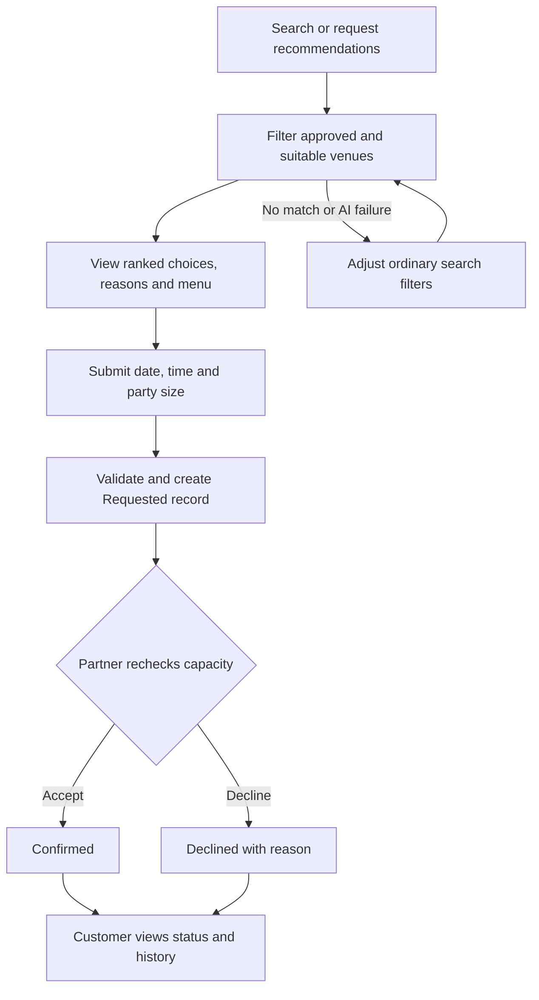
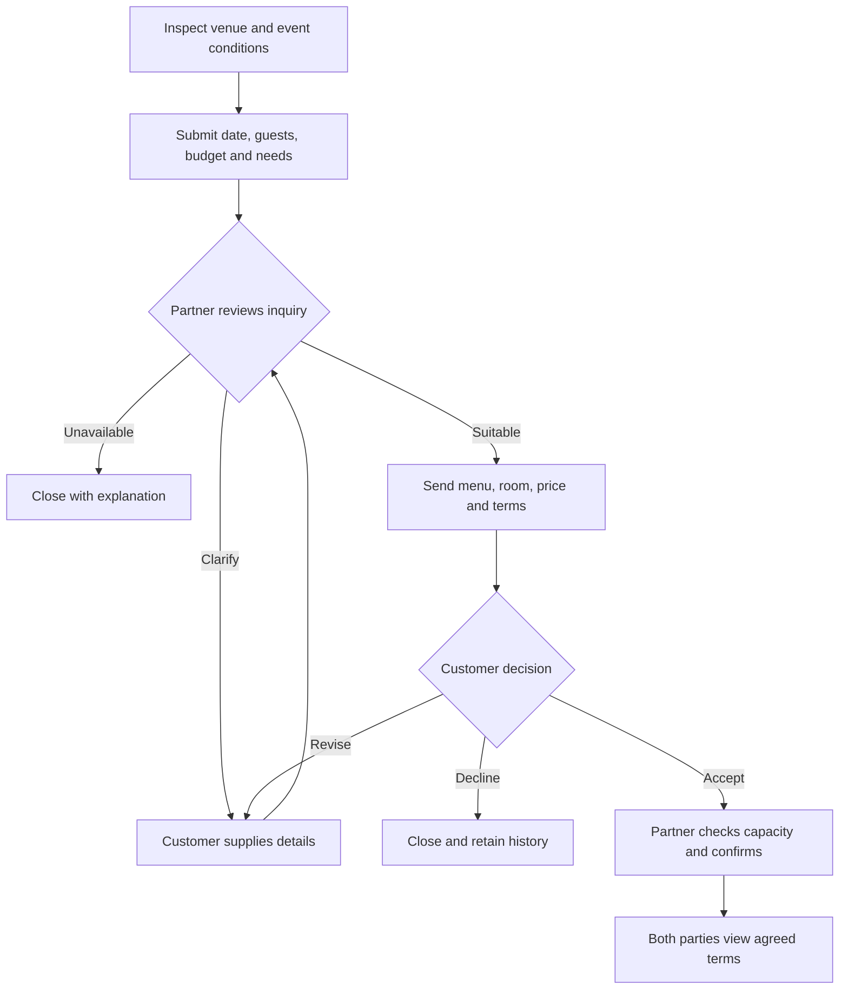

# DineVina - Vision Document (PA2)
**Performed by:** Group 08 source contributors; Hoàng Cao Phong | **Reviewed by:** Peer reviewers by section | **Edited by:** Hoàng Cao Phong

**Group 08 · initial Vision · 31 October 2026**

## 1. Introduction
**Performed by:** Võ Mỹ Ngọc | **Reviewed by:** Hoàng Cao Phong | **Edited by:** Hoàng Cao Phong

This Vision Document defines the high-level needs, market position, and product capabilities of DineVina, a responsive web marketplace for restaurant discovery, table reservation requests, and event inquiries. It gives the project team and stakeholders a shared understanding of what the product should achieve, why its capabilities are needed, and which users benefit from them. Detailed functional behavior, acceptance criteria, and implementation decisions will be refined in the use-case model, supplementary specifications, and product backlog.

DineVina follows a B2B2C model in which restaurant partners publish and manage dining services, customers find suitable venues and submit requests, and the platform connects both sides through visible request states. An ordinary table reservation remains a request until the restaurant partner confirms it, while event inquiries follow a separate clarification and proposal process. The current product scope excludes a complete restaurant point-of-sale, inventory, accounting, and payment system, and it does not include native mobile applications.

### 1.1 References
**Performed by:** Võ Mỹ Ngọc | **Reviewed by:** Hoàng Cao Phong | **Edited by:** Hoàng Cao Phong

| Reference                                                                        | Date                     | Publishing organization or source                      | Use in this document                                                                                                                      |
| -------------------------------------------------------------------------------- | ------------------------ | ------------------------------------------------------ | ----------------------------------------------------------------------------------------------------------------------------------------- |
| *PA1 Report - DineVina: Smart Restaurant Reservation and Event Booking System* | 17 October 2026          | Group 08, Introduction to Software Engineering         | Defines the agreed product idea, boundaries, actors, nine functional groups, AI direction, and PasGo/Eatigo survey findings.              |
| *Project Assignment 2 (PA2-2026)*                                              | 15 October 2026          | CS300/CSC13002, University of Science, VNU-HCM         | Defines the required Vision Document sections, paragraph depth for product features, Mermaid workflow requirement, and submission format. |
| *Vision Document for a Small Project* (`rup_vision_sp.docx`)                 | Course-provided template | Rational Unified Process template distributed with PA2 | Provides the required section structure and the formats for the Problem Statement and Product Position Statement.                         |
| *Vision Document Example* (`rup_vision_sp-example.docx`)                     | Course-provided example  | Distributed with PA2                                   | Illustrates how the positioning tables and product feature section may be completed.                                                      |

## 2. Positioning
**Performed by:** Võ Mỹ Ngọc | **Reviewed by:** Hoàng Cao Phong | **Edited by:** Hoàng Cao Phong

### 2.1 Problem Statement
**Performed by:** Võ Mỹ Ngọc | **Reviewed by:** Hoàng Cao Phong | **Edited by:** Hoàng Cao Phong

|                                          | Statement                                                                                                                                                                                                                                                                                                 |
| ---------------------------------------- | --------------------------------------------------------------------------------------------------------------------------------------------------------------------------------------------------------------------------------------------------------------------------------------------------------- |
| **The problem of**                 | finding a restaurant that fits a customer's location, cuisine, budget, party size, capacity, and event needs while keeping restaurant information and request status clear and traceable                                                                                                                  |
| **affects**                        | customers planning ordinary meals or group events, restaurant partners receiving and managing requests, and platform administrators responsible for trustworthy listings                                                                                                                                  |
| **the impact of which is**         | customers spend time comparing fragmented or uncertain information, may confuse a submitted request with a confirmed booking, and must coordinate complex events through unstructured channels; restaurant partners face incomplete requests, conflicting capacity commitments, and inefficient follow-up |
| **a successful solution would be** | a responsive marketplace that presents attributable venue and menu information, supports relevant search criteria, separates requested and confirmed states, provides a structured event proposal path, and gives restaurant partners a single workspace for availability and incoming demand             |

### 2.2 Product Position Statement
**Performed by:** Võ Mỹ Ngọc | **Reviewed by:** Hoàng Cao Phong | **Edited by:** Hoàng Cao Phong

|                            | Statement                                                                                                                                                                                                       |
| -------------------------- | --------------------------------------------------------------------------------------------------------------------------------------------------------------------------------------------------------------- |
| **For**              | diners looking for suitable restaurants, customers planning group events, restaurant partners seeking qualified demand, and platform administrators maintaining listing quality                                 |
| **Who**              | need a clearer way to discover venues, evaluate dining or event suitability, submit complete requests, and track responses without confusing a request with a confirmed commitment                              |
| **The product name** | DineVina is a responsive B2B2C web marketplace for restaurant discovery, table reservation requests, and event inquiries                                                                                        |
| **That**             | connects customers and restaurant partners through approved venue information, menus, availability, explicit request states, structured event briefs and proposals, promotions, and preference-based assistance |
| **Unlike**           | relying on separate search, social, messaging, and booking tools, or the limited PasGo and Eatigo interface flows observed in the PA1 survey                                                                    |
| **Our product**      | combines a traceable booking state, a dedicated event negotiation workflow, and explainable recommendations grounded in partner-verified venue data, while keeping ordinary filters available as a fallback     |

## 3. Stakeholder and User Descriptions
**Performed by:** Lương Thiện Nhân | **Reviewed by:** Nguyễn Trung Kiên | **Edited by:** Hoàng Cao Phong

### 3.1 Stakeholder summary
**Performed by:** Lương Thiện Nhân | **Reviewed by:** Nguyễn Trung Kiên | **Edited by:** Hoàng Cao Phong

| Stakeholder | Interest | Responsibility / representation |
| --- | --- | --- |
| Restaurant business owners | Accurate listing and qualified customer demand | Authorize venue publication, set policies and nominate partner staff. |
| Dining groups and event organizers | A suitable venue and clear commitment | Represent party size, budget, accessibility and event requirements. |
| Platform operator | Trustworthy marketplace and reliable service | Moderate listings, support disputes and operate access/audit controls. |
| Group 08 and course reviewers | A feasible, traceable academic product | Maintain the backlog, assess increments and review documented assumptions. |

### 3.2 User summary
**Performed by:** Lương Thiện Nhân | **Reviewed by:** Nguyễn Trung Kiên | **Edited by:** Hoàng Cao Phong

| User | Responsibilities | Represented interest |
| --- | --- | --- |
| Customer | Search venues, inspect menus, submit complete table/event requests, track responses and cancel within policy | Diners and event organizers |
| Restaurant partner staff | Maintain their venue/menu/availability, decide requests, prepare event proposals and update state history | Restaurant owner |
| Platform administrator | Review onboarding, return corrections, moderate published information and investigate support cases | Platform operator |

### 3.3 User environment
**Performed by:** Lương Thiện Nhân | **Reviewed by:** Nguyễn Trung Kiên | **Edited by:** Hoàng Cao Phong

Customers use a responsive browser on a phone or desktop and may have intermittent mobile data. Discovery supports manual district/location filters without mandatory geolocation permission. A request cycle involves one customer and authorized staff of the selected restaurant; the administrator participates in onboarding and exceptions. Partner staff use a desktop dashboard during service and may check incoming requests by phone. Clear state labels and retry-safe submission reduce confusion when the connection is interrupted. The initial interface targets Vietnamese restaurant data; language and localization expansion are later backlog decisions.

### 3.4 Summary of key stakeholder or user needs
**Performed by:** Lương Thiện Nhân | **Reviewed by:** Nguyễn Trung Kiên | **Edited by:** Hoàng Cao Phong

| Need / cause | Priority | Current workaround | Product response |
| --- | --- | --- | --- |
| Fragmented venue, menu and condition information | High | Compare websites/social pages and call venues | Approved profiles, structured menus, update context and filters (F3, F4) |
| Unclear distinction between a request and a commitment | High | Follow-up calls or messages | Explicit requested/confirmed/declined states and history (F5) |
| Complex group-event requirements | High | Phone consultations and separate message threads | Structured brief, clarification and proposal history (F6) |
| Changing capacity and incoming demand | High | Manual reservation books/spreadsheets | Venue-owned availability and partner queue (F7) |
| Difficulty choosing among many venues | Medium | Manually compare a shortlist | Eligible recommendations with attributable reasons and filter fallback (F9) |
| Consistent listing quality | High | Staff inspect each submission | Administrator approval and partner corrections (F2) |

### 3.5 Alternatives and competition
**Performed by:** Lương Thiện Nhân | **Reviewed by:** Nguyễn Trung Kiên | **Edited by:** Hoàng Cao Phong

The following comparison is anchored to the PA1 survey and its dated interface captures, rather than new market measurements.

| Alternative | Observed strength / existing approach | Design implication for DineVina |
| --- | --- | --- |
| PasGo | Venue discovery, detail pages, booking form and consultation entry | Adopt clear venue detail and request forms; connect event briefs to an explicit proposal history. |
| Eatigo | Time-based search, discount presentation and visible offer conditions | Keep date/time and eligibility conditions visible; separate offers from reservation confirmation. |
| Phone and messaging | Flexible human clarification | Preserve clarification while keeping requests and decisions attributable in one history. |
| Internal spreadsheet or restaurant management software | Staff track operations internally | DineVina connects multiple restaurants to customers; POS, inventory and accounting remain outside scope. |

See `evidence/pa1-survey/` for the survey Markdown and original screenshots. No new competitor booking was performed during PA2 consolidation.

## 4. Product Overview
**Performed by:** Nguyễn Trung Kiên | **Reviewed by:** Trương Khánh Duy | **Edited by:** Hoàng Cao Phong

### 4.1 Product perspective and interfaces
**Performed by:** Nguyễn Trung Kiên | **Reviewed by:** Trương Khánh Duy | **Edited by:** Hoàng Cao Phong

DineVina is a B2B2C marketplace with responsive customer, partner and administrator interfaces. The checked repository uses React, TypeScript and Vite for the frontend and FastAPI for the backend; PostgreSQL is the planned persistent store. Browser presentation, API business rules and persistence are separate responsibilities. The API contract governs discovery, venue details, request creation and lifecycle transitions. Partner/admin operations require server authorization and ownership checks. Notification and mapping integrations are replaceable external dependencies, with in-app status history and manual location filters as baseline behavior.

The source Product Overview discusses a separate Supabase/GCP prototype branch. That description is preserved in the supporting source; the packaged source revision is identified in the Git evidence. This Vision defines product requirements and does not certify a separate deployment. Full POS, kitchen management, inventory, accounting, payment processing and native mobile apps are excluded. Menu selection supplies event preferences; it does not add a separate food-order checkout flow.

### 4.2 Assumptions and dependencies
**Performed by:** Nguyễn Trung Kiên | **Reviewed by:** Trương Khánh Duy | **Edited by:** Hoàng Cao Phong

Partner data must be complete and approved before public discovery or AI ranking. Sample data are labeled. A 30-minute partner response window, two-hour cancellation cutoff and 30-minute slot granularity are planning defaults from Kiên's contribution; final policy values are configured and checked before release. Capacity updates and confirmation require a persistent atomic check. If persistent storage fails, writes return an explicit retryable error; a demo memory store must never silently replace live booking records. Provider quotas, network access, source freshness, role permissions and the agreed API schema constrain delivery. The primary recommendation slice uses deterministic filtering and scoring, so external LLM availability does not block ordinary discovery.

## 5. Product Features
**Performed by:** Võ Mỹ Ngọc | **Reviewed by:** Hoàng Cao Phong | **Edited by:** Hoàng Cao Phong

The following features refine the nine functional groups established in the PA1 project proposal. They describe externally visible product capabilities and user value without committing the team to a particular implementation design.

### 5.1 Accounts and Profiles
**Performed by:** Võ Mỹ Ngọc | **Reviewed by:** Hoàng Cao Phong | **Edited by:** Hoàng Cao Phong

DineVina allows customers and restaurant partners to create accounts and maintain the contact and preference information needed for their activities. Role-aware access separates customer, partner, and administrator actions so that each user sees only the functions and records relevant to that role. Customers benefit from reusable booking details and preferences, while partners and administrators benefit from attributable actions and controlled access to operational data.

### 5.2 Restaurant Onboarding
**Performed by:** Võ Mỹ Ngọc | **Reviewed by:** Hoàng Cao Phong | **Edited by:** Hoàng Cao Phong

Restaurant partners can submit a venue profile containing its identity, location, cuisine, photos, amenities, capacity, and contact details. A platform administrator reviews the submission and either approves it or returns it for correction before it becomes an attributable source for customer discovery. This feature gives customers more trustworthy venue information and helps partners present their restaurants consistently on the marketplace.

### 5.3 Restaurant Discovery and Venue Details
**Performed by:** Võ Mỹ Ngọc | **Reviewed by:** Hoàng Cao Phong | **Edited by:** Hoàng Cao Phong

Customers can search and filter restaurants by criteria such as location, cuisine, budget, party size, capacity, and amenities, then open a venue page for more detail. The feature shortens the path from a dining or event need to a manageable set of suitable options instead of forcing users to compare fragmented information manually. Customers benefit from more relevant choices, while approved restaurant partners gain visibility among users whose needs match their offerings.

### 5.4 Menu Management and Viewing
**Performed by:** Võ Mỹ Ngọc | **Reviewed by:** Hoàng Cao Phong | **Edited by:** Hoàng Cao Phong

Restaurant partners can maintain menu items with approved names, descriptions, and prices, and customers can review this information before submitting a request. Menu visibility is needed because price and dish suitability influence whether a venue fits a customer's budget, dietary preferences, and occasion. Customers make better-informed decisions, and partners receive requests from people who have already reviewed the relevant offering.

### 5.5 Table Reservation Requests
**Performed by:** Võ Mỹ Ngọc | **Reviewed by:** Hoàng Cao Phong | **Edited by:** Hoàng Cao Phong

Customers can choose a date, time, and party size and submit a table reservation request to a restaurant partner. The partner can confirm or reject the request, while both sides can see its status history and applicable cancellation conditions; submitting a request does not itself create a confirmed reservation. This feature gives customers a clear path from venue selection to a visible outcome and helps restaurant staff respond to demand without making ambiguous promises.

### 5.6 Event Inquiries and Proposals
**Performed by:** Võ Mỹ Ngọc | **Reviewed by:** Hoàng Cao Phong | **Edited by:** Hoàng Cao Phong

Customers planning an event can submit a structured brief containing the occasion, expected headcount, preferred date, budget, and special needs. Restaurant partners can request clarification, propose terms, and track the customer's response in one conversation rather than treating a complex event like an ordinary table request. Customers benefit from a clearer planning process, and partners benefit from receiving the information required to prepare realistic proposals.

### 5.7 Availability and Partner Dashboard
**Performed by:** Võ Mỹ Ngọc | **Reviewed by:** Hoàng Cao Phong | **Edited by:** Hoàng Cao Phong

Restaurant partners can maintain operating hours, capacity, and blocked slots while viewing incoming reservation and event requests in a role-specific dashboard. Keeping availability and demand together is needed to reduce conflicting commitments and give staff a practical queue for daily work. Partners benefit from better operational control, while customers benefit from choices and responses based on more current partner-provided information.

### 5.8 Promotions and Editorial Content
**Performed by:** Võ Mỹ Ngọc | **Reviewed by:** Hoàng Cao Phong | **Edited by:** Hoàng Cao Phong

Restaurant partners can submit time-bound promotions and venue content under platform rules, with eligibility conditions and expiry information visible to customers. Clear conditions are needed so that an offer can support discovery without creating uncertainty about when or to whom it applies. Customers benefit from understandable value, partners gain a controlled promotional channel, and administrators can moderate content quality without turning DineVina into a full merchant accounting or payment system.

### 5.9 Intelligent Assistance
**Performed by:** Trương Khánh Duy | **Reviewed by:** Lương Thiện Nhân | **Edited by:** Hoàng Cao Phong

F9 is one functional group with one primary capability and two optional candidate slices. The explainable recommender is the core scope; RAG and OCR enter a sprint only after the core request path meets its acceptance criteria.

#### 5.9.1: Explainable Restaurant Recommendation Engine (Primary Slice)
**Performed by:** Trương Khánh Duy | **Reviewed by:** Lương Thiện Nhân | **Edited by:** Hoàng Cao Phong

The Explainable Restaurant Recommendation Engine matches diners with suitable venues by evaluating their stated preferences (cuisine, budget, location, party size, and dining occasion) against partner-verified restaurant attributes and published capacity, revalidated at confirmation. Unlike black-box algorithms or static directory filters, this feature generates a transparent justification badge for every suggested venue (e.g., *"Recommended because it matches your Vietnamese cuisine preference, fits your 200k-400k VND budget, and has a private room available for 10 guests"*). This capability is needed to reduce decision fatigue for customers navigating large restaurant catalogs while preventing false expectations caused by unverified recommendations. Customers benefit from faster, higher-confidence booking decisions, while restaurant partners benefit from receiving high-intent reservation requests that accurately fit their operational capacity.

#### 5.9.2: Source-Grounded Menu & Policy Assistant (Candidate Slice - RAG)
**Performed by:** Trương Khánh Duy | **Reviewed by:** Lương Thiện Nhân | **Edited by:** Hoàng Cao Phong

The Source-Grounded Menu & Policy Assistant is a retrieval-augmented generation (RAG) conversational tool embedded on venue detail pages to answer specific diner questions regarding ingredients, allergy accommodations, corkage fees, parking, and cancellation rules. The assistant retrieves answers strictly from administrator-approved restaurant profiles, structured menus, and published venue policies, appending direct citations to its responses. This feature is needed to eliminate the operational bottleneck of manual call centers and live-chat agents while ensuring diners receive instant, reliable answers outside standard business hours. Diners benefit from immediate clarity on complex dining conditions before submitting a table or event request, and restaurant staff benefit from a significant reduction in repetitive pre-booking inquiries.

#### 5.9.3: Automated Menu Digitization via OCR (Candidate Slice - Partner Onboarding)
**Performed by:** Trương Khánh Duy | **Reviewed by:** Lương Thiện Nhân | **Edited by:** Hoàng Cao Phong

The Automated Menu Digitization feature provides restaurant partners with an optical character recognition (OCR) and structured extraction pipeline that converts uploaded menu photographs or PDF documents into editable digital menu drafts. The system automatically parses dish names, descriptions, categories, and prices into DineVina's database schema, flagging low-confidence text for human review prior to publication. This capability is needed because manual dish-by-dish data entry creates severe onboarding friction for restaurants and leads to outdated menu catalogs on the platform. Restaurant partners benefit from a streamlined onboarding process that reduces repeated manual entry, while the platform and customers benefit from rich, structured menu data that directly powers search filters and AI recommendations.

### 5.10 Key user workflows
**Performed by:** Trương Khánh Duy | **Reviewed by:** Lương Thiện Nhân | **Edited by:** Hoàng Cao Phong

These two design workflows combine Duy's AI and event paths with Ngọc's request-state boundary. Optional RAG and OCR are excluded from the core acceptance path.

#### Workflow 1 - Discovery to reservation decision
**Performed by:** Trương Khánh Duy | **Reviewed by:** Lương Thiện Nhân | **Edited by:** Hoàng Cao Phong

#### Workflow 2 - Event inquiry and proposal
**Performed by:** Trương Khánh Duy | **Reviewed by:** Lương Thiện Nhân | **Edited by:** Hoàng Cao Phong

## 6. Non-Functional Requirements
**Performed by:** Nguyễn Trung Kiên, Trương Khánh Duy | **Reviewed by:** Trương Khánh Duy, Lương Thiện Nhân | **Edited by:** Hoàng Cao Phong

The following are initial acceptance targets, not benchmark results. They consolidate the two technical contributions into one testable baseline. Performance checks identify dataset size, hardware, concurrency, sampling period and p95 values. Detailed test cases are refined in later assignments.

| ID | Requirement / target | Verification |
| --- | --- | --- |
| PERF-01 | Search p95 <= 300 ms at 50 requests/s against 1,000 labeled fixture venues for a 5-minute steady period | Load-test API and record environment, error rate and response distribution |
| PERF-02 | Request submission p95 <= 500 ms on the same environment; capacity decision and mutation are atomic | API load test plus transaction/concurrency checks |
| PERF-03 | Initial FCP < 1.5 s on a documented mid-range mobile/4G profile; reserve form usable by 2.5 s | Production build Lighthouse trace and manual interaction |
| PERF-04 | List APIs default to 20 and cap at 50 items per page | Boundary/schema tests |
| SEC-01 | Public deployment uses HTTPS; every partner/admin mutation verifies role and venue ownership | Redirect and cross-role authorization tests |
| SEC-02 | Passwords are salted hashes using the selected maintained library; no plaintext credentials or secrets in Git/logs | Hash verification and repository scan |
| SEC-03 | Access token lifetime is 15 minutes; refresh lifetime is 7 days with rotation if JWT sessions are adopted | Expiry, rotation and revoked-token tests |
| REL-01 | Zero over-capacity confirmed bookings during 20 concurrent overlapping requests; illegal state changes are rejected | Concurrency and state-transition tests |
| REL-02 | Cancellation respects configured cutoff; status changes retain actor, time and reason | Boundary tests before/at/after cutoff |
| REL-03 | Persistent storage outage rejects writes safely and explains retry; no silent switch to separate booking records | Fault injection against booking writes |
| REL-04 | Target 99.5% availability during defined 07:00-23:00 service hours, measured after deployment | Monitoring record and incident log |
| STD-01 | OpenAPI schema and ISO 8601 timestamps; structured errors with stable code, message and request ID | Schema and negative request tests |
| PLAT-01 | Responsive core flows at 360 px and 1280 px in Chrome, Firefox, Edge and Safari, recording tested versions | Browser/device matrix |
| A11Y-01 | Keyboard operability, labels, visible focus and contrast checked against WCAG 2.2 AA for core flows | Manual checklist and automated accessibility scan |
| AI-01 | Ranking/explanations p95 < 2.5 s with 50 concurrent users; fallback activated within 500 ms of detected failure | Stubbed provider failure and latency test |
| AI-02 | All explanation facts match approved data; no ineligible venue in 30 labeled scenarios | Attribute audit; report Precision@3, coverage and unsuitable-result count |
| PRIV-01 | Session preferences require explicit input; no customer identifiers sent to external model training or committed in fixtures | Request inspection and fixture review |
| REC-01 | Test backup can be restored before the final demo; record elapsed recovery and restored record counts | Restore exercise on a test database |

## 7. Traceability and references
**Performed by:** Hoàng Cao Phong | **Reviewed by:** Võ Mỹ Ngọc | **Edited by:** Hoàng Cao Phong

Nine functional groups remain aligned to PA1. The stakeholder source refines the customer/partner/admin boundary; the AI source adds feasibility, fallback and evaluation; Kiên's product overview supplies system dependencies and measurable platform targets. Scope corrections in this integration remove ambiguous Vue/React options, food-order checkout, automatic production memory fallback, and unverified deployment/benchmark claims. Original contributions are preserved under `evidence/sources/`.

- Course *PA2-2026*, Vision template and example; Group 08 PA1 report and dated survey.
- Nhân: `evidence/sources/Nhan_StakeHolders/nhan.md`.
- Kiên: `evidence/sources/Kien_ProductOverview/kien.md` and its API contract.
- Duy: `evidence/sources/Duy_AIFeature/duy.md`.
- Ngọc: `evidence/sources/Ngoc_VisionDocs/ngoc.md`.
- [WCAG 2.2](https://www.w3.org/TR/WCAG22/).
