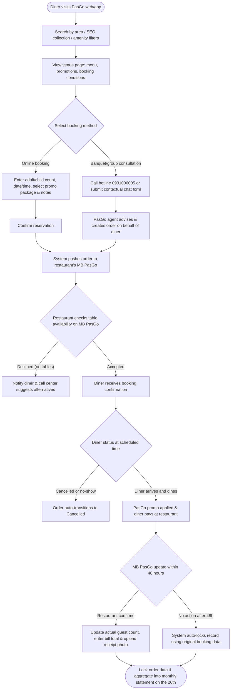
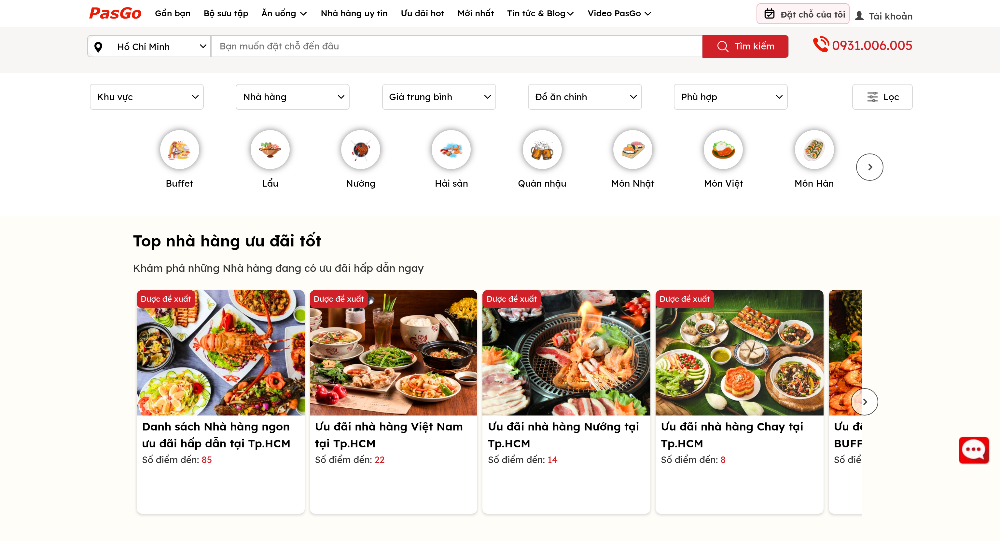
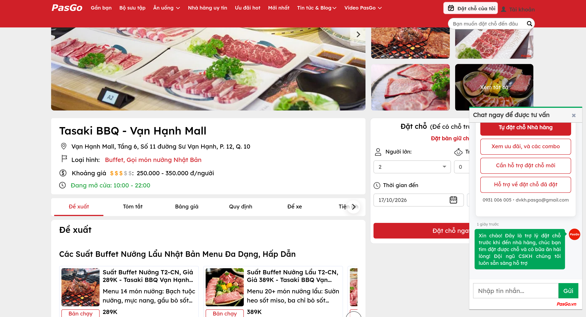
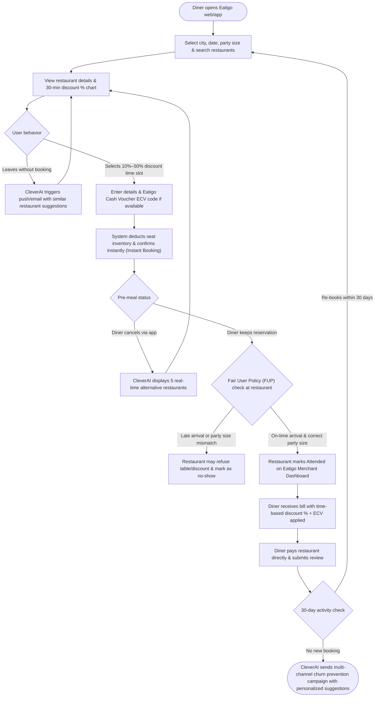
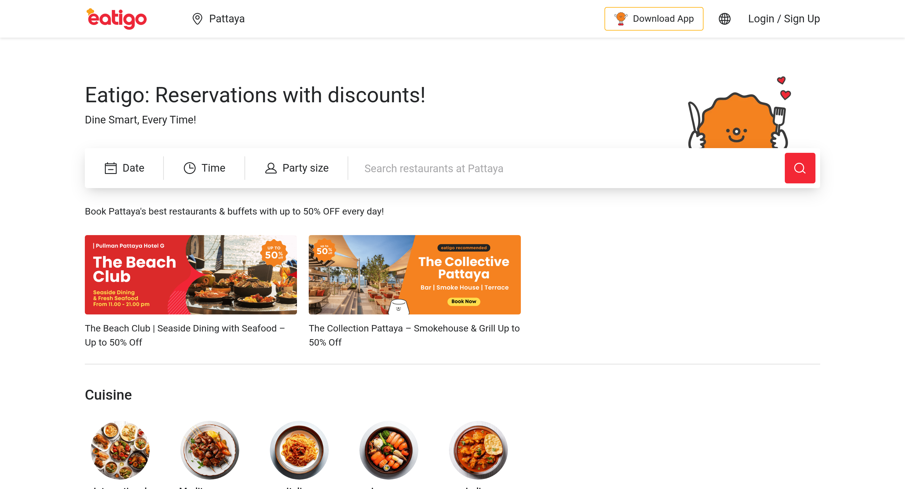
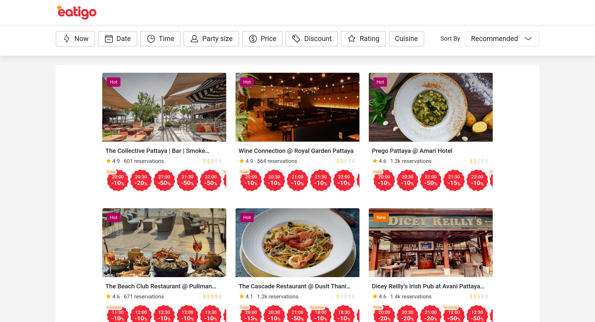

# Existing App Survey: PasGo vs Eatigo
*Performed by: Lương Thiện Nhân (Data Management Lead) | Reviewed by: Hoàng Cao Phong (Scrum Master) | Edited by: Võ Mỹ Ngọc (Product Owner)*

[PasGo](https://pasgo.vn/blog/pasgo-la-gi-cac-cach-thuc-hop-tac-voi-pasgo-5786) and [Eatigo](https://eatigo.com/en) are leading online restaurant reservation platforms in the region, each following a distinct product philosophy. [PasGo](https://pasgo.vn/blog/pasgo-la-gi-cac-cac-thuc-hop-tac-voi-pasgo-5786) focuses on group dining, banquet booking, and venue marketing in Vietnam, while [Eatigo](https://blog.eatigo.com/singapore/how-eatigo-uses-yield-management-to-help-restaurants-maximise-profits/) operates on a time-based yield management model with dynamic discounts across Southeast Asia.

## 1. Software Category: E-commerce or SaaS?

Neither platform is a pure SaaS product. Both operate as **O2O (Online-to-Offline) two-sided service marketplaces with SaaS-enabled merchant tooling (SaaS-enabled Marketplace)**:

> * **E-commerce core (primary revenue driver):** Both [PasGo](https://pasgo.vn/quy-che-hoat-dong-cua-nen-tang-pasgo) and [Eatigo](https://eatigo.com/en) act as intermediary platforms connecting diners (B2C) with restaurants (B2B), earning commission (CPA) on each successful reservation or charging advertising and promotion fees ([PasGo Partnership Process](https://pasgo.vn/blog/quy-trinh-hop-tac-dich-vu-dat-cho-voi-pasgo-5789)).
> * **Bundled SaaS component (ecosystem lock-in tool):** Both provide cloud-based management software for restaurant partners — [MB PasGo](https://play.google.com/store/apps/details?id=com.onepas.android.pasgo.manager&hl=vi) and [Eatigo Merchant Dashboard](https://ortemtech.com/case-studies/eatigo-restaurant-reservations/). Unlike standalone POS/SaaS systems (e.g. iPOS, KiotViet), these tools focus on receiving marketplace orders, controlling table availability, and reconciling payables ([PasGo for Restaurants](https://pasgo.vn/danh-cho-nha-hang)).

| Criterion | PasGo | Eatigo |
| :---- | :---- | :---- |
| **Core positioning** | O2O reservation marketplace combined with food/SEO content channel ([PasGo Blog](https://pasgo.vn/blog/pasgo-la-gi-cac-cach-thuc-hop-tac-voi-pasgo-5786)) | Time-slot discount marketplace (Yield Management Marketplace) ([Eatigo Blog](https://blog.eatigo.com/singapore/how-eatigo-uses-yield-management-to-help-restaurants-maximise-profits/)) |
| **B2C transaction flow** | No upfront payment, no voucher sales; diners pay 100% at the restaurant ([PasGo Terms](https://pasgo.vn/quy-che-hoat-dong-cua-nen-tang-pasgo)) | Diners pay at the restaurant after discount is applied; also sells [Eatigo Cash Voucher (ECV)](https://help.eatigo.com/hc/en-us/articles/47187614682777-What-is-an-Eatigo-Cash-Voucher-ECV-code) codes and [Eatigo Market](https://blog.eatigo.com/singapore/how-eatigo-uses-yield-management-to-help-restaurants-maximise-profits/) deals |
| **B2B fee model** | Commission (avg. 3%–7% of actual revenue), onboarding fee, and advertising/promotion packages ([PasGo Blog](https://pasgo.vn/blog/pasgo-la-gi-cac-cach-thuc-hop-tac-voi-pasgo-5786)) | Fixed per-diner commission on seated guests and display campaign packages ([Ortem Case Study](https://ortemtech.com/case-studies/eatigo-restaurant-reservations/)) |
| **SaaS automation level** | Semi-automated: combines [MB PasGo](https://pasgo.vn/quy-che-hoat-dong-cua-nen-tang-pasgo) software, Zalo reminders, and call-center agents ([PasGo Process](https://pasgo.vn/blog/quy-trinh-hop-tac-dich-vu-dat-cho-voi-pasgo-5789)) | Highly automated: instant booking against real-time seat inventory with POS integration ([Ortem Case Study](https://ortemtech.com/case-studies/eatigo-restaurant-reservations/)) |

## 2. Feature Comparison and Killer Features

| Feature Group | PasGo | Eatigo |
| :---- | :---- | :---- |
| **Search & Filters** | By area, cuisine (Hot Pot, Buffet, Seafood), price range, and **detailed physical amenities** (private rooms, karaoke, car parking, kids' area) ([PasGo Blog](https://pasgo.vn/blog/pasgo-la-gi-cac-cach-thuc-hop-tac-voi-pasgo-5786)) | By city/area, hotel brand, theme (Hotel Dining, All-You-Can-Eat) and **time-slot discount filter (10%–50%)** ([Eatigo](https://eatigo.com/en)) |
| **Discount mechanism** | Fixed promotions by day/week (10%–30% off or complimentary items) with minimum party-size conditions ([PasGo Blog](https://pasgo.vn/blog/pasgo-la-gi-cac-cach-thuc-hop-tac-voi-pasgo-5786)) | Variable discounts every 30 minutes (10%–50% off food bill) based on restaurant occupancy ([Eatigo Yield Management](https://blog.eatigo.com/singapore/how-eatigo-uses-yield-management-to-help-restaurants-maximise-profits/)) |
| **Booking flow** | Select date/time, adults/children count, promo package/set menu, special requests; await restaurant or call-center confirmation ([PasGo Terms](https://pasgo.vn/quy-che-hoat-dong-cua-nen-tang-pasgo)) | Select a time slot with its attached discount % and party size; system deducts seat inventory and confirms instantly (Instant Booking) ([Eatigo](https://eatigo.com/en)) |
| **Call center / Chat booking** | Strong: free booking assistance and venue consultation via hotline and contextual live chat ([PasGo Blog](https://pasgo.vn/blog/pasgo-la-gi-cac-cach-thuc-hop-tac-voi-pasgo-5786)) | Fully self-service via app/web; live chat (Zendesk) only for dispute resolution ([Eatigo Help Center](https://help.eatigo.com/hc/en-us)) |
| **Vouchers & Takeaway** | No prepaid vouchers; dine-in experience only ([PasGo Blog](https://pasgo.vn/blog/pasgo-la-gi-cac-cach-thuc-hop-tac-voi-pasgo-5786)) | [Eatigo Cash Voucher (ECV)](https://help.eatigo.com/hc/en-us/articles/47187614682777-What-is-an-Eatigo-Cash-Voucher-ECV-code) stackable on time-based discounts; [Eatigo Market](https://blog.eatigo.com/singapore/how-eatigo-uses-yield-management-to-help-restaurants-maximise-profits/) for QSR chains |
| **Content & SEO** | Extensive [Collections](https://pasgo.vn/blog/pasgo-la-gi-cac-cach-thuc-hop-tac-voi-pasgo-5786), SEO-optimized PR articles, food blog, and video reviews | Minimal long-form SEO content; focuses on concise deal listings ([Eatigo](https://eatigo.com/en)) |
| **Restaurant management (B2B)** | [MB PasGo](https://play.google.com/store/apps/details?id=com.onepas.android.pasgo.manager&hl=vi) app: accept/reject orders, update actual guest count, upload receipt photos, approve end-of-period statements ([PasGo Terms](https://pasgo.vn/quy-che-hoat-dong-cua-nen-tang-pasgo)) | [Eatigo Merchant Dashboard](https://ortemtech.com/case-studies/eatigo-restaurant-reservations/): adjust seat limits and discount % per 30-min slot, mark guests as attended or no-show |

> * **PasGo killer features:**
>   * **SEO-driven Collections system & advanced banquet filters:** Addresses the "where to eat with a large group" use case by classifying private-room capacity, AV equipment, outdoor seating, and parking, combined with live call-center assistance ([PasGo Blog](https://pasgo.vn/blog/pasgo-la-gi-cac-cach-thuc-hop-tac-voi-pasgo-5786)).
>   * **48-hour attendance lock & auto-close on [MB PasGo](https://pasgo.vn/quy-che-hoat-dong-cua-nen-tang-pasgo):** Automates revenue reconciliation — if a restaurant does not update guest count or receipt within 48 hours of the reservation time, the system locks the record using the original booking data and finalizes the statement at 12:00 noon on the last day of the month.
> * **Eatigo killer features:**
>   * **30-minute dynamic discount chart (Time-based Yield Management):** Visualizes discounts from 10% (peak hours) up to **50% (off-peak, e.g. 14:00–17:00 or after 20:30)** directly on the restaurant card, incentivizing diners to shift meal times for better prices without requiring prepaid vouchers ([Eatigo Yield Management](https://blog.eatigo.com/singapore/how-eatigo-uses-yield-management-to-help-restaurants-maximise-profits/)).
>   * **Capacity protection via [Fair User Policy (FUP)](https://eatigo.com/en/fair-user-policy):** Strictly enforces arrival time and party size (similar to budget airline ticketing), ensuring restaurants actually fill the vacant tables in their desired time slots.

## 3. Target Customer Segments (B2C & B2B)

> * **PasGo:**
>   * **Individual & corporate diners (B2C):** Primarily targets **group dining** — office workers booking company dinners, client entertainment, families organizing birthdays or gatherings requiring guaranteed seating, private rooms, and VAT invoices ([PasGo Blog](https://pasgo.vn/blog/pasgo-la-gi-cac-cach-thuc-hop-tac-voi-pasgo-5786)).
>   * **Restaurant partners (B2B):** Over 2,000 mid-to-high-end restaurants in Vietnam (major hot-pot/BBQ/buffet chains such as Goldsun Food, Hoang Yen, Al Fresco's, seafood restaurants, and large garden-style venues) needing to fill large-party tables and boost Google brand visibility ([PasGo Blog](https://pasgo.vn/blog/pasgo-la-gi-cac-cach-thuc-hop-tac-voi-pasgo-5786)).
> * **Eatigo:**
>   * **Individual diners (B2C):** Primarily targets **deal-seekers and flexible diners** — young professionals, couples, independent travelers, and office workers willing to dine 1–2 hours outside peak time for up to 50% off ([Eatigo Yield Management](https://blog.eatigo.com/singapore/how-eatigo-uses-yield-management-to-help-restaurants-maximise-profits/)).
>   * **Restaurant partners (B2B):** 4,500–6,000+ restaurants across Singapore, Thailand, Malaysia, Hong Kong, and the Philippines, especially strong in **4–5 star hotel buffets** (Sheraton, Novotel, Marriott), fine dining, and F&B chains in shopping malls with high fixed rent/staff costs but low afternoon occupancy ([CleverTap Case Study](https://clevertap.com/case-study/how-eatigo-boosted-reservations/)).

## 4. User Roles

Both platforms implement a multi-tier authorization structure for their two-sided marketplace, comprising **six core role groups**:

> 1. **Guest (Unregistered User):** Browse restaurants, filter deals, view menus, and read articles on both [PasGo](https://pasgo.vn/quy-che-hoat-dong-cua-nen-tang-pasgo) and [Eatigo](https://eatigo.com/en). On PasGo, guests can also submit a phone number via a consultation form or call the hotline to book without signing in.
> 2. **Registered Diner (Member):** Make online reservations, manage booking history, cancel/modify orders, save favorites, redeem [Eatigo Cash Voucher (ECV)](https://help.eatigo.com/hc/en-us/articles/47187614682777-What-is-an-Eatigo-Cash-Voucher-ECV-code) codes (Eatigo), and write service reviews ([PasGo Terms](https://pasgo.vn/quy-che-hoat-dong-cua-nen-tang-pasgo)).
> 3. **Restaurant Outlet Staff:** Log in to a branch account on [MB PasGo](https://pasgo.vn/quy-che-hoat-dong-cua-nen-tang-pasgo) (up to 3 mobile devices per account) or [Eatigo Merchant Dashboard](https://ortemtech.com/case-studies/eatigo-restaurant-reservations/) to receive new-order notifications, check in guests (attended), flag no-shows, and upload receipt photos.
> 4. **Merchant Manager / Chain Admin:** Use a master management account across locations on [MB PasGo Web](https://pasgo.vn/quy-che-hoat-dong-cua-nen-tang-pasgo) or the Eatigo merchant portal to configure prime-time slots, adjust discount rates and seat availability, update menus, and approve end-of-month billing statements.
> 5. **Platform Operations / Call Center / Account Manager:** Particularly critical at [PasGo](https://pasgo.vn/quy-che-hoat-dong-cua-nen-tang-pasgo), where the customer-service and sales team directly assists via the call center, creates bookings on behalf of diners, moderates venue listings, and sends partner reminders via Zalo ([PasGo Process](https://pasgo.vn/blog/quy-trinh-hop-tac-dich-vu-dat-cho-voi-pasgo-5789)).
> 6. **System Admin & CMS Editor:** Manages platform-wide configuration, role-based access control, automatic statement locking, marketing/SEO campaigns, and user review moderation ([PasGo Terms](https://pasgo.vn/quy-che-hoat-dong-cua-nen-tang-pasgo)).

## 5. AI Feature Comparison

> * [**Eatigo**](https://clevertap.com/case-study/how-eatigo-boosted-reservations/) **(Deep AI/ML integration for personalization & conversion optimization):**
>   * **AI Recommendation Engine ([CleverAI](https://clevertap.com/case-study/how-eatigo-boosted-reservations/)):** [Eatigo](https://clevertap.com/case-study/how-eatigo-boosted-reservations/) integrates CleverTap's AI/ML system, combining real-time behavioral analytics, booking history, and psychographics to automate three retention workflows:
>     1. *Cancellation recovery:* AI immediately suggests 5 alternative restaurants of similar cuisine and price segment to retain the transaction within the same session.
>     2. *Browse abandonment:* AI automatically sends contextual restaurant recommendations to push conversion after a user views a listing without booking.
>     3. *30-day churn prevention:* The system triggers a multi-channel campaign (SMS, email, push notification) with a dynamically personalized restaurant list for users inactive for 30+ days, resulting in a **2× increase in booking conversion rate** ([CleverTap Case Study](https://clevertap.com/case-study/how-eatigo-boosted-reservations/)).
>   * **Yield Management & Dynamic Pricing algorithm:** Helps restaurants analyze historical occupancy data to optimize seat allocation and discount levels per time slot ([Eatigo Yield Management](https://blog.eatigo.com/singapore/how-eatigo-uses-yield-management-to-help-restaurants-maximise-profits/)).
> * [**PasGo**](https://pasgo.vn/quy-che-hoat-dong-cua-nen-tang-pasgo) **(Rule-based filtering & human-assisted consultation):**
>   * **No prominent AI/GenAI features in the product:** [PasGo](https://pasgo.vn/blog/pasgo-la-gi-cac-cach-thuc-hop-tac-voi-pasgo-5786) uses GPS-based recommendation to suggest nearby venues and stores booking history/favorites to surface preference-matched listings ([PasGo Terms](https://pasgo.vn/quy-che-hoat-dong-cua-nen-tang-pasgo)).
>   * **Human-in-the-loop approach:** Instead of an AI chatbot or automated recommendations, [PasGo](https://pasgo.vn/blog/pasgo-la-gi-cac-cach-thuc-hop-tac-voi-pasgo-5786) auto-attaches the current venue context to chat/inquiry forms for **live call-center agents to advise directly**. This human-plus-tool approach suits the complexity of group/banquet bookings in Vietnam (menu negotiation, private rooms, deposits) but lacks the automated scalability and real-time personalization of [Eatigo](https://clevertap.com/case-study/how-eatigo-boosted-reservations/) for individual diners.

## 6. User Flow Diagrams & Interface Evidence

### 6.1 PasGo User Flow (B2C Reservation & B2B Reconciliation via MB PasGo)

#### PasGo User Flow Interface Evidence

* **Step A — Diner visits PasGo web/app (`pasgo.vn/ho-chi-minh`):**
  
  * *Screen description:* The localized landing page for Ho Chi Minh City displaying top promotional banners, quick cuisine/district category chips, and curated dining collections (Buffet, Seafood, Family gatherings).
  * *Feature mechanics:* The platform resolves the user's geographic location, renders active campaign banners, and provides categorized search pathways to guide users into venue exploration.

* **Step B — Search by area / SEO collection / amenity filters:**
  
  * *Screen description:* The multi-attribute search and filtering interface featuring district selectors, cuisine categories, price-range sliders, and granular amenity checkboxes.
  * *Feature mechanics:* Diners toggle specific physical filters (e.g., Private rooms, Car parking, Kids' play areas, Outdoor seating); the engine executes real-time faceted filtering against the restaurant database and updates the candidate venue list.

* **Step C — View venue page (menu, promotions, booking conditions):**
  
  * *Screen description:* Dedicated restaurant profile page (D'Maris Buffet) showing verified physical address, opening hours, photography galleries, promotional terms, and policy details.
  * *Feature mechanics:* Diners review operating hours, eligible discount packages, party-size restrictions, and click the primary "Book Table" (Đặt chỗ) action to initiate the reservation workflow.

* **Step D & E — Online booking form (party size, date/time, contact info & notes):**
  
  * *Screen description:* Standard reservation input form capturing adult/children guest counts, arrival date, time slot, preferred promotional deal, and diner contact notes.
  * *Feature mechanics:* The system validates operating hours, party-size constraints, and promotion eligibility; upon submission, it transitions to order verification and sends data to the partner venue.

* **Step F — Banquet/group consultation via live chat & hotline (`0931.006.005`):**
  
  * *Screen description:* Embedded customer-support chat drawer and hotline contact widget pre-populated with the current restaurant context.
  * *Feature mechanics:* Designed for large groups and corporate banquets requiring customized menus or private room assignments; diners can bypass standard forms to connect directly with a PasGo consultation agent.

* **Step G — Confirm reservation & phone verification modal:**
  
  * *Screen description:* Booking confirmation and phone verification modal displaying a booking summary, diner phone number field, and terms acknowledgement.
  * *Feature mechanics:* Enforces anti-abuse verification via mobile number before finalizing the order, ensuring valid diner identity before pushing the booking record to the restaurant's [MB PasGo](https://pasgo.vn/quy-che-hoat-dong-cua-nen-tang-pasgo) app.

### 6.2 Eatigo User Flow (Time-slot Discount Booking & AI Recommendations)

#### Eatigo User Flow Interface Evidence

* **Step A — Diner opens Eatigo web/app (`eatigo.com/en`):**
  
  * *Screen description:* The multi-market homepage featuring global city navigation, promotional deal banners, search bar with party size, and date/time selection.
  * *Feature mechanics:* Diners establish their dining parameters (target city, meal session, party size); the platform loads active dynamic discount inventories across participating restaurants.

* **Step B — Select city, date, party size & search restaurants (dynamic discount filtering):**
  
  * *Screen description:* Discovery search results feed displaying restaurant cards with prominent discount tags (10% to 50% off), location filters, and cuisine classifications.
  * *Feature mechanics:* Diners filter by discount tier or cuisine; the yield-management search engine queries real-time merchant table availability and surfaces off-peak slots with deeper discounts.

* **Step C — View restaurant details, 30-min discount % chart & AI foodie summary:**
  
  * *Screen description:* Restaurant details page featuring the signature 30-minute Yield Management discount matrix and an AI-generated foodie summary highlighting venue specialties.
  * *Feature mechanics:* The matrix dynamically plots fluctuating discount percentages across operating hours (up to 50% during non-peak windows); selecting a specific time chip locks in that discount percentage for the reservation.

* **Step D & F — Select 10%–50% discount time slot & reservation modal:**
  
  * *Screen description:* Two-step booking modal showing the chosen time slot, applicable discount rate, party size, diner contact inputs, and promotional voucher code field.
  * *Feature mechanics:* Allows diners to review discount terms, enter optional [Eatigo Cash Voucher (ECV)](https://help.eatigo.com/hc/en-us/articles/47187614682777-What-is-an-Eatigo-Cash-Voucher-ECV-code) codes, and confirm the table instantly against live seat quota without requiring upfront payment.

* **Step G & J — Fair User Policy (FUP), Special Conditions & Cancellation Policy:**
  
  * *Screen description:* Policy disclosure modal detailing the Fair User Policy (FUP), 15-minute arrival grace period, discount exclusions (e.g., drinks, set menus), and cancellation rules.
  * *Feature mechanics:* Enforces diner compliance with arrival timing and party size requirements before final order submission, safeguarding restaurant capacity against late arrivals and invalid discount claims.

## 7. Strategic Comparison & DineVina Product Roadmap

### 7.1 Common Features Across Existing Apps

Both PasGo and Eatigo share foundational architecture and operational patterns characteristic of SaaS-enabled reservation marketplaces:

1. **Two-Sided Service Marketplace Architecture:** Both platforms connect diners looking for table availability with restaurant operators looking to maximize seat utilization and foot traffic.
2. **Multi-Attribute Search & Discovery:** Users can browse listings filtered by geographic area, cuisine, date, time, and party size.
3. **Structured Venue Profiles:** Both platforms provide comprehensive restaurant detail pages containing address, operating hours, food galleries, promotional terms, and specific dining policies.
4. **Reservation Management & Verification:** Both systems enforce anti-abuse mechanisms (SMS OTP / phone number verification) and provide reservation lifecycle tracking (pending, confirmed, seated/attended, cancelled, no-show).
5. **Merchant Operations Tooling:** Both platforms provide dedicated B2B merchant software ([MB PasGo](https://pasgo.vn/quy-che-hoat-dong-cua-nen-tang-pasgo) and [Eatigo Merchant Dashboard](https://ortemtech.com/case-studies/eatigo-restaurant-reservations/)) enabling restaurant managers and floor staff to accept/decline table requests, monitor daily arrivals, flag no-shows, and reconcile monthly billing statements.
6. **No Upfront B2C Payment for Reservations:** Both platforms allow diners to reserve tables free of charge and settle their bills directly at the restaurant upon dining, lowering the booking friction for users.

### 7.2 What DineVina Will Do Differently and Better

While PasGo and Eatigo address core booking needs, they present clear limitations in operational scalability, personalization, and partner onboarding. DineVina innovates across these dimensions:

1. **Explainable AI Recommendations vs. Black-Box / Static Listings:**
   * *Existing limitation:* PasGo relies on manual editorial collections and basic location sorting, offering no real-time personalized matching. Eatigo uses proprietary third-party ML (CleverTap) as a black box without transparency.
   * *DineVina improvement:* DineVina implements an **Explainable Recommendation Engine** that pairs user dietary preferences, party dynamics, and budget constraints with verified restaurant attributes, accompanied by transparent justifications (e.g., *"Recommended because it matches your preferred Vietnamese cuisine, fits your 250k–500k VND budget, and accommodates 8 guests with private room availability"*). This eliminates decision fatigue and builds consumer trust.
2. **Retrieval-Augmented (RAG) Menu & Policy Assistant vs. Manual Call Centers / Generic Help Desks:**
   * *Existing limitation:* PasGo relies heavily on a human call center and manual chat operators to answer specific inquiries (e.g., private room equipment, corkage fees, allergy accommodations), which creates high operational labor costs and delays outside business hours. Eatigo offers no intelligent inquiry support, directing users to generic FAQ pages or ticketing.
   * *DineVina improvement:* DineVina incorporates an **AI Conversational Assistant using RAG** trained strictly on verified restaurant documents, menus, and operating policies. It provides instantaneous, accurate answers with direct source citations back to the restaurant's profile, backed by strict uncertainty handling that refuses to hallucinate facts when data is unavailable.
3. **AI-Powered Menu Digitization (OCR) for Partner Onboarding:**
   * *Existing limitation:* Onboarding a new venue on PasGo or Eatigo requires tedious manual dish-by-dish data entry, leading to high friction, outdated menu catalogs, and onboarding backlogs.
   * *DineVina improvement:* DineVina equips restaurant partners with an **OCR menu extraction pipeline** that automatically parses physical menu photos or PDF menus into structured, editable drafts (dish names, prices, categories, descriptions), allowing partners to review and publish a 50-item menu in minutes.
4. **End-to-End Digital Event & Banquet Booking:**
   * *Existing limitation:* PasGo delegates group and banquet requests to offline phone consultation, while Eatigo exclusively supports standard table reservations (typically capped at 8–10 people).
   * *DineVina improvement:* DineVina introduces a dedicated **Digital Event Booking functional group**, enabling corporate and event planners to submit structured event briefs (guest count, budget per head, AV/private room needs, set menu requests) and receive transparent quotes and confirmations directly within the platform.
5. **Strict Data Verification & Human-in-the-Loop Governance:**
   * *DineVina improvement:* Unlike generic crowd-sourced review platforms where outdated menus and fake listings degrade trust, DineVina enforces partner-verified restaurant profiles and human-in-the-loop review for all AI-generated drafts prior to customer-facing publication.

### 7.3 UI/UX Patterns Adopted for DineVina

DineVina synthesizes proven, user-tested interface patterns from both industry benchmarks:

1. **Granular Amenity & Occasion Filter Chips (from PasGo):**
   * Adopting prominent filter tags for physical venue attributes (e.g., *Private Rooms*, *Car Parking*, *Karaoke / AV*, *Kids' Play Area*, *Outdoor Seating*). These attributes are critical for Vietnamese diners organizing family gatherings and corporate dinners.
2. **Dynamic Slot-Based Availability Selector (from Eatigo):**
   * Adopting Eatigo's horizontal, interactive time-slot picker that displays seat availability and promotional tiers directly on the restaurant overview page, enabling diners to select their preferred time slot in a single click without opening multiple sub-pages.
3. **Streamlined 2-Step Reservation Drawer / Modal (from PasGo & Eatigo):**
   * Implementing a compact, non-intrusive booking modal that captures essential fields (date, time, party size, dietary/seating notes, and contact phone number) in minimal steps, avoiding disruptive full-page redirects.
4. **Transparent Cancellation and Fair User Policy (FUP) Notices (from Eatigo):**
   * Prominently displaying table holding grace periods (e.g., 15-minute grace window) and cancellation terms immediately before the final booking submission button, setting clear expectations and minimizing restaurant no-shows.
5. **Clean, Responsive Partner Management Console (from PasGo MB & Eatigo Merchant):**
   * Adapting a clean web/tablet-first partner dashboard featuring one-tap reservation acceptance/rejection, real-time guest status toggling (Arrived / Seated / No-show), and straightforward monthly statement reconciliation.