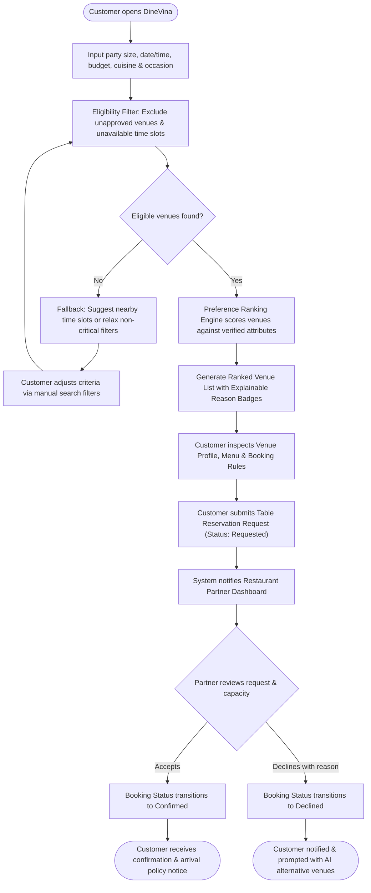
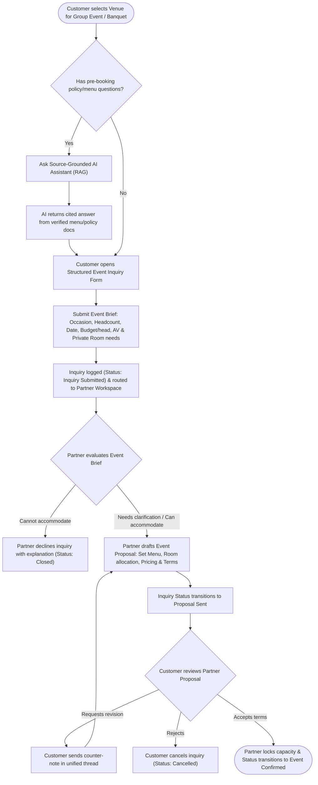

## 1. AI Product Features (For Vision Document - Section 5)

The following features define the **Intelligent Assistance (Group 9)** capabilities of DineVina, refined from the PA1 proposal to establish clear product boundaries and user value.

### Feature 9.1: Explainable Restaurant Recommendation Engine (Primary Slice)
The Explainable Restaurant Recommendation Engine matches diners with suitable venues by evaluating their stated preferences (cuisine, budget, location, party size, and dining occasion) against partner-verified restaurant attributes and real-time seating capacity. Unlike black-box algorithms or static directory filters, this feature generates a transparent justification badge for every suggested venue (e.g., *"Recommended because it matches your Vietnamese cuisine preference, fits your 200k–400k VND budget, and has a private room available for 10 guests"*). This capability is needed to reduce decision fatigue for customers navigating large restaurant catalogs while preventing false expectations caused by unverified recommendations. Customers benefit from faster, higher-confidence booking decisions, while restaurant partners benefit from receiving high-intent reservation requests that accurately fit their operational capacity.

### Feature 9.2: Source-Grounded Menu & Policy Assistant (Candidate Slice - RAG)
The Source-Grounded Menu & Policy Assistant is a retrieval-augmented generation (RAG) conversational tool embedded on venue detail pages to answer specific diner questions regarding ingredients, allergy accommodations, corkage fees, parking, and cancellation rules. The assistant retrieves answers strictly from administrator-approved restaurant profiles, structured menus, and published venue policies, appending direct citations to its responses. This feature is needed to eliminate the operational bottleneck of manual call centers and live-chat agents while ensuring diners receive instant, reliable answers outside standard business hours. Diners benefit from immediate clarity on complex dining conditions before submitting a table or event request, and restaurant staff benefit from a significant reduction in repetitive pre-booking inquiries.

### Feature 9.3: Automated Menu Digitization via OCR (Candidate Slice - Partner Onboarding)
The Automated Menu Digitization feature provides restaurant partners with an optical character recognition (OCR) and structured extraction pipeline that converts uploaded menu photographs or PDF documents into editable digital menu drafts. The system automatically parses dish names, descriptions, categories, and prices into DineVina's database schema, flagging low-confidence text for human review prior to publication. This capability is needed because manual dish-by-dish data entry creates severe onboarding friction for restaurants and leads to outdated menu catalogs on the platform. Restaurant partners benefit from a streamlined onboarding process that cuts menu setup time from hours to minutes, while the platform and customers benefit from rich, structured menu data that directly powers search filters and AI recommendations.

### Summary of AI Features & Priority

| No. | Feature | Description | Priority | Target Delivery |
| :--- | :--- | :--- | :--- | :--- |
| **F9.1** | Explainable Restaurant Recommender | Filters eligible venues by capacity/status and ranks options with human-readable reasons based on user constraints. | **High** | Core MVP (Sprint 3–4) |
| **F9.2** | Source-Grounded Menu & Policy Assistant | RAG-based Q&A assistant answering menu and policy questions using strictly verified venue documents with citations. | **Medium** | Candidate Slice (Sprint 4–5) |
| **F9.3** | Automated Menu Digitization (OCR) | Extracts structured dish names and prices from menu images/PDFs into partner-reviewed drafts. | **Low** | Candidate Slice (Sprint 5 / Stretch) |

---

## 2. Core User Workflow Diagrams (For Vision Document - Section 5)

### Workflow 1: AI-Assisted Discovery to Confirmed Table Reservation
This workflow illustrates how a customer transitions from expressing dining preferences to receiving explainable AI recommendations (with manual filter fallback) and completing a traceable table reservation request confirmed by the restaurant partner.

### Workflow 2: Structured Event Inquiry & Partner Proposal Negotiation
This workflow illustrates the end-to-end digital negotiation path for group banquets and corporate events, replacing traditional offline phone consultations with a structured brief and partner proposal thread.

### 3. AI Feasibility, Risk Management & NFR Proposal (For Project Plan & Vision Document)

#### 3.1. Technical Feasibility & Staged Delivery Plan

To ensure realistic execution within a 5-sprint academic timeline without overpromising unbuilt capabilities, the AI architecture adopts a hybrid deterministic-first, LLM-second approach:

*   **Stage 1 – Data Readiness & Deterministic Eligibility (Sprint 2–3):**
    *   **Architecture:** PostgreSQL relational filtering via FastAPI.
    *   **Feasibility:** High. Before any ranking or LLM generation occurs, hard SQL constraints remove unapproved venues, closed hours, and tables smaller than the requested party size.
*   **Stage 2 – Explainable Feature Scoring & Template/LLM Justification (Sprint 3–4):**
    *   **Architecture:** Multi-attribute weighted scoring (matching cuisine tags, price range overlap, and amenity tags) paired with structured explanation templates or lightweight LLM prompt formatting (e.g., Gemini API / OpenAI API).
    *   **Feasibility:** High. Does not require training custom deep learning models from scratch; relies on clean relational metadata curated by the Data Engineer.
*   **Stage 3 – Evaluation & Candidate Slices (Sprint 4–5):**
    *   **Evaluation Benchmark:** A golden dataset of 25–30 realistic diner scenarios (e.g., "Quiet anniversary dinner for 2 in District 1 under 1M VND", "Company team building for 20 people with private room and karaoke") will be used to evaluate Precision@3, explanation faithfulness, and zero-hallucination compliance.

#### 3.2. AI Risk Management 

| Risk ID | Risk Description | Likelihood | Impact | Mitigation Strategy |
| :--- | :--- | :--- | :--- | :--- |
| **R-AI01** | Cold-Start & Sparse Restaurant Data: Insufficient verified venue/menu records in early sprints degrade recommendation quality. | High | High | Curate a structured seed dataset of 20–30 realistic Ho Chi Minh City restaurants with complete menus, pricing, and amenity tags during Sprint 2–3. |
| **R-AI02** | AI Hallucination / Unverified Claims: Recommender or RAG assistant states inaccurate pricing, allergens, or amenity availability. | Medium | High | Enforce strict grounding: AI explanations may only reference structured database fields confirmed by partners. Display a mandatory fallback to standard UI filters and raw menu views. |
| **R-AI03** | External LLM API Latency or Quota Failure: Third-party API rate limits or slow response times block the customer discovery flow. | Medium | Medium | Implement a deterministic rule-based template generator as an automatic fallback if LLM response latency exceeds 2.5 seconds or if the API is unreachable. |

#### 3.3. AI Non-Functional Requirements (For Vision Document - Section 6)

*   **NFR-AI-01 (Response Latency):** The Explainable Recommendation endpoint must return ranked venues and explanation badges within < 2.5 seconds for 95% of requests under a load of 50 concurrent users.
*   **NFR-AI-02 (Factual Faithfulness):** 100% of venue attributes cited in recommendation explanations (price range, cuisine, capacity, amenities) must directly match the verified PostgreSQL record for that restaurant; zero unverified facts may be presented as certain.
*   **NFR-AI-03 (Graceful Degradation & Fallback):** If the AI service fails or returns zero high-confidence matches, the system must automatically fall back to standard multi-attribute search filters within < 500 milliseconds without crashing the user session.
*   **NFR-AI-04 (Privacy & Consent):** User dietary and budget preferences used for session ranking must require explicit user input/consent and must not expose personally identifiable information (PII) to external model training pipelines.
