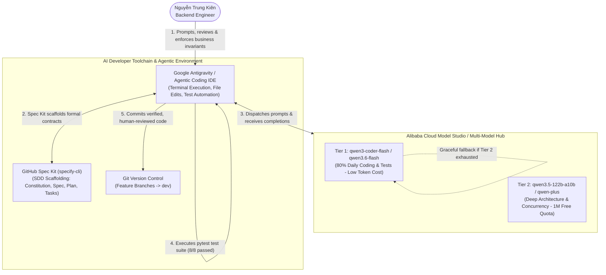

# AI Coding Research, Toolchain & Foundation Models Specification

**Project:** DineVina — Smart Restaurant Reservation and Event Booking Marketplace (Group 08)  
**Author / Performer:** Nguyễn Trung Kiên (Backend Engineer; Student ID: 24127068)  
**Reviewer:** Trương Khánh Duy (AI Engineer / Peer Reviewer) & Hoàng Cao Phong (Scrum Master)  
**Scope:** AI-Assisted Software Engineering Strategy — Evolution from PA1 Exploration to PA2 Spec-Driven Development (SDD)  
**Linked Tasks:** `[PA1] AI Coding Account – Kien` & `[PA2] Spec Kit Initialization & Training – Kien`  

---

## 1. Executive Summary & Objectives
*Performed by: Nguyễn Trung Kiên | Reviewed by: Trương Khánh Duy | Edited by: Nguyễn Trung Kiên*

In modern AI-integrated software engineering, leveraging Large Language Models (LLMs) requires a systematic, quota-conscious, and deterministic framework rather than unconstrained "vibe coding". 

This deliverable records the comprehensive **AI Coding Research** conducted by **Nguyễn Trung Kiên (Backend Engineer)** for the DineVina project, documenting:
1. **Model Selection & Multi-Tier Quota Strategy:** Evaluation of 141 models on Alibaba Cloud Model Studio and selection of balanced, cost-effective models for backend tasks.
2. **AI Developer Toolchain:** Integration of Google Antigravity (Agentic Coding IDE) and command-line agent hooks for fullstack backend engineering.
3. **Evolution to Spec-Driven Development (SDD):** Transitioning from conversational AI prompts in Week 1 to formal GitHub Spec Kit contracts (`constitution.md`, `spec.md`, `plan.md`, `tasks.md`) in Week 2 / PA2.
4. **Security & Human-in-the-Loop Governance:** Strict isolation of credentials, automated `.gitignore` safeguards, and mandatory unit test verification.

---

## 2. Foundation Models & Quota-Conscious Tiered Architecture
*Performed by: Nguyễn Trung Kiên | Reviewed by: Trương Khánh Duy | Edited by: Nguyễn Trung Kiên*

From a verified roster of **141 foundation models** available via Alibaba Cloud Model Studio, a tiered selection was established to optimize token consumption, latency, and reasoning depth:

| Tier | Model Identifier | Architecture / Category | Active Allocation / Quota | Primary Role & Practical Value in DineVina |
|:---:|:---|:---|:---|:---|
| **Tier 1** | **`qwen3-coder-flash`** | Lightweight Coder (Low Latency) | High-throughput Free Tier | **Daily Workhorse:** 80% of daily programming tasks. Generates FastAPI route boilerplates, Pydantic v2 validation models, and pytest fixtures with near-instant response. |
| **Tier 1** | **`qwen3.6-flash`** / `qwen3.5-flash` | Lightweight General Assistant | High-throughput Free Tier | **Rapid Refactoring:** Drafting technical documentation, markdown formatting, docstring generation, and quick syntax linting. |
| **Tier 2** | **`qwen3.5-122b-a10b`** | Mid-Tier Mixture-of-Experts (MoE) | **1M Free Tokens** (Active through 2027/01/14) | **Architecture Anchor:** Handles complex relational schema modeling, database migration design, and system boundary specifications. |
| **Tier 2** | **`qwen-plus`** / `qwen3.7-plus` | Balanced Mid-Tier | Standard API Quota | **Complex Concurrency Logic:** Designs atomic slot reservation mutators, cancellation cutoff policies, and prevents race conditions. |
| **Tier 2** | **`deepseek-v4.1-flash`** | Lightweight Deep Reasoning | Free Tier Allocation | **Edge-Case Validation:** Simulates corner-case state transitions (e.g., duplicate cancellations, expired reservation transitions). |
| **Utility**| **`text-embedding-v4`** | Dense Embedding Service | Standard API Quota | **Semantic Matching:** Powers vector representations for cuisine tagging and user dietary preference clustering. |

### Quota-Conscious Fallback Policy
* **Primary Path (Tier 1):** Routine backend tasks (data schemas, mock stores, simple endpoint tests) strictly utilize Tier 1 Flash/Coder models, consuming minimal token quota and minimizing response latency.
* **Secondary Path (Tier 2):** Architectural planning, concurrency race-condition prevention, and Spec Kit constitution authoring tap into Tier 2 models (leveraging Kiên's 1,000,000 free token balance on Model Studio).
* **Graceful Degradation:** If Tier 2 token quotas approach depletion, the workflow automatically downgrades 100% of operations to Tier 1 without stalling team delivery.

---

## 3. AI Developer Toolchain Architecture
*Performed by: Nguyễn Trung Kiên | Reviewed by: Trương Khánh Duy | Edited by: Nguyễn Trung Kiên*

The relationship between the engineer, the agentic environment, the cloud model infrastructure, and the Git repository is illustrated below:

### 3.1. Primary Agentic IDE: Google Antigravity
* **Role in Backend Engineering:**
  * **Interactive Terminal & Tool Execution:** Executes background build runners, system verification scripts, and automated test suites (`pytest`).
  * **Multi-File Context Awareness:** Analyzes cross-cutting dependencies between `schemas.py`, `store.py`, `main.py`, and test files.
  * **DevOps Automation:** Configures containerization (`compose.yaml`, `Dockerfile.api`) and remote GCP VM deployment (`dinevina-demo.duckdns.org` over TLS 1.3 / HTTPS).

---

## 4. Evolution to Spec-Driven Development (SDD) in PA2
*Performed by: Nguyễn Trung Kiên | Reviewed by: Trương Khánh Duy | Edited by: Nguyễn Trung Kiên*

During Week 1 (PA1), AI tools were primarily evaluated through conversational prompting. However, in Week 2/3 (PA2), Kiên advanced this practice by adopting **GitHub Spec Kit** for **Spec-Driven Development (SDD)**:

| Attribute | Conversational AI Prompting (Week 1 / "Vibe Coding") | Spec-Driven Development via Spec Kit (Week 2–3 / SDD) |
|:---|:---|:---|
| **Input to AI** | Ad-hoc text prompts in chat window | Formal `constitution.md`, `spec.md`, and `plan.md` |
| **Output Consistency**| Non-deterministic; variable naming shifts between camelCase and snake_case | 100% deterministic; strictly conforms to Pydantic v2 schemas |
| **Error Handling** | Frequently omits HTTP 400/404/409 edge cases | Pre-defined in acceptance criteria before code is written |
| **Verification Gate** | Manual visual inspection of code snippets | Automated `pytest` suite execution testing 100% of specified scenarios |
| **Traceability** | Chat history lost or hard to audit | Version-controlled artifacts committed in `/src/` and `specs/` |

By anchoring AI generation to the formal [DineVina Backend Constitution](../Kien_SpecKit/speckit-tutorial/constitution.md) and [Spec Kit Training](../Kien_SpecKit/Spec-Kit-Training.md), the backend prototype achieved:
* **8 out of 8 automated integration tests passing** on the first iteration.
* Zero hardcoded credentials or database connection strings in Git.
* Seamless compatibility with Supabase Cloud PostgreSQL on branch `demo/supabase-integration`.

---

## 5. Security, Secrets Management & Governance
*Performed by: Nguyễn Trung Kiên | Reviewed by: Trương Khánh Duy | Edited by: Nguyễn Trung Kiên*

1. **Strict Credential Isolation:**
   * Model API keys (`DASHSCOPE_API_KEY`, `SUPABASE_SERVICE_ROLE_KEY`) are managed strictly through local environment variables (`.env`).
   * `.gitignore` actively filters `.env`, temporary agent workspaces, and token caches.
2. **Human-in-the-Loop Review Policy:**
   * **Zero Blind Acceptance:** Every AI-generated file is reviewed by the engineer to verify business rules (e.g., 2-hour reservation cancellation cutoff window, party size constraints).
   * All generated routes must be exercised by automated tests before being merged.
3. **Traceability to Course Deliverables:**
   * The model tiers, toolchain, and SDD methodology documented here form the direct foundation for the PA2 Vision Document ([`kien.md`](../kien.md)) and API Specification ([`Discovery-and-Reservation-API-Contract.md`](../Kien_APIContract/Discovery-and-Reservation-API-Contract.md)).

---

