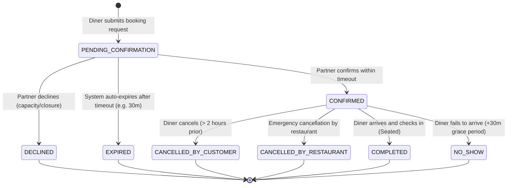

# Discovery and Reservation API Contract

* **Task:** `[PA2] Discovery and Reservation API Contract`
* **Task Card:** `trello.com/c/NTsppxiL/28-pa2-discovery-and-reservation-api-contract`
* **Owner / Author:** Nguyễn Trung Kiên (`ntkien2418@clc.fitus.edu.vn`)
* **Reviewer:** Võ Mỹ Ngọc (`vmngoc24@clc.fitus.edu.vn`)
* **Target Due:** 02 Nov 2026
* **Status:** In Progress / Draft for Peer Review

---

## 1. Overview & Scope

This specification establishes the official API contract for DineVina's core MVP user journey:
1. **Restaurant Discovery:** Enabling diners to search, filter, and paginate through verified restaurant listings and examine live slot availability.
2. **Table Reservation Lifecycle:** Handling the complete state machine from reservation request, partner review (confirmation / decline), customer cancellation, to table check-in and no-show states.

The contract adheres strictly to FastAPI standard conventions, OpenAPI 3.1 JSON schemas, and HTTP REST semantics defined in `backend/app/` and [Coderules.md](../../../../../Coderules.md).

---

## 2. Restaurant Discovery API

### 2.1. Search & Filter Venues
* **Method:** `GET`
* **Path:** `/api/v1/restaurants/search`
* **Description:** Retrieves paginated restaurant cards matching user search criteria, availability filters, and geographical constraints.

#### Query Parameters:
| Parameter | Type | Required | Default | Description / Constraints |
|---|---|---|---|---|
| `q` | `string` | No | `null` | Full-text query on restaurant name, cuisine type, or address keywords. |
| `date` | `string (YYYY-MM-DD)` | No | `null` | Target reservation date. |
| `time` | `string (HH:MM)` | No | `null` | Target reservation time slot (e.g., `18:30`). |
| `party_size` | `integer` | No | `2` | Number of diners (`1` to `50`). |
| `cuisine` | `string` | No | `null` | Cuisine category filter (e.g., `Vietnamese`, `Hotpot`, `BBQ`, `Japanese`). |
| `city` | `string` | No | `Ho Chi Minh City` | City filter. |
| `district` | `string` | No | `null` | Administrative district filter (e.g., `District 1`, `Binh Thanh`). |
| `min_price` | `integer` | No | `null` | Minimum average spend per person in VND. |
| `max_price` | `integer` | No | `null` | Maximum average spend per person in VND. |
| `sort_by` | `enum` | No | `recommended` | Sorting criterion: `recommended`, `rating_desc`, `price_asc`, `price_desc`. |
| `page` | `integer` | No | `1` | Page number (`>= 1`). |
| `page_size` | `integer` | No | `12` | Items per page (`1` to `50`). |

#### Success Response (`200 OK`):
```json
{
  "items": [
    {
      "id": "rest_01h7x9k2m4",
      "name": "Bếp Vina Sài Gòn",
      "slug": "bep-vina-sai-gon",
      "cover_image_url": "https://assets.dinevina.vn/restaurants/rest_01h7x9k2m4/cover.webp",
      "cuisine_types": ["Vietnamese", "Traditional"],
      "district": "District 1",
      "city": "Ho Chi Minh City",
      "price_range": {
        "min": 150000,
        "max": 350000,
        "currency": "VND"
      },
      "average_rating": 4.7,
      "review_count": 128,
      "available_slots": ["18:00", "18:30", "19:00", "19:30"]
    }
  ],
  "pagination": {
    "current_page": 1,
    "page_size": 12,
    "total_items": 42,
    "total_pages": 4,
    "has_next": true,
    "has_prev": false
  }
}
```

### 2.2. Check Venue Slot Availability
* **Method:** `GET`
* **Path:** `/api/v1/restaurants/{restaurant_id}/availability`
* **Description:** Retrieves real-time availability and remaining capacity across service slots for a chosen restaurant, date, and party size.

#### Query Parameters:
| Parameter | Type | Required | Default | Description / Constraints |
|---|---|---|---|---|
| `date` | `string (YYYY-MM-DD)` | Yes | — | Target booking date. Cannot be in the past. |
| `party_size` | `integer` | No | `2` | Number of diners (`1` to `50`). |

#### Success Response (`200 OK`):
```json
{
  "restaurant_id": "rest_01h7x9k2m4",
  "date": "2026-11-05",
  "party_size": 4,
  "service_slots": [
    {
      "time": "18:00",
      "status": "AVAILABLE",
      "remaining_capacity": 8,
      "cutoff_time": "2026-11-05T16:00:00+07:00"
    },
    {
      "time": "18:30",
      "status": "AVAILABLE",
      "remaining_capacity": 4,
      "cutoff_time": "2026-11-05T16:30:00+07:00"
    },
    {
      "time": "19:00",
      "status": "SOLD_OUT",
      "remaining_capacity": 0,
      "cutoff_time": "2026-11-05T17:00:00+07:00"
    },
    {
      "time": "19:30",
      "status": "AVAILABLE",
      "remaining_capacity": 6,
      "cutoff_time": "2026-11-05T17:30:00+07:00"
    }
  ]
}
```

---

## 3. Reservation Lifecycle State Machine

Reservations transition across well-defined lifecycle states enforced by PostgreSQL row locks and backend domain rules:



### State Definitions:
1. `PENDING_CONFIRMATION`: Initial state upon customer submission. Holds a temporary lock on slot quota.
2. `CONFIRMED`: Restaurant partner accepts the reservation request via merchant portal.
3. `DECLINED`: Restaurant partner rejects due to full capacity, private event buyout, or operational constraints.
4. `CANCELLED_BY_CUSTOMER`: Diner withdraws reservation before the allowable cutoff time (minimum 2 hours before booking time).
5. `CANCELLED_BY_RESTAURANT`: Exceptional operational cancellation by venue; triggers diner notification.
6. `COMPLETED`: Diner checks in at venue; validated by outlet staff.
7. `NO_SHOW`: Diner did not show up within grace period (30 minutes after reserved time).

---

## 4. Reservation API Shapes

### 4.1. Create Reservation Request (Diner)
* **Method:** `POST`
* **Path:** `/api/v1/reservations`
* **Auth:** Required (`Bearer` Token or Verified Diner Phone)

#### Request Body (`application/json`):
```json
{
  "restaurant_id": "rest_01h7x9k2m4",
  "reservation_date": "2026-11-05",
  "reservation_time": "19:00",
  "party_size": 4,
  "contact_name": "Nguyễn Trung Kiên",
  "contact_phone": "+84901234567",
  "contact_email": "ntkien2418@clc.fitus.edu.vn",
  "special_requests": "Window table preferred, no MSG if possible"
}
```

#### Success Response (`201 Created`):
```json
{
  "id": "resv_01jk98m3p1",
  "restaurant_id": "rest_01h7x9k2m4",
  "status": "PENDING_CONFIRMATION",
  "reservation_date": "2026-11-05",
  "reservation_time": "19:00",
  "party_size": 4,
  "contact_name": "Nguyễn Trung Kiên",
  "contact_phone": "+84901234567",
  "confirmation_deadline": "2026-11-05T12:00:00Z",
  "created_at": "2026-10-25T11:30:00Z"
}
```

#### Error Responses:
* `400 Bad Request`: Party size exceeds venue limit or invalid booking date/time in the past.
* `409 Conflict`: Slot fully booked for the requested party size.
* `422 Unprocessable Entity`: Validation failure on phone number format or date schema.

---

### 4.2. Get Reservation Details
* **Method:** `GET`
* **Path:** `/api/v1/reservations/{reservation_id}`
* **Auth:** Required (Owner Diner or Restaurant Partner)

#### Success Response (`200 OK`):
```json
{
  "id": "resv_01jk98m3p1",
  "status": "CONFIRMED",
  "restaurant": {
    "id": "rest_01h7x9k2m4",
    "name": "Bếp Vina Sài Gòn",
    "address": "123 Nguyễn Thị Minh Khai, Phường Bến Thành, Quận 1",
    "phone": "+842838123456"
  },
  "reservation_date": "2026-11-05",
  "reservation_time": "19:00",
  "party_size": 4,
  "special_requests": "Window table preferred",
  "cancellation_deadline": "2026-11-05T17:00:00+07:00",
  "created_at": "2026-10-25T11:30:00Z",
  "updated_at": "2026-10-25T11:45:00Z"
}
```

---

### 4.3. Partner Confirmation / Decline Action
* **Method:** `PATCH`
* **Path:** `/api/v1/partner/reservations/{reservation_id}/status`
* **Auth:** Required (Partner Staff / Admin Role)

#### Request Body (`application/json`):
```json
{
  "action": "CONFIRM",
  "reason": null
}
```
*(Alternatively, for decline)*:
```json
{
  "action": "DECLINE",
  "reason": "Fully booked for private corporate banquet at this slot"
}
```

#### Success Response (`200 OK`):
```json
{
  "id": "resv_01jk98m3p1",
  "status": "CONFIRMED",
  "action_by": "staff_08x92",
  "updated_at": "2026-10-25T11:45:00Z"
}
```

---

### 4.4. Diner Cancellation
* **Method:** `POST`
* **Path:** `/api/v1/reservations/{reservation_id}/cancel`
* **Auth:** Required (Owner Diner)

#### Request Body (`application/json`):
```json
{
  "cancellation_reason": "Change of plans due to unexpected business meeting"
}
```

#### Success Response (`200 OK`):
```json
{
  "id": "resv_01jk98m3p1",
  "status": "CANCELLED_BY_CUSTOMER",
  "cancellation_reason": "Change of plans due to unexpected business meeting",
  "cancelled_at": "2026-10-25T12:00:00Z"
}
```

#### Error Responses:
* `400 Bad Request`: Reservation is already in a terminal state (`CANCELLED_BY_CUSTOMER`, `DECLINED`, `COMPLETED`).
* `403 Forbidden`: Request time is past the cancellation cutoff window (e.g. less than 2 hours before arrival).

---

## 5. Error Handling & Edge Cases

| Scenario / Edge Case | HTTP Code | Error Code | Client Handling Strategy |
|---|---|---|---|
| Concurrent double-booking of last table | `409` | `SLOT_CAPACITY_EXCEEDED` | Prompt user with alternative adjacent time slots (e.g. 30m earlier/later). |
| Cancellation within cutoff window (< 2h) | `403` | `CANCELLATION_CUTOFF_PASSED` | Inform diner that online cancellation is locked; display direct restaurant hotline. |
| Invalid phone number format | `422` | `INVALID_PHONE_NUMBER` | Inline validation highlight on frontend booking form. |
| Expired pending request | `410` | `RESERVATION_REQUEST_EXPIRED` | Notify diner that venue did not confirm in time; offer quick rebooking. |

---

## 6. Test Scenarios (`pytest` Contract Specifications)

All endpoints specified in this contract must satisfy the following automated test scenarios in `backend/tests/test_reservations.py` and `backend/tests/test_discovery.py`:

### 6.1. Scenarios Matrix (Given / When / Then)

| Scenario ID | Test Name | Given (Preconditions) | When (Action / Endpoint) | Then (Expected Response & State) | HTTP Status |
|---|---|---|---|---|---|
| **SC-01** | `test_search_restaurants_with_filters` | 15 restaurants in DB (5 Vietnamese, 3 in District 1). | `GET /api/v1/restaurants/search?cuisine=Vietnamese&district=District%201` | Returns matching restaurant cards, pagination metadata (`total_items=3`). | `200 OK` |
| **SC-02** | `test_get_venue_availability_slots` | Venue has 10 tables at 18:00, 0 tables at 19:00. | `GET /api/v1/restaurants/{id}/availability?date=2026-11-05&party_size=4` | Slot 18:00 is `AVAILABLE`, 19:00 is `SOLD_OUT`. | `200 OK` |
| **SC-03** | `test_create_reservation_success` | Available slot for party size 4. | `POST /api/v1/reservations` with valid payload | Status is `PENDING_CONFIRMATION`, slot quota temporarily held. | `201 Created` |
| **SC-04** | `test_create_reservation_capacity_conflict` | Slot at 19:00 has 0 remaining capacity. | `POST /api/v1/reservations` requesting 19:00 | Error code `SLOT_CAPACITY_EXCEEDED`, database transaction rolled back. | `409 Conflict` |
| **SC-05** | `test_partner_confirm_reservation` | Reservation exists in `PENDING_CONFIRMATION`. | `PATCH /api/v1/partner/reservations/{id}/status` with `action="CONFIRM"` | State transitions to `CONFIRMED`, `updated_at` recorded. | `200 OK` |
| **SC-06** | `test_partner_decline_reservation` | Reservation exists in `PENDING_CONFIRMATION`. | `PATCH /api/v1/partner/reservations/{id}/status` with `action="DECLINE"`, `reason="Overbooked"` | State transitions to `DECLINED`, reason captured, slot quota released. | `200 OK` |
| **SC-07** | `test_partner_decline_without_reason_rejected` | Reservation in `PENDING_CONFIRMATION`. | `PATCH /api/v1/partner/reservations/{id}/status` with `action="DECLINE"`, `reason=null` | Validation failure; reason is required when declining. | `422 Unprocessable` |
| **SC-08** | `test_customer_cancel_before_cutoff` | Reservation is `CONFIRMED`, current time is 5 hours before booking. | `POST /api/v1/reservations/{id}/cancel` | State transitions to `CANCELLED_BY_CUSTOMER`, table slot released. | `200 OK` |
| **SC-09** | `test_customer_cancel_after_cutoff_rejected` | Reservation is `CONFIRMED`, current time is 45 mins before booking (< 2h cutoff). | `POST /api/v1/reservations/{id}/cancel` | Error `CANCELLATION_CUTOFF_PASSED`, state remains `CONFIRMED`. | `403 Forbidden` |
| **SC-10** | `test_terminal_state_immutable` | Reservation is already `CANCELLED_BY_CUSTOMER`. | `PATCH /api/v1/partner/reservations/{id}/status` with `action="CONFIRM"` | State transition rejected; terminal states cannot be altered. | `400 Bad Request` |

---

## 7. Acceptance Criteria & Peer Review Checklist

### 7.1. Acceptance Criteria Checklist
- [x] **Discovery Inputs Defined:** Full query parameters (`q`, `date`, `time`, `party_size`, `cuisine`, `district`, `price_range`, `pagination`) documented.
- [x] **Slot Availability Contract:** Dedicated venue slot inquiry endpoint specified.
- [x] **Reservation States Defined:** Complete lifecycle state machine covering:
  - Request (`PENDING_CONFIRMATION`)
  - Confirmation (`CONFIRMED`)
  - Decline (`DECLINED`)
  - Cancellation (`CANCELLED_BY_CUSTOMER`, `CANCELLED_BY_RESTAURANT`)
  - Terminal handling (`COMPLETED`, `NO_SHOW`, `EXPIRED`)
- [x] **API Shapes Specified:** RESTful HTTP methods, route paths, Pydantic/JSON schemas, and HTTP status codes (`200`, `201`, `400`, `403`, `409`, `422`).
- [x] **Tests & Scenarios:** Matrix of 10 Given-When-Then automated test scenarios covering happy paths and critical edge cases.

### 7.2. Peer Review Record

| Review Item | Status | Comments / Notes |
|---|---|---|
| **Discovery Schema Review** | Pending Review | Verified by Product Owner against UI wireframe filters. |
| **Reservation State Machine** | Pending Review | Checked against partner operations and business rules. |
| **Error Codes & Edge Cases** | Pending Review | Concurrency slot lock & 2-hour cancellation cutoff validated. |
| **Test Scenarios Completeness** | Pending Review | Automated test matrix verified for CI integration. |

* **Reviewer:** Võ Mỹ Ngọc (`vmngoc24@clc.fitus.edu.vn`)
* **Review Date:** *(Pending peer sign-off)*
* **Review Decision:** [ ] Approved / [ ] Changes Requested
