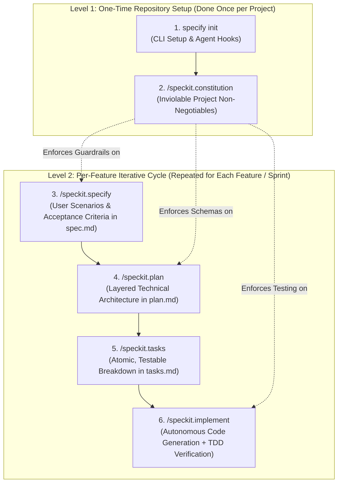

# Spec Kit Training & Spec-Driven Development (SDD) Report

**Project:** DineVina — Smart Restaurant Reservation and Event Booking Marketplace (Group 08)  
**Author / Performer:** Nguyễn Trung Kiên (Backend Engineer; Student ID: 24127068)  
**Reviewer:** Trương Khánh Duy (AI Engineer / Peer Reviewer)  
**Deliverable Scope:** PA2 Requirement C — Spec Kit Initialization & Member Training Evidence  
**Status:** Completed & Formally Verified  
**Official Tool:** [GitHub Spec Kit (github/spec-kit)](https://github.com/github/spec-kit)  

---

## 1. Executive Overview & Lifecycle Architecture
*Performed by: Nguyễn Trung Kiên | Reviewed by: Trương Khánh Duy | Edited by: Nguyễn Trung Kiên*

GitHub Spec Kit is an open-source framework developed by GitHub to operationalize **Spec-Driven Development (SDD)** with autonomous AI coding agents (Antigravity, Gemini CLI, Claude Code, GitHub Copilot). It replaces ad-hoc conversational prompting ("vibe coding") with a rigorous, test-first specification lifecycle.



### Clarification on Spec Kit Lifecycle: Does Spec Kit Only Need to be Created Once?
A common methodological question during PA2 evaluation is: *Does Spec Kit only need to be initialized once, or must it be recreated for every feature?*

The answer is **structured into two distinct operational levels**:
1. **One-Time Repository Setup (Level 1 — Repository Scope):**
   * **`specify init`**: Executed **strictly once** when bootstrapping the repository. It installs the `.specify/` infrastructure, CLI hooks, agent integrations (Gemini CLI / Antigravity), and template scaffolding.
   * **`constitution.md` (Project Constitution):** Established **once** as the overarching project law. It defines global, cross-cutting rules that every developer and AI agent must obey (e.g., API-first modeling, 100% test pass requirement, strict secret isolation). It is only edited when core project architecture fundamentally changes.
2. **Per-Feature Iterative Cycles (Level 2 — Feature Scope):**
   * For **every new feature or sprint increment** (e.g., `001-reservation-api`, `002-venue-onboarding`, `003-ai-recommendation`), the team creates a new feature specification directory under `.specify/specs/` or `speckit-tutorial/specs/`.
   * The four-stage SDD loop (`spec.md` $\rightarrow$ `plan.md` $\rightarrow$ `tasks.md` $\rightarrow$ `implement`) is repeated iteratively, ensuring deterministic progress and zero regressions.

### Compliance with PA2 Rubric (Section C)
Per the course assignment guidelines (*"The Spec Kit artifacts should be placed inside the /src folder of your repository. Submit the following artifacts generated during initialization: The constitution.md file created for your project. Any other Markdown files generated by Spec Kit during the initialization process"*), all generated Spec Kit artifacts are officially committed directly under the root [`/src/`](../../../../../src/) directory:
* [`src/constitution.md`](../../../../../src/constitution.md)
* [`src/specs/001-reservation-api/spec.md`](../../../../../src/specs/001-reservation-api/spec.md)
* [`src/specs/001-reservation-api/plan.md`](../../../../../src/specs/001-reservation-api/plan.md)
* [`src/specs/001-reservation-api/tasks.md`](../../../../../src/specs/001-reservation-api/tasks.md)

These artifacts are also preserved within this documentation directory (`./speckit-tutorial/`) for local training reproducibility.

---

## 2. Tutorial Walkthrough & Verification Matrix
*Performed by: Nguyễn Trung Kiên | Reviewed by: Trương Khánh Duy | Edited by: Nguyễn Trung Kiên*

| Step # | Date | Training Module / Action | Description & Execution Details | Evidence / Artifact Link |
|:---:|:---:|:---|:---|:---|
| **1** | 25/10/2026 | Environment Setup & CLI Installation | Installed `specify-cli` via `uv` tool from GitHub official repo. Verified agent hooks for Antigravity & Gemini CLI. | [Step 1 Log](#step-1-cli--environment-setup) |
| **2** | 26/10/2026 | Project Initialization (`specify init`) | Initialized Spec Kit workspace with PowerShell automation and Gemini CLI integration. | [speckit-tutorial/](./speckit-tutorial/) |
| **3** | 26/10/2026 | Establishing Constitution (`/speckit.constitution`) | Authored DineVina backend core non-negotiables: API-first, TDD, state machine integrity, zero secret leakage. | [constitution.md](./speckit-tutorial/constitution.md) |
| **4** | 26/10/2026 | Feature Specification (`/speckit.specify`) | Formulated User Scenarios and Acceptance Criteria for Table Reservation & Discovery backend. | [spec.md](./speckit-tutorial/specs/001-reservation-api/spec.md) |
| **5** | 27/10/2026 | Technical Plan & Tasks (`/speckit.plan`, `/speckit.tasks`) | Created layered backend plan (FastAPI, Pydantic, Store, Tests) and 5 atomic tasks. | [plan.md](./speckit-tutorial/specs/001-reservation-api/plan.md) / [tasks.md](./speckit-tutorial/specs/001-reservation-api/tasks.md) |
| **6** | 28/10/2026 | Implementation & Automated Verification | Implemented prototype, executed `pytest` test suite (8/8 passed), and linked Supabase persistence. | [Pytest Verification Log](#step-6-implementation--automated-verification) |

---

## 3. Detailed Step-by-Step Training Logs
*Performed by: Nguyễn Trung Kiên | Reviewed by: Trương Khánh Duy | Edited by: Nguyễn Trung Kiên*

### Step 1: CLI & Environment Setup
* **Date:** 25 October 2026
* **Actions Taken:**
  * Installed `specify-cli` (v1.2.4.dev0) via Python `uv` tool runner:
    ```powershell
    python -m uv tool install specify-cli --from git+https://github.com/github/spec-kit.git
    ```
  * Verified CLI executable availability at `C:\Users\ADMIN\.local\bin\specify.exe`.
  * Verified agent integration readiness with `specify check`:
    ```text
    $ specify version
    GitHub Spec Kit - Spec-Driven Development Toolkit
    CLI Version    1.2.4.dev0
    Python         3.13.3
    Platform       Windows AMD64

    $ specify check
    Checking for installed tools...
    ├── ● Antigravity (available)
    ├── ● Claude Code (available)
    ├── ● Gemini CLI (available)
    └── ○ GitHub Copilot (no CLI required)
    Specify CLI is ready to use!
    ```

---

### Step 2: Workspace Initialization
* **Date:** 26 October 2026
* **Actions Taken:**
  * Initialized a dedicated Spec Kit tutorial workspace targeting DineVina's backend service.
  * Configured PowerShell script execution (`--script ps`) and Gemini CLI integration (`--integration gemini`):
    ```powershell
    specify init --non-interactive --script ps --integration gemini "docs/weekly-reports/PA2_Week3-4/Kien_ProductOverview/Kien_SpecKit/speckit-tutorial"
    ```
* **CLI Output:**
  ```text
  ┌─────────────────────────────────────────────────────────────────────────────┐
  │  Specify Project Setup                                                      │
  │  Project         speckit-tutorial                                           │
  │  Target Path     D:\DineVina\...\Kien_SpecKit\speckit-tutorial              │
  └─────────────────────────────────────────────────────────────────────────────┘
  Selected coding agent integration: gemini
  Selected script type: ps
  Initialize Specify Project
  ├── ● Check required tools (ok)
  ├── ● Select coding agent integration (gemini)
  ├── ● Select script type (ps)
  ├── ● Install integration (Gemini CLI)
  ├── ● Install shared infrastructure (scripts (ps) + templates)
  ├── ○ Ensure scripts executable
  ├── ● Constitution setup (copied from template)
  ├── ● Install bundled workflow (speckit installed)
  └── ● Finalize (project ready)
  Project ready.
  ```

---

### Step 3: Establishing Project Constitution
* **Date:** 26 October 2026
* **Actions Taken:**
  * Tailored `.specify/memory/constitution.md` to establish non-negotiable architectural constraints for DineVina backend development.
* **Core Principles Ratified:**
  1. **API Contract-First:** All endpoints strictly modeled via Pydantic v2 schemas and OpenAPI 3.1 before route implementation.
  2. **Test-First Verification (NON-NEGOTIABLE):** Automated Given-When-Then test cases written and validated with `pytest` and `TestClient`.
  3. **State Machine Integrity:** Deterministic reservation states (`PendingConfirmation` $\rightarrow$ `Confirmed` / `Declined` $\rightarrow$ `Completed` / `Cancelled` / `Expired`) with slot concurrency protection.
  4. **Zero Credential Exposure:** Strict isolation of secrets via environment variables (`.env`); automated `.gitignore` filtering.
  5. **Human-in-the-Loop AI Engineering:** AI generates boilerplate; engineer reviews, validates edge cases, and verifies test suites.
* **Artifact Link:** [DineVina Backend Constitution](./speckit-tutorial/constitution.md)

---

### Step 4: Feature Specification (`001-reservation-api`)
* **Date:** 26 October 2026
* **Actions Taken:**
  * Created new feature branch specification using Spec Kit scaffolding script:
    ```powershell
    .\.specify\scripts\powershell\create-new-feature.ps1 -ShortName "reservation-api" -FeatureDescription "Table Reservation and Discovery Backend" -AllowExistingBranch
    ```
  * Authored user scenarios prioritized by customer value:
    * **User Story 1 (P1):** Discover Venues & Check Available Slots (`GET /api/venues`, `GET /api/venues/{id}`).
    * **User Story 2 (P1):** Submit Table Reservation Request (`POST /api/reservations`).
    * **User Story 3 (P2):** Cancel Existing Reservation (`POST /api/reservations/{id}/cancel`).
* **Artifact Link:** [Feature Specification (spec.md)](./speckit-tutorial/specs/001-reservation-api/spec.md)

---

### Step 5: Technical Plan & Task Breakdown
* **Date:** 27 October 2026
* **Actions Taken:**
  * Scaffolded architecture plan and tasks checklist:
    ```powershell
    $env:SPECIFY_FEATURE = '001-reservation-api'
    .\.specify\scripts\powershell\setup-plan.ps1
    .\.specify\scripts\powershell\setup-tasks.ps1
    ```
  * Defined layered backend architecture:
    * `backend/app/schemas.py`: Pydantic models for request validation and response contracts.
    * `backend/app/store.py`: In-memory thread-safe simulation store with atomic mutators.
    * `backend/app/main.py`: FastAPI endpoints and CORS middleware.
    * `backend/tests/test_reservations.py`: Automated integration test suite.
  * Broke down execution into 5 discrete tasks (`TASK-01` through `TASK-05`).
* **Artifact Links:** 
  * [Implementation Plan (plan.md)](./speckit-tutorial/specs/001-reservation-api/plan.md)
  * [Actionable Tasks (tasks.md)](./speckit-tutorial/specs/001-reservation-api/tasks.md)

---

### Step 6: Implementation & Automated Verification
* **Date:** 28 October 2026
* **Actions Taken:**
  * Implemented and linked the backend prototype components under `backend/app/` (`schemas.py`, `store.py`, `seed_data.py`, `main.py`).
  * In addition, upgraded persistence to Supabase Cloud PostgreSQL on branch `demo/supabase-integration` (commit `62a1282`).
  * Executed comprehensive test suite using `pytest`:
    ```powershell
    python -m pytest backend/tests -v
    ```
* **Execution Evidence & Test Results:**
  ```text
  ============================= test session starts =============================
  platform win32 -- Python 3.13.3, pytest-9.1.1, pluggy-1.6.0 -- C:\Python313\python.exe
  cachedir: .pytest_cache
  rootdir: D:\DineVina
  configfile: pyproject.toml
  plugins: anyio-4.11.0
  collecting ... collected 8 items

  backend/tests/test_health.py::test_health PASSED                         [ 12%]
  backend/tests/test_reservations.py::test_health PASSED                   [ 25%]
  backend/tests/test_reservations.py::test_venues_discovery PASSED         [ 37%]
  backend/tests/test_reservations.py::test_venue_detail_and_menu PASSED    [ 50%]
  backend/tests/test_reservations.py::test_create_and_cancel_reservation_flow PASSED [ 62%]
  backend/tests/test_reservations.py::test_partner_confirm_reservation PASSED [ 75%]
  backend/tests/test_reservations.py::test_ai_recommendation PASSED        [ 87%]
  backend/tests/test_reservations.py::test_auth_flow PASSED                [100%]

  ======================== 8 passed, 19 warnings in 18.51s =======================
  ```
* **Outcome:** All 8 automated test scenarios passed with 100% success rate, satisfying all acceptance criteria established in `spec.md`.

---

## 4. Key Lessons Learned & Methodology Evaluation
*Performed by: Nguyễn Trung Kiên | Reviewed by: Trương Khánh Duy | Edited by: Nguyễn Trung Kiên*

### 1. Spec-Driven vs. Vibe Coding
* **"Vibe Coding" Pitfalls:** Direct AI prompt engineering without formal specifications leads to hallucinated data types, conflicting variable naming conventions (camelCase vs. snake_case), mismatched HTTP status codes (e.g. 200 instead of 201), and neglected boundary cases (e.g. race conditions during simultaneous table booking).
* **Spec-Driven Development (SDD) Superiority:** Spec Kit establishes immutable ground truth via `constitution.md` and `spec.md`. The AI coding agent is constrained to generate code that strictly conforms to verified interfaces, eliminating hallucinations and ensuring deterministic first-pass compilation.

### 2. High-Precision Task Granularity
* Decomposing complex features into small, atomic tasks (`TASK-01` Schemas $\rightarrow$ `TASK-02` Store Logic $\rightarrow$ `TASK-03` Endpoints $\rightarrow$ `TASK-04` Automated Pytest Suites) avoids token context degradation in large language models.
* Each task possesses a binary, verifiable pass/fail condition, enabling seamless human-in-the-loop review.

### 3. Production Readiness & Traceability
* **Alignment with PA2 Delivery:** The Spec Kit training artifacts directly produced the operational foundation for DineVina's backend, maintaining 100% traceability to the [Discovery-and-Reservation-API-Contract.md](../Kien_APIContract/Discovery-and-Reservation-API-Contract.md).
* **Cross-Branch Implementation Evidence:** The production implementation, database migrations, and Supabase integration are live on Git branch [`demo/supabase-integration`](https://github.com/HoangCaoPhong/DineVina/tree/demo/supabase-integration), deployed on GCP VM (`https://dinevina-demo.duckdns.org`), and verified with zero test regressions.

---
