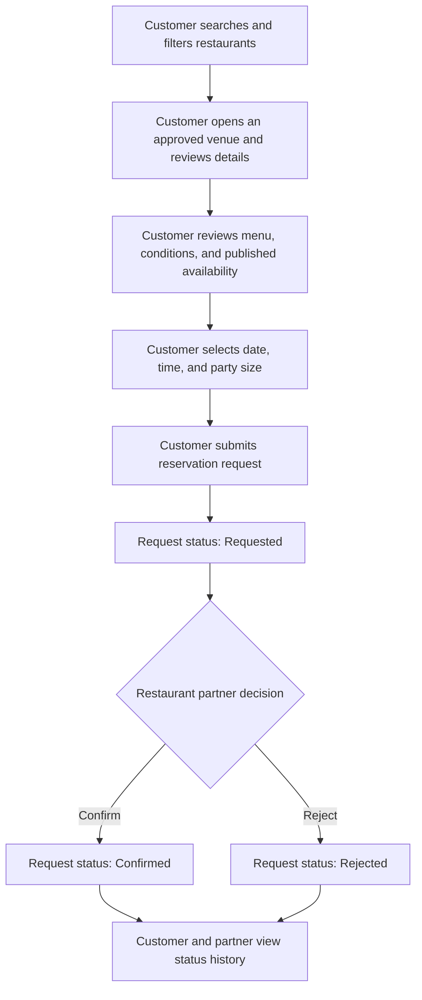
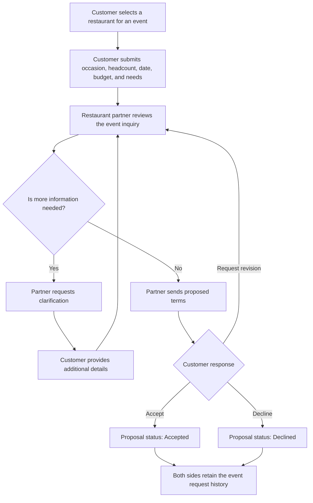

# DineVina Vision Document

## 1. Introduction

**Performed by:** Võ Mỹ Ngọc | **Reviewed by:** Pending assignment | **Edited by:** Võ Mỹ Ngọc

This Vision Document defines the high-level needs, market position, and product capabilities of DineVina, a responsive web marketplace for restaurant discovery, table reservation requests, and event inquiries. It gives the project team and stakeholders a shared understanding of what the product should achieve, why its capabilities are needed, and which users benefit from them. Detailed functional behavior, acceptance criteria, and implementation decisions will be refined in the use-case model, supplementary specifications, and product backlog.

DineVina follows a B2B2C model in which restaurant partners publish and manage dining services, customers find suitable venues and submit requests, and the platform connects both sides through visible request states. An ordinary table reservation remains a request until the restaurant partner confirms it, while event inquiries follow a separate clarification and proposal process. The current product scope excludes a complete restaurant point-of-sale, inventory, accounting, and payment system, and it does not include native mobile applications.

### 1.1 References

**Performed by:** Võ Mỹ Ngọc | **Reviewed by:** Pending assignment | **Edited by:** Võ Mỹ Ngọc

| Reference                                                                        | Date                     | Publishing organization or source                      | Use in this document                                                                                                                      |
| -------------------------------------------------------------------------------- | ------------------------ | ------------------------------------------------------ | ----------------------------------------------------------------------------------------------------------------------------------------- |
| *PA1 Report - DineVina: Smart Restaurant Reservation and Event Booking System* | 17 October 2026          | Group 08, Introduction to Software Engineering         | Defines the agreed product idea, boundaries, actors, nine functional groups, AI direction, and PasGo/Eatigo survey findings.              |
| *Project Assignment 2 (PA2-2026)*                                              | 15 October 2026          | CS300/CSC13002, University of Science, VNU-HCM         | Defines the required Vision Document sections, paragraph depth for product features, Mermaid workflow requirement, and submission format. |
| *Vision Document for a Small Project* (`rup_vision_sp.docx`)                 | Course-provided template | Rational Unified Process template distributed with PA2 | Provides the required section structure and the formats for the Problem Statement and Product Position Statement.                         |
| *Vision Document Example* (`rup_vision_sp-example.docx`)                     | Course-provided example  | Distributed with PA2                                   | Illustrates how the positioning tables and product feature section may be completed.                                                      |

## 2. Positioning

**Performed by:** Võ Mỹ Ngọc | **Reviewed by:** Pending assignment | **Edited by:** Võ Mỹ Ngọc

### 2.1 Problem Statement

**Performed by:** Võ Mỹ Ngọc | **Reviewed by:** Pending assignment | **Edited by:** Võ Mỹ Ngọc

|                                          | Statement                                                                                                                                                                                                                                                                                                 |
| ---------------------------------------- | --------------------------------------------------------------------------------------------------------------------------------------------------------------------------------------------------------------------------------------------------------------------------------------------------------- |
| **The problem of**                 | finding a restaurant that fits a customer's location, cuisine, budget, party size, capacity, and event needs while keeping restaurant information and request status clear and traceable                                                                                                                  |
| **affects**                        | customers planning ordinary meals or group events, restaurant partners receiving and managing requests, and platform administrators responsible for trustworthy listings                                                                                                                                  |
| **the impact of which is**         | customers spend time comparing fragmented or uncertain information, may confuse a submitted request with a confirmed booking, and must coordinate complex events through unstructured channels; restaurant partners face incomplete requests, conflicting capacity commitments, and inefficient follow-up |
| **a successful solution would be** | a responsive marketplace that presents attributable venue and menu information, supports relevant search criteria, separates requested and confirmed states, provides a structured event proposal path, and gives restaurant partners a single workspace for availability and incoming demand             |

### 2.2 Product Position Statement

**Performed by:** Võ Mỹ Ngọc | **Reviewed by:** Pending assignment | **Edited by:** Võ Mỹ Ngọc

|                            | Statement                                                                                                                                                                                                       |
| -------------------------- | --------------------------------------------------------------------------------------------------------------------------------------------------------------------------------------------------------------- |
| **For**              | diners looking for suitable restaurants, customers planning group events, restaurant partners seeking qualified demand, and platform administrators maintaining listing quality                                 |
| **Who**              | need a clearer way to discover venues, evaluate dining or event suitability, submit complete requests, and track responses without confusing a request with a confirmed commitment                              |
| **The product name** | DineVina is a responsive B2B2C web marketplace for restaurant discovery, table reservation requests, and event inquiries                                                                                        |
| **That**             | connects customers and restaurant partners through approved venue information, menus, availability, explicit request states, structured event briefs and proposals, promotions, and preference-based assistance |
| **Unlike**           | relying on separate search, social, messaging, and booking tools, or the limited PasGo and Eatigo interface flows observed in the PA1 survey                                                                    |
| **Our product**      | combines a traceable booking state, a dedicated event negotiation workflow, and explainable recommendations grounded in partner-verified venue data, while keeping ordinary filters available as a fallback     |

## 5. Product Features

**Performed by:** Võ Mỹ Ngọc | **Reviewed by:** Pending assignment | **Edited by:** Võ Mỹ Ngọc

The following features refine the nine functional groups established in the PA1 project proposal. They describe externally visible product capabilities and user value without committing the team to a particular implementation design.

### 5.1 Accounts and Profiles

**Performed by:** Võ Mỹ Ngọc | **Reviewed by:** Pending assignment | **Edited by:** Võ Mỹ Ngọc

DineVina allows customers and restaurant partners to create accounts and maintain the contact and preference information needed for their activities. Role-aware access separates customer, partner, and administrator actions so that each user sees only the functions and records relevant to that role. Customers benefit from reusable booking details and preferences, while partners and administrators benefit from attributable actions and controlled access to operational data.

### 5.2 Restaurant Onboarding

**Performed by:** Võ Mỹ Ngọc | **Reviewed by:** Pending assignment | **Edited by:** Võ Mỹ Ngọc

Restaurant partners can submit a venue profile containing its identity, location, cuisine, photos, amenities, capacity, and contact details. A platform administrator reviews the submission and either approves it or returns it for correction before it becomes an attributable source for customer discovery. This feature gives customers more trustworthy venue information and helps partners present their restaurants consistently on the marketplace.

### 5.3 Restaurant Discovery and Venue Details

**Performed by:** Võ Mỹ Ngọc | **Reviewed by:** Pending assignment | **Edited by:** Võ Mỹ Ngọc

Customers can search and filter restaurants by criteria such as location, cuisine, budget, party size, capacity, and amenities, then open a venue page for more detail. The feature shortens the path from a dining or event need to a manageable set of suitable options instead of forcing users to compare fragmented information manually. Customers benefit from more relevant choices, while approved restaurant partners gain visibility among users whose needs match their offerings.

### 5.4 Menu Management and Viewing

**Performed by:** Võ Mỹ Ngọc | **Reviewed by:** Pending assignment | **Edited by:** Võ Mỹ Ngọc

Restaurant partners can maintain menu items with approved names, descriptions, and prices, and customers can review this information before submitting a request. Menu visibility is needed because price and dish suitability influence whether a venue fits a customer's budget, dietary preferences, and occasion. Customers make better-informed decisions, and partners receive requests from people who have already reviewed the relevant offering.

### 5.5 Table Reservation Requests

**Performed by:** Võ Mỹ Ngọc | **Reviewed by:** Pending assignment | **Edited by:** Võ Mỹ Ngọc

Customers can choose a date, time, and party size and submit a table reservation request to a restaurant partner. The partner can confirm or reject the request, while both sides can see its status history and applicable cancellation conditions; submitting a request does not itself create a confirmed reservation. This feature gives customers a clear path from venue selection to a visible outcome and helps restaurant staff respond to demand without making ambiguous promises.

### 5.6 Event Inquiries and Proposals

**Performed by:** Võ Mỹ Ngọc | **Reviewed by:** Pending assignment | **Edited by:** Võ Mỹ Ngọc

Customers planning an event can submit a structured brief containing the occasion, expected headcount, preferred date, budget, and special needs. Restaurant partners can request clarification, propose terms, and track the customer's response in one conversation rather than treating a complex event like an ordinary table request. Customers benefit from a clearer planning process, and partners benefit from receiving the information required to prepare realistic proposals.

### 5.7 Availability and Partner Dashboard

**Performed by:** Võ Mỹ Ngọc | **Reviewed by:** Pending assignment | **Edited by:** Võ Mỹ Ngọc

Restaurant partners can maintain operating hours, capacity, and blocked slots while viewing incoming reservation and event requests in a role-specific dashboard. Keeping availability and demand together is needed to reduce conflicting commitments and give staff a practical queue for daily work. Partners benefit from better operational control, while customers benefit from choices and responses based on more current partner-provided information.

### 5.8 Promotions and Editorial Content

**Performed by:** Võ Mỹ Ngọc | **Reviewed by:** Pending assignment | **Edited by:** Võ Mỹ Ngọc

Restaurant partners can submit time-bound promotions and venue content under platform rules, with eligibility conditions and expiry information visible to customers. Clear conditions are needed so that an offer can support discovery without creating uncertainty about when or to whom it applies. Customers benefit from understandable value, partners gain a controlled promotional channel, and administrators can moderate content quality without turning DineVina into a full merchant accounting or payment system.

### 5.9 Intelligent Assistance

**Performed by:** Võ Mỹ Ngọc | **Reviewed by:** Pending assignment | **Edited by:** Võ Mỹ Ngọc

DineVina is planned to recommend restaurants by first excluding unapproved or unsuitable venues and then ranking eligible choices using customer preferences and verified venue attributes such as cuisine, location, budget, occasion, and menu information. Each suggestion should include visible reasons, while ordinary search and filters remain available when recommendations are unavailable or unhelpful. This capability is intended to reduce search effort for customers and improve qualified exposure for partners, but it remains a proposed feature rather than an implemented capability in the current project scaffold.

### 5.10 Key User Workflows

**Performed by:** Võ Mỹ Ngọc | **Reviewed by:** Pending assignment | **Edited by:** Võ Mỹ Ngọc

#### Table Reservation Request

#### Event Inquiry and Proposal

<!--
Integration consistency notes for the team:
- Keep the three user roles consistent: Customer, Restaurant Partner, and Platform Administrator.
- Keep ordinary bookings as requests until a Restaurant Partner confirms them.
- Keep event inquiries separate from ordinary table reservation requests.
- Do not describe POS, inventory, accounting, payment processing, or native mobile apps as in scope.
- Treat restaurant recommendations as a proposed capability, not an implemented feature.
- Treat retrieval-based menu/policy assistance, menu OCR, visual dish search, ratings, and reviews as later candidates unless the team formally changes scope.
-->
