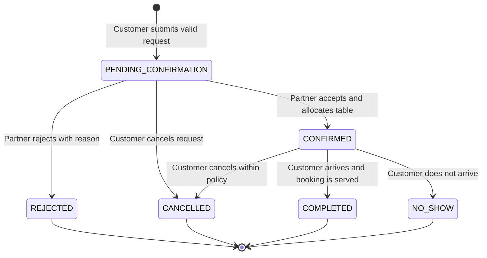

# DineVina Stakeholder View: End-to-End System Pipeline

**Performed by:** Lương Thiện Nhân | **Reviewed by:** Nguyễn Trung Kiên | **Edited by:** Hoàng Cao Phong

**Scope:** Planned DineVina system for Ho Chi Minh City, prepared for PA2 teaching staff and future implementation agents. This document describes the target product design; the current repository scaffold is not evidence that these workflows are implemented.

## 1. Stakeholder perspective and scope

From a stakeholder perspective, DineVina is a two-sided restaurant marketplace for all restaurant types in Ho Chi Minh City. Customers, including individual diners and group or event organizers, can browse without signing in, search nearby restaurants and foods, compare prices and menus, and submit a table or event request for themselves. Restaurant partners manually confirm every reservation request. The platform administrator protects marketplace quality by reviewing partner submissions, moderating content, and handling exceptions.

The diagrams below describe the **target MVP pipeline** for restaurant discovery and table reservation. Event booking, promotions, and AI assistance are shown as extension points because they are in the product scope and roadmap, but are not part of the current implemented scaffold. The current repository contains the web/API foundation and `/api/health`; venue and reservation endpoints are the next delivery surface described by the reservation specification.

## 2. Complete business flow

```mermaid
flowchart TD
	Start([Customer opens DineVina]) --> Channel{Access channel}
	Channel -->|Customer browser| Web[React web application]
	Channel -->|Restaurant partner browser| PartnerWeb[Partner dashboard]
	Channel -->|Platform administrator| AdminWeb[Admin console]

	subgraph CustomerJourney[Customer journey]
		Web --> Account{Signed in?}
		Account -->|No: browsing allowed| Discover[Search restaurants and foods]
		Account -->|Yes| Discover
		Discover --> VenueList[Request venue list]
		VenueList --> VenueAPI[GET /api/venues]
		VenueAPI --> VenueStore[(Venue and catalog data)]
		VenueStore --> VenueCards[Show venue cards: cuisine, price, location, status]
		VenueCards --> SelectVenue[Select a restaurant]
		SelectVenue --> DetailAPI[GET /api/venues/{id}]
		DetailAPI --> DetailStore[(Venue, menu, hours, promotions)]
		DetailStore --> Detail[Show details, menu and operating hours]
		Detail --> Intent{Customer intent}
		Intent -->|Browse only| EndBrowse([Customer leaves or saves venue])
		Intent -->|Reserve for self| Input[Enter date, time, party size, name, phone and basic information]
		Intent -->|Request event service| EventBrief[Enter event date, guest count and requirements]
		EventBrief --> EventRequest[Create event request]
		EventRequest -. Next release .-> PartnerQueue[Partner reviews event request]
		Input --> Availability[Check date, opening hours, capacity and slot]
		Availability --> Available{Slot available?}
		Available -->|No| Alternatives[Show unavailable result and alternative slots]
		Alternatives --> Input
		Available -->|Yes| Review[Review reservation summary and policy]
		Review --> Submit[Submit reservation request]
		Submit --> ReservationAPI[POST /api/reservations]
	end

	subgraph Platform[Platform services]
		ReservationAPI --> Validate[Validate request schema, self-booking rule and business rules]
		Validate --> Valid{Payload valid?}
		Valid -->|No| ValidationError[Return 400/422 with field errors]
		ValidationError --> Input
		Valid -->|Yes| Lock[Atomically hold/check capacity to prevent double booking]
		Lock --> Capacity{Capacity still available?}
		Capacity -->|No| Conflict[Return conflict and ask customer to choose another slot]
		Conflict --> Alternatives
		Capacity -->|Yes| Create[Create reservation with unique ID]
		Create --> Pending[Set status: PENDING_CONFIRMATION]
		Pending --> ReservationStore[(Reservation store)]
		ReservationStore --> NotifyPartner[Notify partner of incoming request]
		ReservationStore --> CustomerPending[Return reservation ID and pending status]
		CustomerPending --> PendingScreen[Show pending confirmation to customer]
		ReservationStore --> Audit[Record timestamps, status changes and ownership]
	end

	subgraph PartnerJourney[Restaurant partner journey]
		PartnerWeb --> PartnerAuth[Authenticate partner and authorize restaurant ownership]
		PartnerAuth --> Manage{Partner action}
		Manage -->|Onboarding| SubmitVenue[Submit venue profile and menu]
		SubmitVenue --> AdminReview[Admin review and moderation]
		AdminReview --> Approved{Approved?}
		Approved -->|No| Revision[Return feedback for correction]
		Revision --> SubmitVenue
		Approved -->|Yes| Publish[Publish venue to discovery catalog]
		Manage -->|Operations| UpdateOps[Update menu, hours, capacity and availability]
		UpdateOps --> CatalogUpdate[Validate and publish operational changes]
		Manage -->|Bookings| PartnerQueue
		NotifyPartner --> PartnerQueue[Show pending reservation in dashboard]
		PartnerQueue --> PartnerDecision{Manual partner decision}
		PartnerDecision -->|Yes| Confirm[Confirm reservation and allocate table]
		PartnerDecision -->|No| Reject[Reject with reason and suggest alternatives]
		Confirm --> ConfirmState[Set status: CONFIRMED]
		Reject --> RejectState[Set status: REJECTED]
		ConfirmState --> NotifyCustomer[Notify customer of confirmation]
		RejectState --> NotifyCustomer
		NotifyCustomer --> CustomerResult[Show final status and reservation details]
	end

	subgraph Lifecycle[After booking]
		CustomerResult --> BeforeVisit{Customer cancels before arrival?}
		BeforeVisit -->|Yes| CancelAPI[POST /api/reservations/{id}/cancel]
		CancelAPI --> CancelRules[Check ownership, status and cancellation policy]
		CancelRules --> CancelValid{Cancellation allowed?}
		CancelValid -->|No| CancelError[Return cancellation error]
		CancelValid -->|Yes| CancelState[Set status: CANCELLED and free capacity]
		CancelState --> NotifyCancellation[Notify customer and partner]
		BeforeVisit -->|No| Visit[Customer arrives at restaurant]
		Visit --> Complete[Partner marks booking completed or no-show]
		Complete --> FinalState[Close reservation lifecycle]
	end

	subgraph FutureServices[Planned intelligent services]
		Discover -. preferences .-> Recommend[AI recommendations with reasons]
		Detail -. questions .-> RAG[RAG assistant using verified venue/menu/policy data]
		SubmitVenue -. image/PDF .-> OCR[Menu OCR creates editable draft]
		OCR -. partner approval required .-> UpdateOps
	end

	style Start fill:#e7f6ec,stroke:#27824b
	style EndBrowse fill:#f4f4f4,stroke:#777
	style FinalState fill:#e7f6ec,stroke:#27824b
	style ValidationError fill:#fff1f0,stroke:#c0392b
	style Conflict fill:#fff1f0,stroke:#c0392b
	style CancelError fill:#fff1f0,stroke:#c0392b
```

### Flow interpretation

1. **Onboarding and publication:** a partner submits venue and menu information. The administrator reviews it before the venue becomes visible to customers. This protects customers from incomplete or misleading listings.
2. **Discovery:** the customer searches the catalog, opens a venue detail page, and sees menu categories, dishes, prices, operating hours, and available reservation choices.
3. **Reservation request:** the system validates the request, checks opening hours and capacity, and uses an atomic operation so two customers cannot receive the same remaining capacity.
4. **Partner decision:** a valid request initially becomes `PENDING_CONFIRMATION`. The partner accepts it and allocates a table, or rejects it with a reason. The customer sees the resulting status rather than assuming that a submitted request is already confirmed.
5. **Lifecycle completion:** the customer may cancel an eligible reservation before arrival. The system records the cancellation timestamp, releases capacity, and informs both parties. The partner later closes the booking as completed or no-show.
6. **Error handling:** invalid fields return `400` or `422`; a missing venue returns `404`; a capacity conflict returns an actionable unavailable result; and an invalid cancellation is rejected without changing state.

## 3. Stakeholder needs and user environment

### 3.1 Stakeholder and user needs

| Stakeholder or user | Need and cause | Priority | Planned product response |
| --- | --- | --- | --- |
| Customer | Find nearby restaurants and the food, price range, cuisine, and amenities that fit the occasion | High | Ho Chi Minh City search, district filters, cuisine/price/party-size filters, venue details and menu search |
| Customer | Know whether a request is actually accepted | High | Explicit `PENDING_CONFIRMATION`, `CONFIRMED`, `REJECTED`, and `CANCELLED` states with history |
| Customer | Submit complete information quickly for a booking for themselves | High | Name, phone number, basic information, date, time and party-size form; browsing remains available without sign-in |
| Customer or event organizer | Coordinate a group or event request that needs more than a standard table | High | Structured event brief, clarification, partner proposal and acceptance flow |
| Restaurant partner | Keep venue, food, menu, price, opening-hour and capacity information accurate | High | Partner-owned profile, menu, availability and promotion management with admin approval |
| Restaurant partner | Decide manually whether each request can be fulfilled | High | Authenticated request queue with capacity context, confirm/reject action and reason history |
| Platform administrator | Keep listings trustworthy and resolve exceptions | High | Onboarding review, correction workflow, moderation, ownership checks and audit history |

These needs explain the system flow, but they are not themselves API steps. Each need is translated into a product response and later into acceptance criteria. For example, “a request is not a confirmed booking” becomes a state-transition rule: the customer sees `PENDING_CONFIRMATION` until an authorized partner manually confirms it.

### 3.2 User environment

| Environment factor | Planned DineVina implication |
| --- | --- |
| Location | Initial examples and filters target Ho Chi Minh City, including manual district selection. |
| Customer devices | Responsive mobile and desktop browsers; customers may use the service while travelling or planning a meal. |
| Partner devices | Primarily a desktop dashboard during service, with mobile status checking when necessary. |
| Connectivity | Intermittent mobile data is expected; forms need clear retry-safe behavior and must avoid duplicate submissions. |
| Discovery access | Customers can browse venue and menu information without signing in; booking requires identity/contact information. |
| Identity boundary | A customer submits a request for themselves using their own name and phone number; booking on behalf of another person is outside the planned flow. |
| Location permission | Geolocation is optional. Manual city/district filters remain available when permission is denied. |
| Privacy | Only information needed for booking and support is exposed to the restaurant partner; sample data must be clearly labeled. |
| Operational timing | Partners manually review incoming requests, while customers need visible status history if confirmation is delayed. |

### 3.3 Alternative competition

The comparison is limited to the two platforms documented in the PA1 survey. The evidence describes visible interface and published service patterns; it does not claim access to competitors' internal systems.

| Alternative | Observed strength | Limitation or design opportunity for DineVina |
| --- | --- | --- |
| PasGo | Strong venue discovery, detailed amenity filters, group-dining consultation, booking forms and partner operations | DineVina can connect group/event requirements to a structured proposal history and make request-versus-confirmed state explicit in one workflow. |
| Eatigo | Time-slot discovery, visible discount conditions, instant-style booking and merchant availability tooling | DineVina can keep conditions and availability visible while focusing on partner-confirmed requests, verified venue data and explainable recommendations rather than discount-led discovery alone. |

The relevant DineVina differentiation is therefore traceable request status, a dedicated event workflow, partner-verified information, and explainable recommendations with ordinary search as a fallback. These are planned capabilities, not claims that the current scaffold has already delivered them.

## 3. Reservation request sequence

This sequence focuses on the highest-value cross-stakeholder transaction: a customer moving from venue discovery to a confirmed or rejected reservation. It includes the alternative paths that matter operationally.

```mermaid
sequenceDiagram
	autonumber
	actor C as Customer
	participant UI as React Web App
	participant API as FastAPI API
	participant Auth as Auth / RBAC
	participant Catalog as Venue & Menu Service
	participant Availability as Availability Service
	participant Store as Reservation Store
	participant Notify as Notification Service
	actor P as Restaurant Partner
	actor A as Platform Admin

	Note over C,A: Target MVP design. Current scaffold only exposes /api/health; the reservation routes are specified for the next implementation slice.

	C->>UI: Open DineVina
	UI->>API: GET /api/venues?filters
	API->>Catalog: Find published venues
	Catalog-->>API: Venue cards
	API-->>UI: 200 OK + venue list
	UI-->>C: Display searchable restaurant results

	C->>UI: Select venue
	UI->>API: GET /api/venues/{venue_id}
	API->>Catalog: Load venue, menu and operating hours
	Catalog-->>API: Venue detail
	API-->>UI: 200 OK + menu and metadata
	UI-->>C: Display details and reservation form

	C->>UI: Enter date, time and party size
	UI->>API: GET availability for selected slot
	API->>Availability: Check hours, capacity and existing holds
	Availability-->>API: Available slots or unavailable reason
	API-->>UI: Availability result

	alt Slot unavailable
		UI-->>C: Show reason and alternative slots
		C->>UI: Choose another slot
	else Slot available
		C->>UI: Submit contact details and reservation
		UI->>API: POST /api/reservations
		API->>Auth: Verify customer identity and request ownership
		Auth-->>API: Authorized
		API->>API: Validate Pydantic schema and business rules

		alt Invalid payload
			API-->>UI: 422 Unprocessable Entity
			UI-->>C: Highlight missing or invalid fields
		else Valid payload
			API->>Store: Atomically check capacity and create reservation

			alt Capacity changed before commit
				Store-->>API: Conflict: no remaining capacity
				API-->>UI: 409 Conflict + alternatives
				UI-->>C: Ask customer to select another slot
			else Reservation created
				Store-->>API: Reservation ID + PENDING_CONFIRMATION
				API->>Notify: Send partner request notification
				Notify-->>P: New reservation request
				API-->>UI: 201 Created + reservation details
				UI-->>C: Show pending confirmation and reservation ID

				P->>UI: Open partner dashboard
				UI->>API: GET pending reservations
				API->>Auth: Verify partner role and venue ownership
				Auth-->>API: Authorized
				API->>Store: Read pending reservation
				Store-->>API: Reservation request
				API-->>UI: Request details
				UI-->>P: Show customer request and capacity impact

				alt Partner accepts
					P->>UI: Confirm and allocate table
					UI->>API: POST /api/reservations/{id}/confirm
					API->>Auth: Verify partner owns venue
					Auth-->>API: Authorized
					API->>Store: Atomically set CONFIRMED
					Store-->>API: Confirmed reservation
					API->>Notify: Send confirmation
					Notify-->>C: Reservation confirmed
					API-->>UI: 200 OK + CONFIRMED
					UI-->>P: Show confirmed booking
				else Partner rejects
					P->>UI: Reject with reason
					UI->>API: POST /api/reservations/{id}/reject
					API->>Auth: Verify partner owns venue
					Auth-->>API: Authorized
					API->>Store: Set REJECTED and record reason
					Store-->>API: Rejected reservation
					API->>Notify: Send rejection and alternatives
					Notify-->>C: Reservation rejected with reason
					API-->>UI: 200 OK + REJECTED
					UI-->>P: Show completed decision
				end
			end
		end
	end

	opt Customer cancels an active reservation
		C->>UI: Select Cancel reservation
		UI->>API: POST /api/reservations/{id}/cancel
		API->>Auth: Verify customer owns reservation
		Auth-->>API: Authorized
		API->>Store: Check policy and set CANCELLED
		alt Cancellation allowed
			Store-->>API: Cancelled + capacity released
			API->>Notify: Send cancellation notice
			Notify-->>P: Customer cancellation
			Notify-->>C: Cancellation confirmed
			API-->>UI: 200 OK + CANCELLED
		else Cancellation not allowed
			Store-->>API: Invalid lifecycle transition
			API-->>UI: 409 Conflict or 422 policy error
			UI-->>C: Explain why cancellation is unavailable
		end
	end

	opt Partner onboarding before publication
		P->>UI: Submit venue profile and menu
		UI->>API: POST partner venue draft
		API->>Auth: Verify partner role
		Auth-->>API: Authorized
		API->>Store: Save draft as pending review
		Store-->>API: Draft created
		API-->>A: Queue venue for moderation
		A->>API: Approve or request changes
		API->>Store: Publish approved venue or return revision notes
		Store-->>API: Updated publication status
	end
```

## 4. Stakeholder responsibilities and system boundaries

| Stakeholder | Main responsibility | System response or control |
| --- | --- | --- |
| Customer | Discover, inspect, request, track, and cancel a reservation | Clear statuses, validation errors, alternatives, and notifications |
| Restaurant partner | Maintain accurate venue data and decide whether requests can be accepted | Ownership checks, partner dashboard, capacity controls, audit trail |
| Platform admin | Moderate onboarding and resolve support or policy issues | Approval queue, revision workflow, and moderation visibility |
| DineVina platform | Coordinate catalog, availability, reservation state, and notifications | REST API, validation, atomic state transitions, and role-based authorization |

## 5. Reservation state lifecycle



The state transition is the key business control: the API must reject illegal transitions, preserve timestamps and reasons, and release capacity whenever a held or confirmed booking is cancelled. Persistence is currently represented by the planned thread-safe store abstraction and is intended to migrate to PostgreSQL in a later foundation slice.

## 6. Evidence and traceability

The stakeholder analysis is grounded in the following project evidence:

| Claim or design input | Evidence source | Status |
| --- | --- | --- |
| Customer, partner and administrator roles | `docs/product-scope.md` and the PA2 Vision source archive | Planned product scope |
| PasGo and Eatigo comparison | `docs/weekly-reports/Week1/Nhan-ExistingAppSurvey/Nhan.md` and `docs/ans/PA2-Group08/evidence/pa1-survey/` | Survey-backed observation |
| HCMC discovery and manual district filtering | PA2 Vision stakeholder/environment section | Planned requirement |
| Reservation states and partner confirmation | `src/specs/001-reservation-api/spec.md` and `docs/ans/PA2-Group08/evidence/sources/` | Contract/design evidence; implementation not claimed |
| PA2 work allocation and stakeholder ownership | `docs/ans/PA2-Group08/meeting-minutes/2026-10-23-Work-Allocation.md` | Team process evidence |
| PA2 meeting and training completion declaration | `docs/ans/PA2-Group08/meeting-minutes/Scrum-Meetings.md` and `Spec-Kit-Training.md` | Team-confirmed with source limitations |

The separate evidence archive records the current source revision, Trello exports, local validation, training summary and AI-use report. Individual screenshots or logs may be added under `docs/ans/PA2-Group08/evidence/training/<member>/` without changing the product design described here. No missing screenshot or unrecorded meeting detail is inferred by this report.
