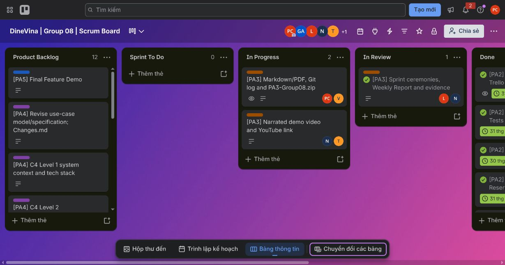
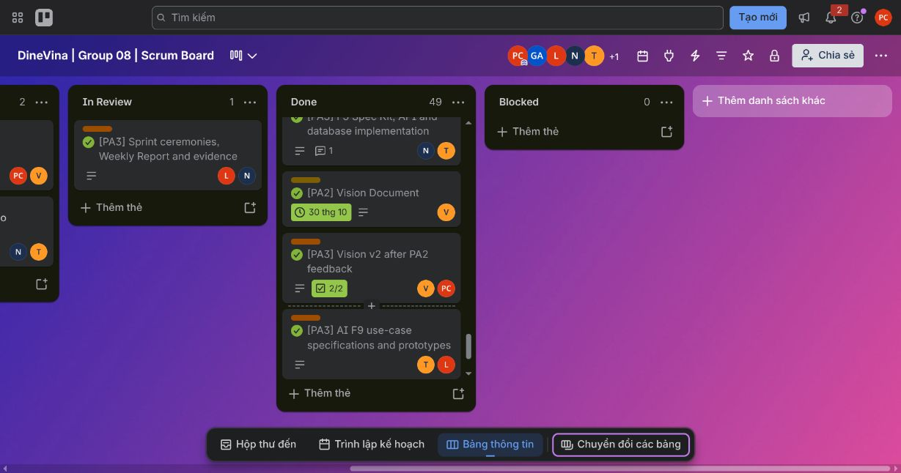
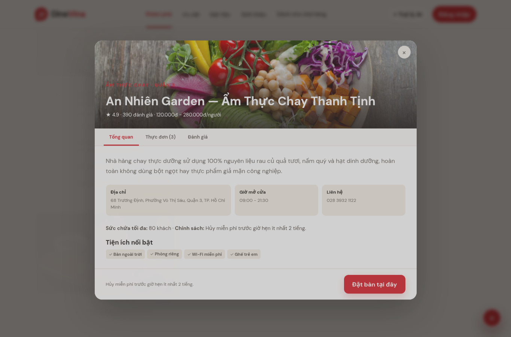

# DineVina Weekly Report Sprint 3 PA3
**Performed by:** Lương Thiện Nhân and Hoàng Cao Phong | **Reviewed by:** Group 08 representative | **Edited by:** Hoàng Cao Phong

## Sprint goal and team
**Performed by:** Lương Thiện Nhân and Hoàng Cao Phong | **Reviewed by:** Group 08 representative | **Edited by:** Hoàng Cao Phong

The five-member team prepared revised Plan and Vision documents, a 44-requirement use-case model with customer, partner, administrator and AI specifications, prototype images, and an F3 restaurant discovery vertical slice. The supplementary meeting minutes were prepared on 14 November from attendee confirmation and project artifacts; no contemporaneous notes were kept.

## 5 November 2026
**Performed by:** Lương Thiện Nhân and Hoàng Cao Phong | **Reviewed by:** Group 08 representative | **Edited by:** Hoàng Cao Phong

All five members attended according to the group representative. Sprint scope and ownership were allocated. See `meeting-minutes/PA3-Reconstructed-Meetings.md` for the summarized agenda, assignments and actions.

## 12 November 2026
**Performed by:** Lương Thiện Nhân and Hoàng Cao Phong | **Reviewed by:** Group 08 representative | **Edited by:** Hoàng Cao Phong

All five members attended according to the group representative. The supplementary check-in account tracks Plan/Vision, use cases, F3 code, fixture and demo preparation. No verbatim member statements were recorded.

## Verified work and open items as of 14 November
**Performed by:** Hoàng Cao Phong | **Reviewed by:** Group 08 representative | **Edited by:** Hoàng Cao Phong

| Item | Status and evidence |
| --- | --- |
| Plan v2 and one Changes file | Integrated in this package; Plan and Vision changes in separate sections. |
| Vision and use cases | Master model, customer, partner/admin and AI specifications plus prototype files included. F9 identifiers normalized to `UC-AI01`–`UC-AI03`. |
| F3 backend | `ruff check backend` passed. On fresh local PostgreSQL 17, `pytest -q -rs` returned 25 passed, 2 skipped; approved-only API responses and persisted rows were checked. See `PostgreSQL-Local-Verification`. Remote Supabase checks were skipped. |
| F3 frontend | Built with `npm run build`; API failure now shows an error rather than hard-coded discovery results. A local browser smoke check loaded 8 API-backed venues, opened a venue detail panel, and recorded no page errors. |
| Video | Narrated F3 demo uploaded Unlisted on 14 November 2026: https://youtu.be/zDdyh3pvxeM. Watch-page playback and public title metadata verified; screenshot in `evidence/YouTube-Unlisted-Playback.jpg`. |
| Local PostgreSQL verification | Completed on PostgreSQL 17; 11 persisted venues (8 approved) and 21 dishes. See `PostgreSQL-Local-Verification`. Remote Supabase deployment remains unverified. |
| Trello screenshots | Dated board and Done-list captures are in `evidence/`. The group representative confirms the instructor accepted Trello instead of Jira; no separate instructor message is attached. See figures below. |
| Sprint Review confirmation |  
  **Note:** Record actual review meeting and outcome if held. |

## Retrospective observations
**Performed by:** Hoàng Cao Phong | **Reviewed by:** Group 08 representative | **Edited by:** Hoàng Cao Phong

Integrating source after the F3 backend merge exposed lint failures and an incomplete frontend in `dev`. The local fixes and frontend build are recorded above. The remaining verification gap is the remote Supabase deployment. No separate actual Sprint Review record was supplied; neither item is claimed complete.

## PA3 Trello evidence
**Performed by:** Hoàng Cao Phong | **Reviewed by:** Group 08 representative | **Edited by:** Hoàng Cao Phong

## F3 browser evidence
**Performed by:** Hoàng Cao Phong | **Reviewed by:** Group 08 representative | **Edited by:** Hoàng Cao Phong

Local browser smoke test on 14 November 2026: 8 approved venues appeared and the selected venue detail matched the API result.

