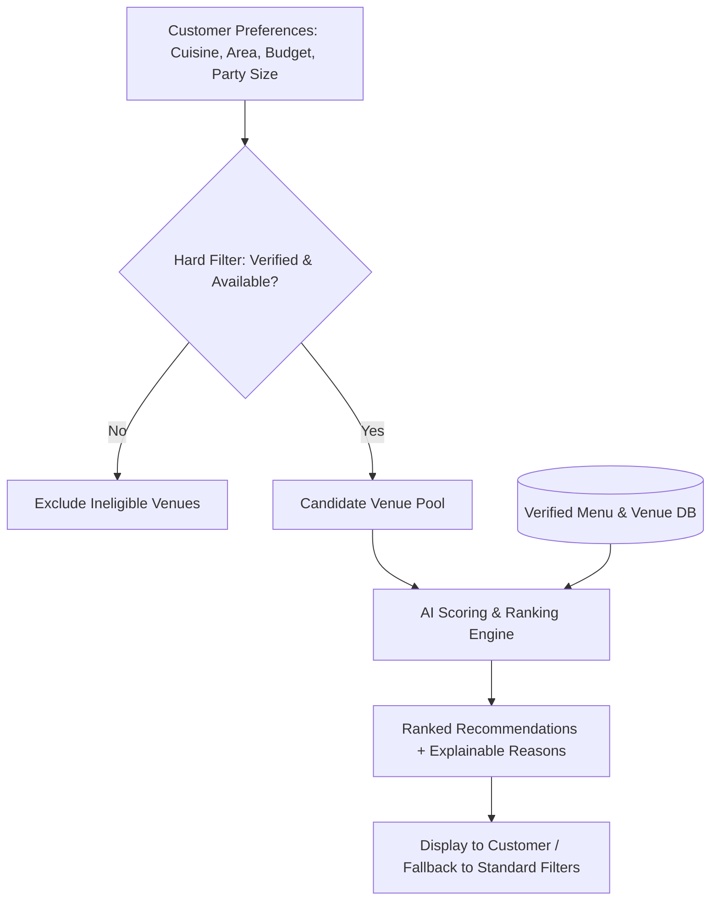
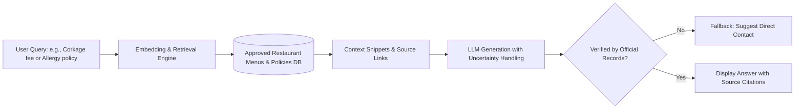
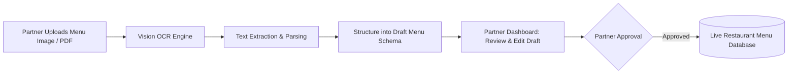

### 3.4. AI Feature and Staged Delivery

#### 1. Explainable Restaurant Recommendation (Core Sprint Feature)

*   **Description & Practical Value:** Customers often struggle to filter through dozens of options when planning group dinners or specific occasions. This feature takes natural user preferences (cuisine, geographic area, price range, group size, and occasion type) and computes a matching score against verified restaurant attributes. Crucially, instead of acting as a black box, the system generates transparent, human-readable explanations for each recommendation. This significantly reduces decision fatigue and builds user trust.
*   **Architecture & Evaluation:** The system applies a hard-filtering pipeline to eliminate unavailable or unverified venues, followed by a scoring algorithm over the candidate pool. Performance is evaluated using a small labeled set of realistic test queries to measure ranking quality and minimize bad recommendations. If AI suggestions do not align with user needs, customers can seamlessly fall back to standard manual filters.
*   **Architecture and Workflow:**

#### 2. Retrieval-Based Menu & Policy Assistant (Future Expansion Slice)

*   **Description & Practical Value:** Users frequently have specific questions regarding restaurant policies. This conversational assistant uses Retrieval-Augmented Generation (RAG) to query approved restaurant documents, menus, and policy records directly. It provides precise answers complete with source links back to the official menu or venue profile.
*   **Safety & Guardrails:** To prevent hallucinations (fabricated facts), the assistant includes strict uncertainty handling: if an answer cannot be verified from the approved records, it refuses to guess and prompts the user to contact the restaurant directly. Generated responses must never be published without human review.
*   **Retrieval and Guardrail Workflow:**

#### 3. AI-Powered Menu Digitization / OCR (Partner Workflow Enhancement)

*   **Description & Practical Value:** Restaurant partners often struggle with manually inputting dozens of dishes, descriptions, and prices into the platform when onboarding. This feature allows partners to upload an image or PDF scan of their physical menu. The OCR and vision-language model parses the text, extracts dish names, categories, and pricing, and structures them into an editable draft form in the partner dashboard.
*   **Workflow & Data Safety:** The AI output serves purely as a preliminary draft. Partners must review, edit, and approve each item before it goes live on the platform, ensuring no inaccurate pricing or unverified dishes are published to customers.
*   **Partner Digitization Workflow:**

