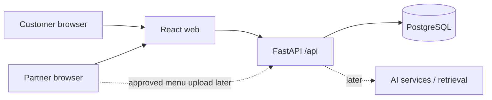

# Architecture (Working Draft)

The scaffold currently connects the browser to `/api/health`; database integration and AI services are future work. The web Docker image uses Nginx to serve the built app and proxy `/api` to the API container. Vite provides the same proxy during local development.

Suggested backend domains: `auth`, `restaurants`, `menus`, `availability`, `reservations`, `events`, `promotions`, and `ai`. Create each module when implementing its first use case; avoid empty code directories. Keep database migrations versioned once persistence is introduced. Uploaded menus and models require external object storage or dedicated volumes and should never be committed.

Security baseline for the first real feature: role-based authorization for partner/admin operations, validation of uploaded files, explicit ownership of each restaurant, rate limits on public and AI endpoints, and no secrets in source. Decide retention and consent rules before storing customer or image data.
