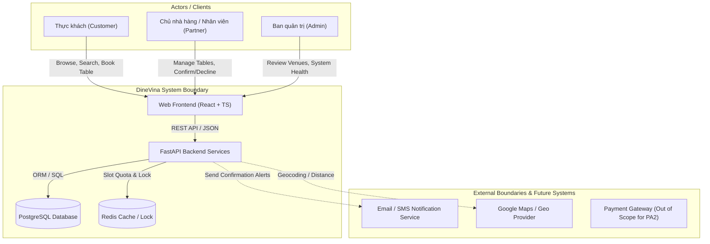

# PA2 Deliverables & Product Overview - Nguyễn Trung Kiên

* **Sprint / Milestone:** PA2 (Week 3 - Week 4)
* **Author / Owner:** Nguyễn Trung Kiên (Backend Engineer) - `ntkien2418@clc.fitus.edu.vn`
* **Assigned Scope:** 
  1. RUP Vision Document - Section 4: Product Overview (`Product Perspective`, `Assumptions & Dependencies`)
  2. Core MVP API Specifications (`[PA2] Discovery and Reservation API Contract`)
  3. AI-Assisted Engineering Training (`[PA2] Spec Kit Training - Kien`)
  4. Integration & Test Verification (`[PA2] Integration Build and Tests`)

---

## 1. Directory & Deliverables Navigation

Tất cả tài liệu và sản phẩm bàn giao của Kiên trong giai đoạn PA2 (bao gồm toàn bộ công việc thực hiện trong Tuần 2 và giai đoạn chuẩn bị PA2) được tổ chức và lưu trữ tập trung tại thư mục `docs/weekly-reports/PA2_Week3-4/Kien_ProductOverview/`:

| STT | Tài liệu / Hạng mục | Đường dẫn | Trạng thái |
|:---:|:---|:---|:---:|
| 1 | **Tài liệu tổng hợp & Product Overview** | [kien.md](./kien.md) | In Progress |
| 2 | **Discovery and Reservation API Contract** | [Kien_APIContract/Discovery-and-Reservation-API-Contract.md](./Kien_APIContract/Discovery-and-Reservation-API-Contract.md) | Completed (Draft) / Pending Peer Review |
| 3 | **Spec Kit Training Record & Evidence** | [Kien_SpecKit/Spec-Kit-Training.md](./Kien_SpecKit/Spec-Kit-Training.md) | Completed & Verified (100%) |
| 4 | **Integration Build & Test Report** | *(Scheduled for Nov 04)* | Planned |

---

## 2. RUP Vision Document - Section 4: Product Overview

*(Đóng góp trực tiếp vào tài liệu Vision chung của nhóm theo chuẩn Rational Unified Process)*

### 4.1. Product Perspective

DineVina là nền tảng marketplace dạng **B2B2C** kết nối ba nhóm đối tượng người dùng chính: **Thực khách (Customer/Diner)**, **Đối tác nhà hàng (Restaurant Partner)**, và **Quản trị viên nền tảng (Administrator)**.

Hệ thống DineVina hoạt động như một hệ thống độc lập (independent web application) với kiến trúc Client-Server hiện đại:
* **Frontend Client:** Ứng dụng web React SPA (Single Page Application) viết bằng TypeScript, tối ưu hóa cho trải nghiệm tìm kiếm, duyệt menu và đặt bàn mượt mà trên cả trình duyệt máy tính và thiết bị di động.
* **Backend Core:** Dịch vụ web RESTful API xây dựng bằng Python (FastAPI), chịu trách nhiệm điều phối toàn bộ nghiệp vụ đặt bàn, xử lý truy vấn tìm kiếm, quản lý phân quyền và kiểm soát giao dịch (ACID transactions).
* **Database & Cache:** Hệ quản trị cơ sở dữ liệu quan hệ PostgreSQL lưu trữ toàn bộ dữ liệu thực thể (nhà hàng, bàn, khung giờ, đơn đặt bàn, tài khoản) cùng Redis làm bộ nhớ đệm phục vụ khóa phân tán (distributed slot lock) chống double-booking.

#### Các giao tiếp ngoại vi (External System Interfaces):
1. **Dịch vụ thông báo (Notification Services):** Gửi email/tin nhắn xác nhận đơn đặt bàn hoặc thông báo hủy đến thực khách và đối tác.
2. **Dịch vụ bản đồ (Geocoding / Maps):** Cung cấp tọa độ và hiển thị vị trí nhà hàng theo quận/thành phố phục vụ tính năng tìm kiếm theo vị trí.
3. **Phạm vi loại trừ (Out of Scope):** Cổng thanh toán trực tuyến (Payment Gateway), hệ thống POS (Point of Sale), và quản lý kho vận / kế toán nội bộ nhà hàng nằm ngoài phạm vi cốt lõi của PA2.

---

### 4.2. Assumptions and Dependencies (Giả định và Phụ thuộc)

#### Giả định kỹ thuật & vận hành (Assumptions):
1. **Môi trường kết nối mạng:** Người dùng (cả thực khách và đối tác) luôn có kết nối Internet ổn định trong quá trình gửi yêu cầu và xác nhận đặt bàn.
2. **Khung giờ xác nhận của đối tác:** Đối tác nhà hàng cam kết phản hồi xác nhận hoặc từ chối yêu cầu đặt bàn trong khoảng thời gian quy định (mặc định 30 phút); nếu quá thời hạn, hệ thống tự động chuyển trạng thái đơn sang hết hạn (`EXPIRED`).
3. **Chính sách hủy bàn:** Thực khách chỉ được phép hủy bàn trực tuyến tối thiểu trước 2 giờ so với giờ hẹn (`cancellation cutoff >= 2h`). Sau thời hạn này, hệ thống khóa hủy online và yêu cầu liên hệ trực tiếp hotline nhà hàng.

#### Ràng buộc & Sự phụ thuộc (Dependencies):
1. **Container hóa:** Toàn bộ dịch vụ backend, frontend, và database phải khởi chạy nhất quán thông qua Docker Compose nhằm đảm bảo tính tái lập (reproducibility) trong các đợt kiểm thử tích hợp.
2. **Mô hình dữ liệu và Hợp đồng API:** Giao diện frontend React phụ thuộc chặt chẽ vào cấu trúc dữ liệu trả về từ các endpoint được đặc tả trong [Discovery-and-Reservation-API-Contract.md](./Kien_APIContract/Discovery-and-Reservation-API-Contract.md).

---

## 3. Trello Task Tracking & Status Audit

Chi tiết kết quả rà soát trạng thái 3 thẻ công việc được giao trên Trello board:

| Thẻ công việc (Trello Card) | Người thực hiện / Phản biện | Hạn chót (Due Date) | Trạng thái hiện tại | Đánh giá chi tiết |
|:---|:---|:---:|:---:|:---|
| **[PA2] Discovery and Reservation API Contract** | Owner: **Kiên** Reviewer: **Ngọc** | 02 Nov 2026 | **Đã hoàn thành soạn thảo** *(Chờ Peer Review)* | Toàn bộ 7 phần đặc tả, sơ đồ máy trạng thái (7 states), 5 REST endpoints và 10 kịch bản test tự động đã hoàn thiện 100% tại `Kien_APIContract`. Chờ bạn Ngọc review và ký duyệt. |
| **[PA2] Spec Kit Training - Kien** | Owner: **Kiên** Reviewer: **Phong** | 30 Oct 2026 | **Đã hoàn thành 100%** *(Sẵn sàng nghiệm thu)* | Đã hoàn thành toàn bộ 6 bước tutorial với `specify-cli`, tạo workspace thực hành `speckit-tutorial/` với Constitution, Feature Spec, Plan, Tasks, và chạy kiểm thử tự động `pytest` (8/8 passed). |
| **[PA2] Integration Build and Tests** | Owner: **Kiên** Reviewer: **Phong** | 04 Nov 2026 | **Chưa thực hiện** *(Theo kế hoạch)* | Chạy build tích hợp frontend + backend tests sau khi API contract được duyệt. Ghi nhận commit hash, log test `pytest`, smoke test browser và known gaps. |

