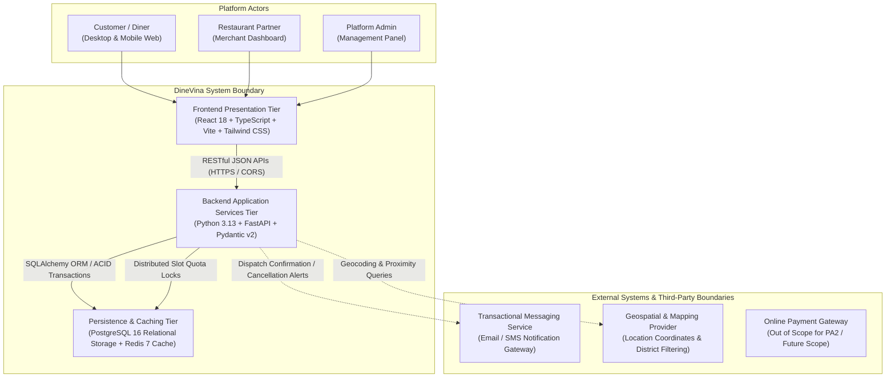

# Product Overview — PA2 Deliverable

**Project:** DineVina — Smart Restaurant Reservation and Event Booking Marketplace (Group 08)  
**Author:** Nguyễn Trung Kiên (Backend Engineer; Student ID: 24127068)  
**Deliverable Scope:** Rational Unified Process (RUP) Vision Document — Section 4: Product Overview  
**Sprint / Milestone:** PA2 (Week 3 – Week 4)  
**Reviewer:** Hoàng Cao Phong (Scrum Master / Project Manager)  

---

## 1. Executive Summary

This document establishes the official **Product Overview** specification for DineVina under the Rational Unified Process (RUP) Vision framework for Project Assignment 2 (PA2). It defines the system perspective, architectural context, external interfaces, operational assumptions, and critical technical dependencies governing the platform.

In parallel with this architectural overview, backend engineering deliverables authored by Nguyễn Trung Kiên for PA2 include:
1. **Core API Contract Specification:** Complete RESTful definitions, state machine transitions, and automated test matrices for Restaurant Discovery and Table Reservation lifecycles.
2. **AI-Assisted Engineering (Spec Kit Training):** Formal adoption of GitHub Spec Kit for Spec-Driven Development (SDD), establishing project constitution guardrails, feature specifications, and automated verification suites.

---

## 2. Product Perspective

### 2.1. System Context & Marketplace Model

DineVina is architected as an independent, cloud-native **B2B2C restaurant discovery, table reservation, and culinary event booking marketplace**. The platform bridges three distinct actor groups through unified, responsive web interfaces:
* **Customers (Diners):** Search and filter verified restaurants, check real-time table availability, submit booking requests, pre-order selected menus, and manage reservation lifecycles.
* **Restaurant Partners (Venues):** Manage venue operational profiles, configure dining capacity and service time slots, review and confirm/decline reservation requests, and administer table check-ins.
* **Platform Administrators:** Supervise partner onboarding, monitor platform health, review catalog compliance, and maintain overall marketplace integrity.

The system operates autonomously without relying on legacy on-premise restaurant management hardware, lowering adoption friction for Vietnamese culinary establishments.

### 2.2. Architectural Context & System Boundaries

The platform adopts a modern, decoupled Client-Server architecture containerized via Docker Compose:

### 2.3. System Interfaces

1. **User Interface (Presentation Layer):**
   * Responsive Single-Page Application (SPA) developed with React, TypeScript, and Vite.
   * Tailored views for consumer discovery, booking forms, partner table management dashboards, and administrator moderation panels.
2. **Software Interfaces (Application Layer):**
   * **FastAPI Web Framework:** High-performance asynchronous REST endpoints complying with OpenAPI 3.1 standards.
   * **Pydantic Schemas:** Strict runtime payload validation, enforcing ISO 8601 timestamps, standardized pagination envelopes, and Vietnamese mobile phone number constraints.
   * **Object-Relational Mapping (ORM):** SQLAlchemy 2.0 managing domain entities and relational mappings with schema migration versioning.
3. **Database & Persistence Interfaces:**
   * **PostgreSQL Database:** Primary relational store maintaining ACID transactions for reservation bookings, user credentials, restaurant catalogs, and slot capacity.
   * **Redis Cache:** Low-latency key-value storage managing temporary hold locks during the booking request window to prevent concurrent overbooking.
4. **External Service Interfaces:**
   * **Notification Gateway:** Webhook and SMTP/SMS integration triggering transactional notifications upon reservation status transitions.
   * **Geospatial Mapping Provider:** Geocoding service resolving administrative districts (e.g., District 1, Binh Thanh) and distance coordinates.
   * **Explicit Scope Exclusions (Out of Scope for PA2):** Full Point-of-Sale (POS) hardware integration, internal kitchen display systems (KDS), inventory warehousing, complex accounting ledger systems, and native mobile applications (iOS/Android) are explicitly excluded from the MVP scope.

---

## 3. Assumptions and Dependencies

### 3.1. Operational & Business Assumptions

1. **Continuous Network Connectivity:** Both diners and restaurant staff operate devices with stable broadband or cellular internet access during reservation submission and confirmation interactions.
2. **Partner Response Time SLA:** Restaurant partners are assumed to review and confirm or decline incoming booking requests within an agreed operational window (default: 30 minutes). Unacknowledged requests automatically transition to an expired state (`EXPIRED`) to safeguard diner experience.
3. **Cancellation Policy Enforcement:** Diners are permitted to cancel confirmed reservations online strictly prior to a minimum cutoff threshold (default: at least 2 hours before the reserved time). Cancellations requested within the 2-hour window are locked online, directing the diner to contact the venue directly.
4. **Slot Granularity:** Dining availability is segmented into standardized 30-minute operational time slots (e.g., 18:00, 18:30, 19:00) with predefined maximum guest quotas per interval.

### 3.2. Technical Constraints and Dependencies

1. **Containerized Deployment Consistency:** All core services (FastAPI backend, React frontend, and PostgreSQL database) must run consistently under Docker Compose, guaranteeing environment parity between developer local workstations and continuous integration (CI) test runners.
2. **OpenAPI Schema Contract Compliance:** Frontend client modules and automated integration test harnesses depend strictly on the contract shapes, path conventions, and error response envelopes formalized in the backend API specifications.
3. **Python Runtime & Package Ecosystem:** The backend is dependent on Python 3.13+, FastAPI, Pydantic v2, and standard ASGI servers (`uvicorn`), ensuring compatibility across modern Linux container distributions and Windows development environments.

---

## 4. Deliverables Index & Traceability Matrix

The engineering artifacts authored by Nguyễn Trung Kiên supporting the PA2 milestone are organized as follows:

| Deliverable Name | Target Path / Reference | Primary Focus | Status |
|:---|:---|:---|:---:|
| **Product Overview (This Document)** | `docs/weekly-reports/PA2_Week3-4/Kien_ProductOverview/kien.md` | RUP Vision Section 4 (System Perspective, Boundaries, Assumptions & Dependencies) | **Completed** |
| **Discovery & Reservation API Contract** | `docs/weekly-reports/PA2_Week3-4/Kien_ProductOverview/Kien_APIContract/Discovery-and-Reservation-API-Contract.md` | 7-state reservation lifecycle, 5 REST endpoints, OpenAPI schemas, and 10 Given-When-Then automated test scenarios | **Completed (Draft for Peer Review)** |
| **Spec Kit Training & SDD Verification** | `docs/weekly-reports/PA2_Week3-4/Kien_ProductOverview/Kien_SpecKit/Spec-Kit-Training.md` | GitHub Spec Kit workflow execution, DineVina constitution, feature specs, and 8/8 passing automated tests | **Completed & Verified** |

---
