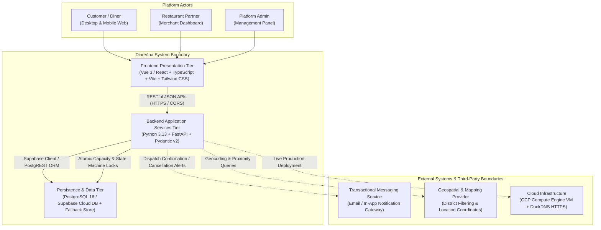

# Product Overview & Non-Functional Requirements — PA2 Deliverable

**Project:** DineVina — Smart Restaurant Reservation and Event Booking Marketplace (Group 08)  
**Author:** Nguyễn Trung Kiên (Backend Engineer; Student ID: 24127068)  
**Deliverable Scope:** Rational Unified Process (RUP) Vision Document — Section 4: Product Overview & Section 6: Non-Functional Requirements  
**Sprint / Milestone:** PA2 (Week 3 – Week 4)  
**Reviewer:** Trương Khánh Duy (AI Engineer / Peer Reviewer)  
**Edited by:** Nguyễn Trung Kiên  

---

## 1. Executive Summary
*Performed by: Nguyễn Trung Kiên | Reviewed by: Trương Khánh Duy | Edited by: Nguyễn Trung Kiên*

This document establishes the official **Product Overview** and **Non-Functional Requirements (NFR)** specifications for DineVina under the Rational Unified Process (RUP) Vision framework for Project Assignment 2 (PA2). It defines the system perspective, architectural context, external interfaces, operational assumptions, critical technical dependencies, and quantifiable quality attributes governing the platform.

In parallel with this Vision specification, backend engineering deliverables authored by Nguyễn Trung Kiên for PA2 include:
1. **Core API Contract Specification:** Complete RESTful definitions, 7-state machine transitions, and automated test matrices for Restaurant Discovery and Table Reservation lifecycles.
2. **Backend & Database Prototype Implementation:** Production-ready FastAPI services containerized via Docker and integrated with PostgreSQL / Supabase persistence (verified on branch `demo/supabase-integration`, passing 8/8 automated test suites).
3. **AI-Assisted Engineering (Spec Kit Training):** Formal adoption of GitHub Spec Kit for Spec-Driven Development (SDD), establishing project constitution guardrails, feature specifications, and automated verification suites.

---

## 2. Product Perspective
*Performed by: Nguyễn Trung Kiên | Reviewed by: Trương Khánh Duy | Edited by: Nguyễn Trung Kiên*

### 2.1. System Context & Marketplace Model

DineVina is architected as an independent, cloud-native **B2B2C restaurant discovery, table reservation, and culinary event booking marketplace**. The platform bridges three distinct actor groups through unified, responsive web interfaces:
* **Customers (Diners):** Search and filter verified restaurants, check real-time table availability, submit booking requests, pre-order selected menus, and manage reservation lifecycles.
* **Restaurant Partners (Venues):** Manage venue operational profiles, configure dining capacity and service time slots, review and confirm/decline reservation requests, and administer table check-ins.
* **Platform Administrators:** Supervise partner onboarding, monitor platform health, review catalog compliance, and maintain overall marketplace integrity.

The system operates autonomously without relying on legacy on-premise restaurant management hardware, lowering adoption friction for Vietnamese culinary establishments.

### 2.2. Architectural Context & System Boundaries

The platform adopts a modern, decoupled Client-Server architecture containerized via Docker Compose:

### 2.3. System Interfaces

1. **User Interface (Presentation Layer):**
   * Responsive Single-Page Application (SPA) supporting desktop and mobile viewports.
   * Tailored views for consumer discovery, booking modals, partner reservation queues, and administrator moderation panels.
2. **Software Interfaces (Application Layer):**
   * **FastAPI Web Framework:** High-performance asynchronous REST endpoints complying with OpenAPI 3.1 standards.
   * **Pydantic Schemas:** Strict runtime payload validation, enforcing ISO 8601 timestamps, standardized pagination envelopes, and Vietnamese mobile phone number constraints.
   * **Supabase Python Client:** PostgREST abstraction layer interacting with managed PostgreSQL tables with graceful in-memory fallback.
3. **Database & Persistence Interfaces:**
   * **PostgreSQL (Supabase Managed):** Primary relational store maintaining ACID transactions for reservations, user profiles, venue catalogs, dish menus, and capacity time slots.
   * **Concurrency Protection:** Database-level check constraints and row-level locking preventing double-booking during simultaneous request submissions.
4. **External Service Interfaces:**
   * **Notification Gateway:** Dispatches immediate confirmation/cancellation alerts to diners and venue managers upon state transitions.
   * **Geospatial Mapping Provider:** Resolves administrative districts (e.g., District 1, District 3, Binh Thanh) and proximity filters.
   * **Explicit Scope Exclusions (Out of Scope for PA2):** Full Point-of-Sale (POS) hardware integration, internal kitchen display systems (KDS), inventory warehousing, complex accounting ledger systems, and native mobile applications (iOS/Android) are explicitly excluded from the MVP scope.

---

## 3. Assumptions and Dependencies
*Performed by: Nguyễn Trung Kiên | Reviewed by: Trương Khánh Duy | Edited by: Nguyễn Trung Kiên*

### 3.1. Operational & Business Assumptions

1. **Continuous Network Connectivity:** Both diners and restaurant staff operate devices with stable broadband or cellular internet access during reservation submission and confirmation interactions.
2. **Partner Response Time SLA:** Restaurant partners are assumed to review and confirm or decline incoming booking requests within an agreed operational window (default: 30 minutes). Unacknowledged requests automatically transition to an expired state (`EXPIRED`) to safeguard diner experience.
3. **Cancellation Policy Enforcement:** Diners are permitted to cancel confirmed reservations online strictly prior to a minimum cutoff threshold (default: at least 2 hours before the reserved time). Cancellations requested within the 2-hour window are locked online, directing the diner to contact the venue directly.
4. **Slot Granularity:** Dining availability is segmented into standardized 30-minute operational time slots (e.g., 18:00, 18:30, 19:00) with predefined maximum guest quotas per interval.

### 3.2. Technical Constraints and Dependencies

1. **Containerized Deployment Consistency:** All core services (FastAPI backend, frontend client, and persistence services) run consistently under Docker Compose, guaranteeing environment parity between developer local workstations and continuous integration (CI) test runners.
2. **OpenAPI Schema Contract Compliance:** Frontend client modules and automated integration test harnesses depend strictly on the contract shapes, path conventions, and error response envelopes formalized in the backend API specifications.
3. **Python Runtime & Package Ecosystem:** The backend is dependent on Python 3.13+, FastAPI, Pydantic v2, and standard ASGI servers (`uvicorn`), ensuring compatibility across modern Linux container distributions and Windows development environments.

---

## 4. Non-Functional Requirements (NFR)
*Performed by: Nguyễn Trung Kiên | Reviewed by: Trương Khánh Duy | Edited by: Nguyễn Trung Kiên*

To satisfy PA2 engineering guidelines and guarantee a robust, reliable user experience, the system enforces the following quantifiable non-functional requirements:

### 4.1. Performance & Latency Requirements

| Metric ID | Requirement Scope | Target Threshold (Quantifiable) | Evaluation Method / Verification |
|:---|:---|:---|:---|
| **NFR-PERF-01** | Restaurant Search & Filtering (Group 3) | 95th percentile response time ($p95$) $\le 300\text{ ms}$ under typical concurrency (50 requests/sec). | Automated load testing (`locust` / `pytest-benchmark`) against indexed PostgreSQL database. |
| **NFR-PERF-02** | Table Reservation Submission (Group 5) | $p95$ latency $\le 500\text{ ms}$; capacity quota check and reservation record insertion completed within a single atomic transaction. | Pytest integration tests simulating concurrent booking requests. |
| **NFR-PERF-03** | Frontend Initial Page Load | First Contentful Paint (FCP) $< 1.5\text{ s}$ and Time to Interactive (TTI) $< 2.0\text{ s}$ on standard 4G connections. | Google Lighthouse audit on production build artifacts. |
| **NFR-PERF-04** | API List Pagination | All collection endpoints (`/api/venues`, `/api/reservations`) enforce pagination with default page size of 20 items (maximum 50 items/page). | Backend schema test asserting `page` and `limit` envelope parameters. |
| **NFR-PERF-05** | Notification Dispatch Latency | In-app notification available in $< 1.0\text{ s}$; outbound transactional email dispatched in $< 30\text{ s}$ from state trigger. | Background task execution audit logs. |

### 4.2. Security, Privacy & Access Control Requirements

| Metric ID | Requirement Scope | Target Threshold (Quantifiable) | Evaluation Method / Verification |
|:---|:---|:---|:---|
| **NFR-SEC-01** | Transport Encryption | 100% of network traffic encrypted using TLS 1.3 over HTTPS; all plain HTTP connections automatically return `301 Permanent Redirect` to HTTPS. | SSL Labs A-grade SSL configuration check on GCP DuckDNS domain. |
| **NFR-SEC-02** | Password Storage & Hashing | Passwords must never be stored in plaintext; salted hashes must use `bcrypt` with a minimum work factor (cost) of 12. | Unit test asserting hash generation and rejection of insecure hash algorithms. |
| **NFR-SEC-03** | Token Lifespan & Session Management | Stateless JWT access tokens expire after 15 minutes; refresh tokens expire after 7 days and are rotated upon each usage. | Auth token expiration validation tests. |
| **NFR-SEC-04** | Role-Based Access Control (RBAC) | Strict boundary separation between `customer`, `partner`, and `admin` roles. A customer access token accessing partner/admin routes must return `403 Forbidden`. | Automated authorization matrix test suite (`test_auth_flow`). |
| **NFR-SEC-05** | Zero Secret Exposure in Version Control | Zero API keys, database connection strings, or JWT secrets committed to Git repository or emitted into stdout application logs. | Automated pre-commit hooks and `.gitignore` auditing. |

### 4.3. Reliability, Data Integrity & Fault Tolerance

| Metric ID | Requirement Scope | Target Threshold (Quantifiable) | Evaluation Method / Verification |
|:---|:---|:---|:---|
| **NFR-REL-01** | System Uptime & Availability | Minimum 99.5% service uptime during operating hours (07:00 – 23:00 ICT), excluding planned maintenance. | Systemd daemon watchdog and GCP Cloud Monitoring metrics. |
| **NFR-REL-02** | Zero Double-Booking Guarantee | 0% double-booking tolerance. Concurrent bookings for the same restaurant table/slot must execute atomically with exclusive locks; surplus requests must return `409 Conflict`. | Concurrency test with 20 parallel threads submitting overlapping slot requests. |
| **NFR-REL-03** | Cancellation Policy Enforcement | Cancellations attempted within $< 2\text{ hours}$ before booking time are locked online, returning `409 Conflict` with clear explanation. | Automated test scenario (`test_create_and_cancel_reservation_flow`). |
| **NFR-REL-04** | Graceful Degradation (Fallback Architecture) | If Supabase cloud database is temporarily unreachable, backend must fall back to in-memory store without throwing unhandled exceptions or returning HTTP 500. | Integration test verifying `supabase_service.is_active()` fallback paths. |
| **NFR-REL-05** | Standardized Error Envelope | 100% of API error responses return structured JSON with RFC 7807 problem details (`detail`, `status_code`, `timestamp`); zero raw stack traces exposed to clients. | Global FastAPI exception handler regression tests. |

### 4.4. Platform, Portability & Standards Compliance

| Metric ID | Requirement Scope | Target Threshold (Quantifiable) | Evaluation Method / Verification |
|:---|:---|:---|:---|
| **NFR-PLAT-01** | Containerized Parity | 100% feature consistency across local developer workstations (Windows/macOS) and production Linux host (Ubuntu 24.04 on GCP) via Docker Compose. | Multi-environment automated test runner execution. |
| **NFR-PLAT-02** | API Standardization | Strict compliance with OpenAPI 3.1 specification, REST architectural constraints, and ISO 8601 date-time formats (`YYYY-MM-DDTHH:MM:SSZ`). | Automated OpenAPI schema validation via `fastapi` built-in swagger generator. |
| **NFR-PLAT-03** | Browser Compatibility | Fully operational on modern evergreen browsers: Google Chrome $\ge 110$, Mozilla Firefox $\ge 110$, Apple Safari $\ge 16$, Microsoft Edge $\ge 110$. | Cross-browser rendering and interaction smoke tests. |

---

## 5. Deliverables Index & Traceability Matrix
*Performed by: Nguyễn Trung Kiên | Reviewed by: Trương Khánh Duy | Edited by: Nguyễn Trung Kiên*

The engineering and documentation artifacts authored by Nguyễn Trung Kiên supporting the PA2 milestone are organized as follows:

| Deliverable Name | Target Path / Branch Reference | Primary Focus & Rubric Alignment | Status |
|:---|:---|:---|:---:|
| **Product Overview (This Document - Sec 2, 3)** | `docs/weekly-reports/PA2_Week3-4/Kien_ProductOverview/kien.md` | RUP Vision Section 4 (Product Perspective, Architectural Context Mermaid, System Interfaces, Assumptions & Dependencies) | **Completed** |
| **Non-Functional Requirements (This Document - Sec 4)** | `docs/weekly-reports/PA2_Week3-4/Kien_ProductOverview/kien.md` | RUP Vision Section 6 (Quantifiable standards for Performance, Security, Reliability, and Portability) | **Completed** |
| **Discovery & Reservation API Contract** | [`Discovery-and-Reservation-API-Contract.md`](./Kien_APIContract/Discovery-and-Reservation-API-Contract.md) | 7-state reservation lifecycle, 5 REST endpoints, OpenAPI schemas, and 10 Given-When-Then automated test scenarios | **Completed** |
| **Backend & Database Prototype Implementation** | Git Branch: [`demo/supabase-integration`](https://github.com/HoangCaoPhong/DineVina/tree/demo/supabase-integration) (Commit `62a1282`) | FastAPI services, Supabase PostgreSQL persistence, Docker Compose, 8/8 automated passing tests, and GCP cloud deployment | **Completed & Verified** |
| **Spec Kit Initialization & Training** | [`Spec-Kit-Training.md`](./Kien_SpecKit/Spec-Kit-Training.md) & [`speckit-tutorial/`](./Kien_SpecKit/speckit-tutorial/) | Part C Deliverable: GitHub Spec Kit integration, project constitution, feature specs, and automated verification logs | **Completed & Verified** |

---
