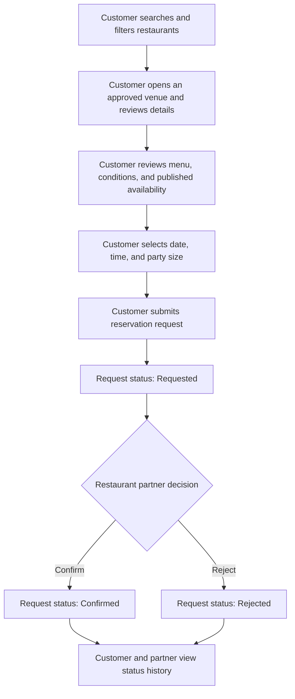
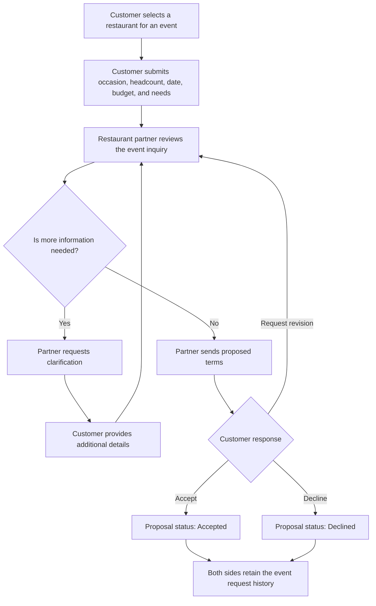

# DineVina — Vision Document (PA2)
**Performed by:** Võ Mỹ Ngọc (Vision source), Nguyễn Trung Kiên (product overview source), Hoàng Cao Phong (integration) | **Reviewed by:** Lương Thiện Nhân and Võ Mỹ Ngọc (assigned; review records not supplied) | **Edited by:** Hoàng Cao Phong

**Group 08 · initial Vision · 29 October 2026**

## 1. Introduction
**Performed by:** Võ Mỹ Ngọc | **Reviewed by:** Lương Thiện Nhân (assigned; review record not supplied) | **Edited by:** Võ Mỹ Ngọc

This Vision Document defines the high-level needs, market position, and product capabilities of DineVina, a responsive web marketplace for restaurant discovery, table reservation requests, and event inquiries. It gives the project team and stakeholders a shared understanding of what the product should achieve, why its capabilities are needed, and which users benefit from them. Detailed functional behavior, acceptance criteria, and implementation decisions will be refined in the use-case model, supplementary specifications, and product backlog.

DineVina follows a B2B2C model in which restaurant partners publish and manage dining services, customers find suitable venues and submit requests, and the platform connects both sides through visible request states. An ordinary table reservation remains a request until the restaurant partner confirms it, while event inquiries follow a separate clarification and proposal process. The current product scope excludes a complete restaurant point-of-sale, inventory, accounting, and payment system, and it does not include native mobile applications.

### 1.1 References
**Performed by:** Võ Mỹ Ngọc | **Reviewed by:** Lương Thiện Nhân (assigned; review record not supplied) | **Edited by:** Võ Mỹ Ngọc

| Reference                                                                        | Date                     | Publishing organization or source                      | Use in this document                                                                                                                      |
| -------------------------------------------------------------------------------- | ------------------------ | ------------------------------------------------------ | ----------------------------------------------------------------------------------------------------------------------------------------- |
| *PA1 Report - DineVina: Smart Restaurant Reservation and Event Booking System* | 17 October 2026          | Group 08, Introduction to Software Engineering         | Defines the agreed product idea, boundaries, actors, nine functional groups, AI direction, and PasGo/Eatigo survey findings.              |
| *Project Assignment 2 (PA2-2026)*                                              | 15 October 2026          | CS300/CSC13002, University of Science, VNU-HCM         | Defines the required Vision Document sections, paragraph depth for product features, Mermaid workflow requirement, and submission format. |
| *Vision Document for a Small Project* (`rup_vision_sp.docx`)                 | Course-provided template | Rational Unified Process template distributed with PA2 | Provides the required section structure and the formats for the Problem Statement and Product Position Statement.                         |
| *Vision Document Example* (`rup_vision_sp-example.docx`)                     | Course-provided example  | Distributed with PA2                                   | Illustrates how the positioning tables and product feature section may be completed.                                                      |

## 2. Positioning
**Performed by:** Võ Mỹ Ngọc | **Reviewed by:** Lương Thiện Nhân (assigned; review record not supplied) | **Edited by:** Võ Mỹ Ngọc

### 2.1 Problem Statement
**Performed by:** Võ Mỹ Ngọc | **Reviewed by:** Lương Thiện Nhân (assigned; review record not supplied) | **Edited by:** Võ Mỹ Ngọc

|                                          | Statement                                                                                                                                                                                                                                                                                                 |
| ---------------------------------------- | --------------------------------------------------------------------------------------------------------------------------------------------------------------------------------------------------------------------------------------------------------------------------------------------------------- |
| **The problem of**                 | finding a restaurant that fits a customer's location, cuisine, budget, party size, capacity, and event needs while keeping restaurant information and request status clear and traceable                                                                                                                  |
| **affects**                        | customers planning ordinary meals or group events, restaurant partners receiving and managing requests, and platform administrators responsible for trustworthy listings                                                                                                                                  |
| **the impact of which is**         | customers spend time comparing fragmented or uncertain information, may confuse a submitted request with a confirmed booking, and must coordinate complex events through unstructured channels; restaurant partners face incomplete requests, conflicting capacity commitments, and inefficient follow-up |
| **a successful solution would be** | a responsive marketplace that presents attributable venue and menu information, supports relevant search criteria, separates requested and confirmed states, provides a structured event proposal path, and gives restaurant partners a single workspace for availability and incoming demand             |

### 2.2 Product Position Statement
**Performed by:** Võ Mỹ Ngọc | **Reviewed by:** Lương Thiện Nhân (assigned; review record not supplied) | **Edited by:** Võ Mỹ Ngọc

|                            | Statement                                                                                                                                                                                                       |
| -------------------------- | --------------------------------------------------------------------------------------------------------------------------------------------------------------------------------------------------------------- |
| **For**              | diners looking for suitable restaurants, customers planning group events, restaurant partners seeking qualified demand, and platform administrators maintaining listing quality                                 |
| **Who**              | need a clearer way to discover venues, evaluate dining or event suitability, submit complete requests, and track responses without confusing a request with a confirmed commitment                              |
| **The product name** | DineVina is a responsive B2B2C web marketplace for restaurant discovery, table reservation requests, and event inquiries                                                                                        |
| **That**             | connects customers and restaurant partners through approved venue information, menus, availability, explicit request states, structured event briefs and proposals, promotions, and preference-based assistance |
| **Unlike**           | relying on separate search, social, messaging, and booking tools, or the limited PasGo and Eatigo interface flows observed in the PA1 survey                                                                    |
| **Our product**      | combines a traceable booking state, a dedicated event negotiation workflow, and explainable recommendations grounded in partner-verified venue data, while keeping ordinary filters available as a fallback     |

## 3. Stakeholder and user descriptions
**Performed by:** Lương Thiện Nhân | **Reviewed by:** Nguyễn Trung Kiên | **Edited by:** Hoàng Cao Phong

### 3.1 Stakeholder summary
**Performed by:** Lương Thiện Nhân | **Reviewed by:** Nguyễn Trung Kiên | **Edited by:** Hoàng Cao Phong

| Stakeholder | Interest | Responsibility / representation |
| --- | --- | --- |
| Restaurant business owners | Accurate listing and qualified customer demand | Authorize venue publication, set policies and nominate partner staff. |
| Dining groups and event organizers | A suitable venue and clear commitment | Represent party size, budget, accessibility and event requirements. |
| Platform operator | Trustworthy marketplace and reliable service | Moderate listings, support disputes and operate access/audit controls. |
| Group 08 and course reviewers | A feasible, traceable academic product | Maintain the backlog, assess increments and review documented assumptions. |

### 3.2 User summary
**Performed by:** Lương Thiện Nhân | **Reviewed by:** Nguyễn Trung Kiên | **Edited by:** Hoàng Cao Phong

| User | Responsibilities | Represented interest |
| --- | --- | --- |
| Customer | Browse without signing in, search restaurants and foods, inspect menus and prices, submit complete table/event requests for themselves, track responses and cancel within policy | Adult diners and event organizers in Ho Chi Minh City |
| Restaurant partner staff | Maintain venue/menu/availability, manually decide every request, prepare event proposals and update state history | Restaurant owner or authorized operator |
| Platform administrator | Review onboarding, return corrections, moderate published information and investigate support cases | Platform operator |

### 3.3 User environment
**Performed by:** Lương Thiện Nhân | **Reviewed by:** Nguyễn Trung Kiên | **Edited by:** Hoàng Cao Phong

Customers use a responsive browser on a phone or desktop and may have intermittent mobile data. Discovery targets restaurants in Ho Chi Minh City and supports manual district/location filters without mandatory geolocation permission. Customers can browse publicly, but submitting a request requires their own name, phone number and basic information; booking on behalf of another person is outside the planned flow. Partner staff primarily use a desktop dashboard during service and may check incoming requests by phone. Clear state labels and retry-safe submission reduce confusion when the connection is interrupted. Administrators use an authenticated browser for onboarding, moderation and exception handling. The initial interface targets Vietnamese restaurant data; language and localization expansion are later backlog decisions.

### 3.4 Summary of key stakeholder or user needs
**Performed by:** Lương Thiện Nhân | **Reviewed by:** Nguyễn Trung Kiên | **Edited by:** Hoàng Cao Phong

| Need / cause | Priority | Current workaround | Product response |
| --- | --- | --- | --- |
| Fragmented venue, food, menu, price and condition information | High | Compare websites/social pages and call venues | Approved profiles, searchable menus, price context, update context and filters (F3, F4) |
| Unclear distinction between a request and a commitment | High | Follow-up calls or messages | Explicit requested/confirmed/declined/cancelled states and history (F5) |
| Customers need to book a suitable table for themselves | High | Phone calls or separate booking forms | Name, phone, basic information, date/time/party-size form and self-booking validation |
| Complex group-event requirements | High | Phone consultations and separate message threads | Structured brief, clarification and proposal history (F6) |
| Changing capacity and incoming demand | High | Manual reservation books/spreadsheets | Venue-owned availability and partner queue; every request receives manual partner confirmation (F7) |
| Difficulty choosing among many venues | Medium | Manually compare a shortlist | Eligible recommendations with attributable reasons and filter fallback (F9) |
| Consistent listing quality | High | Staff inspect each submission | Administrator approval and partner corrections (F2) |

### 3.5 Alternatives and competition
**Performed by:** Lương Thiện Nhân | **Reviewed by:** Nguyễn Trung Kiên | **Edited by:** Hoàng Cao Phong

The comparison is limited to PasGo and Eatigo, using the PA1 survey and dated interface captures. These sources establish visible product patterns and published claims; they do not prove either competitor's internal implementation.

| Alternative | Observed strength / existing approach | Design implication for DineVina |
| --- | --- | --- |
| PasGo | Venue discovery, detailed amenity filters, group-dining consultation, booking forms and partner operations | Adopt clear venue details and request forms; connect event briefs to explicit proposal history and state tracking. |
| Eatigo | Time-based search, discount presentation, visible offer conditions and merchant availability tooling | Keep date/time and eligibility conditions visible; separate offers from reservation confirmation and use verified venue data. |

DineVina's proposed differentiation is traceable request status, a dedicated event workflow, partner-verified information, and explainable recommendations with ordinary search as a fallback. These are planned capabilities, not claims that the current scaffold has already delivered them.

## 4. Product overview
**Performed by:** Nguyễn Trung Kiên (source Product Overview) and Hoàng Cao Phong (integration) | **Reviewed by:** Võ Mỹ Ngọc (assigned; review record not supplied) | **Edited by:** Hoàng Cao Phong

DineVina is a B2B2C responsive web marketplace with customer, restaurant-partner and platform-administrator roles. Its planned client, API and data tiers separate browser presentation, business rules and persistent records. The current repository contains a React/TypeScript frontend and FastAPI backend scaffold; the complete venue, reservation and event workflows remain implementation targets. A health endpoint or contract document alone does not demonstrate those workflows.

The intended authoritative records include approved venue profiles, menus, availability slots, reservation requests, event conversations and state history. The platform does not require a restaurant POS, inventory or accounting system, a payment gateway, or native mobile applications for PA2. External map and notification services are possible later dependencies, not prerequisites for the initial documentation. Manual location entry and in-app status display provide fallbacks.

The most important dependencies are accurate partner-supplied venue data, administrator approval, agreed reservation/cancellation policy and role-based access. Demo records must be approved partner data or explicitly identified as samples. A recommendation should rank only eligible venues and explain the attributes behind a result. The system boundaries and architectural options were drawn from Kiên's `research/PA2_Kien_ProductOverview` contribution; this integrated overview avoids treating proposed technology as deployed behavior.

## 5. Product Features
**Performed by:** Võ Mỹ Ngọc | **Reviewed by:** Lương Thiện Nhân (assigned; review record not supplied) | **Edited by:** Võ Mỹ Ngọc

The following features refine the nine functional groups established in the PA1 project proposal. They describe externally visible product capabilities and user value without committing the team to a particular implementation design.

### 5.1 Accounts and Profiles
**Performed by:** Võ Mỹ Ngọc | **Reviewed by:** Lương Thiện Nhân (assigned; review record not supplied) | **Edited by:** Võ Mỹ Ngọc

DineVina allows customers and restaurant partners to create accounts and maintain the contact and preference information needed for their activities. Role-aware access separates customer, partner, and administrator actions so that each user sees only the functions and records relevant to that role. Customers benefit from reusable booking details and preferences, while partners and administrators benefit from attributable actions and controlled access to operational data.

### 5.2 Restaurant Onboarding
**Performed by:** Võ Mỹ Ngọc | **Reviewed by:** Lương Thiện Nhân (assigned; review record not supplied) | **Edited by:** Võ Mỹ Ngọc

Restaurant partners can submit a venue profile containing its identity, location, cuisine, photos, amenities, capacity, and contact details. A platform administrator reviews the submission and either approves it or returns it for correction before it becomes an attributable source for customer discovery. This feature gives customers more trustworthy venue information and helps partners present their restaurants consistently on the marketplace.

### 5.3 Restaurant Discovery and Venue Details
**Performed by:** Võ Mỹ Ngọc | **Reviewed by:** Lương Thiện Nhân (assigned; review record not supplied) | **Edited by:** Võ Mỹ Ngọc

Customers can search and filter restaurants by criteria such as location, cuisine, budget, party size, capacity, and amenities, then open a venue page for more detail. The feature shortens the path from a dining or event need to a manageable set of suitable options instead of forcing users to compare fragmented information manually. Customers benefit from more relevant choices, while approved restaurant partners gain visibility among users whose needs match their offerings.

### 5.4 Menu Management and Viewing
**Performed by:** Võ Mỹ Ngọc | **Reviewed by:** Lương Thiện Nhân (assigned; review record not supplied) | **Edited by:** Võ Mỹ Ngọc

Restaurant partners can maintain menu items with approved names, descriptions, and prices, and customers can review this information before submitting a request. Menu visibility is needed because price and dish suitability influence whether a venue fits a customer's budget, dietary preferences, and occasion. Customers make better-informed decisions, and partners receive requests from people who have already reviewed the relevant offering.

### 5.5 Table Reservation Requests
**Performed by:** Võ Mỹ Ngọc | **Reviewed by:** Lương Thiện Nhân (assigned; review record not supplied) | **Edited by:** Võ Mỹ Ngọc

Customers can choose a date, time, and party size and submit a table reservation request to a restaurant partner. The partner can confirm or reject the request, while both sides can see its status history and applicable cancellation conditions; submitting a request does not itself create a confirmed reservation. This feature gives customers a clear path from venue selection to a visible outcome and helps restaurant staff respond to demand without making ambiguous promises.

### 5.6 Event Inquiries and Proposals
**Performed by:** Võ Mỹ Ngọc | **Reviewed by:** Lương Thiện Nhân (assigned; review record not supplied) | **Edited by:** Võ Mỹ Ngọc

Customers planning an event can submit a structured brief containing the occasion, expected headcount, preferred date, budget, and special needs. Restaurant partners can request clarification, propose terms, and track the customer's response in one conversation rather than treating a complex event like an ordinary table request. Customers benefit from a clearer planning process, and partners benefit from receiving the information required to prepare realistic proposals.

### 5.7 Availability and Partner Dashboard
**Performed by:** Võ Mỹ Ngọc | **Reviewed by:** Lương Thiện Nhân (assigned; review record not supplied) | **Edited by:** Võ Mỹ Ngọc

Restaurant partners can maintain operating hours, capacity, and blocked slots while viewing incoming reservation and event requests in a role-specific dashboard. Keeping availability and demand together is needed to reduce conflicting commitments and give staff a practical queue for daily work. Partners benefit from better operational control, while customers benefit from choices and responses based on more current partner-provided information.

### 5.8 Promotions and Editorial Content
**Performed by:** Võ Mỹ Ngọc | **Reviewed by:** Lương Thiện Nhân (assigned; review record not supplied) | **Edited by:** Võ Mỹ Ngọc

Restaurant partners can submit time-bound promotions and venue content under platform rules, with eligibility conditions and expiry information visible to customers. Clear conditions are needed so that an offer can support discovery without creating uncertainty about when or to whom it applies. Customers benefit from understandable value, partners gain a controlled promotional channel, and administrators can moderate content quality without turning DineVina into a full merchant accounting or payment system.

### 5.9 Intelligent Assistance
**Performed by:** Võ Mỹ Ngọc | **Reviewed by:** Lương Thiện Nhân (assigned; review record not supplied) | **Edited by:** Võ Mỹ Ngọc

DineVina is planned to recommend restaurants by first excluding unapproved or unsuitable venues and then ranking eligible choices using customer preferences and verified venue attributes such as cuisine, location, budget, occasion, and menu information. Each suggestion should include visible reasons, while ordinary search and filters remain available when recommendations are unavailable or unhelpful. This capability is intended to reduce search effort for customers and improve qualified exposure for partners, but it remains a proposed feature rather than an implemented capability in the current project scaffold.

### 5.10 Key User Workflows
**Performed by:** Võ Mỹ Ngọc | **Reviewed by:** Lương Thiện Nhân (assigned; review record not supplied) | **Edited by:** Võ Mỹ Ngọc

#### Table Reservation Request
**Performed by:** Võ Mỹ Ngọc | **Reviewed by:** Lương Thiện Nhân (assigned; review record not supplied) | **Edited by:** Võ Mỹ Ngọc

#### Event Inquiry and Proposal
**Performed by:** Võ Mỹ Ngọc | **Reviewed by:** Lương Thiện Nhân (assigned; review record not supplied) | **Edited by:** Võ Mỹ Ngọc

## 6. Non-functional requirements
**Performed by:** Hoàng Cao Phong (integration from PA2 working draft) | **Reviewed by:** Võ Mỹ Ngọc (assigned; review record not supplied) | **Edited by:** Hoàng Cao Phong

The values below are proposed acceptance targets. They require measurement on an agreed test environment before the team can claim achievement.

| Quality attribute | Acceptance target or verification method |
| --- | --- |
| Performance | At least 95% of search and venue-detail API requests finish within 800 ms at 100 concurrent virtual users on the documented test environment; first useful page content within 2.5 s on a defined mid-range mobile/4G profile. |
| Security | Server-side role authorization on all partner/admin mutations; HTTPS for public deployment; password hashes stored with a maintained password-hashing library; no secrets in Git. |
| Privacy | Use only contact and booking data needed for service; exclude real customer records from repository and demo fixtures; agree retention and deletion rules before public use. |
| Booking reliability | A concurrent capacity test must prevent confirmed reservations above a slot limit; every state change is timestamped. |
| Accessibility | Core search and request flows support keyboard use, labelled inputs and visible focus; inspect against WCAG 2.2 AA. |
| Platform | Test current Chrome, Firefox, Edge and Safari at 360 px mobile and 1280 px desktop widths. |
| Maintainability | Backend tests/lint and frontend production build pass at each tested build; API contract changes receive peer review. |
| Recommendation quality | Evaluate at least 30 representative preference queries and report precision at 3, unsuitable-result count, coverage and failure examples. |
| Recovery | Demonstrate a database backup and restore on a test copy before the final demo; record elapsed restoration time. |

## References
**Performed by:** Hoàng Cao Phong | **Reviewed by:** Võ Mỹ Ngọc (assigned; review record not supplied) | **Edited by:** Hoàng Cao Phong

- Course *Project Assignment 2 (PA2-2026)* and the course Vision template.
- Group 08 PA1 project proposal and PasGo/Eatigo survey.
- Source contributions: Ngọc, `research/PA2_Ngoc_Vision_Overview`; Kiên, `research/PA2_Kien_ProductOverview`; Group 08 PA2 working Vision draft.
- [WCAG 2.2](https://www.w3.org/TR/WCAG22/) for the accessibility target.
