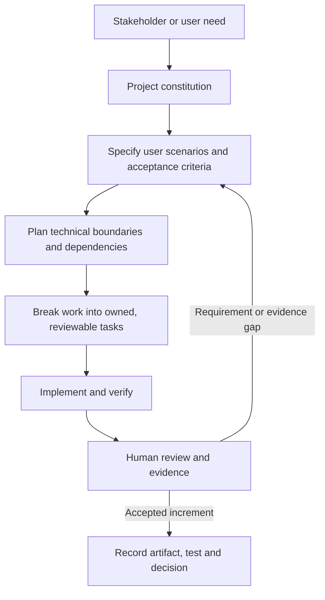

# Spec Kit Training & Spec-Driven Development (SDD) Report - Nhan

**Project:** DineVina - Smart Restaurant Reservation and Event Booking Marketplace (Group 08)  
**Author / Performer:** Lương Thiện Nhân (Data Management and Stakeholder Lead; Student ID: 24127475)  
**Reviewer:** Nguyễn Trung Kiên (Backend Lead / Peer Reviewer)  
**Edited by:** Hoàng Cao Phong  
**Deliverable Scope:** PA2 Requirement C - Individual Spec Kit Training Evidence  
**Status:** Completed - Evidence supplied 31 October 2026  
**Official Tool:** [GitHub Spec Kit](https://github.com/github/spec-kit)  

---

## 1. Training overview

Spec-Driven Development (SDD) uses a written project constitution, feature specification, technical plan, and task breakdown as the shared source of truth before implementation. This approach helps DineVina keep stakeholder needs, acceptance criteria, data rules, implementation tasks, and later tests consistent.

My PA2 training focused on understanding how the Spec Kit workflow turns a user or stakeholder problem into a structured, reviewable delivery plan. I applied that understanding to the DineVina stakeholder work: customer needs, restaurant-partner responsibilities, administrator controls, venue/menu data quality, and the planned reservation pipeline.

The training evidence is the supplied screenshot [`speckit_evidence_nhan.png`](speckit_evidence_nhan.png). It shows the Microsoft Learn course **Get started with spec-driven development and GitHub Spec Kit**, the **module assessment passed** status, and the completed achievement for the module.

## 2. Spec Kit lifecycle learned

The lifecycle separates the following responsibilities:

1. **Constitution:** establishes project-wide rules such as traceable requirements, validation, security, testing, and human review.
2. **Specification:** describes what the user needs, why it matters, acceptance scenarios, and error conditions.
3. **Plan:** identifies system boundaries, data ownership, dependencies, and the technical approach needed to satisfy the specification.
4. **Tasks:** assigns small, testable work items to an owner and reviewer.
5. **Implementation and verification:** produces the increment and checks it against the acceptance criteria before it is treated as complete.

## 3. Application to my DineVina work

| SDD concept | Application in DineVina | Resulting evidence or artifact |
| --- | --- | --- |
| User need | Customers need to discover nearby restaurants, inspect foods and prices, and request a table for themselves | PA2 Vision stakeholder needs and user-environment sections |
| Stakeholder boundary | Customers, restaurant partners, and platform administrators have different responsibilities and permissions | Stakeholder summary and end-to-end system flow |
| Data contract | Venue, menu, price, opening-hour, capacity, and booking-state information must be clear and attributable | Venue/menu data-contract task and reservation specification |
| Acceptance behavior | A submitted request remains pending until the restaurant partner manually confirms it | Reservation state and partner-confirmation flow |
| Task traceability | Stakeholder analysis is assigned to an owner, reviewed by a peer, and linked to the final Vision | PA2 work allocation and Vision attribution |
| Human review | Planned AI or generated content must be checked against approved venue data and project scope | Human-in-the-loop rule in the project constitution |

## 4. Learning outcome

I learned that Spec Kit is not only a code-generation tool. It is a collaboration method that makes the relationship between user needs, product requirements, technical decisions, tasks, implementation, and verification visible. For DineVina, this prevents a stakeholder request such as “help users find and book a suitable restaurant” from remaining vague: it becomes searchable venue data, menu and price information, availability rules, required customer information, a manual partner decision, explicit reservation states, and testable acceptance criteria.

The training also reinforced that planned behavior must be distinguished from implemented behavior. DineVina's current repository scaffold and the target marketplace workflow are documented separately, so a design requirement is not reported as a completed software feature without implementation evidence.

## 5. Evidence and limitations

- **Evidence file:** `evidence/training/supplied/speckit_evidence_nhan.png`.
- **Evidence type:** Microsoft Learn achievement and passed module assessment screenshot.
- **Completion date:** 31 October 2026, based on the supplied evidence context.
- **Individual work applied:** stakeholder needs, user environment, competition comparison, and stakeholder flow documentation.
- **Limitation:** The screenshot proves the displayed learning achievement and assessment status. It does not prove that the current DineVina reservation API is implemented, nor does it replace code or integration-test evidence.

---

## 6. References

1. [GitHub Spec Kit](https://github.com/github/spec-kit).
2. `src/constitution.md` - DineVina project constitution.
3. `src/specs/001-reservation-api/spec.md` - Reservation and discovery feature specification.
4. `src/specs/001-reservation-api/plan.md` - Implementation plan.
5. `src/specs/001-reservation-api/tasks.md` - Actionable task breakdown.
6. `docs/weekly-reports/PA2_Week3-4/Nhan_StakeHolders/nhan.md` - Stakeholder pipeline and user analysis.
7. `docs/weekly-reports/Week1/Nhan-ExistingAppSurvey/Nhan.md` - PasGo and Eatigo survey.
