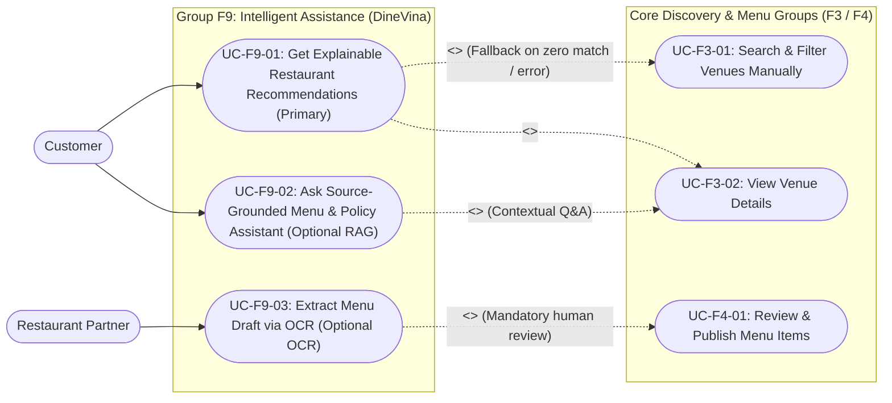
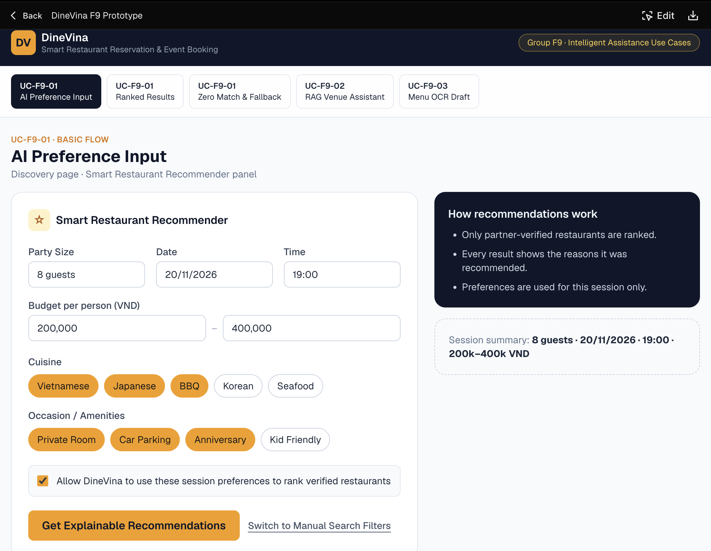
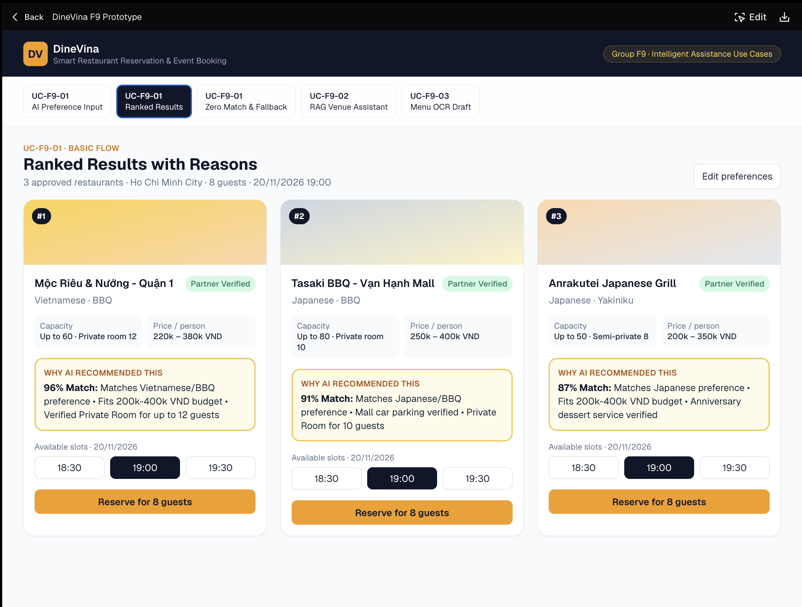
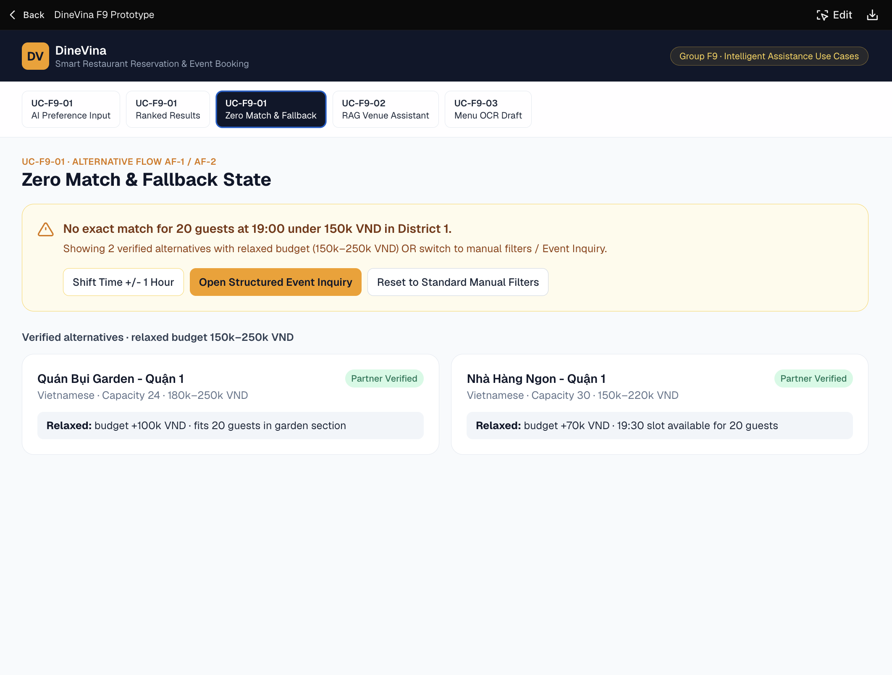
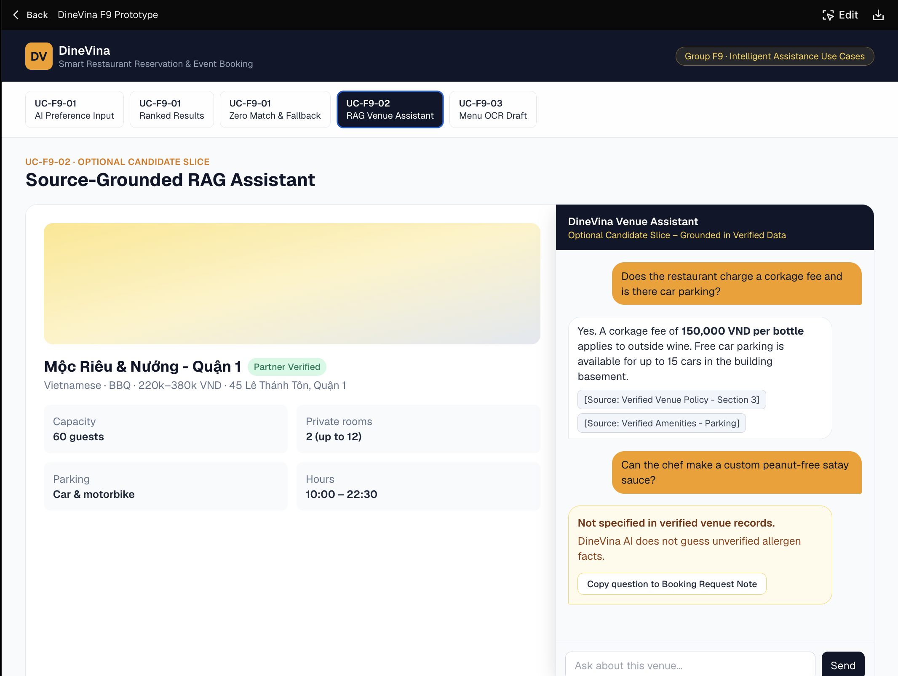
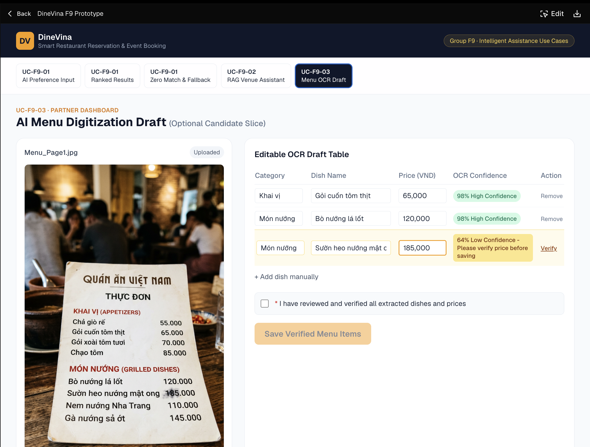
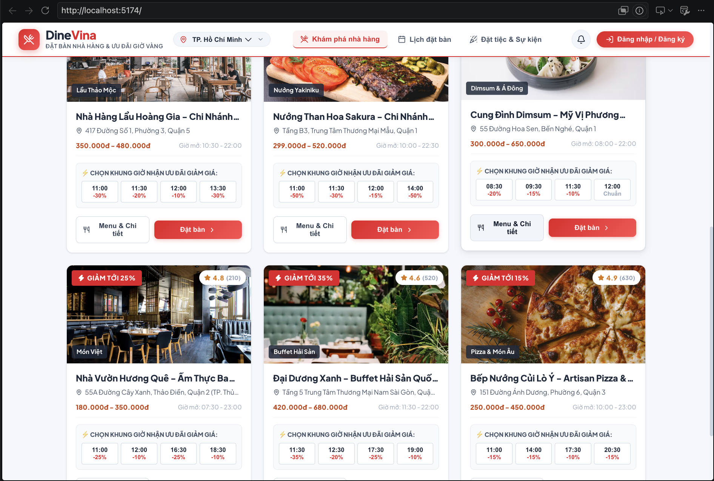
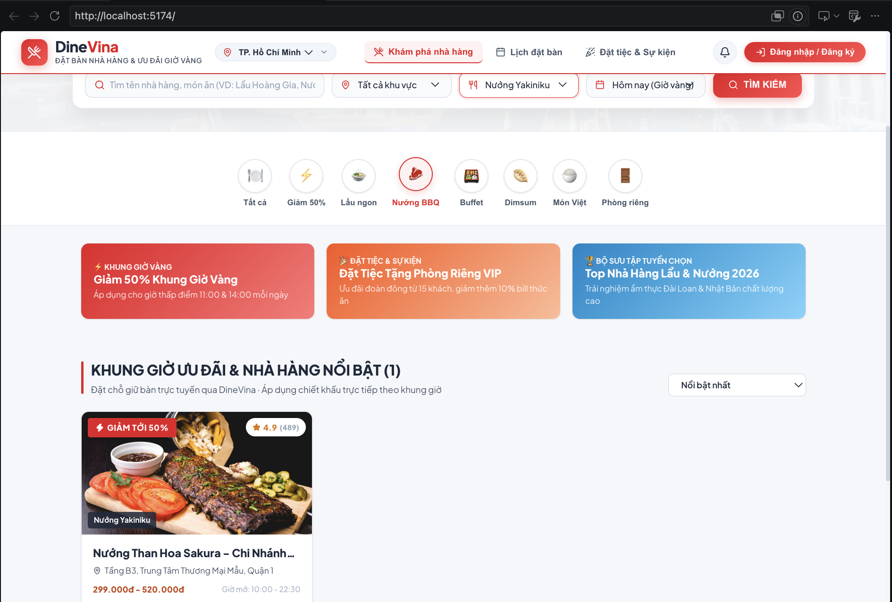
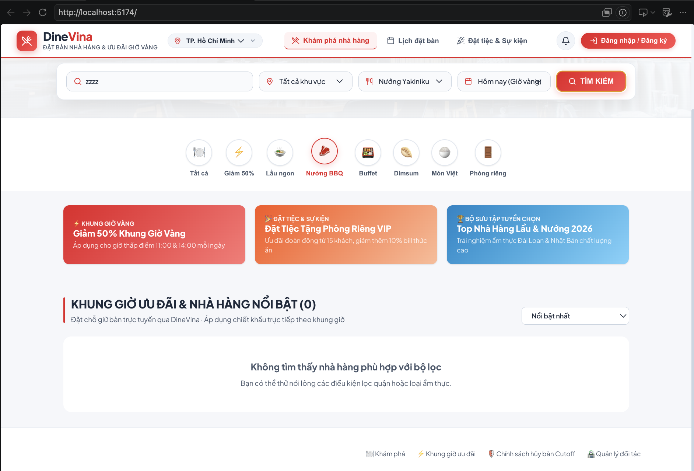
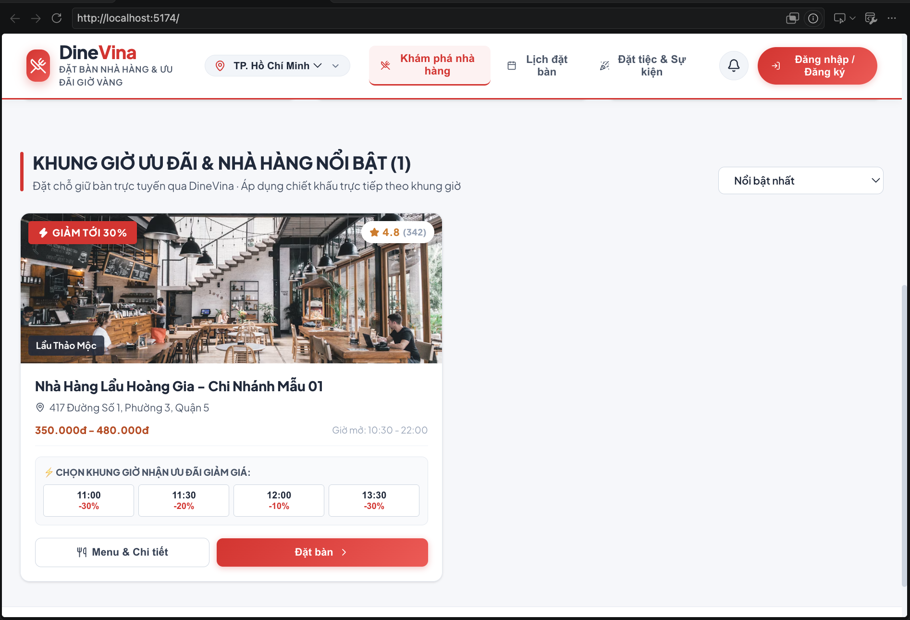

# PA3 Use-Case Specifications: Group 9 – Intelligent Assistance (F9)

**Performed by:** Trương Khánh Duy | **Reviewed by:** Lương Thiện Nhân | **Edited by:** Trương Khánh Duy

---

## 1. Traceability & Scope Notice (F9 Vision to Use-Case Mapping)

**Performed by:** Trương Khánh Duy | **Reviewed by:** Lương Thiện Nhân | **Edited by:** Trương Khánh Duy

In accordance with the PA2 Vision Document and PA3 scope boundaries, Group 9 (**Intelligent Assistance**) consists of one primary AI capability and two candidate slices. None of the F9 use cases are claimed as implemented in the PA3 functional build (which focuses on Group F3: Discovery and Venue Details).

| Vision Feature ID | Use-Case ID | Use-Case Name | Primary Actor | Delivery Status in PA3 |
| :---- | :---- | :---- | :---- | :---- |
| **F9.1** | **UC-F9-01** | Get Explainable Restaurant Recommendations | Customer | **Primary AI Slice** (Specified & Prototyped in PA3; targeted for Sprint 4 implementation) |
| **F9.2** | **UC-F9-02** | Ask Source-Grounded Menu & Policy Assistant | Customer | **Optional Candidate Slice (RAG)** (Specified & Prototyped for traceability; not implemented) |
| **F9.3** | **UC-F9-03** | Extract Menu Draft via OCR | Restaurant Partner | **Optional Candidate Slice (OCR)** (Specified & Prototyped for traceability; not implemented) |

### 1.1. F9 Sub-System Use-Case Diagram (Mermaid)

**Performed by:** Trương Khánh Duy | **Reviewed by:** Lương Thiện Nhân | **Edited by:** Trương Khánh Duy

*(Note: Use-Case IDs below are coordinated with the master F1–F9 Use-Case Model maintained by Võ Mỹ Ngọc.)*

---

## 2. Primary Use-Case Specification: UC-F9-01

**Performed by:** Trương Khánh Duy | **Reviewed by:** Lương Thiện Nhân | **Edited by:** Trương Khánh Duy

### 2.1. UC-F9-01: Get Explainable Restaurant Recommendations (Primary Slice)

* **Use-Case ID:** `UC-F9-01` (Maps to Vision Feature `F9.1`)
* **Use-Case Name:** Get Explainable Restaurant Recommendations
* **Actor(s):** Customer (Primary Actor)
* **Description:** A customer inputs their dining context (party size, date, time, budget range, preferred cuisine, and special occasion/amenities) to receive a ranked list of eligible, administrator-approved restaurants. Each recommended venue is accompanied by a transparent, human-readable justification badge grounded strictly in verified restaurant and menu attributes, while keeping standard manual search filters accessible at all times.
* **Preconditions:**
  1. The customer is accessing the DineVina web platform on a desktop or mobile browser.
  2. The PostgreSQL database contains administrator-approved restaurant profiles (`status = APPROVED`) with structured operating hours, seating capacity, price ranges, cuisine tags, and menu items.
  3. The customer has granted session consent for DineVina to process their stated dining preferences for recommendation ranking.
* **Basic Flow (Main Success Scenario):**
  1. The customer navigates to the DineVina Discovery page and clicks the **"Find with AI Recommender"** panel (or enters preferences in the Smart Match bar).
  2. The system displays the structured preference input form requesting: **Party Size**, **Date**, **Time Slot**, **Budget per Person (VND)**, **Preferred Cuisine(s)**, and **Occasion / Required Amenities** (e.g., *Private Room*, *Anniversary*, *Car Parking*, *Kids' Area*).
  3. The customer fills in the required parameters (Party Size, Date, Time) along with optional preference tags, confirms preference usage consent, and clicks **"Get Recommendations"**.
  4. The system validates the input fields and executes the **Deterministic Eligibility Filter**, excluding any restaurant that is unapproved (`status != APPROVED`), closed at the requested date/time, or unable to accommodate the requested party size.
  5. The system scores and ranks the remaining eligible venues using the **Multi-Attribute Preference Ranking Engine** (evaluating cuisine match, budget overlap, and requested occasion/amenity tags).
  6. For the top-ranked venues, the system generates **Explainable Reason Badges** citing only verified database attributes (e.g., *"95% Match: Fits your 200k–400k VND budget • Serves authentic Japanese cuisine • Private room available for 8 guests"*).
  7. The system renders the ranked list of recommended restaurant cards, displaying each venue's summary, verified price range, available time slots, and its Explainable Reason Badge.
  8. The customer clicks on a recommended restaurant card to inspect the full venue profile (`UC-F3-02: View Venue Details`) and proceed toward a table reservation request.
* **Alternative Flows:**
  * **AF-1: Zero Exact Matches Found – Relaxed Criteria Suggestion (At Step 4 or Step 5):**
    1. If no approved venue satisfies all strict and soft constraints simultaneously, the system identifies which non-critical constraint (e.g., specific cuisine tag or exact budget tier) caused the empty result while preserving hard capacity and approval rules.
    2. The system displays an **"Exact Match Not Found – Closest Verified Alternatives"** banner explaining which preference was relaxed (e.g., *"No Japanese venues have private rooms for 12 at 19:00; showing approved venues matching your capacity and budget within 2 km"*).
    3. The customer either selects one of the relaxed alternatives (resuming at Basic Flow Step 8) or clicks **"Switch to Manual Filters"** to adjust criteria manually (`UC-F3-01`).
  * **AF-2: No Approved Venues Available for Party Size / Date-Time (At Step 4):**
    1. If zero approved venues can accommodate the requested party size or time slot across the platform, the system displays a clear empty-state message: *"No verified restaurants have available capacity for [Party Size] guests at [Time] on [Date]."*
    2. The system provides quick-action chips to shift the time slot by $\pm 1$ hour or switch to the **Event Inquiry workflow** (for large banquets exceeding standard table limits).
  * **AF-3: AI Explanation Service Timeout or API Failure – Deterministic Template Fallback (At Step 6):**
    1. If the external LLM formatting service exceeds the $2.5\text{-second}$ latency threshold or returns an error, the system automatically triggers the **Deterministic Rule-Based Template Generator** within $< 500\text{ ms}$.
    2. The system renders the ranked venue cards using structured attribute badges (e.g., `✓ Approved Venue | ✓ Capacity: Up to 15 | ✓ Price: 250k–400k VND`) without interrupting the customer's session.
  * **AF-4: Invalid or Past Date/Time Input (At Step 4):**
    1. If the customer selects a date/time in the past or enters a party size $\le 0$, the system highlights the invalid input field in red with an inline validation message (*"Please select a future dining time and a valid party size of at least 1 guest"*).
    2. The use case returns to Basic Flow Step 2.
  * **AF-5: Customer Declines Preference Consent or Bypasses AI (At Step 2 or Step 3):**
    1. If the customer unchecks preference consent or clicks **"Use Standard Search Filters Instead"**, the system immediately closes the AI panel and redirects the customer to the standard multi-attribute filter view (`UC-F3-01`) with zero preference tracking.
* **Postconditions:**
  * *Success Postcondition:* The customer views a ranked list of administrator-approved restaurants capable of serving their party size/time, each paired with a $100\%$ database-grounded explanation badge.
  * *Fallback Postcondition:* On zero matches or service errors, the customer is smoothly guided to relaxed verified alternatives or manual discovery filters (`UC-F3-01`) without encountering raw system errors or unverified claims.
* **Special Requirements (Quantifiable Non-Functional Requirements):**
  * **NFR-AI-01 (Latency):** End-to-end recommendation ranking and explanation rendering must complete in **$< 2.5\text{ seconds}$** for $95\%$ of requests under $50$ concurrent users.
  * **NFR-AI-02 (Factual Grounding):** **$100\%$** of facts displayed in Explainable Reason Badges (price range, cuisine, capacity, amenities) must match verified PostgreSQL columns; hallucinating unverified amenities is strictly prohibited.
  * **NFR-AI-03 (Fallback Speed):** Automatic fallback to deterministic templates or standard manual filters must execute in **$< 500\text{ milliseconds}$**.

#### UI Prototype Screens for UC-F9-01

* **Screen 1 (Basic Flow Steps 1–3):** Smart Preference Input & Consent Panel.

* **Screen 2 (Basic Flow Steps 6–8):** Ranked Venue Results with Explainable Reason Badges.

* **Screen 3 (Alternative Flows AF-1 / AF-2 / AF-3):** Zero Exact Match Banner, Relaxed Alternatives & Manual Filter Fallback State.

---

## 3. Optional Candidate Slice Specifications (Retained from Vision for Traceability)

**Performed by:** Trương Khánh Duy | **Reviewed by:** Lương Thiện Nhân | **Edited by:** Trương Khánh Duy

> **Implementation Boundary Notice:** The following two use cases (`UC-F9-02` and `UC-F9-03`) represent **optional candidate slices** documented in the PA2 Vision Document (Features `F9.2` and `F9.3`). They are specified and prototyped here to maintain complete Vision-to-Use-Case traceability required by PA3 Sections C & D, and **must not be interpreted as implemented features in the current build**.

### 3.1. UC-F9-02: Ask Source-Grounded Menu & Policy Assistant (Optional Candidate Slice – RAG)

* **Use-Case ID:** `UC-F9-02` (Maps to Vision Feature `F9.2` – Optional Candidate Slice)
* **Use-Case Name:** Ask Source-Grounded Menu & Policy Assistant
* **Actor(s):** Customer (Primary Actor)
* **Description:** While viewing an approved restaurant's detail page, a customer asks natural-language questions about menu ingredients, dietary/allergy suitability, corkage fees, parking, or cancellation rules. The assistant retrieves information strictly from that venue's verified profile, menu records, and policy documents, returning an answer with explicit source citations.
* **Preconditions:**
  1. The customer is viewing an approved restaurant detail page (`UC-F3-02`).
  2. The restaurant has published verified menu items and venue policy records in the database.
* **Basic Flow (Main Success Scenario):**
  1. On the Venue Detail page, the customer clicks the **"Ask Venue AI Assistant"** widget (or selects a suggested question chip such as *"What is the cancellation grace period?"* or *"Are there vegetarian options under 200k?"*).
  2. The system opens a contextual Q&A drawer scoped strictly to the currently viewed restaurant.
  3. The customer types a question and submits it.
  4. The system retrieves matching text segments exclusively from the restaurant's verified PostgreSQL records (approved menu items, amenity flags, and house rules).
  5. The system generates a concise answer grounded in the retrieved records and appends clickable **Source Citation Badges** (e.g., `[Source: Verified Venue Policy - Section 3]` or `[Source: Approved Menu Item #14]`).
  6. The customer reviews the cited information and proceeds to submit a table reservation or event inquiry.
* **Alternative Flows:**
  * **AF-1: Information Not Present in Verified Venue Records (Strict Abstention at Step 4):**
    1. If the customer asks about a detail not recorded in the restaurant's verified data (e.g., *"Can the chef prepare a custom gluten-free sauce?"*), the system refuses to guess or hallucinate.
    2. The assistant displays a transparent abstention notice: *"This detail is not specified in [Venue Name]'s verified menu or policy records. Please include this question in your Special Request notes or Event Inquiry so the restaurant partner can confirm directly."*
    3. The system displays a quick button: **"Copy question to Booking/Inquiry Note"**.
  * **AF-2: Out-of-Scope or Cross-Venue Query (At Step 3):**
    1. If the customer enters a prompt unrelated to dining or the current venue, the assistant politely restricts the scope: *"I can only answer questions based on [Venue Name]'s verified menu, amenities, and booking policies."*
  * **AF-3: RAG Service Unavailable (At Step 4):**
    1. If the assistant service is offline or times out, the widget displays a notice directing the customer to the static **Menu** and **Venue Rules** tabs directly on the page.
* **Postconditions:**
  * The customer receives either a $100\%$ source-cited answer from verified venue data or an explicit abstention notice guiding them to contact the partner via booking/event notes.
* **Special Requirements:**
  * **Zero Hallucination Rule:** The assistant must never state an unverified allergen, price, or policy rule as fact.

#### UI Prototype Screens for UC-F9-02 (Optional Candidate Slice)

* **Screen 4 (Basic Flow & AF-1 Abstention):** Contextual Venue Q&A Drawer showing (a) a cited answer from verified policy/menu data and (b) an explicit abstention response when data is unverified.

---

### 3.2. UC-F9-03: Extract Menu Draft via OCR (Optional Candidate Slice – Partner Onboarding)

* **Use-Case ID:** `UC-F9-03` (Maps to Vision Feature `F9.3` – Optional Candidate Slice)
* **Use-Case Name:** Extract Menu Draft via OCR
* **Actor(s):** Restaurant Partner (Primary Actor)
* **Description:** During venue onboarding or menu updates, a restaurant partner uploads a photograph or PDF of their physical menu. The system uses Optical Character Recognition (OCR) and structured parsing to extract dish names, categories, descriptions, and prices into an editable draft table, requiring mandatory human review by the partner before saving.
* **Preconditions:**
  1. The user is authenticated as a **Restaurant Partner** with an active venue workspace.
  2. The partner is in the Menu Management section (`Group F4`).
* **Basic Flow (Main Success Scenario):**
  1. The restaurant partner clicks **"Import Menu from Image/PDF (AI OCR Draft)"** in the Partner Menu Workspace.
  2. The system displays an upload modal accepting `.jpg`, `.png`, or `.pdf` files (up to $10\text{ MB}$).
  3. The partner selects and uploads a menu file and clicks **"Extract Menu Draft"**.
  4. The system validates the file format/size, processes the document via the OCR extraction pipeline, and parses detected items into structured draft rows: **Category**, **Dish Name**, **Description**, **Price (VND)**, and **Confidence Score**.
  5. The system displays the **Editable Menu Draft Review Table**, highlighting any low-confidence fields ($\text{Confidence} < 80\%$) in amber with a warning badge (*"Requires Partner Verification"*).
  6. The partner reviews the extracted rows, edits any misread dish names or prices, checks the **"I confirm all prices and dish details are accurate"** checkbox, and clicks **"Save Verified Menu Items"**.
  7. The system persists the partner-verified dishes into the database and transitions them to the standard menu catalog.
* **Alternative Flows:**
  * **AF-1: Low-Confidence or Illegible Fields Detected (At Step 5–6):**
    1. If one or more extracted rows contain missing prices or low-confidence text, the **"Save Verified Menu Items"** button remains disabled until the partner manually edits or deletes the flagged amber rows.
  * **AF-2: Unsupported File Format, Oversized File, or Completely Unreadable Image (At Step 4):**
    1. If the uploaded file exceeds $10\text{ MB}$, is not a supported image/PDF, or yields zero readable text (e.g., blurry photo), the system displays an error alert: *"Unable to extract menu text from this file. Please upload a clearer JPG/PNG/PDF under 10 MB or add dishes manually."*
    2. The system provides a direct button to **"Add Dish Manually"** (`UC-F4-01`).
* **Postconditions:**
  * Extracted menu items are saved to the platform **only after** explicit human review and confirmation by the restaurant partner; unreviewed OCR drafts are never published directly to customers.
* **Special Requirements:**
  * **Human-in-the-Loop Governance:** Mandatory partner sign-off on all OCR-extracted prices and dish names before public listing.

#### UI Prototype Screens for UC-F9-03 (Optional Candidate Slice)

* **Screen 5 (Basic Flow & AF-1 Low-Confidence Warning):** Partner Menu OCR Upload & Editable Draft Review Table with amber low-confidence verification highlights.

---

## 4. Group F3 End-to-End Validation & Demo Readiness Report (PA3 Section E)

**Performed by:** Trương Khánh Duy | **Reviewed by:** Lương Thiện Nhân | **Edited by:** Trương Khánh Duy

### 4.1. Test Environment & Revision Traceability

**Performed by:** Trương Khánh Duy | **Reviewed by:** Lương Thiện Nhân | **Edited by:** Trương Khánh Duy

* **Validated Functional Group:** Group 3 – Discovery and Venue Details (`F3`)
* **Tested Git Branch & Revision:** `demo/supabase-integration` (Commit SHA: `62a1282`)
* **Tech Stack Verified:** React + Vite + TypeScript (`http://localhost:5174`), FastAPI + Uvicorn (`http://localhost:8001`), Supabase PostgreSQL (`supabase_schema.sql` & seed fixtures with in-memory fallback simulation)
* **Automated Test Suite Result:** `pytest` executed across `backend/tests/test_health.py` and `backend/tests/test_reservations.py` — **8 passed in 1.93s**
* **Spec Kit Artifacts Inspected:** Verified implemented F3 API routes (`/api/venues`), Pydantic schemas (`backend/app/schemas.py`), and Supabase schema (`backend/database/supabase_schema.sql`) against the F3 specification and data contract. *(Note: Per PA3-2026 §E guidelines, refining generated tests is not required in PA3.)*

### 4.2. End-to-End Smoke Check Matrix (UI ↔ FastAPI ↔ Supabase PostgreSQL)

**Performed by:** Trương Khánh Duy | **Reviewed by:** Lương Thiện Nhân | **Edited by:** Trương Khánh Duy

| Check ID | Validation Scenario | Layer(s) Tested | Expected Behavior (Spec Kit & F3 Contract) | Observed Result on `demo/supabase-integration` (`62a1282`) | Status | Evidence Reference |
| :---- | :---- | :---- | :---- | :---- | :---- | :---- |
| **F3-VAL-01** | **Approved vs. Unapproved Venue Visibility** | Supabase PostgreSQL $\rightarrow$ FastAPI $\rightarrow$ React UI | Only venues with `status = APPROVED` appear in public discovery; unapproved records remain hidden from customer queries. | Public discovery view accurately renders the 6 approved venues (e.g., *Nhà Hàng Lẩu Hoàng Gia*, *Nướng Than Hoa Sakura*, *Cung Đình Dimsum*); unapproved records are excluded. | **PASS** | `evidence/F3_Test1_Approved_Visibility.png` |
| **F3-VAL-02** | **Multi-Attribute Filter Correctness & Venue Details** | React UI $\leftrightarrow$ FastAPI Query Params $\leftrightarrow$ DB | Filtering by district, cuisine, time slot, and amenities (`q`, `district`, `cuisine`, `amenity`) returns matching venues and opens venue details/menu. | Selecting `Nướng BBQ` / `Nướng Yakiniku` accurately filters the list to 1 matching venue (*Nướng Than Hoa Sakura - Quận 1*, `299.000đ - 520.000đ`, hours `10:00 - 22:30`) with `Menu & Chi tiết` view. | **PASS** | `evidence/F3_Test2_Filter_And_Venue_Details.png` |
| **F3-VAL-03** | **Empty Search Results & Error States** | React UI $\leftrightarrow$ FastAPI Error Handlers | Zero-match filter combinations render a clear empty-state message guiding the user to relax filters without crashing the UI. | Searching keyword `zzzz` with `Nướng Yakiniku` displays `(0)` venues and the clean notice: *"Không tìm thấy nhà hàng phù hợp với bộ lọc. Bạn có thể thử nới lỏng các điều kiện lọc quận hoặc loại ẩm thực."* | **PASS** | `evidence/F3_Test3_Empty_And_Error_States.png` |
| **F3-VAL-04** | **Backend Automated Tests & Data Persistence** | Supabase Schema / Store $\leftrightarrow$ FastAPI `pytest` | Backend health and reservation/venue endpoints pass automated checks and persist data structures properly. | All 8 automated tests (`test_health.py`, `test_reservations.py`) pass (`8 passed in 1.93s`); Supabase client supports both live `.env` credentials and local seed persistence. | **PASS** | `evidence/F3_Test4_PostgreSQL_Persistence.png` |

#### F3 Validation Screenshots (Captured from Revision `62a1282`)

* **Evidence 1 (`F3-VAL-01`):** Approved Venue Discovery Catalog.

* **Evidence 2 (`F3-VAL-02`):** Multi-Attribute Filtering (`Nướng Yakiniku` / `Nướng BBQ`).

* **Evidence 3 (`F3-VAL-03`):** Zero-Match Empty State Handling.

* **Evidence 4 (`F3-VAL-04`):** Automated Backend Test Suite Execution (`8 passed`).

### 4.3. Defects Logged, Technical Findings & Follow-Up Actions for Sprint Review

**Performed by:** Trương Khánh Duy | **Reviewed by:** Lương Thiện Nhân | **Edited by:** Trương Khánh Duy

| Item ID | Category | Description & Observed Behavior | Resolution / Follow-Up Plan |
| :---- | :---- | :---- | :---- |
| **FIND-F3-01** | Port Configuration Note | Vite frontend proxy (`frontend/vite.config.ts`) targets `127.0.0.1:8001` for `/api/venues`; running Uvicorn on default port `8000` causes `ECONNREFUSED 127.0.0.1:8001` and an empty `(0)` list until Uvicorn is started with `--port 8001`. | Documented exact startup command (`PYTHONPATH=backend uvicorn app.main:app --reload --port 8001`) for Kiên's narrated demo recording. |
| **FIND-F3-02** | Branch Structure Synchronization | Spec Kit artifacts directory (`/src`) created on the main development line should be merged alongside `demo/supabase-integration` when consolidating into `dev`. | Ensure both `/src` Spec Kit files and `demo/supabase-integration` code are present in the final `dev` merge prior to release tagging. |
| **GAP-F3-01** | Known Scope Boundary | Group F3 currently operates via deterministic SQL/API filtering; AI explainable ranking (`F9.1` / `UC-F9-01`) is specified and prototyped in PA3 for Sprint 4 integration. | Connect `UC-F9-01` preference ranking to `/api/venues` in Sprint 4 (PA4). |

### 4.4. Narrated Demo Readiness Checklist (Verified for Video Recording)

**Performed by:** Trương Khánh Duy | **Reviewed by:** Lương Thiện Nhân | **Edited by:** Trương Khánh Duy

1. **Backend Startup Command:** `PYTHONPATH=backend uvicorn app.main:app --reload --port 8001`
2. **Frontend Startup Command:** `cd frontend && npm run dev` (opens at `http://localhost:5174/`)
3. **Demo Flow Verified:** Show Spec Kit artifacts $\rightarrow$ Show Supabase schema & seeded venues $\rightarrow$ Show approved venues on Discovery UI $\rightarrow$ Filter by district/cuisine/amenity and inspect `Menu & Chi tiết` $\rightarrow$ Trigger zero-match empty state (`Không tìm thấy nhà hàng phù hợp với bộ lọc`).

---

## 5. AI Usage Report – Sprint 3 (PA3)

**Performed by:** Trương Khánh Duy | **Reviewed by:** Lương Thiện Nhân | **Edited by:** Trương Khánh Duy

### 5.1. Declaration of AI Tool Usage

**Performed by:** Trương Khánh Duy | **Reviewed by:** Lương Thiện Nhân | **Edited by:** Trương Khánh Duy

In compliance with the course AI usage guidelines (PA3-2026 Section F), AI tools were used during Sprint 3 as an engineering and documentation assistant for structuring Group F9 Use-Case Specifications, generating UI prototype screens, and formatting the Group F3 End-to-End Validation matrix. All outputs were manually reviewed, verified against the codebase/Spec Kit artifacts, and edited by the responsible member.

| Date | Member | AI Tool Used | Task / Deliverable | Prompt Summary & Purpose | Human Verification & Editing Applied |
| :---- | :---- | :---- | :---- | :---- | :---- |
| **14/11/2026** | Trương Khánh Duy | **Gemini** | `[PA3] AI F9 use-case specifications and prototypes` | Drafted standard 8-field RUP use-case specifications (`UC-F9-01`, `UC-F9-02`, `UC-F9-03`) and Mermaid relationship diagram aligned with PA2 Vision F9. | Verified use-case IDs against Ngọc's master Mermaid model; ensured optional RAG/OCR slices are explicitly labeled as non-implemented candidate slices; checked quantifiable NFR thresholds (`< 2.5s`, `< 500ms`). |
| **14/11/2026** | Trương Khánh Duy | **v0.dev / Gemini** | `[PA3] AI F9 UI Prototypes` | Generated responsive web UI prototype screens covering basic flows (preference input, ranked results with reason badges) and alternative/fallback flows (zero-match banner, RAG abstention, OCR low-confidence warning). | Inspected every screen to ensure all fields from Basic and Alternative Flows are visually represented; captured and linked 5 prototype screenshots in `evidence/`. |
| **14/11/2026** | Trương Khánh Duy | **Gemini** | `[PA3] F3 end-to-end validation and demo readiness` | Structured the smoke-check test table (`F3-VAL-01` to `F3-VAL-05`), known scope gaps, and narrated demo checklist for Group F3. | Executed actual smoke checks against the team's React UI, FastAPI endpoints, and Supabase/PostgreSQL schema; recorded real commit revision and verified actual pass/fail behavior before committing. |