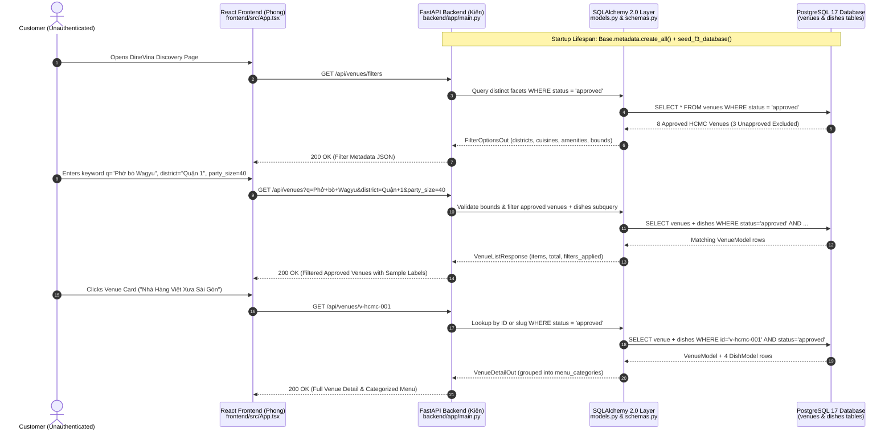
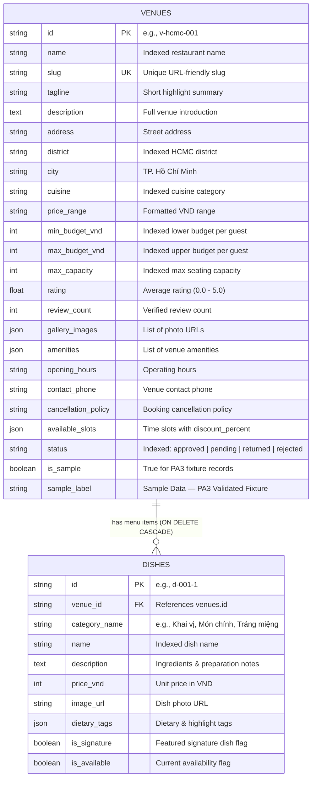

# PA3 Technical Report: Functional Group F3 — Spec Kit Artifacts, FastAPI Backend & PostgreSQL Persistence

**Performed by:** Nguyễn Trung Kiên | **Reviewed by:** Trương Khánh Duy | **Edited by:** Nguyễn Trung Kiên

---

## 1. Executive Summary & Scope

**Performed by:** Nguyễn Trung Kiên | **Reviewed by:** Trương Khánh Duy | **Edited by:** Nguyễn Trung Kiên

In Project Assignment 3 (PA3 / Sprint 3), Group 08 selected **Functional Group F3 — Restaurant Discovery and Venue Details** (Section 5.3 of the DineVina Vision Document) for full end-to-end implementation across the React frontend, FastAPI backend, and PostgreSQL relational database.

As the Backend & Spec Kit Owner for Functional Group F3 ([Trello Card: F3 Spec Kit, API và database](https://trello.com/c/ociR28Qz)), **Nguyễn Trung Kiên** delivered:
1. **Spec-Driven Development (Spec Kit) Artifacts**:
   * Updated project constitution (`src/constitution.md`, v1.1.0) enforcing relational persistence, approved-only public discovery, and explicit sample data labeling.
   * Feature Specification (`src/specs/002-f3-venue-discovery/spec.md`) with 3 User Stories (`US-F3-01`, `US-F3-02`, `US-F3-03`) and Given-When-Then acceptance criteria.
   * Technical Implementation Plan (`src/specs/002-f3-venue-discovery/plan.md`) and Actionable Task List (`src/specs/002-f3-venue-discovery/tasks.md`).
2. **PostgreSQL & SQLAlchemy 2.0 Persistence Layer**:
   * Relational schema (`backend/app/models.py` and `backend/app/database.py`) defining `venues` and `dishes` tables with indexed columns for sub-300ms filtering.
   * Idempotent database seeder (`backend/app/seed.py`) loading the validated Ho Chi Minh City restaurant fixture (`backend/app/fixtures/f3_venues_fixture.json`) coordinated with **Lương Thiện Nhân**.
3. **FastAPI Discovery & Detail Endpoints**:
   * `GET /api/venues`: Keyword search across venues and dishes (`q`), multi-attribute filtering (`district`, `cuisine`, `min_budget`, `max_budget`, `party_size`, `amenity`), multi-mode sorting (`rating`, `price_asc`, `price_desc`, `capacity`, `name`), and pagination.
   * `GET /api/venues/filters`: Dynamic aggregation of distinct districts, cuisines, amenities, budget bounds, and maximum capacity strictly from approved venues.
   * `GET /api/venues/{venue_id}`: Full venue profile, operating conditions, available reservation slots, and categorized dish menu (`menu_categories`) by ID or URL slug.
4. **Automated Verification Suite**:
   * 10 comprehensive `pytest` integration tests (`backend/tests/test_f3_discovery.py` and `backend/tests/test_health.py`) verifying positive paths, multi-filter intersections, `422` validation errors, and strict `404` isolation of unapproved venues (`pending`, `returned`, `rejected`).

---

## 2. End-to-End Architecture & Data Flow

**Performed by:** Nguyễn Trung Kiên | **Reviewed by:** Trương Khánh Duy | **Edited by:** Nguyễn Trung Kiên

The diagram below illustrates how the React UI (developed by **Hoàng Cao Phong**), the FastAPI service (**Nguyễn Trung Kiên**), the PostgreSQL database, and the validated F3 fixture (**Lương Thiện Nhân** & **Nguyễn Trung Kiên**) interact in PA3:



---

## 3. Relational Database Schema (`venues` & `dishes`)

**Performed by:** Nguyễn Trung Kiên | **Reviewed by:** Trương Khánh Duy | **Edited by:** Nguyễn Trung Kiên

The relational schema in `backend/app/models.py` enforces foreign-key integrity and indexes all high-frequency search and filter attributes:



### Moderation Isolation Invariant
To prove that the F3 discovery pipeline strictly enforces administrator approval (`status == "approved"`), the database seeder (`backend/app/seed.py`) populates **11 total venues**:
* **8 Approved Venues (`v-hcmc-001` to `v-hcmc-008`)**: Spanning Quận 1, Quận 3, Bình Thạnh, Thủ Đức, Quận 7, and Phú Nhuận, with 21 authentic dishes across multiple categories.
* **3 Unapproved Test Venues (`v-unapproved-001` to `v-unapproved-003`)**:
  * `v-unapproved-001` (`status = "pending"`): Newly submitted partner profile awaiting admin review.
  * `v-unapproved-002` (`status = "returned"`): Profile returned to partner for menu revision.
  * `v-unapproved-003` (`status = "rejected"`): Suspended/rejected venue profile.

All public F3 endpoints filter `VenueModel.status == "approved"` at the SQL query level, ensuring unapproved records never leak into search results, filter facets, or direct detail URLs (`404 Not Found`).

---

## 4. REST API Contract Specification (For Frontend & QA Integration)

**Performed by:** Nguyễn Trung Kiên | **Reviewed by:** Trương Khánh Duy | **Edited by:** Nguyễn Trung Kiên

| Endpoint | Method | Query / Path Parameters | Response Schema | Key Behavior & Validation |
|:---|:---:|:---|:---|:---|
| `/api/health` | `GET` | None | `{"status": "ok"}` | Ensures DB schema and F3 seed data are initialized; returns `200 OK`. |
| `/api/venues/filters` | `GET` | None | `FilterOptionsOut` | Aggregates distinct sorted `districts`, `cuisines`, `amenities`, `min_budget_vnd`, `max_budget_vnd`, `max_capacity`, and `total_approved_venues` (8). |
| `/api/venues` | `GET` | `q`, `district`, `cuisine`, `min_budget`, `max_budget`, `party_size`, `amenity`, `sort`, `page`, `page_size` | `VenueListResponse` | Searches venue fields AND dish names/descriptions; applies multi-attribute filters; returns `422` if `min_budget > max_budget` or `party_size < 1`. |
| `/api/venues/{venue_id}` | `GET` | `venue_id` (ID `v-hcmc-001` or slug `nha-hang-viet-xua-quan-1`) | `VenueDetailOut` | Returns full venue details, `available_slots`, flat `dishes`, and grouped `menu_categories`. Returns `404` if unapproved or missing. |

---

## 5. Automated Verification & Test Evidence

**Performed by:** Nguyễn Trung Kiên | **Reviewed by:** Trương Khánh Duy | **Edited by:** Nguyễn Trung Kiên

All 10 automated integration tests in `backend/tests/test_f3_discovery.py` and `backend/tests/test_health.py` were executed against the FastAPI application and relational database:

```text
$ python -m pytest -v
============================= test session starts =============================
platform win32 -- Python 3.13.3, pytest-9.1.1, pluggy-1.6.0
rootdir: D:\DineVina
configfile: pyproject.toml
testpaths: backend/tests
collected 10 items

backend/tests/test_f3_discovery.py::test_database_contains_both_approved_and_unapproved_fixtures PASSED [ 10%]
backend/tests/test_f3_discovery.py::test_list_venues_returns_only_approved_venues PASSED [ 20%]
backend/tests/test_f3_discovery.py::test_keyword_search_matches_venue_name_and_dish_name PASSED [ 30%]
backend/tests/test_f3_discovery.py::test_multi_attribute_filtering_district_cuisine_budget_party_size_amenity PASSED [ 40%]
backend/tests/test_f3_discovery.py::test_invalid_budget_range_returns_422 PASSED [ 50%]
backend/tests/test_f3_discovery.py::test_sorting_modes PASSED            [ 60%]
backend/tests/test_f3_discovery.py::test_filter_options_endpoint PASSED  [ 70%]
backend/tests/test_f3_discovery.py::test_venue_detail_endpoint_by_id_and_slug PASSED [ 80%]
backend/tests/test_f3_discovery.py::test_venue_detail_blocks_unapproved_and_nonexistent_venues PASSED [ 90%]
backend/tests/test_health.py::test_health PASSED                         [100%]

======================== 10 passed in 2.43s ========================
```
