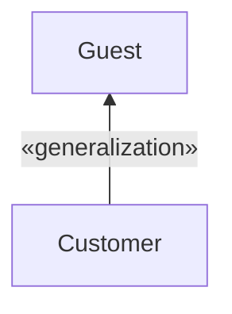
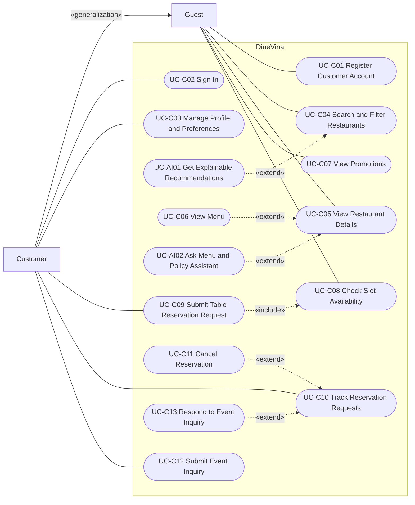
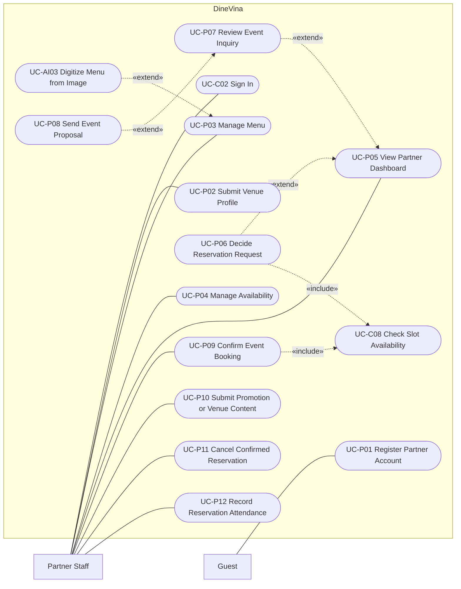
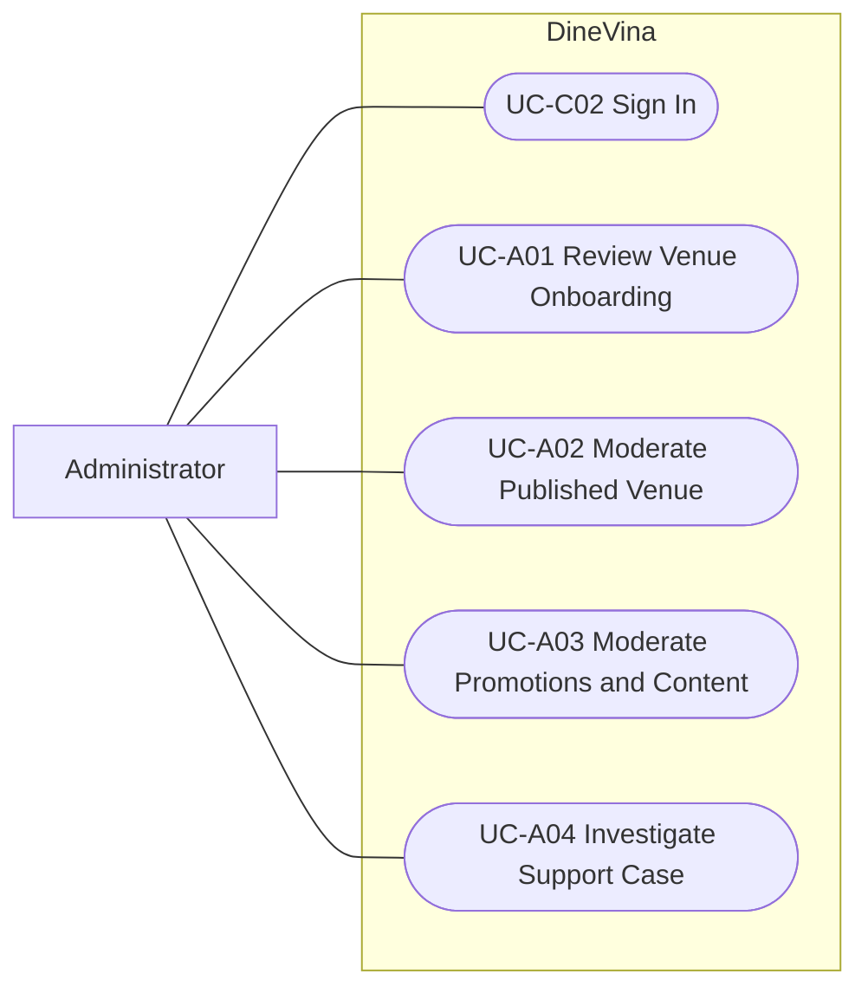

# DineVina - Use-Case Model
**Performed by:** Võ Mỹ Ngọc | **Reviewed by:** Hoàng Cao Phong | **Edited by:** Võ Mỹ Ngọc

This document models the functional requirements of the DineVina Vision Document as use cases. It contains the functional requirement catalogue, the actors, the use-case catalogue, the traceability matrix from requirements to use cases, and the use-case diagrams.

## 1. Notation
**Performed by:** Võ Mỹ Ngọc | **Reviewed by:** Hoàng Cao Phong | **Edited by:** Võ Mỹ Ngọc

| Prefix | Meaning |
| --- | --- |
| `FR-g.n` | Functional requirement `n` of functional group `Fg` |
| `UC-Cnn` | Use case whose primary actor is a Guest or Customer |
| `UC-Pnn` | Use case whose primary actor is Partner Staff |
| `UC-Ann` | Use case whose primary actor is the Administrator |
| `UC-AInn` | Intelligent-assistance use case (functional group F9) |

In the diagrams, a rectangle is an actor, a rounded node is a use case, and the box labelled *DineVina* is the system boundary. A solid line is an association between an actor and a use case. A dashed arrow labelled `«include»` points from the base use case to the included use case. A dashed arrow labelled `«extend»` points from the extending use case to the base use case. An arrow labelled `«generalization»` points from the specialized actor to the general actor.

## 2. Functional requirement catalogue
**Performed by:** Võ Mỹ Ngọc | **Reviewed by:** Hoàng Cao Phong | **Edited by:** Võ Mỹ Ngọc

Requirements marked *(candidate)* belong to optional F9 slices that enter a sprint only after the core request path is accepted.

### F1 - Accounts and Profiles

| ID | Requirement |
| --- | --- |
| FR-1.1 | A guest can create a customer account with their contact information. |
| FR-1.2 | A restaurant partner can create a partner account for the staff authorized by the restaurant owner. |
| FR-1.3 | A registered user can sign in; the system grants only the functions and records of the user's role (customer, partner staff or administrator). |
| FR-1.4 | A customer can maintain contact information and dining preferences that are reused when booking. |

### F2 - Restaurant Onboarding

| ID | Requirement |
| --- | --- |
| FR-2.1 | A partner can submit a venue profile containing identity, location, cuisine, photos, amenities, capacity and contact details. |
| FR-2.2 | An administrator can review a submitted profile and either approve it or return it for correction. |
| FR-2.3 | A partner can correct a returned profile and resubmit it for review. |
| FR-2.4 | Only approved venues appear in public discovery and recommendations. |
| FR-2.5 | An administrator can moderate published venue information. |

### F3 - Restaurant Discovery and Venue Details

| ID | Requirement |
| --- | --- |
| FR-3.1 | A guest can search restaurants and foods in Ho Chi Minh City without signing in or granting device-location permission. |
| FR-3.2 | A guest can filter venues by district, cuisine, budget, party size, capacity and amenities. |
| FR-3.3 | Results can be sorted and are paginated (20 items by default, at most 50). |
| FR-3.4 | A guest can open a venue page that shows the approved venue details. |
| FR-3.5 | When no venue matches, the guest can adjust the search filters. |

### F4 - Menu Management and Viewing

| ID | Requirement |
| --- | --- |
| FR-4.1 | A partner can maintain menu items with approved names, descriptions and prices. |
| FR-4.2 | A guest can review a venue's menu items and prices before submitting a request. |

### F5 - Table Reservation Requests

| ID | Requirement |
| --- | --- |
| FR-5.1 | A guest can view the available time slots of a venue for a selected date and party size. |
| FR-5.2 | A signed-in customer can submit a table reservation request for themselves with name, phone number, date, time, party size and special requests; a valid request is stored in the *Pending confirmation* state. |
| FR-5.3 | Partner staff can confirm a pending request after a capacity recheck, or decline it with a mandatory reason. |
| FR-5.4 | A customer can view their reservation requests with the current state and status history. |
| FR-5.5 | A customer can cancel a confirmed reservation with a cancellation reason at least 2 hours before the reserved time; the reservation becomes *Cancelled by customer*. A later cancellation is rejected, and the restaurant hotline is shown instead. |
| FR-5.6 | A pending request that is not answered within the 30-minute partner response window is marked *Expired*. |
| FR-5.7 | An administrator can open the status history of a reservation or event inquiry to investigate a support case. |
| FR-5.8 | Partner staff can cancel a confirmed reservation in an exceptional operational situation; the reservation becomes *Cancelled by restaurant* and the customer is notified. |
| FR-5.9 | Partner staff can validate the customer's check-in at the venue; the confirmed reservation becomes *Completed*. |
| FR-5.10 | A confirmed reservation whose customer has not arrived within the 30-minute grace period after the reserved time becomes *No-show*. |

### F6 - Event Inquiries and Proposals

| ID | Requirement |
| --- | --- |
| FR-6.1 | A customer can submit an event brief with occasion, party size, preferred date, budget and special needs. |
| FR-6.2 | Partner staff can review an inquiry and request clarification, close it as unavailable with an explanation, or prepare a proposal. |
| FR-6.3 | A customer can supply the requested details in the inquiry. |
| FR-6.4 | Partner staff can send a proposal with menu, room, price and terms. |
| FR-6.5 | A customer can accept a proposal, ask for a revision, or decline it; a declined inquiry is closed and its history retained. |
| FR-6.6 | After acceptance, partner staff check capacity and confirm the event; both parties can view the agreed terms. |

### F7 - Availability and Partner Dashboard

| ID | Requirement |
| --- | --- |
| FR-7.1 | A partner can maintain operating hours, capacity and blocked slots. |
| FR-7.2 | A partner dashboard shows incoming reservation and event requests. |
| FR-7.3 | Capacity checks and booking state changes are atomic so that no slot is confirmed beyond its capacity. |

### F8 - Promotions and Editorial Content

| ID | Requirement |
| --- | --- |
| FR-8.1 | A partner can submit a time-bound promotion with eligibility conditions and expiry information. |
| FR-8.2 | A partner can submit venue content under platform rules. |
| FR-8.3 | An administrator can moderate submitted promotions and venue content. |
| FR-8.4 | A guest can view promotions with their eligibility conditions and expiry information. |

### F9 - Intelligent Assistance

| ID | Requirement |
| --- | --- |
| FR-9.1 | A guest can state dining preferences (cuisine, budget, location, party size, occasion) and receive ranked recommendations among eligible approved venues. |
| FR-9.2 | Each recommended venue shows an explanation whose facts match approved venue data. |
| FR-9.3 | When the recommender fails or finds no match, the system falls back to ordinary search filters. |
| FR-9.4 | *(candidate)* A guest can ask menu and policy questions on a venue page and receive answers with citations to approved sources. |
| FR-9.5 | *(candidate)* A partner can upload a menu photo or PDF and receive an editable menu draft with low-confidence text flagged for review. |

## 3. Actors
**Performed by:** Võ Mỹ Ngọc | **Reviewed by:** Hoàng Cao Phong | **Edited by:** Võ Mỹ Ngọc

| Actor | Description |
| --- | --- |
| Guest | Anyone using the public web interface without signing in. Can search, view venues, menus, slots and promotions, ask for recommendations, and create an account. |
| Customer | A signed-in diner. Inherits every Guest use case and can also submit and track reservation requests and event inquiries for themselves. |
| Partner Staff | An owner or authorized staff member of a restaurant who maintains its data and decides its requests. |
| Administrator | A platform operator who reviews onboarding, moderates published information and investigates support cases. |

## 4. Use-case catalogue
**Performed by:** Võ Mỹ Ngọc | **Reviewed by:** Hoàng Cao Phong | **Edited by:** Võ Mỹ Ngọc

Use cases are ordered by workflow: account access, discovery, reservation and event requests, partner operations, administration, and intelligent assistance.

| ID | Use case | Primary actor | Functional group |
| --- | --- | --- | --- |
| UC-C01 | Register Customer Account | Guest | F1 |
| UC-C02 | Sign In | Customer, Partner Staff, Administrator | F1 |
| UC-C03 | Manage Profile and Preferences | Customer | F1 |
| UC-C04 | Search and Filter Restaurants | Guest | F3 |
| UC-C05 | View Restaurant Details | Guest | F3 |
| UC-C06 | View Menu | Guest | F4 |
| UC-C07 | View Promotions | Guest | F8 |
| UC-C08 | Check Slot Availability | Guest | F5, F7 |
| UC-C09 | Submit Table Reservation Request | Customer | F5 |
| UC-C10 | Track Reservation Requests | Customer | F5 |
| UC-C11 | Cancel Reservation | Customer | F5 |
| UC-C12 | Submit Event Inquiry | Customer | F6 |
| UC-C13 | Respond to Event Inquiry | Customer | F6 |
| UC-P01 | Register Partner Account | Guest | F1 |
| UC-P02 | Submit Venue Profile | Partner Staff | F2 |
| UC-P03 | Manage Menu | Partner Staff | F4 |
| UC-P04 | Manage Availability | Partner Staff | F7 |
| UC-P05 | View Partner Dashboard | Partner Staff | F7 |
| UC-P06 | Decide Reservation Request | Partner Staff | F5 |
| UC-P07 | Review Event Inquiry | Partner Staff | F6 |
| UC-P08 | Send Event Proposal | Partner Staff | F6 |
| UC-P09 | Confirm Event Booking | Partner Staff | F6 |
| UC-P10 | Submit Promotion or Venue Content | Partner Staff | F8 |
| UC-P11 | Cancel Confirmed Reservation | Partner Staff | F5 |
| UC-P12 | Record Reservation Attendance | Partner Staff | F5 |
| UC-A01 | Review Venue Onboarding | Administrator | F2 |
| UC-A02 | Moderate Published Venue | Administrator | F2 |
| UC-A03 | Moderate Promotions and Content | Administrator | F8 |
| UC-A04 | Investigate Support Case | Administrator | F5, F6 |
| UC-AI01 | Get Explainable Recommendations | Guest | F9 |
| UC-AI02 | Ask Menu and Policy Assistant *(candidate)* | Guest | F9 |
| UC-AI03 | Digitize Menu from Image *(candidate)* | Partner Staff | F9 |

### 4.1 Relationships

| Relationship | Type | Description |
| --- | --- | --- |
| UC-C09 → UC-C08 | «include» | A reservation request always checks the remaining capacity of the chosen slot. |
| UC-P06 → UC-C08 | «include» | Confirming a reservation always rechecks capacity. |
| UC-P09 → UC-C08 | «include» | An accepted event is confirmed only after a capacity check. |
| UC-C06 → UC-C05 | «extend» | The menu is viewed from the venue page. |
| UC-C11 → UC-C10 | «extend» | A customer cancels a reservation that they are tracking. |
| UC-C13 → UC-C10 | «extend» | A customer answers a clarification request or a proposal on an inquiry that they are tracking. |
| UC-P06 → UC-P05 | «extend» | A reservation request is decided from the dashboard. |
| UC-P07 → UC-P05 | «extend» | An event inquiry is reviewed from the dashboard. |
| UC-P08 → UC-P07 | «extend» | A proposal is sent only when the reviewed inquiry is suitable. |
| UC-AI01 → UC-C04 | «extend» | Recommendations are an optional mode of searching, with ordinary filters as the fallback. |
| UC-AI02 → UC-C05 | «extend» | The assistant is embedded on the venue page. |
| UC-AI03 → UC-P03 | «extend» | OCR is an optional way to create a menu draft that the partner reviews. |
| Customer → Guest | «generalization» | A customer can do everything a guest can. |

## 5. Traceability matrix
**Performed by:** Võ Mỹ Ngọc | **Reviewed by:** Hoàng Cao Phong | **Edited by:** Võ Mỹ Ngọc

"Main" means that the basic flow of the use case fulfils the requirement; "Alt" means that an alternative flow or a special requirement of the use case fulfils it.

| Requirement | Realized by | Coverage |
| --- | --- | --- |
| FR-1.1 | UC-C01 | Main |
| FR-1.2 | UC-P01 | Main |
| FR-1.3 | UC-C02 | Main |
| FR-1.4 | UC-C03 | Main |
| FR-2.1 | UC-P02 | Main |
| FR-2.2 | UC-A01 | Main |
| FR-2.3 | UC-P02 | Alt (resubmit returned profile) |
| FR-2.4 | UC-C04, UC-AI01 | Special requirement (approved venues only) |
| FR-2.5 | UC-A02 | Main |
| FR-3.1 | UC-C04 | Main |
| FR-3.2 | UC-C04 | Main |
| FR-3.3 | UC-C04 | Alt (sort, next page) |
| FR-3.4 | UC-C05 | Main |
| FR-3.5 | UC-C04 | Alt (no matching venue) |
| FR-4.1 | UC-P03 | Main |
| FR-4.2 | UC-C06 | Main |
| FR-5.1 | UC-C08 | Main |
| FR-5.2 | UC-C09 | Main |
| FR-5.3 | UC-P06 | Main |
| FR-5.4 | UC-C10 | Main |
| FR-5.5 | UC-C11 | Main and Alt (after cutoff) |
| FR-5.6 | UC-P06 | Alt (no decision within the response window) |
| FR-5.7 | UC-A04 | Main |
| FR-5.8 | UC-P11 | Main |
| FR-5.9 | UC-P12 | Main |
| FR-5.10 | UC-P12 | Alt (customer not arrived after grace period) |
| FR-6.1 | UC-C12 | Main |
| FR-6.2 | UC-P07 | Main |
| FR-6.3 | UC-C13 | Main (clarification) |
| FR-6.4 | UC-P08 | Main |
| FR-6.5 | UC-C13 | Main (proposal) and Alt (revise, decline) |
| FR-6.6 | UC-P09 | Main |
| FR-7.1 | UC-P04 | Main |
| FR-7.2 | UC-P05 | Main |
| FR-7.3 | UC-C08 (included by UC-C09, UC-P06, UC-P09) | Special requirement (atomic check) |
| FR-8.1 | UC-P10 | Main |
| FR-8.2 | UC-P10 | Alt (venue content) |
| FR-8.3 | UC-A03 | Main |
| FR-8.4 | UC-C07 | Main |
| FR-9.1 | UC-AI01 | Main |
| FR-9.2 | UC-AI01 | Main |
| FR-9.3 | UC-AI01 | Alt (fallback) |
| FR-9.4 | UC-AI02 | Main |
| FR-9.5 | UC-AI03 | Main |

All 44 functional requirements are realized, and every use case realizes at least one requirement.

## 6. Use-case diagrams
**Performed by:** Võ Mỹ Ngọc | **Reviewed by:** Hoàng Cao Phong | **Edited by:** Võ Mỹ Ngọc

The model is split into three diagrams by actor. Shared use cases (UC-C02, UC-C08) appear in more than one diagram.

### 6.1 Guest and Customer

### 6.2 Partner Staff

### 6.3 Administrator

