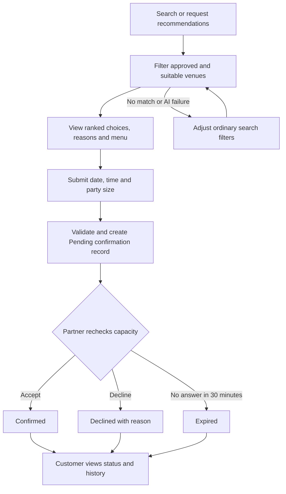
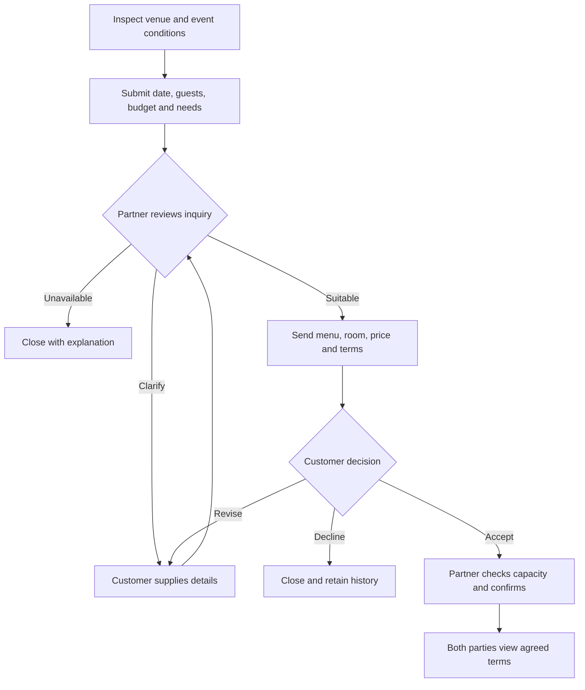

# DineVina - Vision Document
**Performed by:** Group 08 contributors; Võ Mỹ Ngọc | **Reviewed by:** Hoàng Cao Phong | **Edited by:** Võ Mỹ Ngọc

**Group 08 · Vision version 2.0 · 13 November 2026**

## Revision History
**Performed by:** Võ Mỹ Ngọc | **Reviewed by:** Hoàng Cao Phong | **Edited by:** Võ Mỹ Ngọc

| Version | Date | Description | Contributors |
| --- | --- | --- | --- |
| 1.0 | 31 October 2026 | Integrated PA2 Vision from the five member contributions; aligned product scope, terminology, workflows and quality targets. | Ngọc, Nhân, Kiên, Duy and Phong |
| 2.0 | 13 November 2026 | Added an identified functional requirement catalogue (FR-1.1 to FR-9.5), grouped and extended the non-functional requirements, expanded alternatives and competitors, and described the user environment per user role. | Ngọc |

## Table of Contents
**Performed by:** Võ Mỹ Ngọc | **Reviewed by:** Hoàng Cao Phong | **Edited by:** Võ Mỹ Ngọc

1. Introduction - purpose and references
2. Positioning - problem and product position statements
3. Stakeholder and User Descriptions - stakeholders, users, user environment, needs, alternatives and competitors
4. Product Overview - perspective, interfaces, assumptions and dependencies
5. Product Features and Functional Requirements - nine functional groups, intelligent assistance and key workflows
6. Non-Functional Requirements - measurable quality targets by category
7. Traceability and References

## 1. Introduction
**Performed by:** Võ Mỹ Ngọc | **Reviewed by:** Hoàng Cao Phong | **Edited by:** Võ Mỹ Ngọc

This Vision Document defines the high-level needs, market position, and product capabilities of DineVina, a responsive web marketplace for restaurant discovery, table reservation requests, and event inquiries. It gives the project team and stakeholders a shared understanding of what the product should achieve, why its capabilities are needed, and which users benefit from them. Detailed functional behavior is specified in the Use-Case Model and the use-case specifications.

DineVina follows a B2B2C model in which restaurant partners publish and manage dining services, customers find suitable venues and submit requests, and the platform connects both sides through visible request states. An ordinary table reservation remains a request until the restaurant partner confirms it, while event inquiries follow a separate clarification and proposal process. The product scope excludes a complete restaurant point-of-sale, inventory, accounting, and payment system, and it does not include native mobile applications.

### 1.1 References
**Performed by:** Võ Mỹ Ngọc | **Reviewed by:** Hoàng Cao Phong | **Edited by:** Võ Mỹ Ngọc

| Reference | Date | Publishing organization or source | Use in this document |
| --- | --- | --- | --- |
| *PA1 Report - DineVina: Smart Restaurant Reservation and Event Booking System* | 17 October 2026 | Group 08 | Product idea, boundaries, actors, nine functional groups, AI direction, and the PasGo/Eatigo survey. |
| *Project Assignment 2 (PA2-2026)* and *Project Assignment 3 (PA3-2026)* | 2026 | CS300/CSC13002, University of Science, VNU-HCM | Required Vision content and level of detail. |
| *Vision Document for a Small Project* (`rup_vision_sp.docx`) and its example | Course-provided | Rational Unified Process template | Section structure, Problem Statement and Product Position Statement formats. |
| *Discovery and Reservation API Contract* | November 2026 | Group 08 | Reservation states, slot availability, cancellation cutoff and error cases. |
| *DineVina Use-Case Model* | 13 November 2026 | Group 08 | Use cases that realize the functional requirements of Section 5. |
| *Web Content Accessibility Guidelines (WCAG) 2.2* | 2023 | W3C | Accessibility target A11Y-01. |

## 2. Positioning
**Performed by:** Võ Mỹ Ngọc | **Reviewed by:** Hoàng Cao Phong | **Edited by:** Võ Mỹ Ngọc

### 2.1 Problem Statement
**Performed by:** Võ Mỹ Ngọc | **Reviewed by:** Hoàng Cao Phong | **Edited by:** Võ Mỹ Ngọc

| | Statement |
| --- | --- |
| **The problem of** | finding a restaurant that fits a customer's location, cuisine, budget, party size, capacity, and event needs while keeping restaurant information and request status clear and traceable |
| **affects** | customers planning ordinary meals or group events, restaurant partners receiving and managing requests, and platform administrators responsible for trustworthy listings |
| **the impact of which is** | customers spend time comparing fragmented or uncertain information, may confuse a submitted request with a confirmed booking, and must coordinate complex events through unstructured channels; restaurant partners face incomplete requests, conflicting capacity commitments, and inefficient follow-up |
| **a successful solution would be** | a responsive marketplace that presents attributable venue and menu information, supports relevant search criteria, separates requested and confirmed states, provides a structured event proposal path, and gives restaurant partners a single workspace for availability and incoming demand |

### 2.2 Product Position Statement
**Performed by:** Võ Mỹ Ngọc | **Reviewed by:** Hoàng Cao Phong | **Edited by:** Võ Mỹ Ngọc

| | Statement |
| --- | --- |
| **For** | diners looking for suitable restaurants, customers planning group events, restaurant partners seeking qualified demand, and platform administrators maintaining listing quality |
| **Who** | need a clearer way to discover venues, evaluate dining or event suitability, submit complete requests, and track responses without confusing a request with a confirmed commitment |
| **The product name** | DineVina is a responsive B2B2C web marketplace for restaurant discovery, table reservation requests, and event inquiries |
| **That** | connects customers and restaurant partners through approved venue information, menus, availability, explicit request states, structured event briefs and proposals, promotions, and preference-based assistance |
| **Unlike** | relying on separate search, social, messaging, and booking tools, or the limited PasGo and Eatigo interface flows observed in the PA1 survey |
| **Our product** | combines a traceable booking state, a dedicated event negotiation workflow, and explainable recommendations grounded in partner-verified venue data, while keeping ordinary filters available as a fallback |

## 3. Stakeholder and User Descriptions
**Performed by:** Lương Thiện Nhân; Võ Mỹ Ngọc | **Reviewed by:** Hoàng Cao Phong | **Edited by:** Võ Mỹ Ngọc

### 3.1 Stakeholder Summary
**Performed by:** Lương Thiện Nhân | **Reviewed by:** Nguyễn Trung Kiên | **Edited by:** Võ Mỹ Ngọc

| Stakeholder | Interest | Responsibility / representation |
| --- | --- | --- |
| Restaurant business owners | Accurate listing and qualified customer demand | Authorize venue publication, set policies and nominate partner staff. |
| Dining groups and event organizers | A suitable venue and clear commitment | Represent party size, budget, accessibility and event requirements. |
| Platform operator | Trustworthy marketplace and reliable service | Moderate listings, support disputes and operate access/audit controls. |
| Group 08 and course reviewers | A feasible, traceable academic product | Maintain the backlog, assess increments and review documented assumptions. |

### 3.2 User Summary
**Performed by:** Lương Thiện Nhân | **Reviewed by:** Nguyễn Trung Kiên | **Edited by:** Võ Mỹ Ngọc

| User | Responsibilities | Represented interest |
| --- | --- | --- |
| Guest | Browse without signing in, search restaurants and foods, inspect menus, prices, slots and promotions, ask for recommendations, create an account | Diners in Ho Chi Minh City |
| Customer | Everything a guest can do, plus submit table and event requests for themselves, track responses and cancel within policy | Diners and event organizers in Ho Chi Minh City |
| Restaurant partner staff | Maintain their venue, menu and availability, decide requests, prepare event proposals and update state history | Restaurant owner |
| Platform administrator | Review onboarding, return corrections, moderate published information and investigate support cases | Platform operator |

### 3.3 User Environment
**Performed by:** Lương Thiện Nhân; Võ Mỹ Ngọc | **Reviewed by:** Hoàng Cao Phong | **Edited by:** Võ Mỹ Ngọc

DineVina is used through a responsive web browser; no native mobile application is provided. The initial market is Ho Chi Minh City, all times are expressed in Indochina Time (ICT), and the initial restaurant data is Vietnamese. Language and localization expansion are later backlog decisions.

| Factor | Guest and Customer | Restaurant Partner Staff | Platform Administrator |
| --- | --- | --- | --- |
| Devices | Phone or desktop browser; may use the service while travelling or while planning a meal | Primarily a desktop dashboard during service; a phone browser to check incoming requests when away from the desk | Web browser using the administrator interface |
| Connectivity | Intermittent mobile data is expected; submissions must be retry-safe and must not create duplicates | Stable broadband or cellular access is assumed while confirming or declining requests | Same web platform as other users |
| Access and sign-in | Browsing, search, menus, slots and promotions require no sign-in; submitting or tracking a request requires a customer account | Sign-in required; access limited to the staff member's own restaurant | Sign-in required; administrator role only |
| Location | Manual city and district filters; device geolocation is optional and never required | Uses the dashboard at the venue during service | - |
| Typical tasks and timing | Compares venues and submits a request; checks the status history later when confirmation is delayed | Manually decides each request within the 30-minute response window; maintains availability, menu and promotions | Reviews onboarding submissions, returns corrections, moderates published information and investigates support cases |
| Identity and privacy constraints | Books only for themselves with their own name and phone number; booking on behalf of another person is outside the flow | Sees only the customer information needed for booking and support | Opens request histories to investigate support cases |

**Platform environment.** The core flows must work at 360 px and 1280 px widths on Google Chrome 110 or later, Mozilla Firefox 110 or later, Apple Safari 16 or later, and Microsoft Edge 110 or later. Phone numbers follow Vietnamese mobile number formats. Service availability is measured during 07:00-23:00 ICT.

### 3.4 Summary of Key Stakeholder or User Needs
**Performed by:** Lương Thiện Nhân | **Reviewed by:** Nguyễn Trung Kiên | **Edited by:** Võ Mỹ Ngọc

| Need / cause | Priority | Current workaround | Product response |
| --- | --- | --- | --- |
| Fragmented venue, food, menu, price and condition information | High | Compare websites/social pages and call venues | Approved profiles, searchable menus, price context, update context and filters (F3, F4) |
| Unclear distinction between a request and a commitment | High | Follow-up calls or messages | Explicit requested/confirmed/declined states and history (F5) |
| Need to submit a complete booking for oneself | High | Call or fill separate venue forms | Name, phone number, date, time and party-size fields with self-booking validation (F5) |
| Complex group-event requirements | High | Phone consultations and separate message threads | Structured brief, clarification and proposal history (F6) |
| Changing capacity and incoming demand | High | Manual reservation books/spreadsheets | Venue-owned availability and partner queue (F7) |
| Difficulty choosing among many venues | Medium | Manually compare a shortlist | Eligible recommendations with attributable reasons and filter fallback (F9) |
| Consistent listing quality | High | Staff inspect each submission | Administrator approval and partner corrections (F2) |

### 3.5 Alternatives and Competition
**Performed by:** Lương Thiện Nhân; Võ Mỹ Ngọc | **Reviewed by:** Hoàng Cao Phong | **Edited by:** Võ Mỹ Ngọc

DineVina competes with two kinds of alternatives: dedicated reservation platforms, represented by PasGo and Eatigo from the PA1 survey, and the manual workarounds that customers and restaurants use today. The platform observations are limited to the interfaces captured in the PA1 survey; no reservation was submitted. The Eatigo captures show a Pattaya, Thailand browsing session and do not establish its Vietnam coverage.

#### 3.5.1 Reservation Platforms
**Performed by:** Lương Thiện Nhân; Võ Mỹ Ngọc | **Reviewed by:** Hoàng Cao Phong | **Edited by:** Võ Mỹ Ngọc

| Criterion | PasGo | Eatigo | DineVina |
| --- | --- | --- | --- |
| Narrowing choices | Local venue search with amenity filters | Date, time, cuisine, price and discount search | District, cuisine, budget, party size, capacity and amenity filters, plus explainable recommendations with filter fallback |
| Venue information | Venue detail pages | Venue cards with time-slot offers | Administrator-approved venue profiles and menus with prices |
| Starting a booking | Booking form for party and visit details | Time-slot selection followed by a sign-in or registration gate | Reservation request form for oneself after checking slot availability |
| Request status | Confirmation view; status handling not observed in the survey | No booking confirmation shown in the captured session | Explicit states (pending, confirmed, declined, expired, cancelled, completed, no-show) with full history |
| Group events | Human-assisted consultation chat | Not shown in the captured screens | Structured event brief, clarification and partner proposal in one inquiry history |
| Offers | Venue and promotion context | Discounts attached to time slots, with conditions near the venue | Time-bound promotions showing eligibility and expiry, kept separate from reservation confirmation |
| Main strength to learn from | Clear venue details and request forms | Visible date/time choice and offer conditions | - |

#### 3.5.2 Manual Workarounds
**Performed by:** Lương Thiện Nhân; Võ Mỹ Ngọc | **Reviewed by:** Hoàng Cao Phong | **Edited by:** Võ Mỹ Ngọc

| Workaround | Used by | Limitation | DineVina response |
| --- | --- | --- | --- |
| Comparing restaurant websites and social pages, then calling venues | Customers | Information is fragmented and may be outdated | One search over approved venue and menu data (F3, F4) |
| Phone calls and message threads to book or plan an event | Customers and partner staff | A request is easily confused with a confirmed booking; event details are scattered | Request states with history (F5) and a structured event inquiry (F6) |
| Manual reservation books and spreadsheets | Partner staff | Capacity changes and incoming demand are hard to keep consistent | Venue-owned availability and a partner dashboard with atomic capacity checks (F7) |
| Comparing a shortlist manually | Customers | Choosing among many venues takes time | Recommendations with attributable reasons (F9) |

DineVina's differentiation is therefore a traceable request status, a dedicated event workflow, partner-verified venue information, and explainable recommendations with ordinary search as a fallback.

## 4. Product Overview
**Performed by:** Nguyễn Trung Kiên | **Reviewed by:** Trương Khánh Duy | **Edited by:** Võ Mỹ Ngọc

### 4.1 Product Perspective and Interfaces
**Performed by:** Nguyễn Trung Kiên | **Reviewed by:** Trương Khánh Duy | **Edited by:** Võ Mỹ Ngọc

DineVina is a B2B2C marketplace with responsive customer, partner and administrator interfaces. The frontend uses React, TypeScript and Vite, the backend uses FastAPI, and PostgreSQL is the persistent store. Browser presentation, API business rules and persistence are separate responsibilities. The API contract governs discovery, venue details, request creation and lifecycle transitions. Partner and administrator operations require server-side authorization and ownership checks. Notification and mapping integrations are replaceable external dependencies, with in-app status history and manual location filters as baseline behavior.

Full POS, kitchen management, inventory, accounting, payment processing and native mobile apps are excluded. Menu viewing supports the customer's choice of venue and event preferences; it does not add a food-order checkout flow.

### 4.2 Assumptions and Dependencies
**Performed by:** Nguyễn Trung Kiên | **Reviewed by:** Trương Khánh Duy | **Edited by:** Võ Mỹ Ngọc

Partner data must be complete and approved before public discovery or AI ranking. Sample data are labeled. A 30-minute partner response window, a two-hour cancellation cutoff and 30-minute slot granularity are planning defaults; final policy values are configured and checked before release. Capacity updates and confirmation require a persistent atomic check. If persistent storage fails, writes return an explicit retryable error; a demo memory store must never silently replace live booking records. Provider quotas, network access, source freshness, role permissions and the agreed API schema constrain delivery. The primary recommendation slice uses deterministic filtering and scoring, so external LLM availability does not block ordinary discovery.

## 5. Product Features and Functional Requirements
**Performed by:** Võ Mỹ Ngọc | **Reviewed by:** Hoàng Cao Phong | **Edited by:** Võ Mỹ Ngọc

The following features refine the nine functional groups established in the PA1 project proposal. Each feature is described by its user value and then by identified functional requirements. Priority follows the product scope: **MVP** groups are delivered first, **Next** groups follow. Requirements marked *(candidate)* belong to optional F9 slices that enter a sprint only after the core request path meets its acceptance criteria. The Use-Case Model traces every requirement to the use cases that realize it.

### 5.1 Accounts and Profiles (F1 · MVP)
**Performed by:** Võ Mỹ Ngọc | **Reviewed by:** Hoàng Cao Phong | **Edited by:** Võ Mỹ Ngọc

DineVina allows customers and restaurant partners to create accounts and maintain the contact and preference information needed for their activities. Role-aware access separates customer, partner, and administrator actions so that each user sees only the functions and records relevant to that role. Customers benefit from reusable booking details and preferences, while partners and administrators benefit from attributable actions and controlled access to operational data.

| ID | Functional requirement |
| --- | --- |
| FR-1.1 | A guest can create a customer account with their contact information. |
| FR-1.2 | A restaurant partner can create a partner account for the staff authorized by the restaurant owner. |
| FR-1.3 | A registered user can sign in; the system grants only the functions and records of the user's role (customer, partner staff or administrator). |
| FR-1.4 | A customer can maintain contact information and dining preferences that are reused when booking. |

### 5.2 Restaurant Onboarding (F2 · MVP)
**Performed by:** Võ Mỹ Ngọc | **Reviewed by:** Hoàng Cao Phong | **Edited by:** Võ Mỹ Ngọc

Restaurant partners can submit a venue profile containing its identity, location, cuisine, photos, amenities, capacity, and contact details. A platform administrator reviews the submission and either approves it or returns it for correction before it becomes an attributable source for customer discovery. This feature gives customers more trustworthy venue information and helps partners present their restaurants consistently on the marketplace.

| ID | Functional requirement |
| --- | --- |
| FR-2.1 | A partner can submit a venue profile containing identity, location, cuisine, photos, amenities, capacity and contact details. |
| FR-2.2 | An administrator can review a submitted profile and either approve it or return it for correction. |
| FR-2.3 | A partner can correct a returned profile and resubmit it for review. |
| FR-2.4 | Only approved venues appear in public discovery and recommendations. |
| FR-2.5 | An administrator can moderate published venue information. |

### 5.3 Restaurant Discovery and Venue Details (F3 · MVP)
**Performed by:** Võ Mỹ Ngọc | **Reviewed by:** Hoàng Cao Phong | **Edited by:** Võ Mỹ Ngọc

Customers can search restaurants and foods in Ho Chi Minh City, filter venues by district, cuisine, budget, party size, capacity and amenities, then open a venue page for more detail. Public browsing remains available without sign-in or device-location permission. The feature shortens the path from a dining or event need to a manageable set of suitable options instead of forcing users to compare fragmented information manually. Customers benefit from more relevant choices, while approved restaurant partners gain visibility among users whose needs match their offerings.

| ID | Functional requirement |
| --- | --- |
| FR-3.1 | A guest can search restaurants and foods in Ho Chi Minh City without signing in or granting device-location permission. |
| FR-3.2 | A guest can filter venues by district, cuisine, budget, party size, capacity and amenities. |
| FR-3.3 | Results can be sorted and are paginated (20 items by default, at most 50). |
| FR-3.4 | A guest can open a venue page that shows the approved venue details. |
| FR-3.5 | When no venue matches, the guest can adjust the search filters. |

### 5.4 Menu Management and Viewing (F4 · MVP)
**Performed by:** Võ Mỹ Ngọc | **Reviewed by:** Hoàng Cao Phong | **Edited by:** Võ Mỹ Ngọc

Restaurant partners can maintain menu items with approved names, descriptions, and prices, and customers can review this information before submitting a request. Menu visibility is needed because price and dish suitability influence whether a venue fits a customer's budget, dietary preferences, and occasion. Customers make better-informed decisions, and partners receive requests from people who have already reviewed the relevant offering.

| ID | Functional requirement |
| --- | --- |
| FR-4.1 | A partner can maintain menu items with approved names, descriptions and prices. |
| FR-4.2 | A guest can review a venue's menu items and prices before submitting a request. |

### 5.5 Table Reservation Requests (F5 · MVP)
**Performed by:** Võ Mỹ Ngọc | **Reviewed by:** Hoàng Cao Phong | **Edited by:** Võ Mỹ Ngọc

Customers can choose a date, time and party size, enter their own name and phone number, and submit a table reservation request for themselves. Restaurant staff manually confirm or decline every request; both sides can see its status history and applicable cancellation conditions. Submitting a request does not itself create a confirmed reservation. This feature gives customers a clear path from venue selection to a visible outcome and helps restaurant staff respond to demand without making ambiguous promises.

| ID | Functional requirement |
| --- | --- |
| FR-5.1 | A guest can view the available time slots of a venue for a selected date and party size. |
| FR-5.2 | A signed-in customer can submit a table reservation request for themselves with name, phone number, date, time, party size and special requests; a valid request is stored in the *Pending confirmation* state. |
| FR-5.3 | Partner staff can confirm a pending request after a capacity recheck, or decline it with a mandatory reason. |
| FR-5.4 | A customer can view their reservation requests with the current state and status history. |
| FR-5.5 | A customer can cancel a confirmed reservation with a cancellation reason at least 2 hours before the reserved time; the reservation becomes *Cancelled by customer*. A later cancellation is rejected, and the restaurant hotline is shown instead. |
| FR-5.6 | A pending request that is not answered within the 30-minute partner response window is marked *Expired*. |
| FR-5.7 | An administrator can open the status history of a reservation or event inquiry to investigate a support case. |
| FR-5.8 | Partner staff can cancel a confirmed reservation in an exceptional operational situation; the reservation becomes *Cancelled by restaurant* and the customer is notified. |
| FR-5.9 | Partner staff can validate the customer's check-in at the venue; the confirmed reservation becomes *Completed*. |
| FR-5.10 | A confirmed reservation whose customer has not arrived within the 30-minute grace period after the reserved time becomes *No-show*. |

### 5.6 Event Inquiries and Proposals (F6 · Next)
**Performed by:** Võ Mỹ Ngọc | **Reviewed by:** Hoàng Cao Phong | **Edited by:** Võ Mỹ Ngọc

Customers planning an event can submit a structured brief containing the occasion, party size, preferred date, budget, and special needs. Restaurant partners can request clarification, propose terms, and track the customer's response in one conversation rather than treating a complex event like an ordinary table request. Customers benefit from a clearer planning process, and partners benefit from receiving the information required to prepare realistic proposals.

| ID | Functional requirement |
| --- | --- |
| FR-6.1 | A customer can submit an event brief with occasion, party size, preferred date, budget and special needs. |
| FR-6.2 | Partner staff can review an inquiry and request clarification, close it as unavailable with an explanation, or prepare a proposal. |
| FR-6.3 | A customer can supply the requested details in the inquiry. |
| FR-6.4 | Partner staff can send a proposal with menu, room, price and terms. |
| FR-6.5 | A customer can accept a proposal, ask for a revision, or decline it; a declined inquiry is closed and its history retained. |
| FR-6.6 | After acceptance, partner staff check capacity and confirm the event; both parties can view the agreed terms. |

### 5.7 Availability and Partner Dashboard (F7 · MVP)
**Performed by:** Võ Mỹ Ngọc | **Reviewed by:** Hoàng Cao Phong | **Edited by:** Võ Mỹ Ngọc

Restaurant partners can maintain operating hours, capacity, and blocked slots while viewing incoming reservation and event requests in a role-specific dashboard. Keeping availability and demand together is needed to reduce conflicting commitments and give staff a practical queue for daily work. Partners benefit from better operational control, while customers benefit from choices and responses based on more current partner-provided information.

| ID | Functional requirement |
| --- | --- |
| FR-7.1 | A partner can maintain operating hours, capacity and blocked slots. |
| FR-7.2 | A partner dashboard shows incoming reservation and event requests. |
| FR-7.3 | Capacity checks and booking state changes are atomic so that no slot is confirmed beyond its capacity. |

### 5.8 Promotions and Editorial Content (F8 · Next)
**Performed by:** Võ Mỹ Ngọc | **Reviewed by:** Hoàng Cao Phong | **Edited by:** Võ Mỹ Ngọc

Restaurant partners can submit time-bound promotions and venue content under platform rules, with eligibility conditions and expiry information visible to customers. Clear conditions are needed so that an offer can support discovery without creating uncertainty about when or to whom it applies. Customers benefit from understandable value, partners gain a controlled promotional channel, and administrators can moderate content quality without turning DineVina into a full merchant accounting or payment system.

| ID | Functional requirement |
| --- | --- |
| FR-8.1 | A partner can submit a time-bound promotion with eligibility conditions and expiry information. |
| FR-8.2 | A partner can submit venue content under platform rules. |
| FR-8.3 | An administrator can moderate submitted promotions and venue content. |
| FR-8.4 | A guest can view promotions with their eligibility conditions and expiry information. |

### 5.9 Intelligent Assistance (F9 · Next)
**Performed by:** Trương Khánh Duy | **Reviewed by:** Lương Thiện Nhân | **Edited by:** Võ Mỹ Ngọc

F9 is one functional group with one primary capability and two optional candidate slices. The explainable recommender is the core scope; RAG and OCR enter a sprint only after the core request path meets its acceptance criteria.

| ID | Functional requirement |
| --- | --- |
| FR-9.1 | A guest can state dining preferences (cuisine, budget, location, party size, occasion) and receive ranked recommendations among eligible approved venues. |
| FR-9.2 | Each recommended venue shows an explanation whose facts match approved venue data. |
| FR-9.3 | When the recommender fails or finds no match, the system falls back to ordinary search filters. |
| FR-9.4 | *(candidate)* A guest can ask menu and policy questions on a venue page and receive answers with citations to approved sources. |
| FR-9.5 | *(candidate)* A partner can upload a menu photo or PDF and receive an editable menu draft with low-confidence text flagged for review. |

#### 5.9.1 Explainable Restaurant Recommendation Engine (Primary Slice)
**Performed by:** Trương Khánh Duy | **Reviewed by:** Lương Thiện Nhân | **Edited by:** Võ Mỹ Ngọc

The Explainable Restaurant Recommendation Engine matches diners with suitable venues by evaluating their stated preferences (cuisine, budget, location, party size, and dining occasion) against partner-verified restaurant attributes and published capacity, revalidated at confirmation. Unlike black-box algorithms or static directory filters, this feature generates a transparent justification badge for every suggested venue (e.g., *"Recommended because it matches your Vietnamese cuisine preference, fits your 200k-400k VND budget, and has a private room available for 10 guests"*). This capability is needed to reduce decision fatigue for customers navigating large restaurant catalogs while preventing misleading availability claims from unverified recommendations. Customers benefit from faster, higher-confidence booking decisions, while restaurant partners benefit from receiving high-intent reservation requests that accurately fit their operational capacity.

#### 5.9.2 Source-Grounded Menu & Policy Assistant (Candidate Slice - RAG)
**Performed by:** Trương Khánh Duy | **Reviewed by:** Lương Thiện Nhân | **Edited by:** Võ Mỹ Ngọc

The Source-Grounded Menu & Policy Assistant is a retrieval-augmented generation (RAG) conversational tool embedded on venue detail pages to answer specific diner questions regarding ingredients, allergy accommodations, corkage fees, parking, and cancellation rules. The assistant retrieves answers strictly from administrator-approved restaurant profiles, structured menus, and published venue policies, appending direct citations to its responses. This feature is needed to eliminate the operational bottleneck of manual call centers and live-chat agents while ensuring diners receive instant, reliable answers outside standard business hours. Diners benefit from immediate clarity on complex dining conditions before submitting a table or event request, and restaurant staff benefit from a significant reduction in repetitive pre-booking inquiries.

#### 5.9.3 Automated Menu Digitization via OCR (Candidate Slice - Partner Onboarding)
**Performed by:** Trương Khánh Duy | **Reviewed by:** Lương Thiện Nhân | **Edited by:** Võ Mỹ Ngọc

The Automated Menu Digitization feature provides restaurant partners with an optical character recognition (OCR) and structured extraction pipeline that converts uploaded menu photographs or PDF documents into editable digital menu drafts. The system automatically parses dish names, descriptions, categories, and prices into DineVina's database schema, flagging low-confidence text for human review prior to publication. This capability is needed because manual dish-by-dish data entry creates severe onboarding friction for restaurants and leads to outdated menu catalogs on the platform. Restaurant partners benefit from a streamlined onboarding process that reduces repeated manual entry, while the platform and customers benefit from rich, structured menu data that directly powers search filters and AI recommendations.

### 5.10 Key User Workflows
**Performed by:** Trương Khánh Duy | **Reviewed by:** Lương Thiện Nhân | **Edited by:** Võ Mỹ Ngọc

The two workflows below show how the core features combine. Optional RAG and OCR are excluded from the core acceptance path.

#### Workflow 1 - Discovery to Reservation Decision
**Performed by:** Trương Khánh Duy | **Reviewed by:** Lương Thiện Nhân | **Edited by:** Võ Mỹ Ngọc

#### Workflow 2 - Event Inquiry and Proposal
**Performed by:** Trương Khánh Duy | **Reviewed by:** Lương Thiện Nhân | **Edited by:** Võ Mỹ Ngọc

## 6. Non-Functional Requirements
**Performed by:** Nguyễn Trung Kiên, Trương Khánh Duy | **Reviewed by:** Hoàng Cao Phong | **Edited by:** Võ Mỹ Ngọc

The following are acceptance targets, not benchmark results. Performance checks record dataset size, hardware, concurrency, sampling period and p95 values. The *Applies to* column names the functional groups whose use cases must satisfy the requirement.

### 6.1 Performance
**Performed by:** Nguyễn Trung Kiên | **Reviewed by:** Hoàng Cao Phong | **Edited by:** Võ Mỹ Ngọc

| ID | Requirement / target | Applies to | Verification |
| --- | --- | --- | --- |
| PERF-01 | Search p95 <= 300 ms at 50 requests/s against 1,000 labeled fixture venues for a 5-minute steady period | F3 | Load-test the API and record environment, error rate and response distribution |
| PERF-02 | Request submission p95 <= 500 ms on the same environment; capacity decision and mutation are atomic | F5, F6 | API load test plus transaction and concurrency checks |
| PERF-03 | Initial FCP < 1.5 s on a documented mid-range mobile/4G profile; reserve form usable by 2.5 s | All customer flows | Production-build Lighthouse trace and manual interaction |
| PERF-04 | List APIs default to 20 and cap at 50 items per page | F3, F5, F7 | Boundary and schema tests |

### 6.2 Security
**Performed by:** Nguyễn Trung Kiên | **Reviewed by:** Hoàng Cao Phong | **Edited by:** Võ Mỹ Ngọc

| ID | Requirement / target | Applies to | Verification |
| --- | --- | --- | --- |
| SEC-01 | Public deployment uses HTTPS and redirects plain HTTP to HTTPS; every partner or administrator mutation verifies role and venue ownership | All | Redirect and cross-role authorization tests |
| SEC-02 | Passwords are salted hashes using the selected maintained library; no plaintext credentials or secrets in Git/logs | F1 | Hash verification and repository scan |
| SEC-03 | Access token lifetime is 15 minutes; refresh lifetime is 7 days with rotation if JWT sessions are adopted | F1 | Expiry, rotation and revoked-token tests |
| SEC-04 | Customer, partner and administrator roles are strictly separated; a customer session calling a partner or administrator operation is rejected with `403 Forbidden` | F1, F2, F7, F8 | Authorization matrix test suite |

### 6.3 Reliability
**Performed by:** Nguyễn Trung Kiên | **Reviewed by:** Hoàng Cao Phong | **Edited by:** Võ Mỹ Ngọc

| ID | Requirement / target | Applies to | Verification |
| --- | --- | --- | --- |
| REL-01 | Zero over-capacity confirmed bookings during 20 concurrent overlapping requests; illegal state changes are rejected | F5, F6, F7 | Concurrency and state-transition tests |
| REL-02 | Cancellation respects configured cutoff; status changes retain actor, time and reason | F5 | Boundary tests before, at and after the cutoff |
| REL-03 | Persistent storage outage rejects writes safely and explains retry; no silent switch to separate booking records | All write flows | Fault injection against booking writes |
| REL-04 | 99.5% availability during 07:00-23:00 ICT service hours, measured after deployment | All | Monitoring record and incident log |
| REC-01 | Test backup can be restored before the final demo; record elapsed recovery and restored record counts | All | Restore exercise on a test database |

### 6.4 Standards and Platform
**Performed by:** Nguyễn Trung Kiên | **Reviewed by:** Hoàng Cao Phong | **Edited by:** Võ Mỹ Ngọc

| ID | Requirement / target | Applies to | Verification |
| --- | --- | --- | --- |
| STD-01 | OpenAPI schema and ISO 8601 timestamps; structured errors with stable code, message and request ID | All APIs | Schema and negative request tests |
| PLAT-01 | Responsive core flows at 360 px and 1280 px on Chrome 110+, Firefox 110+, Safari 16+ and Edge 110+, recording tested versions | All user interfaces | Browser and device matrix |

### 6.5 Accessibility
**Performed by:** Nguyễn Trung Kiên | **Reviewed by:** Hoàng Cao Phong | **Edited by:** Võ Mỹ Ngọc

| ID | Requirement / target | Applies to | Verification |
| --- | --- | --- | --- |
| A11Y-01 | Keyboard operability, labels, visible focus and contrast checked against WCAG 2.2 AA for core flows | All user interfaces | Manual checklist and automated accessibility scan |

### 6.6 Intelligent Assistance and Privacy
**Performed by:** Trương Khánh Duy | **Reviewed by:** Hoàng Cao Phong | **Edited by:** Võ Mỹ Ngọc

| ID | Requirement / target | Applies to | Verification |
| --- | --- | --- | --- |
| AI-01 | Ranking/explanations p95 < 2.5 s with 50 concurrent users; fallback activated within 500 ms of detected failure | F9 | Stubbed provider failure and latency test |
| AI-02 | All explanation facts match approved data; no ineligible venue in 30 labeled scenarios | F9 | Attribute audit reporting Precision@3, coverage and unsuitable-result count |
| PRIV-01 | Session preferences require explicit input; no customer identifiers sent to external model training or committed in fixtures | F1, F9 | Request inspection and fixture review |

## 7. Traceability and References
**Performed by:** Võ Mỹ Ngọc | **Reviewed by:** Hoàng Cao Phong | **Edited by:** Võ Mỹ Ngọc

The nine functional groups remain aligned with the PA1 proposal. Every functional requirement in Section 5 is realized by at least one use case in the Use-Case Model, which also contains the requirement-to-use-case traceability matrix and the use-case diagrams. Reservation states follow the Discovery and Reservation API Contract.

- Group 08, *PA1 Report* and its PasGo/Eatigo survey, 17 October 2026.
- Group 08, *Vision Document* version 1.0, 31 October 2026.
- Group 08, *Discovery and Reservation API Contract*, November 2026.
- Group 08, *DineVina Use-Case Model*, 13 November 2026.
- CS300/CSC13002, *PA2-2026* and *PA3-2026*.
- W3C, [Web Content Accessibility Guidelines (WCAG) 2.2](https://www.w3.org/TR/WCAG22/).
