# DineVina - Use-Case Specification: Partner Staff and Administrator Use Cases
**Performed by:** Lương Thiện Nhân | **Reviewed by:** Nguyễn Trung Kiên | **Edited by:** Lương Thiện Nhân

## Revision History
**Performed by:** Lương Thiện Nhân | **Reviewed by:** Nguyễn Trung Kiên | **Edited by:** Lương Thiện Nhân

| Date | Version | Description | Author |
| --- | --- | --- | --- |
| 14 November 2026 | 1.0 | Specifications of partner and administrator use cases `UC-P01` to `UC-P12` and `UC-A01` to `UC-A04`, coordinated with `UseCase-Model.md`. | Lương Thiện Nhân |

## Table of Contents
**Performed by:** Lương Thiện Nhân | **Reviewed by:** Nguyễn Trung Kiên | **Edited by:** Lương Thiện Nhân

The use cases are ordered by partner operations and platform administration workflows, matching the IDs in `UseCase-Model.md`.

1. UC-P01 Register Partner Account
2. UC-P02 Submit Venue Profile
3. UC-P03 Manage Menu
4. UC-P04 Manage Availability
5. UC-P05 View Partner Dashboard
6. UC-P06 Decide Reservation Request
7. UC-P07 Review Event Inquiry
8. UC-P08 Send Event Proposal
9. UC-P09 Confirm Event Booking
10. UC-P10 Submit Promotion or Venue Content
11. UC-P11 Cancel Confirmed Reservation
12. UC-P12 Record Reservation Attendance
13. UC-A01 Review Venue Onboarding
14. UC-A02 Moderate Published Venue
15. UC-A03 Moderate Promotions and Content
16. UC-A04 Investigate Support Case

Requirement IDs (`FR-`) refer to the functional requirement catalogue of `UseCase-Model.md`. Non-functional requirement IDs (`PERF-`, `SEC-`, `REL-`, `STD-`, `PLAT-`, `A11Y-`, `PRIV-`) refer to Section 6 of the Vision Document.

---

## UC-P01 Register Partner Account
**Performed by:** Lương Thiện Nhân | **Reviewed by:** Nguyễn Trung Kiên | **Edited by:** Lương Thiện Nhân

**1. Use-Case Name:** UC-P01 Register Partner Account

**Actor(s):** Guest (Restaurant Owner or Authorized Representative)

**1.1 Brief Description**

A guest acting on behalf of a restaurant creates a Partner Staff account for authorized staff so they can sign in, submit the venue profile, and manage reservations and inquiries. Realizes FR-1.2.

**2. Flow of Events**

**2.1 Basic Flow**

1. The guest selects **Partner Registration** from the navigation header or partner landing page.
2. The system displays the partner registration form with fields for restaurant name, authorized staff full name, business phone number, business email, password, and an owner-authorization confirmation checkbox.
3. The guest fills in all required fields, checks the authorization confirmation, and submits the form.
4. The system validates that all required fields are present, the phone number and email formats are valid, and the password meets minimum complexity rules.
5. The system verifies that no existing account uses the submitted phone number or email.
6. The system creates the Partner Staff account with role `partner_staff`.
7. The system confirms account creation and directs the user to sign in (`UC-C02`) to complete venue onboarding (`UC-P02`).

**2.2 Alternative Flows**

**2.2.1 A1 - Missing or invalid field.** At step 4, if a required field is empty, the authorization checkbox is unchecked, or the phone/email/password format is invalid, the system highlights the offending fields with inline error messages. The flow returns to step 3.

**2.2.2 A2 - Account already exists.** At step 5, if an account already uses the phone number or email, the system informs the guest and offers **Sign In** (`UC-C02`). No duplicate account is created.

**2.2.3 A3 - Storage unavailable.** At step 6, if the account cannot be persisted, the system displays a retryable error message while preserving non-password form inputs. The flow returns to step 3.

**2.2.4 A4 - Guest cancels.** At any step before step 6, the guest navigates away or selects **Cancel**. No account is created.

**3. Special Requirements**

- SEC-01: registration data is transmitted exclusively over HTTPS.
- SEC-02: the password is stored only as a salted hash and never logged.
- SEC-04: the created account is strictly scoped to the `partner_staff` role.
- A11Y-01: all inputs have visible labels and keyboard navigation support.
- PLAT-01: usable at 360 px and 1280 px viewport widths.

**4. Preconditions**

- The user is not signed in.

**5. Postconditions**

- Success: a `partner_staff` account exists and can sign in (`UC-C02`).
- Failure: no account is created.

**6. Extension Points**

None.

**7. Prototype Screens**

*UC-P01 - Basic flow: Partner registration form*

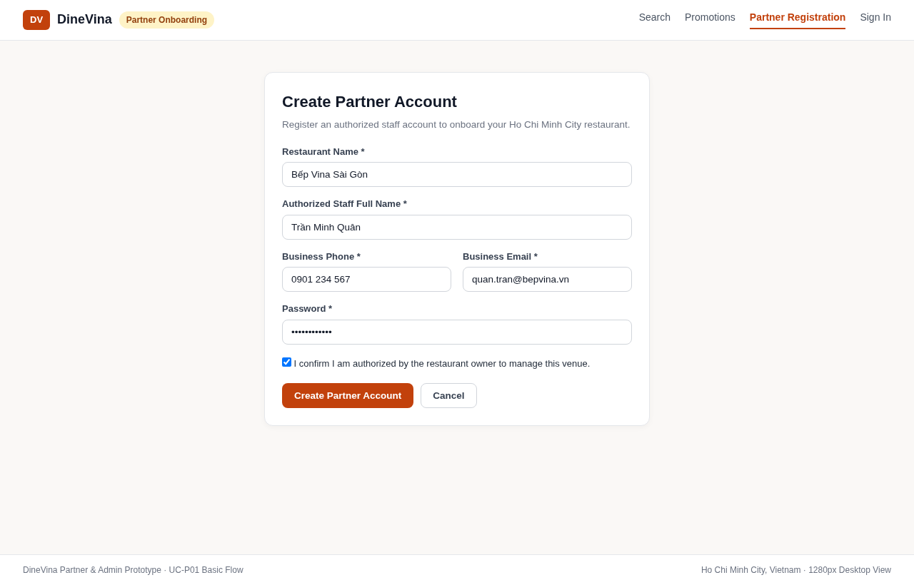

*UC-P01 - Alternative flow A1: Missing or invalid field*

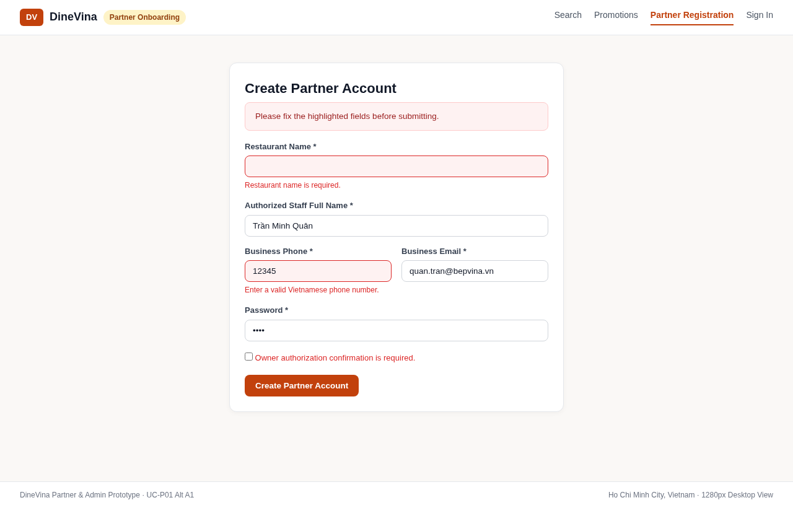

*UC-P01 - Alternative flow A2: Account already exists*

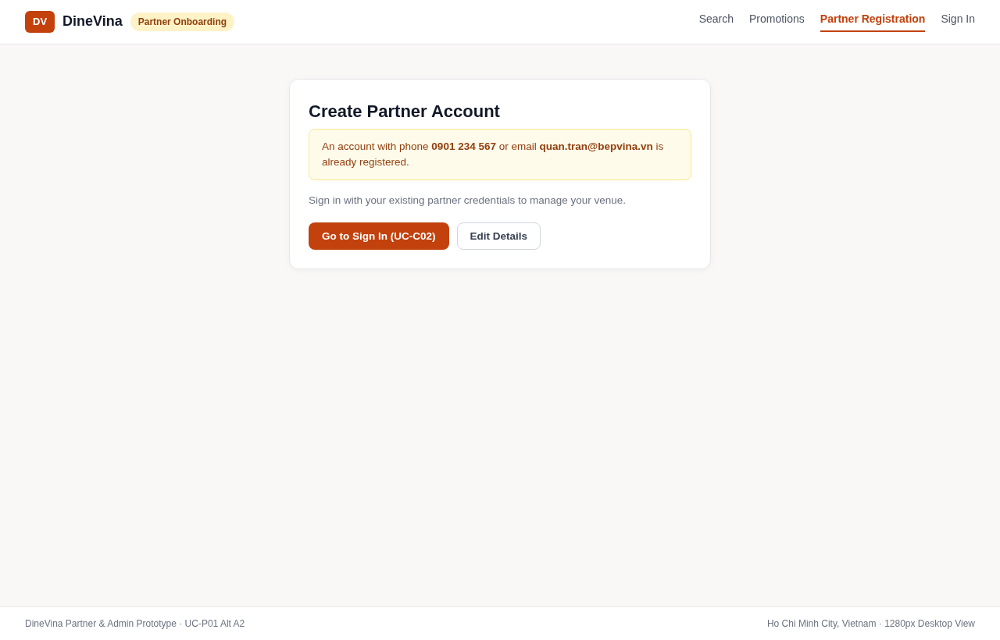

*UC-P01 - Alternative flow A3: Storage unavailable*

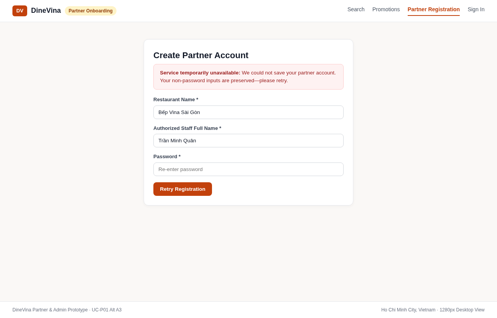

---

## UC-P02 Submit Venue Profile
**Performed by:** Lương Thiện Nhân | **Reviewed by:** Nguyễn Trung Kiên | **Edited by:** Lương Thiện Nhân

**1. Use-Case Name:** UC-P02 Submit Venue Profile

**Actor(s):** Partner Staff

**1.1 Brief Description**

Partner Staff submits a restaurant's profile (identity, Ho Chi Minh City district/address, cuisine, photos, amenities, budget range, capacity, and hotline) for administrator review, or corrects and resubmits a returned profile. Realizes FR-2.1 and FR-2.3.

**2. Flow of Events**

**2.1 Basic Flow**

1. Signed-in Partner Staff opens **Venue Profile** in the Partner Portal.
2. The system displays the venue profile form with required fields: venue name, district, street address, cuisine categories, average spend min/max (VND), total seating capacity, max party size, amenities, hotline, description, and venue photos.
3. Partner Staff completes the fields, uploads or attaches valid image URLs, and selects **Submit for Review**.
4. The system validates all required fields, numeric bounds (`min_price <= max_price`, `capacity >= 1`, `max_party_size >= 1`), and HCMC district selection.
5. The system stores the venue profile with `approval_status = Pending Review` and excludes it from public discovery (`FR-2.4`).
6. The system displays confirmation that the venue is queued for administrator onboarding review (`UC-A01`).

**2.2 Alternative Flows**

**2.2.1 A1 - Resubmit returned profile.** At step 1, if the venue's current status is `Returned`, the system displays the administrator's correction notes banner alongside the editable fields. Partner Staff updates the flagged fields and resubmits; the status transitions back to `Pending Review`.

**2.2.2 A2 - Validation error.** At step 4, if any required field is missing or numeric bounds are invalid (e.g., `min_price > max_price` or `max_party_size > capacity`), the system highlights the invalid fields and returns to step 3.

**2.2.3 A3 - Storage unavailable.** At step 5, if persistence fails, the system displays a retryable error and retains entered form values. The flow returns to step 3.

**2.2.4 A4 - Partner cancels.** Before step 5, Partner Staff exits without submitting; no status transition occurs.

**3. Special Requirements**

- SEC-01, SEC-04: only authenticated `partner_staff` owning the venue may submit or edit its profile.
- FR-2.4: unapproved (`Pending Review`, `Returned`, `Suspended`) venues must never appear in public F3 discovery.
- A11Y-01, PLAT-01: accessible form labels and responsive layout at 360 px and 1280 px.

**4. Preconditions**

- Partner Staff is signed in (`UC-C02`).

**5. Postconditions**

- Success: venue profile is stored with `Pending Review` status and ready for `UC-A01`.
- Failure: venue profile is not submitted for review.

**6. Extension Points**

None.

**7. Prototype Screens**

*UC-P02 - Basic flow (Step 2): Venue profile form*

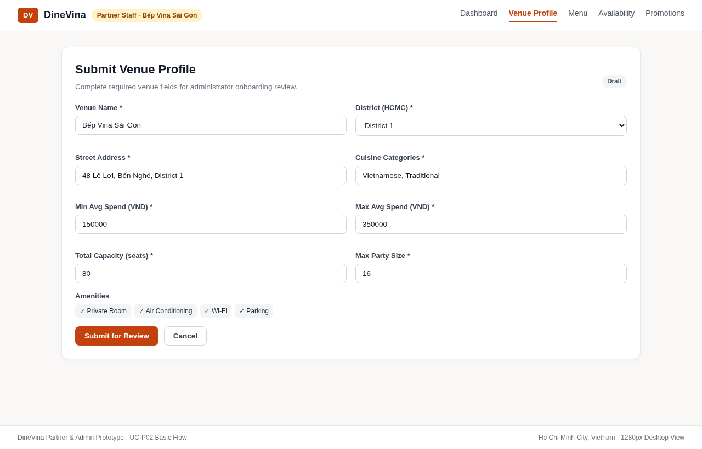

*UC-P02 - Basic flow (Step 6): Submitted for review confirmation*

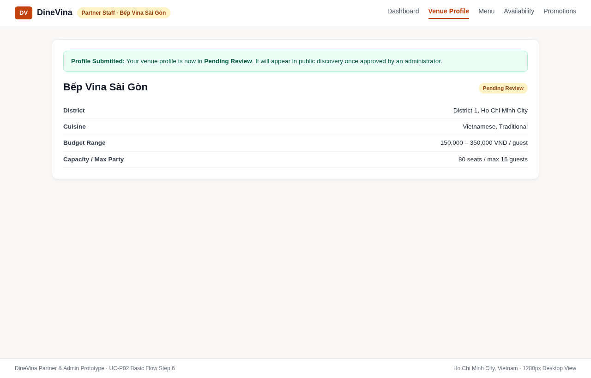

*UC-P02 - Alternative flow A1: Resubmit returned profile*

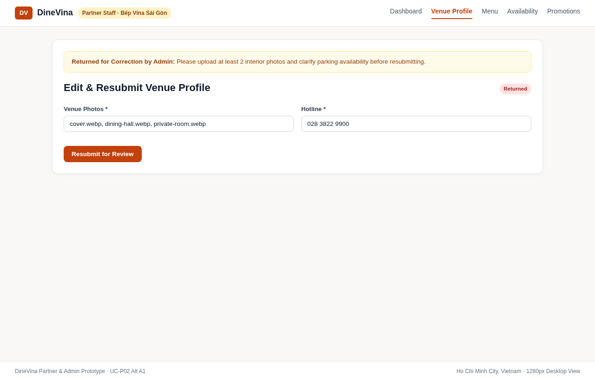

*UC-P02 - Alternative flow A2: Validation error*

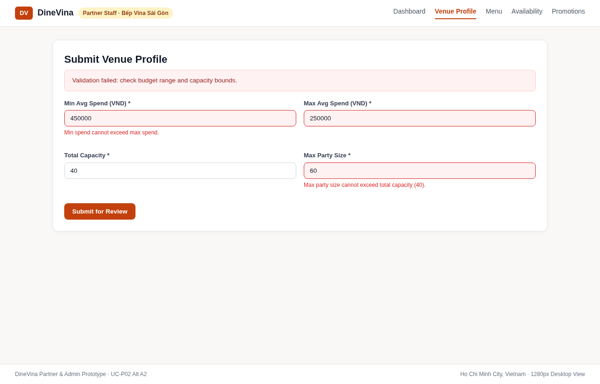

*UC-P02 - Alternative flow A3: Storage unavailable*

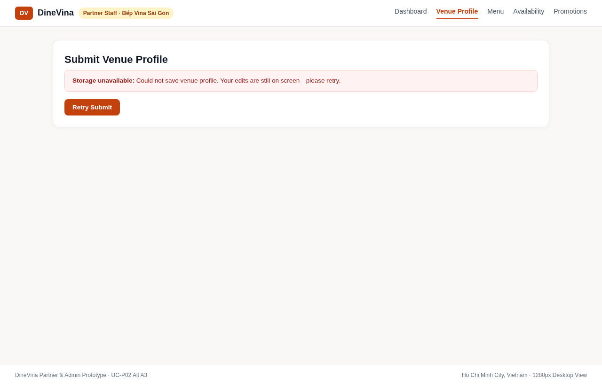

---

## UC-P03 Manage Menu
**Performed by:** Lương Thiện Nhân | **Reviewed by:** Nguyễn Trung Kiên | **Edited by:** Lương Thiện Nhân

**1. Use-Case Name:** UC-P03 Manage Menu

**Actor(s):** Partner Staff

**1.1 Brief Description**

Partner Staff creates, updates, and removes menu items (name, category, description, price in VND, availability flag) for their venue so guests can review accurate menu data before booking. Realizes FR-4.1.

**2. Flow of Events**

**2.1 Basic Flow**

1. Partner Staff opens **Menu Management** in the Partner Portal.
2. The system retrieves and displays the venue's existing menu items grouped by category.
3. Partner Staff selects **Add Menu Item** (or **Edit** on an existing item).
4. The system displays the menu item form (item name, category, description, price in VND, dietary/availability tags).
5. Partner Staff enters valid details and selects **Save Item**.
6. The system validates that the item name is non-empty and price is a positive integer.
7. The system saves the menu item and refreshes the menu list.

**2.2 Alternative Flows**

**2.2.1 A1 - Invalid price or missing name.** At step 6, if the item name is blank or price is missing/non-positive, the system displays inline validation errors and returns to step 5.

**2.2.2 A2 - Delete menu item.** At step 2, Partner Staff selects **Delete** on an item. The system prompts for confirmation; upon confirmation, the item is removed from the venue menu.

**2.2.3 A3 - Empty menu.** At step 2, if the venue has no menu items yet, the system shows an empty state prompting Partner Staff to add the first item (or invoke optional OCR draft `UC-AI03`).

**2.2.4 A4 - Storage unavailable.** At step 7 (or during delete in A2), if the database write fails, the system displays a retryable error without losing form input.

**2.2.5 A5 - Partner cancels.** Before saving or confirming deletion, Partner Staff closes the modal; no menu changes are saved.

**3. Special Requirements**

- SEC-01, SEC-04: role and venue-ownership check on every menu mutation.
- STD-01: prices are stored as integer VND amounts with ISO 8601 audit timestamps.
- A11Y-01, PLAT-01: accessible controls and responsive table/card layout.

**4. Preconditions**

- Partner Staff is signed in (`UC-C02`) and associated with a venue.

**5. Postconditions**

- Success: menu item is created, updated, or deleted in persistent storage.
- Failure: menu remains unchanged.

**6. Extension Points**

- `UC-AI03` Digitize Menu from Image *(candidate)* may extend `UC-P03` at step 2/3 to pre-populate an editable menu draft.

**7. Prototype Screens**

*UC-P03 - Basic flow (Step 2): Menu items list*

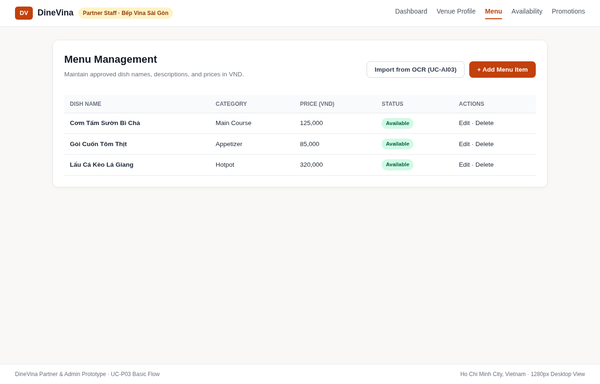

*UC-P03 - Basic flow (Step 4): Add/Edit menu item form*

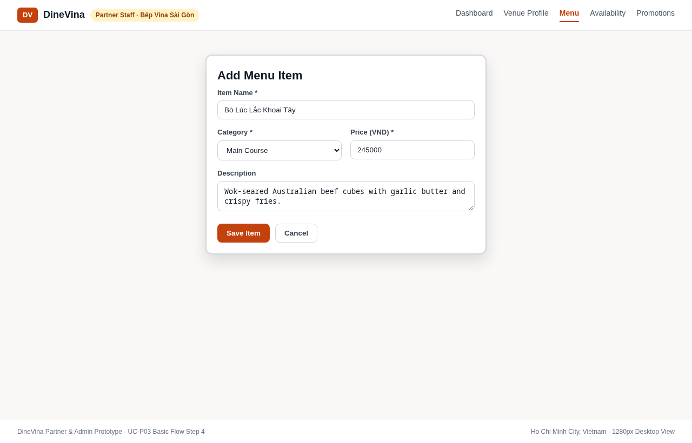

*UC-P03 - Alternative flow A1: Invalid price or missing name*

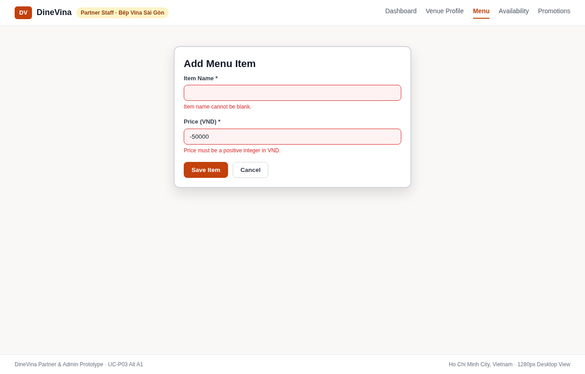

*UC-P03 - Alternative flow A2: Delete confirmation*

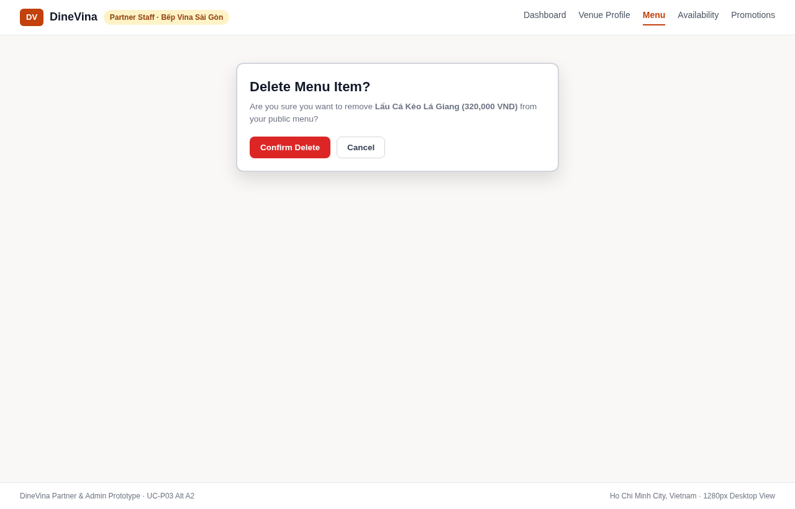

*UC-P03 - Alternative flow A3: Empty menu*

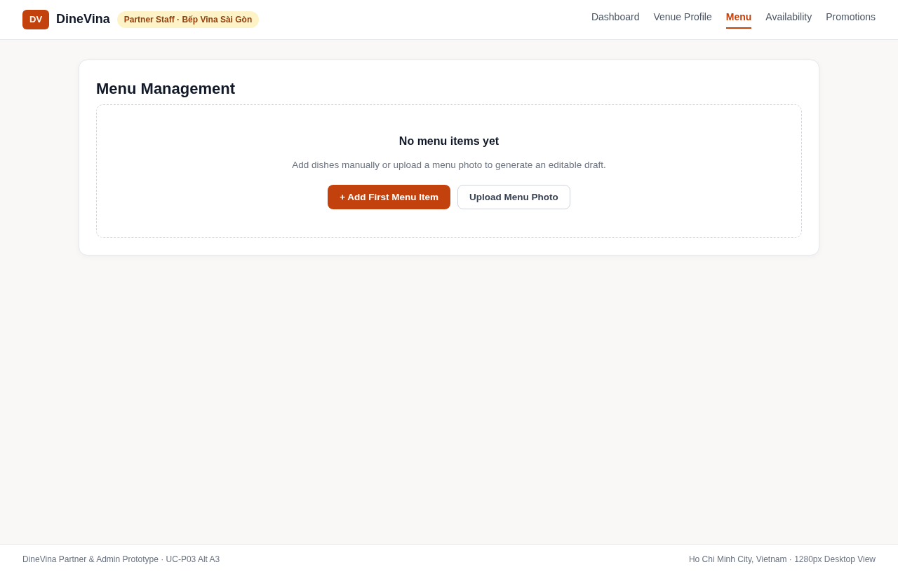

*UC-P03 - Alternative flow A4: Storage unavailable*

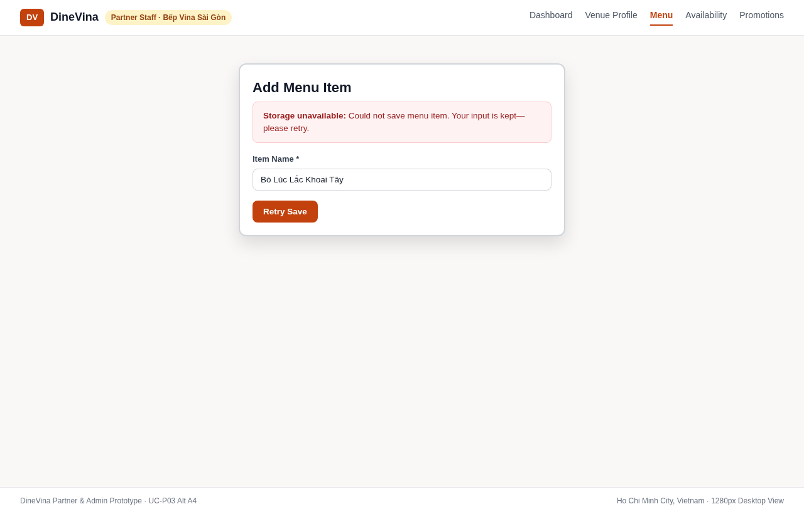

---

## UC-P04 Manage Availability
**Performed by:** Lương Thiện Nhân | **Reviewed by:** Nguyễn Trung Kiên | **Edited by:** Lương Thiện Nhân

**1. Use-Case Name:** UC-P04 Manage Availability

**Actor(s):** Partner Staff

**1.1 Brief Description**

Partner Staff configures operating hours, slot capacities, and blocked dates or time slots so that public slot checks and atomic booking confirmations reflect real venue capacity. Realizes FR-7.1.

**2. Flow of Events**

**2.1 Basic Flow**

1. Partner Staff opens **Availability & Capacity** in the Partner Portal.
2. The system displays current weekly operating hours, default slot capacity, and any active blocked slots.
3. Partner Staff updates operating hours, adjusts capacity, or adds a blocked date/time range and selects **Save Availability**.
4. The system validates that opening time precedes closing time, capacity is a positive integer, and blocked ranges are valid.
5. The system persists the updated availability rules and recalculates bookable slot inventory.
6. The system confirms that availability has been updated.

**2.2 Alternative Flows**

**2.2.1 A1 - Invalid hours or capacity.** At step 4, if closing time is earlier than or equal to opening time, or capacity is `<= 0`, the system shows an inline error and returns to step 3.

**2.2.2 A2 - Blocked slot conflicts with confirmed bookings.** At step 4, if a newly blocked slot overlaps existing `Confirmed` reservations, the system warns Partner Staff with the count of affected bookings and prevents silent deletion; Partner Staff must either cancel the block or handle affected bookings via `UC-P11`.

**2.2.3 A3 - Storage unavailable.** At step 5, if persistence fails, the system displays a retryable error and keeps previous availability unchanged.

**3. Special Requirements**

- REL-01, FR-7.3: availability updates must preserve atomic capacity invariants.
- SEC-01, SEC-04: verified `partner_staff` ownership required.
- PLAT-01, A11Y-01: responsive and keyboard-operable schedule controls.

**4. Preconditions**

- Partner Staff is signed in (`UC-C02`) and owns the venue.

**5. Postconditions**

- Success: operating hours, capacity, and blocked slots are updated in persistent storage.
- Failure: prior availability rules remain intact.

**6. Extension Points**

None.

**7. Prototype Screens**

*UC-P04 - Basic flow: Availability and capacity settings*

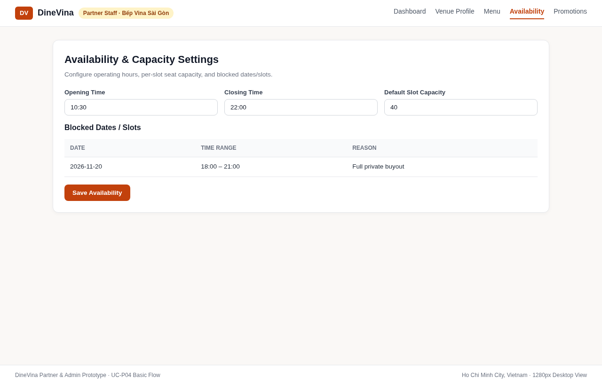

*UC-P04 - Alternative flow A1: Invalid hours or capacity*

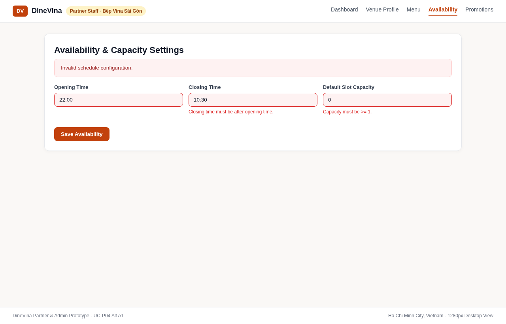

*UC-P04 - Alternative flow A2: Blocked slot conflict*

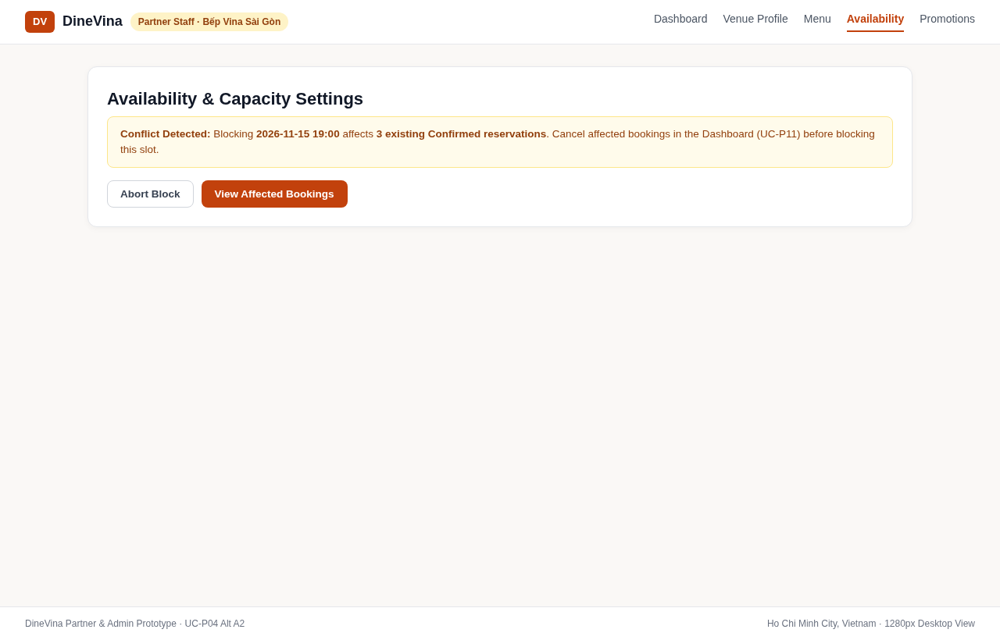

*UC-P04 - Alternative flow A3: Storage unavailable*

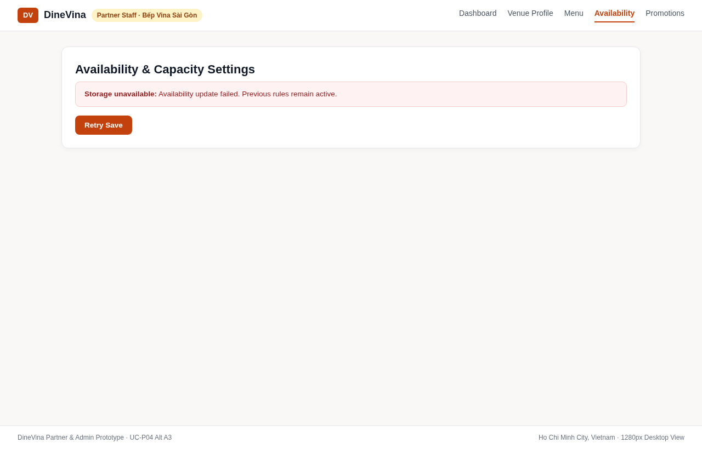

---

## UC-P05 View Partner Dashboard
**Performed by:** Lương Thiện Nhân | **Reviewed by:** Nguyễn Trung Kiên | **Edited by:** Lương Thiện Nhân

**1. Use-Case Name:** UC-P05 View Partner Dashboard

**Actor(s):** Partner Staff

**1.1 Brief Description**

Partner Staff views the operational dashboard listing incoming table reservation requests (with response-window countdowns), confirmed bookings, and incoming event inquiries. Realizes FR-7.2.

**2. Flow of Events**

**2.1 Basic Flow**

1. Partner Staff signs in (`UC-C02`) or selects **Dashboard** in the Partner Portal.
2. The system queries pending and active reservation requests and event inquiries belonging to the partner's venue.
3. The system displays summary counts and paginated queues (default 20, max 50 items) showing guest name, date/time, party size, current state, and remaining 30-minute response window for `Pending confirmation` requests.
4. Partner Staff can filter by status or date and select a request to act on (`UC-P06`, `UC-P07`, `UC-P11`, `UC-P12`).

**2.2 Alternative Flows**

**2.2.1 A1 - Empty queues.** At step 2, if no reservation requests or event inquiries exist for the selected filter, the system displays a clear empty state message.

**2.2.2 A2 - Service unavailable.** At step 2, if the backend cannot load dashboard data, the system shows an error banner with a **Retry** action.

**3. Special Requirements**

- PERF-04: list endpoints default to 20 and cap at 50 items per page.
- SEC-01, SEC-04: Partner Staff sees only records belonging to their authorized venue(s).
- PLAT-01, A11Y-01: usable at 360 px and 1280 px with accessible status badges.

**4. Preconditions**

- Partner Staff is signed in (`UC-C02`).

**5. Postconditions**

- Success: current venue queues are displayed accurately.
- Failure: error state shown without exposing other venues' data.

**6. Extension Points**

- `UC-P06` Decide Reservation Request extends `UC-P05` when Partner Staff opens a pending reservation request.
- `UC-P07` Review Event Inquiry extends `UC-P05` when Partner Staff opens an event inquiry.

**7. Prototype Screens**

*UC-P05 - Basic flow: Partner dashboard queues*

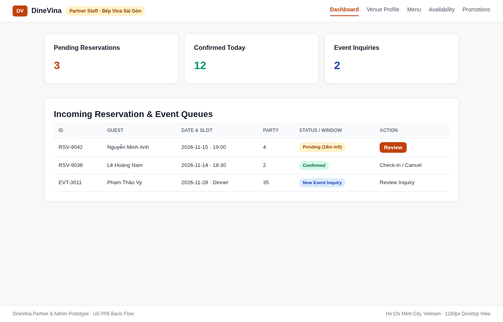

*UC-P05 - Alternative flow A1: Empty queues*

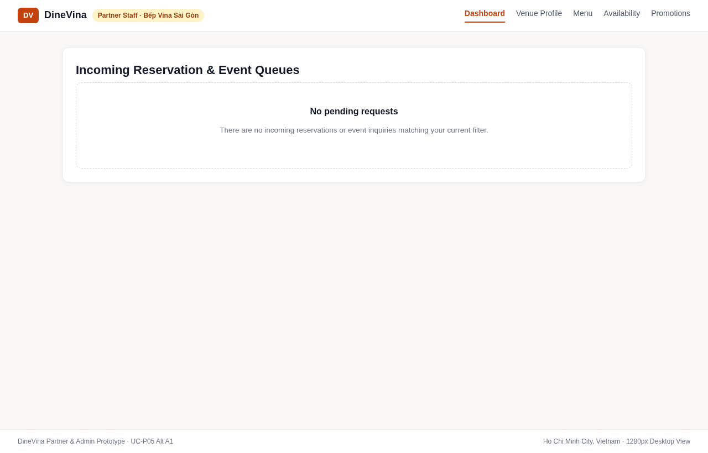

*UC-P05 - Alternative flow A2: Service unavailable*

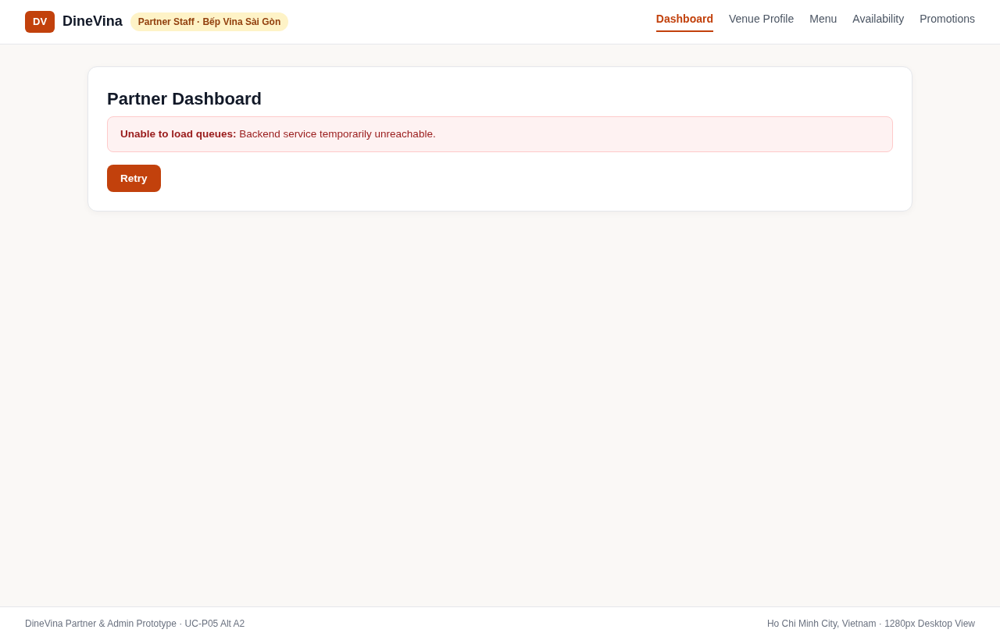

---

## UC-P06 Decide Reservation Request
**Performed by:** Lương Thiện Nhân | **Reviewed by:** Nguyễn Trung Kiên | **Edited by:** Lương Thiện Nhân

**1. Use-Case Name:** UC-P06 Decide Reservation Request

**Actor(s):** Partner Staff

**1.1 Brief Description**

Partner Staff reviews a `Pending confirmation` table reservation request, performs an atomic capacity recheck, and either confirms the booking or declines it with a mandatory reason before the 30-minute response window expires. Realizes FR-5.3 and FR-5.6.

**2. Flow of Events**

**2.1 Basic Flow**

1. From the dashboard (`UC-P05`), Partner Staff selects a `Pending confirmation` reservation request.
2. The system displays the request details (customer name, phone, date, time slot, party size, special requests, and remaining response countdown).
3. The system includes `UC-C08` Check Slot Availability to verify current remaining capacity for the requested date, slot, and party size.
4. Partner Staff selects **Confirm Reservation**.
5. Within an atomic database transaction, the system rechecks capacity, decrements remaining slot capacity, transitions the state from `Pending confirmation` to `Confirmed`, and appends an audit entry (actor, timestamp).
6. The system notifies the customer and displays the `Confirmed` status.

**2.2 Alternative Flows**

**2.2.1 A1 - Decline with mandatory reason.** At step 4, Partner Staff selects **Decline**, enters a mandatory reason (e.g., private buyout, kitchen maintenance), and submits. The system transitions the request to `Declined`, records the reason and timestamp, and notifies the customer. If the reason is empty, submission is blocked with an inline error.

**2.2.2 A2 - Insufficient capacity.** At step 3 or step 5 (due to concurrent confirmations), if remaining capacity is less than the requested party size, the system blocks confirmation, informs Partner Staff that the slot is full, and offers **Decline** with reason.

**2.2.3 A3 - Response window expired (30 minutes).** If the 30-minute partner response window has elapsed before a decision is committed, the system marks the request `Expired`, disables **Confirm** and **Decline**, and informs Partner Staff.

**2.2.4 A4 - Storage unavailable.** At step 5, if the transaction cannot be committed, the system rolls back cleanly (zero partial capacity deduction) and shows a retryable error.

**3. Special Requirements**

- REL-01, FR-7.3, PERF-02: capacity recheck and state transition are atomic (`p95 <= 500 ms`); zero over-capacity confirmations under concurrent requests.
- SEC-01, SEC-04: only authorized Partner Staff for that venue may decide the request.

**4. Preconditions**

- Partner Staff is signed in (`UC-C02`).
- Reservation request exists for the partner's venue.

**5. Postconditions**

- Success: request is `Confirmed` (capacity reserved) or `Declined` (with reason), with immutable history.
- Failure / Timeout: request remains `Pending confirmation` (on retryable error) or becomes `Expired` (after 30 minutes).

**6. Extension Points**

- Extends `UC-P05` View Partner Dashboard.
- Includes `UC-C08` Check Slot Availability.

**7. Prototype Screens**

*UC-P06 - Basic flow: Confirm reservation request with capacity recheck*

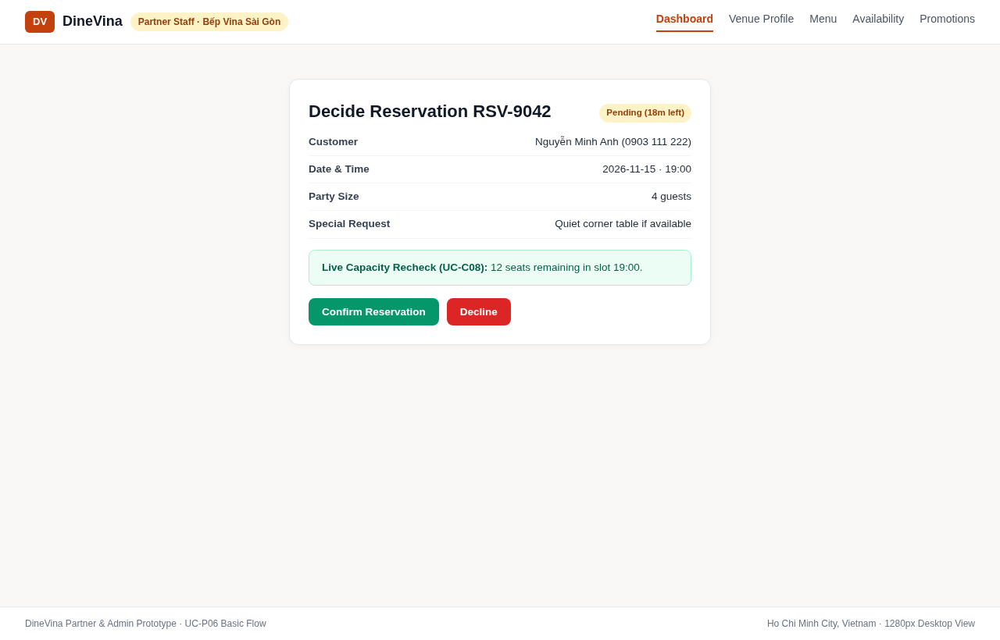

*UC-P06 - Alternative flow A1: Decline with mandatory reason*

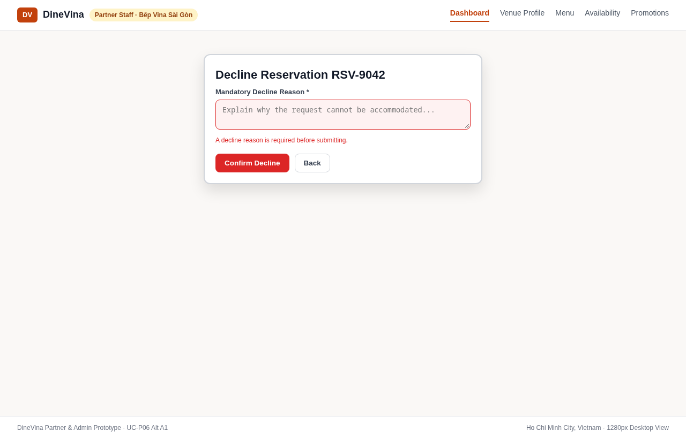

*UC-P06 - Alternative flow A2: Insufficient capacity*

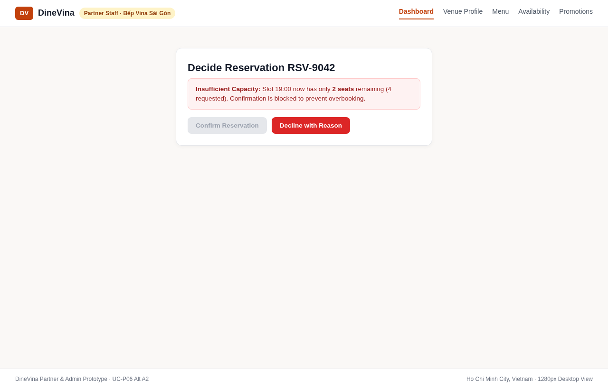

*UC-P06 - Alternative flow A3: Request expired after 30 minutes*

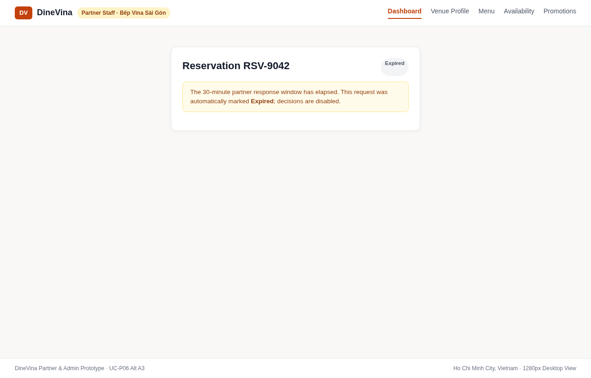

*UC-P06 - Alternative flow A4: Storage unavailable*

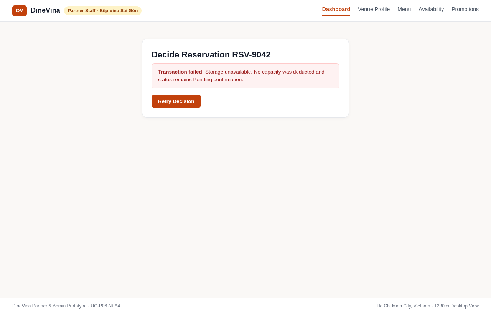

---

## UC-P07 Review Event Inquiry
**Performed by:** Lương Thiện Nhân | **Reviewed by:** Nguyễn Trung Kiên | **Edited by:** Lương Thiện Nhân

**1. Use-Case Name:** UC-P07 Review Event Inquiry

**Actor(s):** Partner Staff

**1.1 Brief Description**

Partner Staff inspects an incoming group-event inquiry (occasion, party size, preferred date, budget, special needs) and decides whether to request clarification, close it as unavailable, or proceed to prepare a proposal. Realizes FR-6.2.

**2. Flow of Events**

**2.1 Basic Flow**

1. From the dashboard (`UC-P05`), Partner Staff selects an event inquiry.
2. The system displays the event brief, customer contact info, and full inquiry timeline.
3. Partner Staff evaluates venue suitability and selects **Prepare Proposal** (extending to `UC-P08`).
4. The system records the review transition and opens the proposal builder (`UC-P08`).

**2.2 Alternative Flows**

**2.2.1 A1 - Request clarification.** At step 3, if event details are incomplete, Partner Staff selects **Request Clarification**, enters the specific questions for the customer, and submits. The inquiry moves to `Clarification Requested` and notifies the customer (`UC-C13`). Empty clarification messages are rejected.

**2.2.2 A2 - Close as unavailable.** At step 3, if the venue cannot host the event (e.g., date booked or budget/capacity mismatch), Partner Staff selects **Close as Unavailable**, enters a mandatory explanation, and submits. The inquiry moves to `Closed - Unavailable` and retains its history.

**2.2.3 A3 - Storage unavailable.** If saving the clarification or closure fails, the system displays a retryable error without changing the inquiry state.

**3. Special Requirements**

- SEC-01, SEC-04: scoped to authorized Partner Staff of the target venue.
- STD-01: all timeline messages and state transitions record ISO 8601 timestamps and actor IDs.

**4. Preconditions**

- Partner Staff is signed in (`UC-C02`) and an event inquiry exists for the venue.

**5. Postconditions**

- Success: inquiry transitions to `Clarification Requested`, `Closed - Unavailable`, or proceeds to `UC-P08`.
- Failure: inquiry state remains unchanged.

**6. Extension Points**

- Extends `UC-P05` View Partner Dashboard.
- Extended by `UC-P08` Send Event Proposal at step 3/4.

**7. Prototype Screens**

*UC-P07 - Basic flow: Review event inquiry*

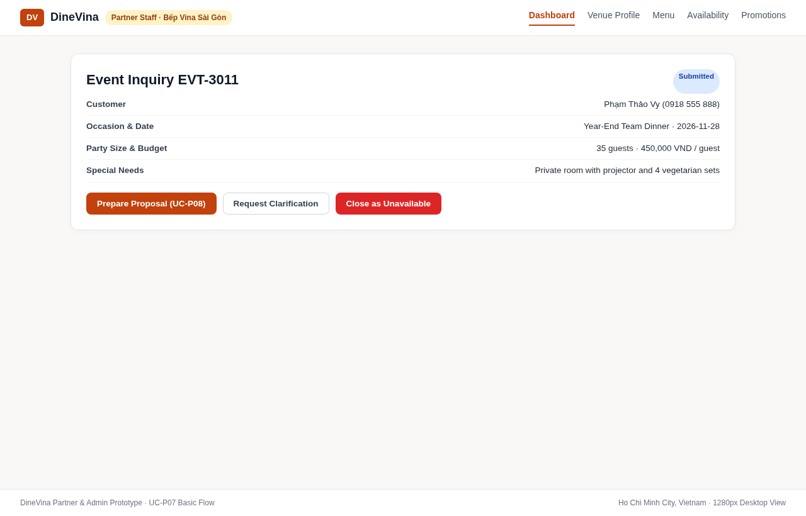

*UC-P07 - Alternative flow A1: Request clarification*

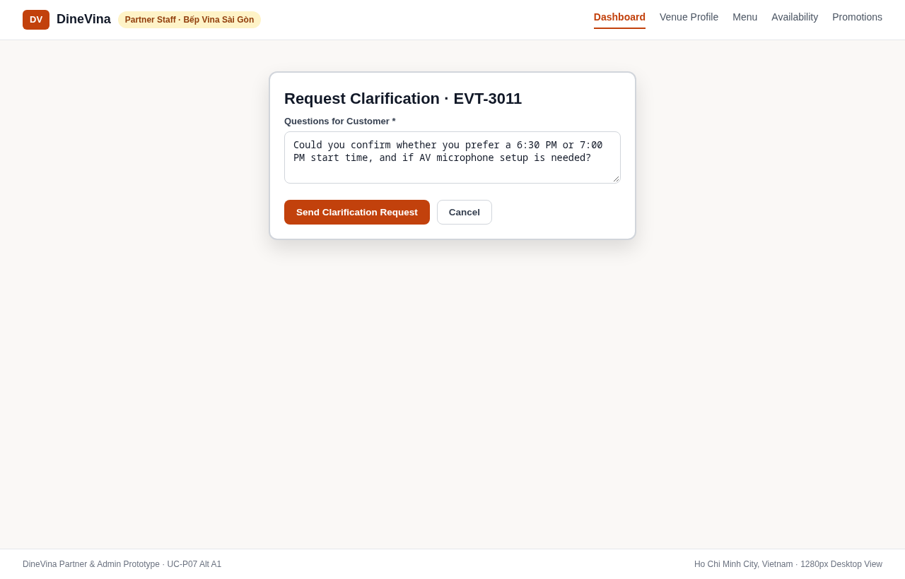

*UC-P07 - Alternative flow A2: Close as unavailable*

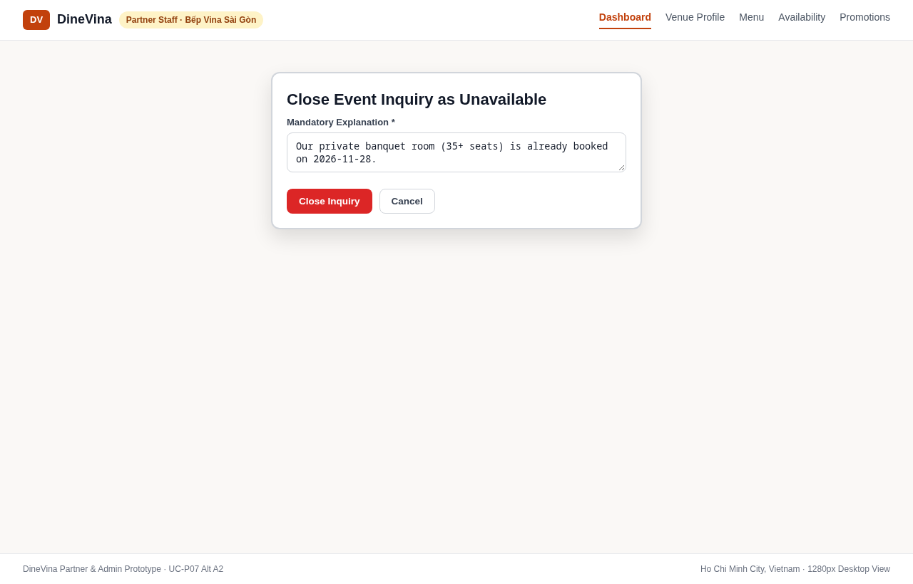

*UC-P07 - Alternative flow A3: Storage unavailable*

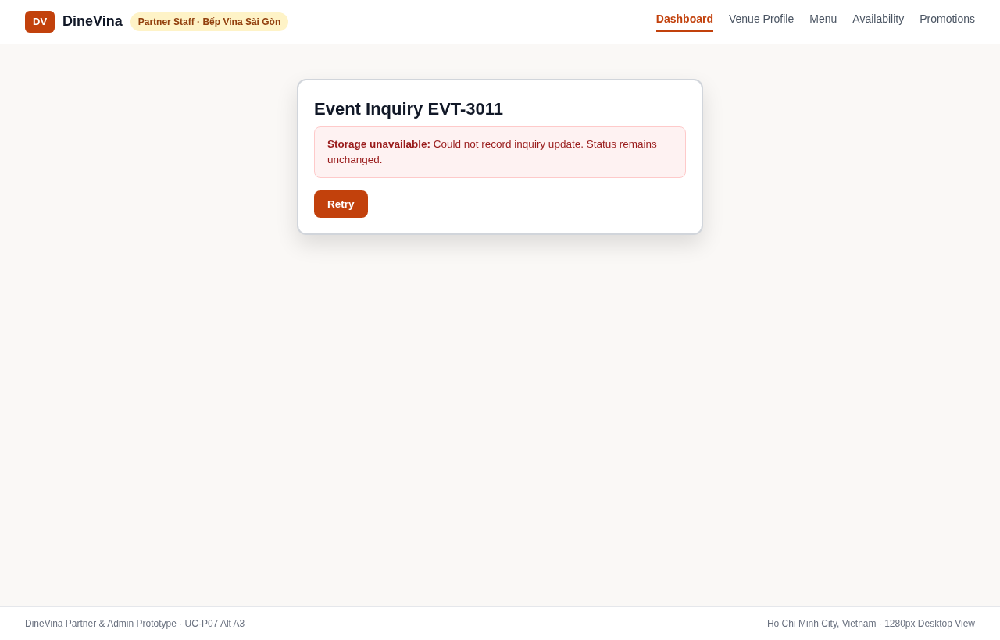

---

## UC-P08 Send Event Proposal
**Performed by:** Lương Thiện Nhân | **Reviewed by:** Nguyễn Trung Kiên | **Edited by:** Lương Thiện Nhân

**1. Use-Case Name:** UC-P08 Send Event Proposal

**Actor(s):** Partner Staff

**1.1 Brief Description**

Partner Staff drafts and sends a structured event proposal containing menu package, room/area assignment, quoted price, and booking terms to the customer. Realizes FR-6.4.

**2. Flow of Events**

**2.1 Basic Flow**

1. From a reviewed event inquiry (`UC-P07`), Partner Staff selects **Prepare Proposal**.
2. The system displays the proposal form with fields for proposed menu summary, assigned room/area, total or per-guest price (VND), and terms/validity.
3. Partner Staff enters all proposal details and selects **Send Proposal**.
4. The system validates that menu, room, positive price, and terms are all provided.
5. The system stores the versioned proposal, transitions the inquiry to `Proposal Sent`, and notifies the customer (`UC-C13`).

**2.2 Alternative Flows**

**2.2.1 A1 - Missing or invalid proposal fields.** At step 4, if any required field is empty or the price is non-positive, the system displays inline validation errors and returns to step 3.

**2.2.2 A2 - Revise proposal after customer feedback.** If the customer requested a revision (`UC-C13`), Partner Staff opens the inquiry, sees the customer's revision note, edits the proposal fields, and sends a new proposal version (`v2`, etc.).

**2.2.3 A3 - Storage unavailable.** At step 5, if persistence fails, the system displays a retryable error and preserves entered proposal fields.

**2.2.4 A4 - Partner cancels.** Before step 5, Partner Staff cancels drafting; no proposal is sent.

**3. Special Requirements**

- SEC-01, SEC-04: only authorized Partner Staff may send proposals for their venue.
- STD-01: proposals are versioned with ISO 8601 timestamps for auditability.

**4. Preconditions**

- An active event inquiry exists in `Under Review`, `Clarification Provided`, or `Revision Requested` state.

**5. Postconditions**

- Success: proposal is saved and sent; inquiry state becomes `Proposal Sent`.
- Failure: no new proposal version is created.

**6. Extension Points**

- Extends `UC-P07` Review Event Inquiry.

**7. Prototype Screens**

*UC-P08 - Basic flow: Send event proposal*

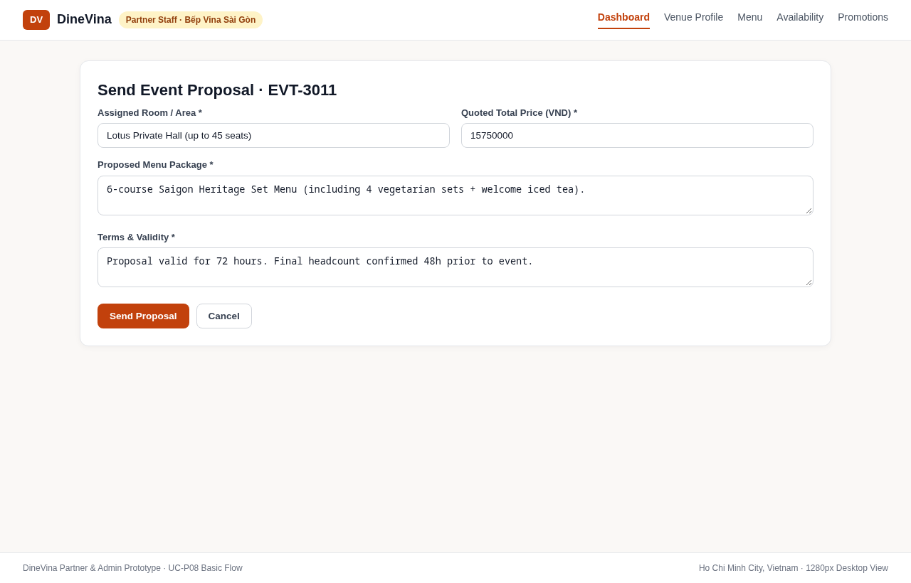

*UC-P08 - Alternative flow A1: Missing or invalid proposal fields*

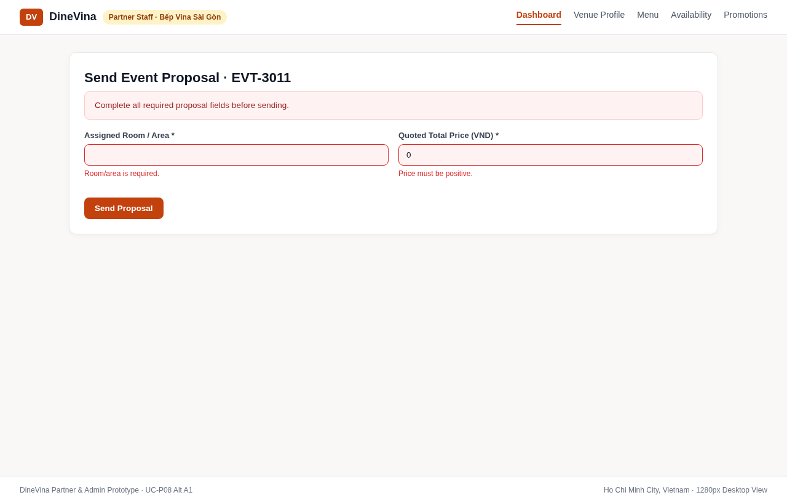

*UC-P08 - Alternative flow A2: Revise proposal after customer feedback*

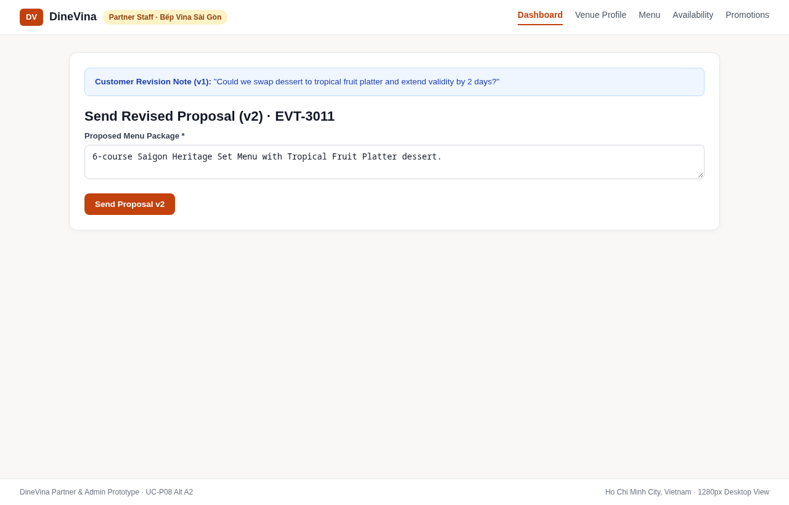

*UC-P08 - Alternative flow A3: Storage unavailable*

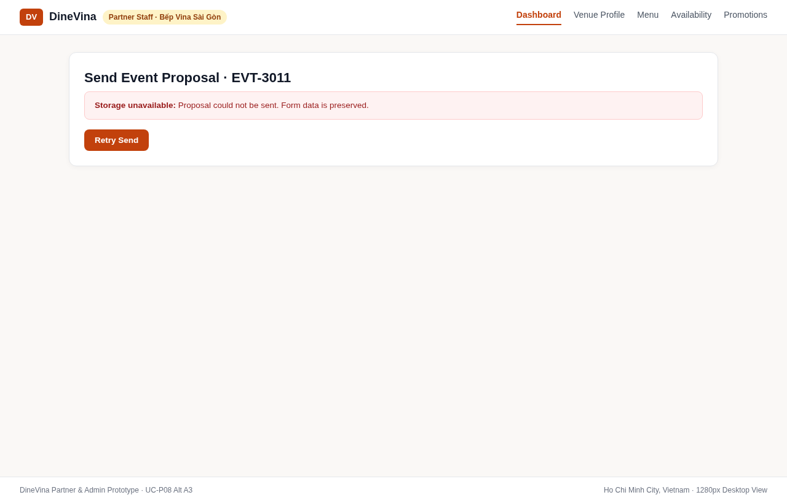

---

## UC-P09 Confirm Event Booking
**Performed by:** Lương Thiện Nhân | **Reviewed by:** Nguyễn Trung Kiên | **Edited by:** Lương Thiện Nhân

**1. Use-Case Name:** UC-P09 Confirm Event Booking

**Actor(s):** Partner Staff

**1.1 Brief Description**

After the customer accepts an event proposal (`UC-C13`), Partner Staff performs a final capacity check and confirms the event booking so agreed terms are locked for both parties. Realizes FR-6.6.

**2. Flow of Events**

**2.1 Basic Flow**

1. Partner Staff opens an event inquiry in `Proposal Accepted` state from the dashboard (`UC-P05`).
2. The system displays the accepted proposal details (menu, room, price, terms, date, party size).
3. The system includes `UC-C08` Check Slot Availability to verify remaining venue/room capacity for the event date and party size.
4. Partner Staff selects **Confirm Event Booking**.
5. Within an atomic transaction, the system rechecks capacity, reserves the required capacity, transitions the event inquiry to `Event Confirmed`, and locks the agreed terms.
6. The system notifies the customer and makes the agreed terms read-only for both parties.

**2.2 Alternative Flows**

**2.2.1 A1 - Capacity conflict.** At step 3 or step 5, if capacity is no longer available for the event date/party size, the system blocks confirmation and prompts Partner Staff to propose an alternative date (`UC-P08`) or close as unavailable (`UC-P07`).

**2.2.2 A2 - Storage unavailable.** At step 5, if the transaction fails, the system rolls back cleanly and shows a retryable error.

**3. Special Requirements**

- REL-01, FR-7.3, PERF-02: atomic capacity check and booking confirmation (`p95 <= 500 ms`).
- SEC-01, SEC-04: authorized Partner Staff ownership check required.

**4. Preconditions**

- Customer has accepted the latest proposal (`Proposal Accepted`).

**5. Postconditions**

- Success: event is `Event Confirmed`, capacity is reserved, and agreed terms are visible to both customer and partner.
- Failure: event remains in `Proposal Accepted` without partial capacity deduction.

**6. Extension Points**

- Includes `UC-C08` Check Slot Availability.

**7. Prototype Screens**

*UC-P09 - Basic flow: Confirm accepted event booking*

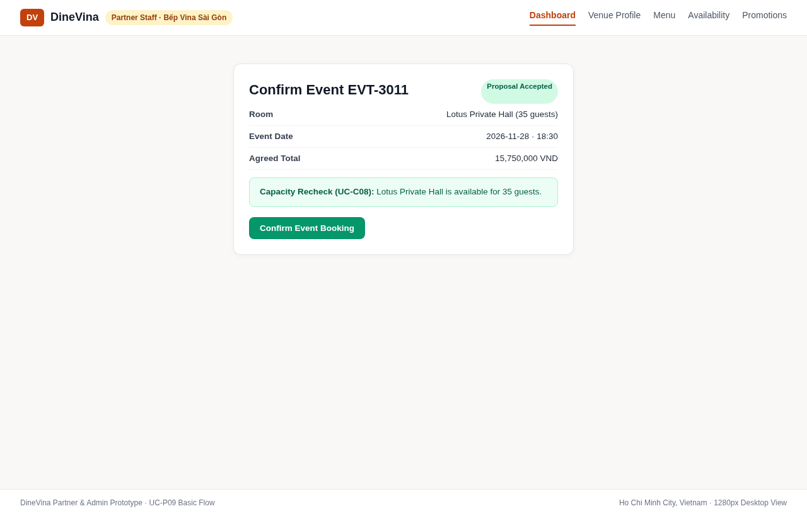

*UC-P09 - Alternative flow A1: Capacity conflict*

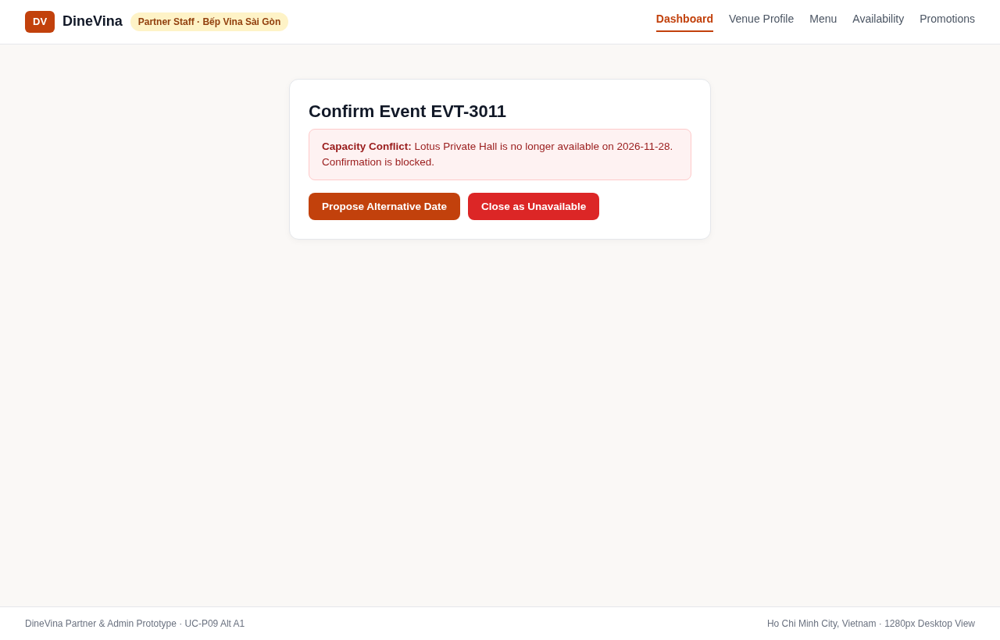

*UC-P09 - Alternative flow A2: Storage unavailable*

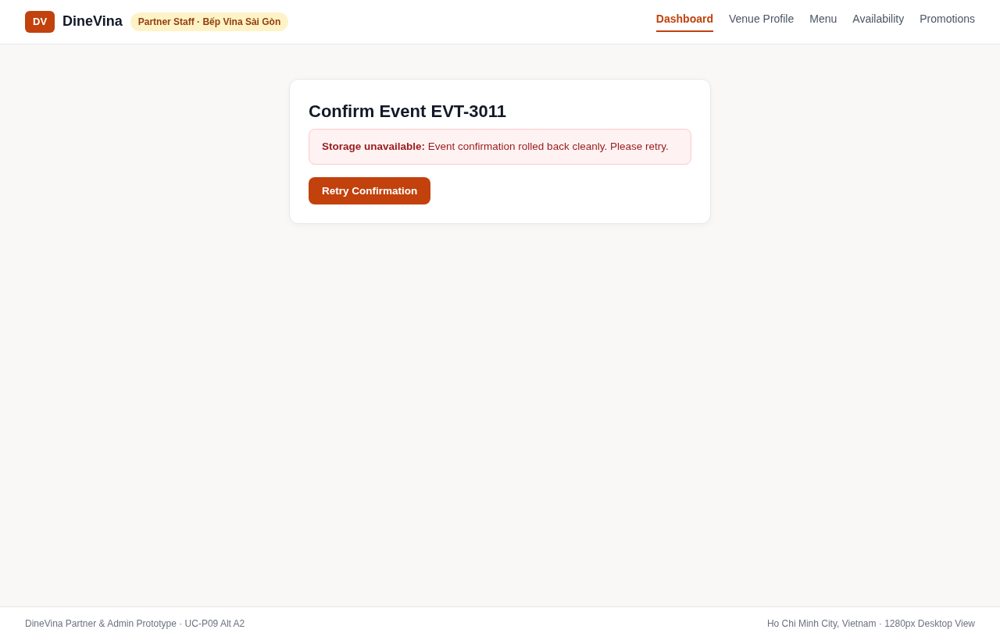

---

## UC-P10 Submit Promotion or Venue Content
**Performed by:** Lương Thiện Nhân | **Reviewed by:** Nguyễn Trung Kiên | **Edited by:** Lương Thiện Nhân

**1. Use-Case Name:** UC-P10 Submit Promotion or Venue Content

**Actor(s):** Partner Staff

**1.1 Brief Description**

Partner Staff submits a time-bound promotion (with eligibility conditions and expiry) or venue editorial content for administrator moderation before publication. Realizes FR-8.1 and FR-8.2.

**2. Flow of Events**

**2.1 Basic Flow**

1. Partner Staff opens **Promotions & Content** in the Partner Portal and selects **New Promotion**.
2. The system displays the promotion form: title, offer summary, eligibility conditions, start date, and expiry date.
3. Partner Staff completes the fields and selects **Submit for Moderation**.
4. The system validates that all fields are non-empty and that the expiry date is after the start date.
5. The system stores the promotion in `Pending Moderation` status (not yet visible to guests) and queues it for `UC-A03`.
6. The system confirms submission.

**2.2 Alternative Flows**

**2.2.1 A1 - Submit venue editorial content.** At step 1, Partner Staff selects **Venue Content** instead of **New Promotion**, enters a title and editorial body compliant with platform rules, and submits it to `Pending Moderation`.

**2.2.2 A2 - Invalid dates or missing conditions.** At step 4, if eligibility conditions are blank or the expiry date is earlier than or equal to the start date, the system highlights the fields and returns to step 3.

**2.2.3 A3 - Storage unavailable.** At step 5, if persistence fails, the system shows a retryable error and retains entered data.

**3. Special Requirements**

- SEC-01, SEC-04: only authorized Partner Staff may submit content for their venue.
- STD-01: dates use ISO 8601 format.

**4. Preconditions**

- Partner Staff is signed in (`UC-C02`) and has an approved or onboarding venue.

**5. Postconditions**

- Success: promotion or content item is stored as `Pending Moderation` for `UC-A03`.
- Failure: nothing is queued or published.

**6. Extension Points**

None.

**7. Prototype Screens**

*UC-P10 - Basic flow: Submit promotion form*

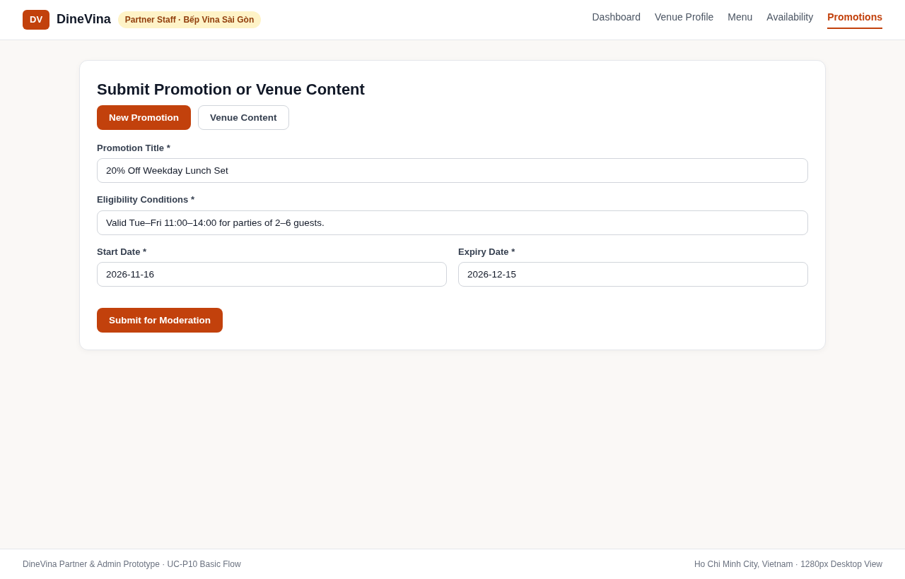

*UC-P10 - Alternative flow A1: Submit venue editorial content*

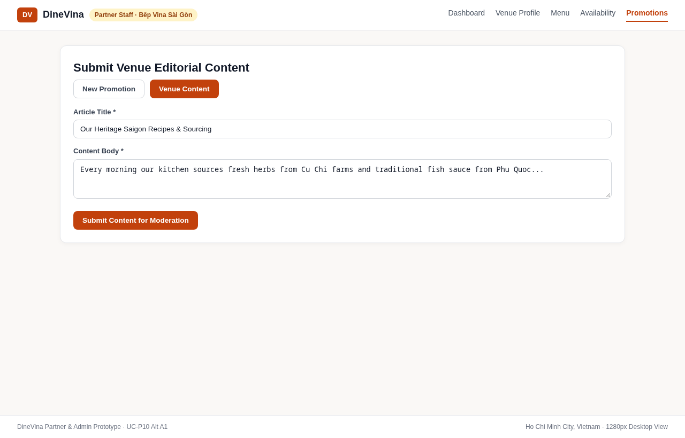

*UC-P10 - Alternative flow A2: Invalid dates or missing conditions*

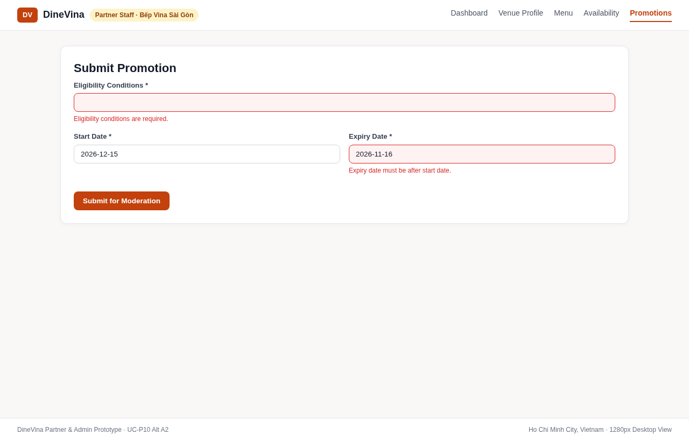

*UC-P10 - Alternative flow A3: Storage unavailable*

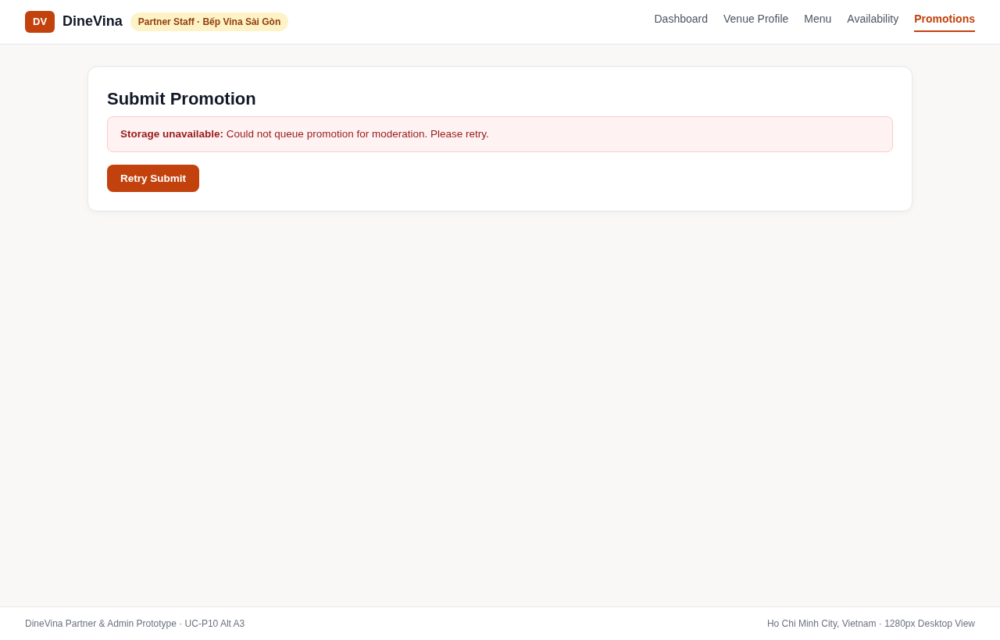

---

## UC-P11 Cancel Confirmed Reservation
**Performed by:** Lương Thiện Nhân | **Reviewed by:** Nguyễn Trung Kiên | **Edited by:** Lương Thiện Nhân

**1. Use-Case Name:** UC-P11 Cancel Confirmed Reservation

**Actor(s):** Partner Staff

**1.1 Brief Description**

In an exceptional operational situation, Partner Staff cancels a `Confirmed` table reservation with a mandatory reason, transitioning it to `Cancelled by restaurant`, releasing slot capacity, and notifying the customer. Realizes FR-5.8.

**2. Flow of Events**

**2.1 Basic Flow**

1. Partner Staff opens a `Confirmed` reservation from the dashboard (`UC-P05`).
2. Partner Staff selects **Cancel Reservation (Operational)**.
3. The system displays a cancellation dialog requiring a mandatory operational reason.
4. Partner Staff enters the reason and confirms cancellation.
5. Within an atomic transaction, the system transitions the reservation to `Cancelled by restaurant`, releases the reserved slot capacity, records the actor, timestamp, and reason in status history, and notifies the customer.
6. The system displays the updated `Cancelled by restaurant` status.

**2.2 Alternative Flows**

**2.2.1 A1 - Missing cancellation reason.** At step 4, if the operational reason is empty, the system blocks submission with an inline error and returns to step 4.

**2.2.2 A2 - Reservation already completed or cancelled.** At step 5, if the reservation state changed concurrently (e.g., `Cancelled by customer` or `Completed`), the system rejects the illegal transition (`REL-01`) and refreshes the current state.

**2.2.3 A3 - Storage unavailable.** At step 5, if persistence fails, the system rolls back cleanly and shows a retryable error.

**2.2.4 A4 - Partner aborts.** At step 3/4, Partner Staff closes the dialog; the reservation remains `Confirmed`.

**3. Special Requirements**

- REL-01, REL-02: illegal state transitions are rejected; status history preserves actor, timestamp, and reason.
- SEC-01, SEC-04: authorized Partner Staff ownership check required.

**4. Preconditions**

- Reservation is currently in `Confirmed` state.

**5. Postconditions**

- Success: reservation is `Cancelled by restaurant`, capacity is released, and customer is notified.
- Failure: reservation remains in its prior state.

**6. Extension Points**

None.

**7. Prototype Screens**

*UC-P11 - Basic flow: Cancel confirmed reservation*

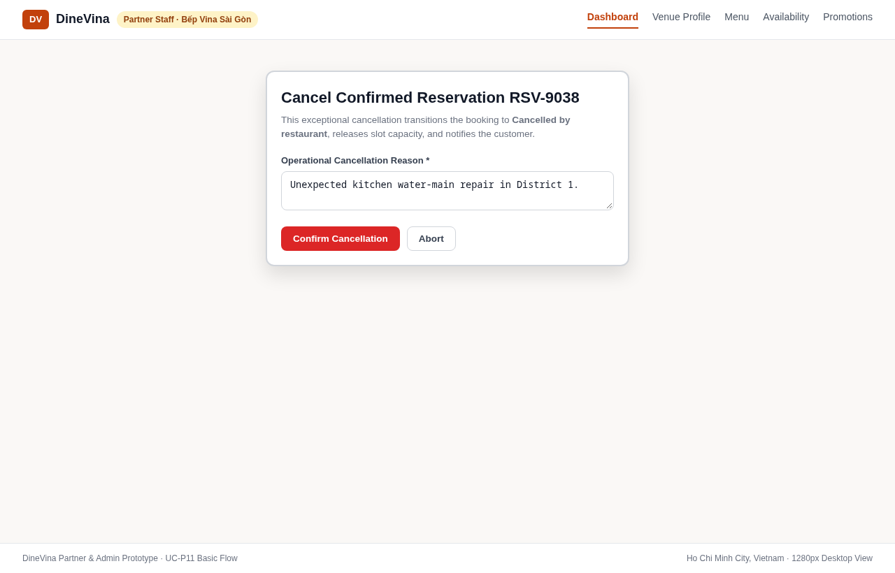

*UC-P11 - Alternative flow A1: Missing cancellation reason*

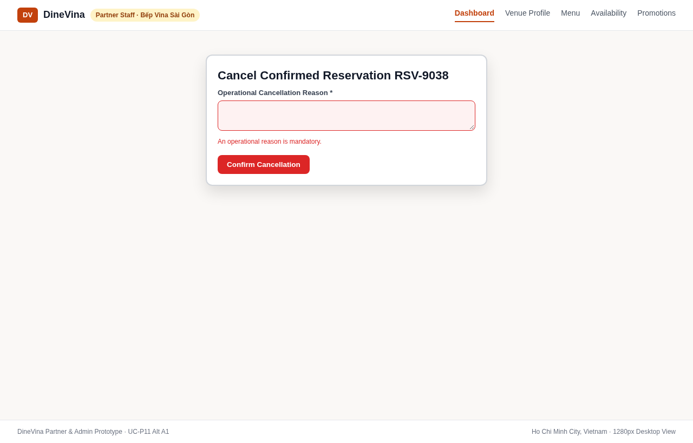

*UC-P11 - Alternative flow A2: Already completed or cancelled*

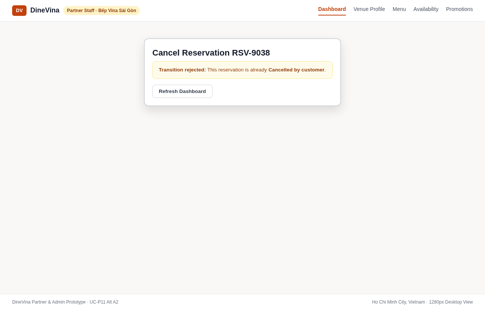

*UC-P11 - Alternative flow A3: Storage unavailable*

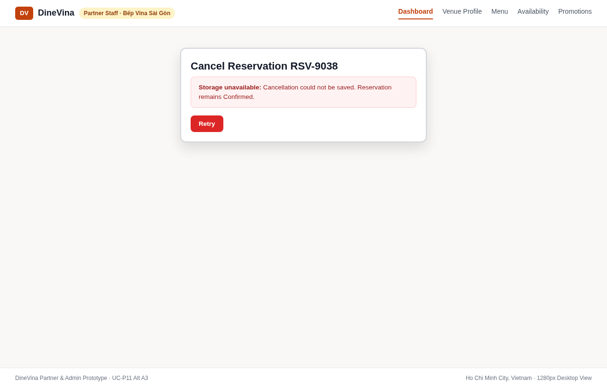

---

## UC-P12 Record Reservation Attendance
**Performed by:** Lương Thiện Nhân | **Reviewed by:** Nguyễn Trung Kiên | **Edited by:** Lương Thiện Nhân

**1. Use-Case Name:** UC-P12 Record Reservation Attendance

**Actor(s):** Partner Staff

**1.1 Brief Description**

Partner Staff validates a customer's arrival and check-in at the venue (`Completed`) or records/observes a `No-show` after the 30-minute grace period. Realizes FR-5.9 and FR-5.10.

**2. Flow of Events**

**2.1 Basic Flow**

1. Partner Staff opens a `Confirmed` reservation for today's service on the dashboard (`UC-P05`).
2. When the customer arrives within the valid check-in window, Partner Staff selects **Validate Check-In**.
3. The system verifies the reservation is `Confirmed` and within the active check-in window.
4. The system transitions the reservation to `Completed` and appends an audit entry (actor, timestamp).
5. The system displays the `Completed` status.

**2.2 Alternative Flows**

**2.2.1 A1 - Customer no-show after 30-minute grace period.** If the customer has not arrived within 30 minutes after the reserved time, the system marks (or allows Partner Staff to mark) the reservation as `No-show`, records the timestamp, and closes the active booking.

**2.2.2 A2 - Outside check-in window or invalid state.** At step 3, if check-in is attempted before the allowed arrival window or on a non-`Confirmed` booking, the system rejects the action with an explanatory message.

**2.2.3 A3 - Storage unavailable.** At step 4, if persistence fails, the system displays a retryable error and keeps the reservation `Confirmed`.

**3. Special Requirements**

- REL-01: only `Confirmed -> Completed` and `Confirmed -> No-show` transitions are permitted.
- SEC-01, SEC-04: authorized Partner Staff ownership check required.

**4. Preconditions**

- Reservation is in `Confirmed` state.

**5. Postconditions**

- Success: reservation is `Completed` or `No-show` with audit history recorded.
- Failure: reservation remains `Confirmed`.

**6. Extension Points**

None.

**7. Prototype Screens**

*UC-P12 - Basic flow: Validate customer check-in (Completed)*

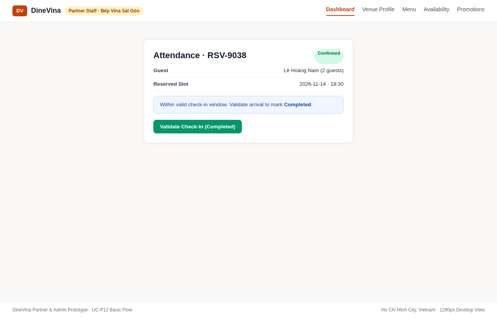

*UC-P12 - Alternative flow A1: No-show after 30-minute grace period*

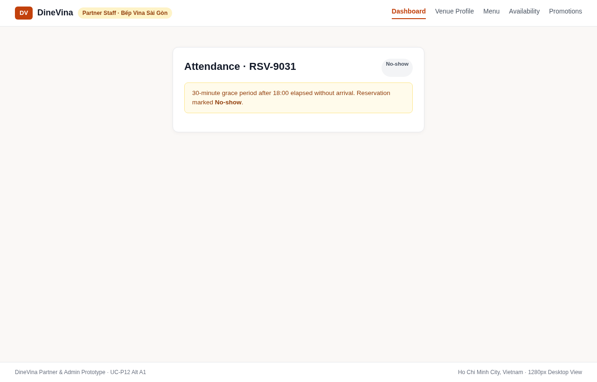

*UC-P12 - Alternative flow A2: Outside check-in window*

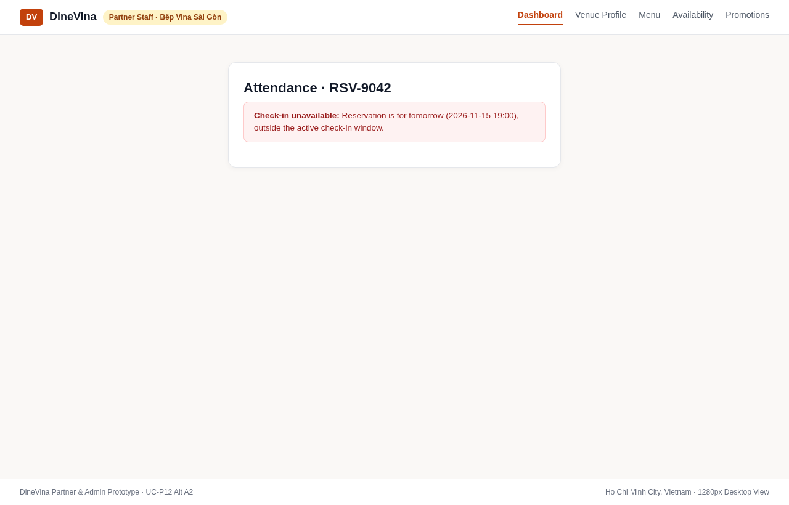

*UC-P12 - Alternative flow A3: Storage unavailable*

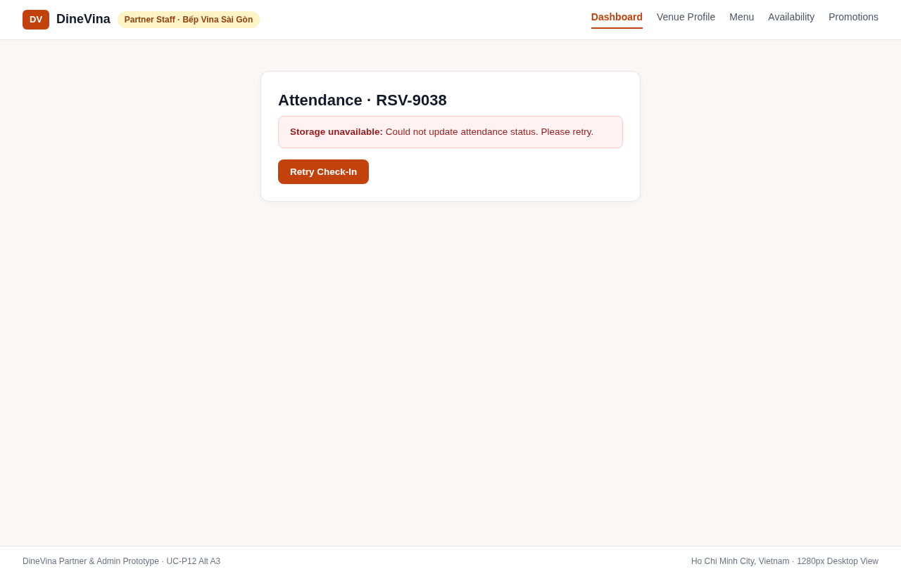

---

## UC-A01 Review Venue Onboarding
**Performed by:** Lương Thiện Nhân | **Reviewed by:** Nguyễn Trung Kiên | **Edited by:** Lương Thiện Nhân

**1. Use-Case Name:** UC-A01 Review Venue Onboarding

**Actor(s):** Administrator

**1.1 Brief Description**

An Administrator reviews a venue profile in `Pending Review` status and either approves it for public discovery (`Approved`) or returns it to Partner Staff for correction (`Returned`). Realizes FR-2.2.

**2. Flow of Events**

**2.1 Basic Flow**

1. The Administrator opens **Onboarding Queue** in the Admin Console.
2. The system displays all venues with `approval_status = Pending Review` (paginated, 20 per page).
3. The Administrator selects a venue to inspect all submitted fields (identity, district, cuisine, budget, capacity, amenities, photos, hotline).
4. Finding the submission complete and compliant, the Administrator selects **Approve Venue**.
5. The system transitions `approval_status` to `Approved`, records the admin actor and timestamp, makes the venue eligible for public F3 discovery (`FR-2.4`), and notifies Partner Staff.

**2.2 Alternative Flows**

**2.2.1 A1 - Return for correction.** At step 4, if fields are incomplete, inaccurate, or non-compliant, the Administrator selects **Return for Correction**, enters mandatory correction notes, and submits. The venue transitions to `Returned`, remains excluded from public discovery, and Partner Staff is notified (`UC-P02` A1). Empty correction notes are rejected.

**2.2.2 A2 - Empty onboarding queue.** At step 2, if no venues are pending review, the system displays an empty queue state.

**2.2.3 A3 - Storage unavailable.** At step 5, if persistence fails, the system displays a retryable error and keeps the venue in `Pending Review`.

**3. Special Requirements**

- SEC-01, SEC-04: only `administrator` role may execute onboarding decisions; `403 Forbidden` for any other role.
- FR-2.4: only `Approved` venues are exposed in public F3 discovery.

**4. Preconditions**

- Administrator is signed in (`UC-C02`).
- At least one venue exists in `Pending Review` state (for basic flow).

**5. Postconditions**

- Success: venue is `Approved` (publicly discoverable) or `Returned` (with correction notes).
- Failure: venue remains `Pending Review`.

**6. Extension Points**

None.

**7. Prototype Screens**

*UC-A01 - Basic flow: Review and approve venue onboarding*

*UC-A01 - Alternative flow A1: Return for correction with mandatory notes*

*UC-A01 - Alternative flow A2: Empty onboarding queue*

*UC-A01 - Alternative flow A3: Storage unavailable*

---

## UC-A02 Moderate Published Venue
**Performed by:** Lương Thiện Nhân | **Reviewed by:** Nguyễn Trung Kiên | **Edited by:** Lương Thiện Nhân

**1. Use-Case Name:** UC-A02 Moderate Published Venue

**Actor(s):** Administrator

**1.1 Brief Description**

An Administrator moderates an already-published (`Approved`) venue when policy, accuracy, or operational issues arise—either suspending/unpublishing it from public discovery or flagging required updates. Realizes FR-2.5.

**2. Flow of Events**

**2.1 Basic Flow**

1. The Administrator opens **Published Venues** in the Admin Console and selects a venue.
2. The system displays the published venue's current profile and moderation history.
3. The Administrator selects **Suspend / Unpublish Venue** (or **Require Update**), enters a mandatory moderation reason, and confirms.
4. The system validates that a moderation reason is provided.
5. The system updates `approval_status` to `Suspended` (or `Returned`), immediately excludes the venue from public F3 discovery, records the audit entry, and notifies Partner Staff.

**2.2 Alternative Flows**

**2.2.1 A1 - Missing moderation reason.** At step 4, if the reason field is empty, the system blocks submission with an inline error and returns to step 3.

**2.2.2 A2 - Venue not found or already suspended.** At step 1 or 5, if the venue was removed or already suspended, the system displays a clear status notice and refreshes the directory.

**2.2.3 A3 - Storage unavailable.** At step 5, if persistence fails, the system displays a retryable error and leaves the venue's status unchanged.

**3. Special Requirements**

- SEC-01, SEC-04: restricted strictly to `administrator` role (`403 Forbidden` otherwise).
- FR-2.4: suspended venues are immediately excluded from public search/discovery.

**4. Preconditions**

- Administrator is signed in (`UC-C02`).

**5. Postconditions**

- Success: venue moderation action is logged and public visibility updated.
- Failure: venue status remains unchanged.

**6. Extension Points**

None.

**7. Prototype Screens**

*UC-A02 - Basic flow: Moderate published venue*

*UC-A02 - Alternative flow A1: Missing moderation reason*

*UC-A02 - Alternative flow A2: Venue not found or already suspended*

*UC-A02 - Alternative flow A3: Storage unavailable*

---

## UC-A03 Moderate Promotions and Content
**Performed by:** Lương Thiện Nhân | **Reviewed by:** Nguyễn Trung Kiên | **Edited by:** Lương Thiện Nhân

**1. Use-Case Name:** UC-A03 Moderate Promotions and Content

**Actor(s):** Administrator

**1.1 Brief Description**

An Administrator reviews partner-submitted promotions and venue editorial content in `Pending Moderation` status and either approves them for public display (`UC-C07`) or rejects them with a reason. Realizes FR-8.3.

**2. Flow of Events**

**2.1 Basic Flow**

1. The Administrator opens **Content & Promotions Moderation** in the Admin Console.
2. The system lists items in `Pending Moderation` status.
3. The Administrator selects an item to verify eligibility conditions, expiry date, and compliance with platform rules.
4. The Administrator selects **Approve**.
5. The system transitions the item to `Approved`, makes it visible on the public venue/promotions pages (`UC-C07`), and records the audit entry.

**2.2 Alternative Flows**

**2.2.1 A1 - Reject promotion or content.** At step 4, if the item violates platform rules or has unclear conditions, the Administrator selects **Reject**, enters a mandatory reason, and confirms. The item becomes `Rejected`, remains hidden from guests, and Partner Staff is notified.

**2.2.2 A2 - Empty moderation queue.** At step 2, if no items are pending moderation, the system displays an empty queue state.

**2.2.3 A3 - Storage unavailable.** At step 5, if persistence fails, the system displays a retryable error and keeps the item in `Pending Moderation`.

**3. Special Requirements**

- SEC-01, SEC-04: restricted to `administrator` role.
- STD-01: moderation decisions record ISO 8601 timestamps and admin actor ID.

**4. Preconditions**

- Administrator is signed in (`UC-C02`).

**5. Postconditions**

- Success: item is `Approved` (visible to guests) or `Rejected` (with reason).
- Failure: item remains `Pending Moderation`.

**6. Extension Points**

None.

**7. Prototype Screens**

*UC-A03 - Basic flow: Moderate promotions and venue content*

*UC-A03 - Alternative flow A1: Reject with mandatory reason*

*UC-A03 - Alternative flow A2: Empty moderation queue*

*UC-A03 - Alternative flow A3: Storage unavailable*

---

## UC-A04 Investigate Support Case
**Performed by:** Lương Thiện Nhân | **Reviewed by:** Nguyễn Trung Kiên | **Edited by:** Lương Thiện Nhân

**1. Use-Case Name:** UC-A04 Investigate Support Case

**Actor(s):** Administrator

**1.1 Brief Description**

An Administrator looks up a table reservation or event inquiry by reference ID or customer/venue filter to inspect its immutable status history, timestamps, actors, and reasons during a support investigation. Realizes FR-5.7.

**2. Flow of Events**

**2.1 Basic Flow**

1. The Administrator opens **Support Case Investigation** in the Admin Console.
2. The Administrator enters a reservation ID, event inquiry ID, or customer/venue search key and submits.
3. The system retrieves the matching record and its complete chronological status history.
4. The system displays the record summary and every state transition (previous state, new state, timestamp, acting role/user, and recorded reason or cancellation note).

**2.2 Alternative Flows**

**2.2.1 A1 - Case not found.** At step 3, if no reservation or event inquiry matches the query, the system displays a "No matching case found" message and invites the Administrator to refine the search key.

**2.2.2 A2 - Service unavailable.** At step 3, if the audit history query fails, the system displays a retryable error banner.

**3. Special Requirements**

- SEC-01, SEC-04: only `administrator` role may inspect cross-venue status histories (`403 Forbidden` for customers/partners).
- REL-02, STD-01: status history is read-only/immutable and timestamps are shown in ISO 8601 / `Asia/Ho_Chi_Minh`.

**4. Preconditions**

- Administrator is signed in (`UC-C02`).

**5. Postconditions**

- Success: full status history is displayed for support resolution.
- Failure: no unauthorized data is exposed.

**6. Extension Points**

None.

**7. Prototype Screens**

*UC-A04 - Basic flow: Support case status history*

*UC-A04 - Alternative flow A1: Case not found*

*UC-A04 - Alternative flow A2: Service unavailable*

