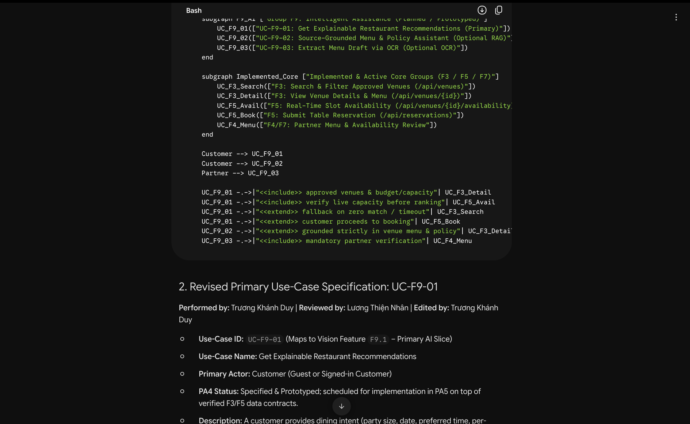
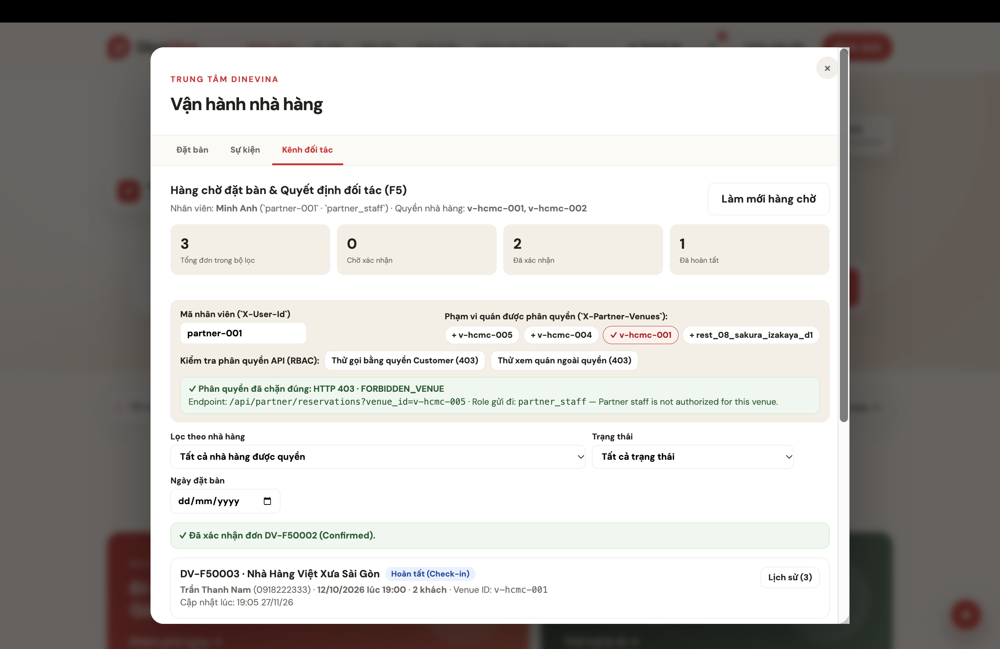
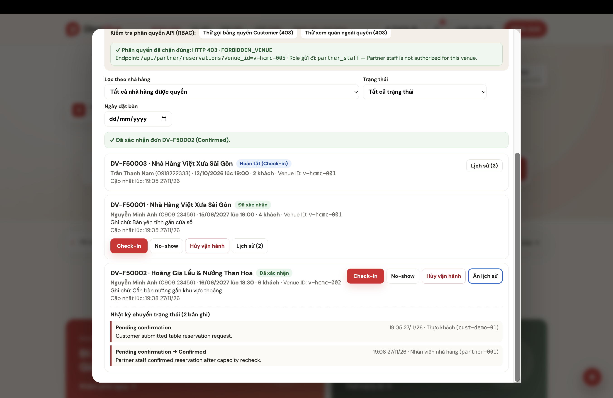
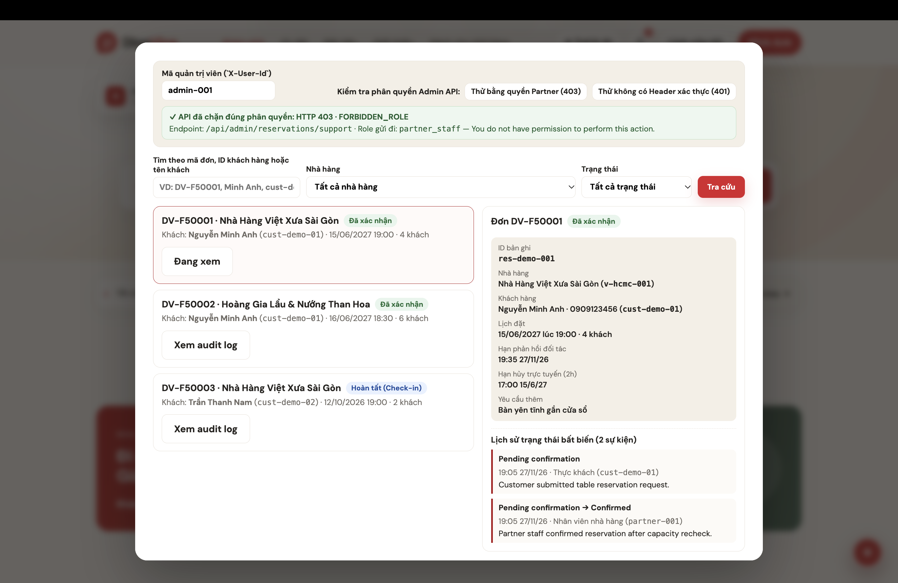

# PA4 Section E – Integration & Generated Test Cases Verification Report

**Performed by:** Trương Khánh Duy | **Reviewed by:** Lương Thiện Nhân | **Edited by:** Trương Khánh Duy

---

## 1. Verification Scope, Branches & Environment

**Performed by:** Trương Khánh Duy | **Reviewed by:** Lương Thiện Nhân | **Edited by:** Trương Khánh Duy

This report documents end-to-end integration verification for **PA4 Functional Group F5 (Table Reservation Lifecycle)**, full regression verification of **Group F3 (Discovery & Venue Details)**, inspection of Spec Kit generated test suites, and integration readiness tracking for **Group F7 (Availability & Partner Dashboard)**.

| Dimension | Verified Target / Value |
| :--- | :--- |
| **Base Integration Branch (`dev`)** | Commit `4072ede` (PA3 F3 + CI Ruff fix merged) |
| **F5 Partner & Admin UI Branch** | `feat/PA4_F5_Duy` (Commit `4e76323`, PR into `dev`) |
| **F5 Backend API & Tests Branch** | `feat/PA4_F5_Kien` (Verified on commit `4d5b0e5` containing all F5 routes & `backend/tests/test_f5_reservations.py`) |
| **F5 Customer UI Branch** | `feat/PA4_F5_Ngoc` (Reviewed for zero-conflict integration with `WorkspaceModal`) |
| **F7 Availability & Partner Dashboard** | Pending merge of Nhân's F7 feature branch into `dev` at time of report (tracked transparently in Section 4) |
| **Runtime Environment** | macOS · Python `3.11.14` (`.venv`) · FastAPI + SQLAlchemy 2.0 + SQLite/PostgreSQL · Vite `7.3.7` + React 19 + TypeScript `5.9` |

---

## 2. Automated Checks, F3 Regression & Generated Test Cases Verification

**Performed by:** Trương Khánh Duy | **Reviewed by:** Lương Thiện Nhân | **Edited by:** Trương Khánh Duy

### 2.1. CI & Regression Execution Summary

| Check Suite | Command Executed | Scope / Test File(s) | Result | Notes |
| :--- | :--- | :--- | :--- | :--- |
| **Backend Linter (CI)** | `ruff check backend` | `backend/` on `feat/PA4_F5_Duy` (`4e76323`) | **PASS** (`All checks passed!`) | Zero lint/style violations |
| **F3 Regression & Health Suite** | `pytest` | `backend/tests/test_f3_discovery.py`, `backend/tests/test_health.py` (27 tests) | **PASS** (`25 passed, 2 skipped` in `0.61s`) | 2 live-Supabase network tests cleanly skipped without local `.env` credentials |
| **Frontend TypeScript & Production Build** | `cd frontend && npm run build` | `tsc -b && vite build` (33 modules, incl. F5 Partner/Admin UI) | **PASS** (`built in 512ms`) | Zero TypeScript or Vite bundling errors |
| **F5 Spec Kit Generated Backend Tests** | `pytest backend/tests/test_f5_reservations.py -v` | 14 generated integration tests (`feat/PA4_F5_Kien` @ `4d5b0e5`) | **PASS** (`13 passed, 1 skipped`) | Covers availability, holds, idempotency, 409 slot full, 2h cutoff, 30m expiry, check-in/no-show, RBAC 401/403; 1 live-Supabase test skipped locally |

### 2.2. Inspection of Spec Kit Generated Test Cases (`backend/tests/test_f5_reservations.py`)

Per PA4 Section E guidelines, generated tests were retained and executed without deep manual refactoring, and verified against the F5 specification (`src/specs/003-f5-table-reservation/spec.md`):

| Test Function | Requirement Verified | Observed Outcome |
| :--- | :--- | :--- |
| `test_seeded_f5_demo_reservations_exist` | Seeded F5 fixtures (`DV-F50001`, `DV-F50002`, `DV-F50003`) persist and appear in Admin support search | **PASS** |
| `test_availability_lookup_and_unapproved_guardrail` | 30-min slot availability for approved venue; `404` for unapproved venue (`v-unapproved-001`) | **PASS** |
| `test_availability_rejects_past_date_and_invalid_party_size` | `422` validation on past dates and out-of-range party sizes | **PASS** |
| `test_customer_auth_and_role_isolation` | `401` anonymous rejection and `403` when `partner_staff` calls customer booking endpoint | **PASS** |
| `test_create_reservation_holds_capacity_and_supports_idempotency` | Atomic seat hold (`120 -> 110`) and duplicate `idempotency_key` replay returning `200` with same ID | **PASS** |
| `test_full_slot_rejects_with_409_and_adjacent_suggestions` | `409 SLOT_FULL` with adjacent `suggested_slots` (`18:30`, `19:30`) | **PASS** |
| `test_customer_track_ownership_isolation` | Customer lists own bookings; `403` when accessing another customer's reservation | **PASS** |
| `test_partner_confirm_and_decline_with_mandatory_reason_and_ownership` | `403` foreign venue; `200` confirm; `422` blank decline reason; `200` decline with reason | **PASS** |
| `test_customer_cancel_2h_cutoff_and_hotline_fallback` | `409 CANCELLATION_CUTOFF_PASSED` with `venue_hotline` at `-119m`; `200` cancel at `-121m` | **PASS** |
| `test_partner_30m_expiry_and_operational_cancel` | `409 RESERVATION_EXPIRED` after 31m (`status -> Expired`); `200` operational cancel (`Cancelled by restaurant`) | **PASS** |
| `test_partner_checkin_and_30m_no_show_grace_and_admin_support` | Check-in (`Completed`), `409` early No-show at `+25m`, `200` No-show at `+31m`, `403` customer on admin route, full audit log for admin | **PASS** |
| `test_partner_queue_list_filters_and_ownership_guardrail` | Partner queue filters (`status`, `reserved_date`), `403` foreign `venue_id`, `403` customer role | **PASS** |
| `test_overlapping_capacity_and_release_on_decline` | Capacity saturation (`30 + 20 = 50`), `409` overflow, and immediate seat release after partner decline | **PASS** |
| `test_supabase_reservations_table_reachability` | Live Supabase REST reachability check (guarded by local `.env` credentials) | **SKIPPED** (no local `.env`) |

---

## 3. End-to-End F5 Full-Stack Verification Matrix (React UI ↔ FastAPI ↔ DB)

**Performed by:** Trương Khánh Duy | **Reviewed by:** Lương Thiện Nhân | **Edited by:** Trương Khánh Duy

Executed live against the F5 FastAPI backend (`http://127.0.0.1:8000`, revision `4d5b0e5`) and React/Vite frontend (`http://localhost:5173`, branch `feat/PA4_F5_Duy` @ `4e76323`):

| Test ID | End-to-End Scenario | Layer(s) Tested | Expected Behavior | Observed Result | Status | Evidence |
| :--- | :--- | :--- | :--- | :--- | :--- | :--- |
| **F5-E2E-01** | **Partner Queue Load & Confirm Decision** | React `PartnerReservations` ↔ `GET /api/partner/reservations` & `POST .../confirm` ↔ DB | Partner staff (`partner-001`, venues `v-hcmc-001, v-hcmc-002`) loads seeded reservations, confirms `DV-F50002`, and persists state transition to `Confirmed`. | Confirmation banner `✓ Đã xác nhận đơn DV-F50002 (Confirmed)` displayed; KPI updated (`0 Chờ xác nhận`, `2 Đã xác nhận`, `1 Đã hoàn tất`); action buttons switched to `Check-in`, `No-show`, `Hủy vận hành`. | **PASS** | `evidence/F5_Partner_Queue_And_RBAC_403.png` |
| **F5-E2E-02** | **Partner Status History Audit Trail** | React UI ↔ `ReservationStatusHistoryModel` | Expanding **Lịch sử** on `DV-F50002` shows chronological transitions with VN timestamps, actor role, actor ID, and reason. | Timeline rendered 2 persisted entries: `Pending confirmation` (`cust-demo-01`) and `Pending confirmation → Confirmed` (`partner-001`: *"Partner staff confirmed reservation after capacity recheck."*). | **PASS** | `evidence/F5_Partner_Confirmed_And_History.png` |
| **F5-E2E-03** | **Partner RBAC Ownership Guardrail (`403`)** | React RBAC Probe ↔ `auth.py` & `reservations_service.py` | Requesting a venue outside `X-Partner-Venues` (`v-hcmc-005`) is blocked at the API layer with `HTTP 403 FORBIDDEN_VENUE`. | Backend returned `HTTP 403 · FORBIDDEN_VENUE` (*"Partner staff is not authorized for this venue."*), rendered cleanly in green verification banner. | **PASS** | `evidence/F5_Partner_Queue_And_RBAC_403.png` |
| **F5-E2E-04** | **Admin Cross-Venue Search & Immutable Audit Log** | React `AdminReservations` ↔ `GET /api/admin/reservations/support` & `GET /api/admin/reservations/{id}` | Administrator (`admin-001`) searches across all venues in read-only mode and inspects immutable audit history for `DV-F50001`. | All 3 reservations (`DV-F50001`, `DV-F50002`, `DV-F50003`) listed; right detail panel displayed record ID (`res-demo-001`), deadlines, customer details, and 2 chronological audit entries. | **PASS** | `evidence/F5_Admin_Audit_Log_And_RBAC_403.png` |
| **F5-E2E-05** | **Admin Endpoint Role Isolation (`403`)** | React RBAC Probe ↔ `require_roles("administrator")` | Sending `X-User-Role: partner_staff` to `/api/admin/reservations/support` is rejected with `HTTP 403 FORBIDDEN_ROLE`. | Backend blocked request with `HTTP 403 · FORBIDDEN_ROLE` (*"You do not have permission to perform this action."*). | **PASS** | `evidence/F5_Admin_Audit_Log_And_RBAC_403.png` |

#### F5 End-to-End UI & RBAC Screenshots

---

## 4. Integration Findings, Defects Flagged & F7 Readiness Status

**Performed by:** Trương Khánh Duy | **Reviewed by:** Lương Thiện Nhân | **Edited by:** Trương Khánh Duy

| Finding ID | Area | Observed Issue / Status | Action Taken / Follow-Up |
| :--- | :--- | :--- | :--- |
| **DEF-PA4-01** | `feat/PA4_F5_Kien` (`backend/app/main.py`) | During QA inspection of commit `6a2a9c4` on `feat/PA4_F5_Kien`, `backend/app/main.py` accidentally overwrote and removed the F5 route registrations that existed in commit `4d5b0e5`. | Immediately reported to Nguyễn Trung Kiên via team chat so `main.py` restores all F5 routes before merging into `dev` and recording the demo video. |
| **INT-PA4-02** | `App.tsx` Merge Compatibility (`Ngọc` + `Duy`) | Both `feat/PA4_F5_Ngoc` (Customer UI) and `feat/PA4_F5_Duy` (Partner/Admin UI) hook into `WorkspaceModal` in `frontend/src/App.tsx`. | Isolated all Partner/Admin code into 4 standalone files (`staffReservationApi.ts`, `PartnerReservations.tsx`, `AdminReservations.tsx`, `staffReservations.css`) so resolving `WorkspaceModal` during merge requires only passing `userName`, `venuesData`, and `addNotification` alongside Ngọc's `CustomerReservations` tab. |
| **PEND-F7-01** | **Group F7 (Availability & Partner Dashboard)** | At the time of this verification checkpoint, Lương Thiện Nhân's F7 feature branch had not yet been pushed/merged into `dev`. | Documented F7 E2E verification as **pending F7 PR availability** (strictly avoiding false pass claims per `Coderules.md`). Once F7 merges into `dev`, re-run `ruff check backend`, `pytest` (F3 + F5 + F7), and verify blocked time slots propagate to `GET /api/venues/{id}/availability`. |
