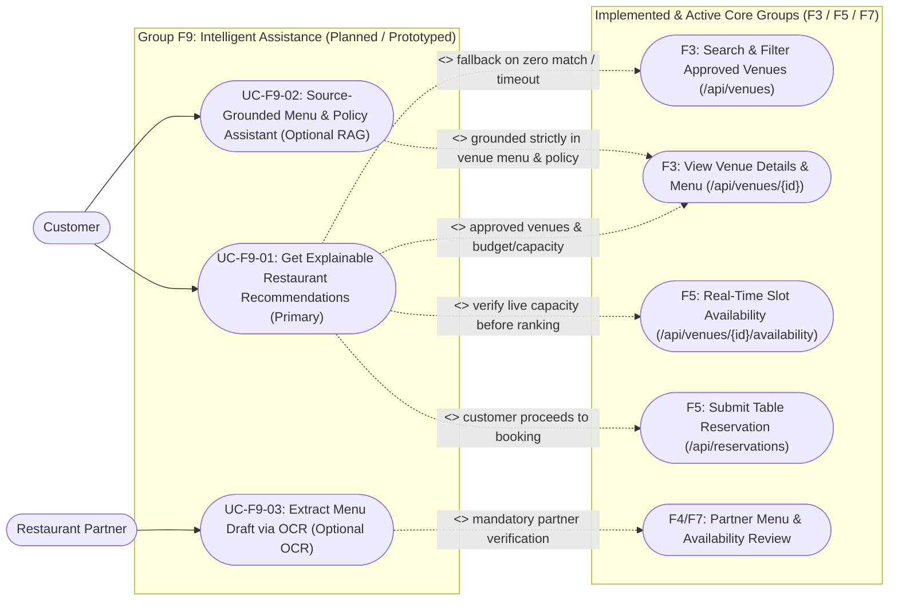
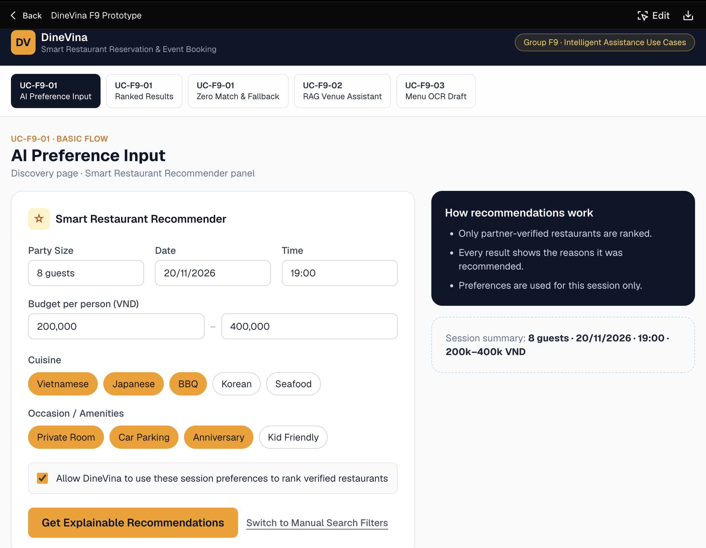
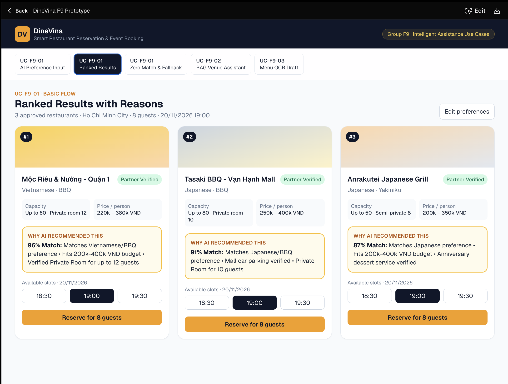
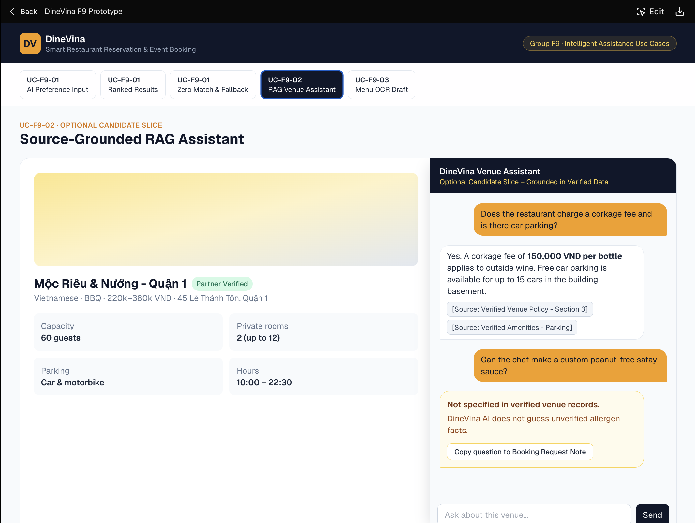
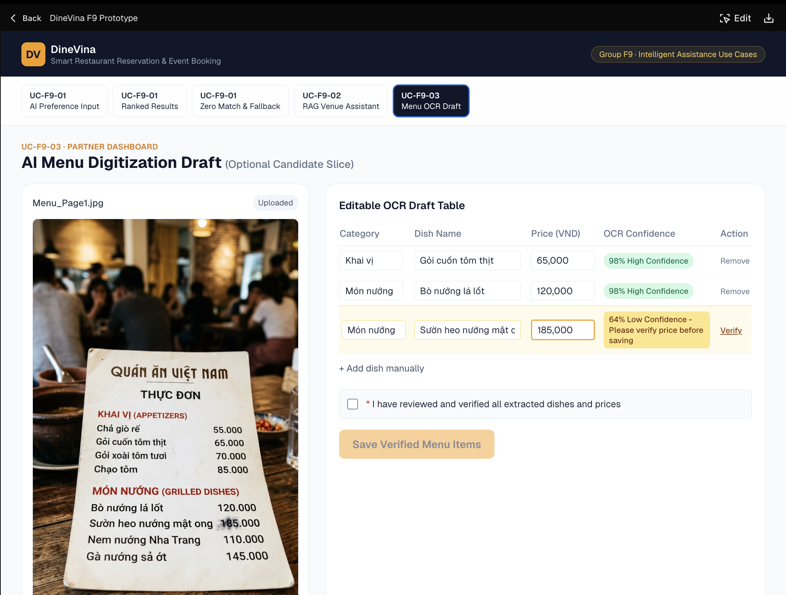

# PA4 Section A – Revised AI Use-Case Specification (Group F9: Intelligent Assistance)

**Performed by:** Trương Khánh Duy | **Reviewed by:** Lương Thiện Nhân | **Edited by:** Trương Khánh Duy

---

## 1. Revision Summary & Delivery Status Update (PA3 → PA4)

**Performed by:** Trương Khánh Duy | **Reviewed by:** Lương Thiện Nhân | **Edited by:** Trương Khánh Duy

No critical defects were flagged on the PA3 Group F9 specification during TA review. For PA4, this document has been revised to synchronize **Group F9 (Intelligent Assistance)** with the actual Sprint 4 architecture (`FastAPI + SQLAlchemy 2.0 + PostgreSQL/Supabase`, Group F3 approved venue discovery, Group F5 table reservation lifecycle, and planned Group F7 availability management), tighten alternative/fallback flows around live F5 slot capacity, and maintain strict implementation-boundary honesty.

| Revision Area | PA3 Baseline | PA4 Revision |
| :--- | :--- | :--- |
| **Delivery Status Boundary** | `UC-F9-01` targeted for Sprint 4; `F9.2`/`F9.3` optional candidate slices. | Sprint 4 prioritized core transactional MVP (**F5 Table Reservation Lifecycle** and **F7 Availability & Partner Dashboard**). All F9 capabilities remain **specified & prototyped only** (not claimed as implemented in PA4; `UC-F9-01` is scheduled for PA5 / AI Pilot slice). |
| **Data & Contract Alignment** | Referenced abstract PostgreSQL restaurant columns. | Explicitly mapped to implemented SQLAlchemy models (`venues`, `dishes`, `reservations`) and F5 real-time slot availability endpoint (`GET /api/venues/{id}/availability`). |
| **Alternative & Fallback Flows** | Generic empty-state and LLM timeout handling. | Added **AF-6 (F5 Slot Sold-Out Handoff)** and **AF-7 (Auth/Role Boundary Enforcement)** to ensure AI suggestions never bypass approved-only filtering (`status = 'approved'`) or F5 capacity holds. |

### 1.1. Feature Traceability & Implementation Status Matrix

| Vision ID | Use-Case ID | Use-Case Name | Primary Actor | PA4 Implementation Status | Target Slice |
| :--- | :--- | :--- | :--- | :--- | :--- |
| **F9.1** | **UC-F9-01** | Get Explainable Restaurant Recommendations | Customer | **Specified & Prototyped (Not yet implemented)** | PA5 – Primary AI Pilot |
| **F9.2** | **UC-F9-02** | Ask Source-Grounded Menu & Policy Assistant | Customer | **Optional Candidate Slice (Not implemented)** | Post-MVP / Optional RAG |
| **F9.3** | **UC-F9-03** | Extract Menu Draft via OCR | Restaurant Partner | **Optional Candidate Slice (Not implemented)** | Post-MVP / Optional OCR |

### 1.2. Revised F9 Integration & Use-Case Diagram (Mermaid)

**Performed by:** Trương Khánh Duy | **Reviewed by:** Lương Thiện Nhân | **Edited by:** Trương Khánh Duy

---

## 2. Revised Primary Use-Case Specification: UC-F9-01

**Performed by:** Trương Khánh Duy | **Reviewed by:** Lương Thiện Nhân | **Edited by:** Trương Khánh Duy

- **Use-Case ID:** `UC-F9-01` (Maps to Vision Feature `F9.1` – Primary AI Slice)
- **Use-Case Name:** Get Explainable Restaurant Recommendations
- **Primary Actor:** Customer (Guest or Signed-in Customer)
- **PA4 Status:** Specified & Prototyped; scheduled for implementation in PA5 on top of verified F3/F5 data contracts.
- **Description:** A customer provides dining intent (party size, date, preferred time, per-person budget in VND, cuisine preferences, and occasion/amenities) via the Dine AI Assistant panel. The system filters strictly over administrator-approved venues (`venues.status = 'approved'`) with verified capacity and live F5 slot availability, ranks matching candidates, and attaches transparent, database-grounded reason badges while always preserving direct fallback to manual F3 filters.

### Preconditions
1. Approved venues and dishes exist in PostgreSQL (`venues.status = 'approved'`, populated `min_budget_vnd`, `max_budget_vnd`, `max_capacity`, `amenities`, and `dishes`).
2. F5 availability lookup (`GET /api/venues/{venue_id}/availability`) is operational for real-time capacity checks.
3. The customer consents to session-scoped preference processing (no hidden profiling).

### Basic Flow (Main Success Scenario)
1. The customer opens the **✦ Trợ lý AI** panel from the Discovery header or floating action button.
2. The system renders the structured preference form: Party Size (1–50), Date, Time Slot, Budget Range (VND), Preferred Cuisine, and Occasion / Amenities (e.g., *Phòng riêng*, *Sân vườn*, *Bãi đỗ xe*, *Ghế trẻ em*).
3. The customer enters criteria, confirms preference consent, and submits **Get Recommendations**.
4. The system validates boundaries (future date/time, `1 <= party_size <= 50`, `min_budget <= max_budget`) and runs the **Deterministic Eligibility Filter**: keeps only `status = 'approved'` venues whose `max_capacity >= party_size` and which have at least one Available (non-blocked) slot near the requested time via F5 availability logic.
5. The **Multi-Attribute Preference Ranking Engine** scores eligible venues across cuisine overlap, budget interval overlap, amenity match, and verified rating/review signals.
6. For the top candidates, the system constructs **Explainable Reason Badges** referencing exclusively verified database columns (price range, cuisine, matched amenities, verified remaining slot times) without inventing dishes, discounts, or table counts.
7. The UI displays the ranked recommendation cards with their reason badges and direct actions (*Xem chi tiết* → F3 Detail, *Kiểm tra chỗ trống / Đặt chỗ* → F5 Booking Flow).
8. The customer selects a recommended restaurant and transitions into the F5 table booking workflow (`POST /api/reservations`).

### Revised Alternative & Exception Flows
- **AF-1 (Zero Exact Matches – Controlled Constraint Relaxation at Step 5):** If hard eligibility (approved + capacity) succeeds but no venue satisfies all soft preferences simultaneously, the system relaxes one non-critical preference (cuisine or exact budget tier), clearly labels which constraint was relaxed, and presents verified alternatives alongside a **Switch to Manual Filters** button (`GET /api/venues`).
- **AF-2 (Zero Eligible Venues for Party Size / Date-Time at Step 4):** If no approved venue can accommodate the requested `party_size` and time slot, the system renders a clear empty state with quick actions to shift the time by ±1 hour or switch to the Event Inquiry workflow for groups exceeding standard capacity.
- **AF-3 (Explanation Generator Timeout or External API Failure at Step 6):** If optional LLM phrasing fails or exceeds `2.5 s`, the backend falls back within `< 500 ms` to a deterministic rule-based template assembled directly from SQLAlchemy venue fields.
- **AF-4 (Invalid Input Boundaries at Step 4):** Past date/time, `party_size < 1` or `> 50`, or `min_budget > max_budget` triggers inline `422` validation feedback without issuing ranking queries.
- **AF-5 (Customer Declines Preference Consent or Bypasses AI at Step 2–3):** Unchecking consent or closing the AI panel redirects cleanly to standard manual F3 filters with zero preference storage.
- **AF-6 (Live F5 Slot Sold Out During Handoff at Step 8 – New in PA4):** Because F5 reservations enforce atomic capacity holds (`409 SLOT_FULL`), if a recommended slot sells out before submission, the F5 Booking Modal surfaces adjacent suggested slots (`suggested_slots`) returned by the backend rather than trusting cached AI output.
- **AF-7 (Strict Moderation & Auth Guardrail – New in PA4):** Unapproved, pending, or rejected venues (`status != 'approved'`) are excluded prior to scoring and can never appear in recommendations. Guest users may receive recommendations, while reservation submission enforces F5 customer authentication (`401`/`403`).

### Postconditions
- **Success:** Customer views ranked, approved venues with 100% database-grounded explanations and transitions cleanly into F3 detail or F5 booking.
- **Fallback:** Customer reaches relaxed verified alternatives or manual F3 search with zero hallucinated claims or unhandled errors.

### Quantifiable Non-Functional Requirements
- **NFR-AI-01 (End-to-End Latency):** `< 2.5 seconds` at p95 under 50 concurrent users.
- **NFR-AI-02 (Factual Grounding):** 100% of cited attributes (price, cuisine, capacity, amenities, slots) must originate from authoritative PostgreSQL records; zero fabricated menu items or availability.
- **NFR-AI-03 (Deterministic Fallback Speed):** `< 500 ms` failover to rule-based reason badges on AI service outage.

### UI Prototype Screens for UC-F9-01

---

## 3. Optional Candidate Slice Specifications (Retained for Vision Traceability)

**Performed by:** Trương Khánh Duy | **Reviewed by:** Lương Thiện Nhân | **Edited by:** Trương Khánh Duy

> **Scope Boundary Notice:** `UC-F9-02` (RAG Assistant) and `UC-F9-03` (Partner OCR Menu Draft) remain optional candidate slices from the PA2 Vision Document. Neither is implemented in PA4; both are maintained with updated PA4 constraints for architectural traceability.

### 3.1. UC-F9-02: Ask Source-Grounded Menu & Policy Assistant (Optional RAG – Not Implemented)
- **Primary Actor:** Customer (viewing an approved venue detail modal/page).
- **PA4 Alignment:** Grounded strictly in the viewed venue's verified `venues` record (`cancellation_policy`, `amenities`, `opening_hours`, `contact_phone`) and `dishes` rows (`price_vnd`, `dietary_tags`, `is_available`).
- **Key Alternative Flows:**
  - **AF-1 (Strict Abstention on Missing Data):** If an allergen, custom dish, or fee is absent from verified venue records, the assistant must abstain and offer a one-click *"Copy question to F5 Special Request note"* action instead of guessing.
  - **AF-2 (Cross-Venue / Off-Topic Restriction):** Queries unrelated to the currently viewed venue are politely declined.
  - **AF-3 (Service Unavailable Fallback):** Directs the customer to the static *Thực đơn* and *Tổng quan* tabs already rendered by F3.

### 3.2. UC-F9-03: Extract Menu Draft via OCR (Optional OCR – Not Implemented)
- **Primary Actor:** Restaurant Partner (`partner_staff` scoped to owned venues via `X-Partner-Venues`).
- **PA4 Alignment:** Accepts `.jpg`, `.png`, or `.pdf` up to 10 MB; extracts draft `DishModel` rows (`category_name`, `name`, `description`, `price_vnd`) with confidence flags. Uploaded files must use external object storage/volumes and are never committed to Git (`Coderules.md`).
- **Key Alternative Flows:**
  - **AF-1 (Low-Confidence Blocking):** Any row with extraction confidence `< 80%` or missing price is flagged in amber; **Save Verified Menu Items** remains disabled until the partner manually edits/confirms every flagged row.
  - **AF-2 (Invalid File / Unreadable Scan):** Rejects unsupported/oversized files (`> 10 MB`) or unreadable images and falls back to manual dish entry.
  - **AF-3 (Unauthorized Venue Ownership – New in PA4):** Partner staff attempting to upload/save OCR drafts for a venue outside their authorized ownership scope receives `403 FORBIDDEN_VENUE`.

