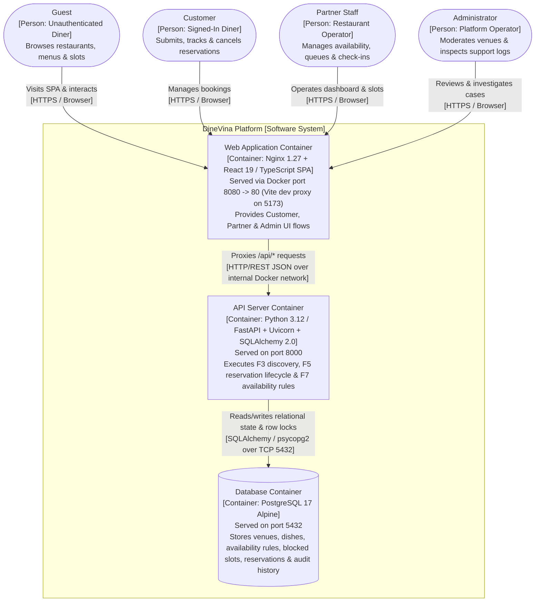
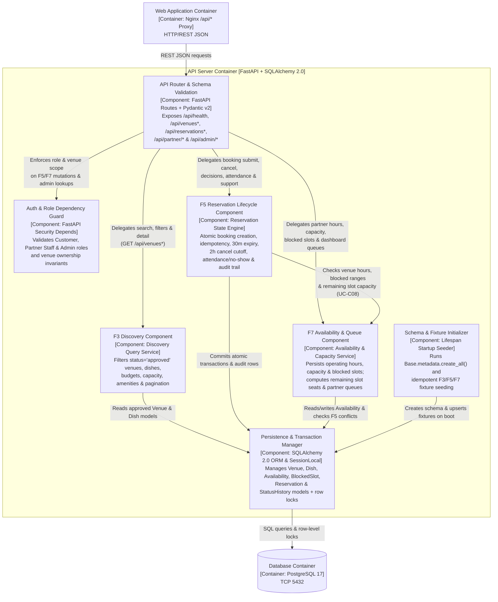

# Software Architecture: C4 Level 2 (Container) & Level 3 (Backend Components)

**Performed by:** Nguyễn Trung Kiên | **Reviewed by:** Trương Khánh Duy | **Edited by:** Nguyễn Trung Kiên

**Scope (`PA4 §C`):** Running system containers and key backend components covering **F3 (Venue Discovery)**, **F5 (Table Reservations)**, and **F7 (Partner Availability & Dashboard)**, aligned with `compose.yaml`, `Dockerfile.web`, `Dockerfile.api`, `frontend/nginx.conf`, and `backend/app/`.  
**Submission Consistency Status:** Baseline architecture draft aligned with PA3 integrated runtime + PA4 F5/F7 Spec Kit contracts; must be re-verified against the final integrated PA4 submission commit before submission.

---

## 1. C4 Model — Level 2: Container Diagram

**Performed by:** Nguyễn Trung Kiên | **Reviewed by:** Trương Khánh Duy | **Edited by:** Nguyễn Trung Kiên

The Container diagram zooms into the **DineVina System** boundary (`compose.yaml` services `web`, `api`, and `db`) and shows how external actors communicate with each runtime container.

### 1.1 Container Descriptions (Responsibilities, Technology & Protocols)

**Performed by:** Nguyễn Trung Kiên | **Reviewed by:** Trương Khánh Duy | **Edited by:** Nguyễn Trung Kiên

| Container Name | Responsibility & Services Provided | Technology / Framework | Communication Protocols |
| :--- | :--- | :--- | :--- |
| **Web Application Container** (`web` in `compose.yaml`) | Serves the compiled static React Single-Page Application (`dist/`) and acts as the reverse proxy forwarding `/api/*` paths to the backend API server without browser CORS friction. Renders Guest discovery (`F3`), slot availability & reservation tracking (`F5`), Partner availability/queues (`F7`), and Admin support views. | **Nginx 1.27 Alpine** (`frontend/nginx.conf`), **React 19 + TypeScript + Vite 7** (`Dockerfile.web` multi-stage build with Node 22). | Receives **HTTP/HTTPS** from user browsers on host port `8080` (`80` inside container; Vite dev server on `5173` locally). Forwards `/api/*` via **HTTP/1.1 REST (JSON)** to `http://api:8000`. |
| **API Server Container** (`api` in `compose.yaml`) | Exposes OpenAPI 3.1 REST endpoints, validates input/output contracts, enforces role/ownership permissions, executes approved-only venue search (`F3`), manages reservation state transitions with atomic capacity locking (`F5`), persists partner availability & queue views (`F7`), and handles startup schema creation/seeding. | **Python 3.12** (`Dockerfile.api`), **FastAPI**, **Uvicorn**, **Pydantic v2**, **SQLAlchemy 2.0**. | Exposes **HTTP/REST JSON** on port `8000` (Docker healthcheck on `/api/health`). Connects to PostgreSQL over **TCP port `5432`** (`postgresql://` via `psycopg2-binary` / SQLite fallback in isolated `pytest`). |
| **Database Container** (`db` in `compose.yaml`) | Durable relational persistence for restaurant profiles, categorized dishes, operating hours, blocked slots, reservation requests, and immutable status audit histories. Enforces foreign keys, composite indexes, and row-level locking (`SELECT ... FOR UPDATE`) for concurrent booking safety. | **PostgreSQL 17 Alpine** (`postgres:17-alpine`) backed by named volume `postgres_data`. *(Cloud rollout mirror optionally synced via Supabase PostgreSQL).* | Accepts **PostgreSQL wire protocol over TCP port `5432`** exclusively from the `API Server Container` inside the Compose network (`pg_isready` healthcheck). |

---

## 2. C4 Model — Level 3: Backend Component Diagram (`API Server Container`)

**Performed by:** Nguyễn Trung Kiên | **Reviewed by:** Trương Khánh Duy | **Edited by:** Nguyễn Trung Kiên

Zooming into the **API Server Container** (`backend/app/`), the diagram below highlights the core backend components and how they collaborate across the primary **F3**, **F5**, and **F7** paths.

### 2.1 Backend Component Responsibilities & Relationships

**Performed by:** Nguyễn Trung Kiên | **Reviewed by:** Trương Khánh Duy | **Edited by:** Nguyễn Trung Kiên

| Component | Responsibility | Key Relationships & Paths |
| :--- | :--- | :--- |
| **API Router & Schema Validation** (`backend/app/main.py`, `schemas.py`) | Defines HTTP endpoints (`/api/health`, `/api/venues`, `/api/venues/filters`, `/api/venues/{venue_id}`, `/api/v1/restaurants/*`, `/api/venues/{id}/availability`, `/api/reservations/*`, `/api/partner/*`, `/api/admin/reservations/*`), validates query bounds and request bodies via Pydantic v2 (`422`), and serializes `STD-01` error envelopes. | Entry point for `Web Application Container`; delegates role checks to `Auth & Role Dependency Guard` and routes domain logic to `F3`, `F5`, and `F7` components. |
| **Auth & Role Dependency Guard** (`backend/app/auth.py` — PA4 extension) | Resolves authenticated actor identity (`user_id`, `role`, `owned_venue_ids`) via FastAPI `Depends`, blocking unauthenticated writes (`401`) and unauthorized cross-role/cross-venue mutations (`403`). Public F3 discovery and F5 slot lookup remain open to `Guest`. | Invoked by `API Router` before executing protected `F5` (customer bookings, partner decisions, admin support) and `F7` (partner availability/queues) operations. |
| **F3 Discovery Component** (`main.py` discovery handlers + `schemas.py`) | Queries approved restaurants (`status == 'approved'`) and dishes; supports multi-attribute filtering (`district`, `cuisine`, budget overlap, `party_size`, `amenity`), keyword search (`q` across venue + dish fields), sorting, pagination, and `404` isolation on unapproved venues. | Uses `Persistence & Transaction Manager` read-only queries over `VenueModel` and `DishModel`. |
| **F5 Reservation Lifecycle Component** (`reservations_service.py`) | Manages end-to-end reservation state transitions (`Pending confirmation`, `Confirmed`, `Declined`, `Expired`, `Cancelled by customer`, `Cancelled by restaurant`, `Completed`, `No-show`), idempotency keys, 30-minute partner response expiry, 2-hour cancellation cutoff + hotline return, and immutable `ReservationStatusHistoryModel` logging. | Calls `F7 Availability & Capacity Component` to validate opening hours, blocked slots, and remaining capacity (`UC-C08`) within a single atomic transaction via `Persistence & Transaction Manager`. |
| **F7 Availability & Queue Component** (PA4 extension coordinated with Nhân) | Persists partner operating hours, slot capacities, and blocked date/time ranges (`UC-P04`), exposes remaining bookable slots, warns on conflicts with existing `Confirmed` reservations, and serves paginated partner queues (`UC-P05`). | Provides availability rules and slot capacity calculations to `F5 Reservation Lifecycle Component`; queries active F5 reservations via `Persistence & Transaction Manager`. |
| **Persistence & Transaction Manager** (`database.py`, `models.py`) | Configures SQLAlchemy 2.0 `Engine`, `SessionLocal`, ORM entity mappings, composite indexes, and row-level transaction boundaries (`FOR UPDATE` locking on PostgreSQL, clean rollback on storage errors `REL-03`). | Shared persistence gateway used by `F3`, `F5`, `F7`, and `Schema & Fixture Initializer` to talk to `Database Container`. |
| **Schema & Fixture Initializer** (`seed.py`, `main.py` `lifespan`) | Runs `Base.metadata.create_all()` on FastAPI startup and idempotently seeds validated F3 venues/dishes (`f3_venues_fixture.json`) and PA4 availability/reservation demo fixtures. | Invokes `Persistence & Transaction Manager` during application lifespan boot before serving HTTP requests. |

---

## 3. Shared Container & Interface Handoff (For Ngọc & Phong)

**Performed by:** Nguyễn Trung Kiên | **Reviewed by:** Trương Khánh Duy | **Edited by:** Nguyễn Trung Kiên

To ensure **Section B (Tech Stack / L1)**, **Section C (Frontend L3 by Võ Mỹ Ngọc)**, and **Section D (Deployment Diagram by Hoàng Cao Phong)** align 100% with Backend C4 Level 2 & Level 3:

| Shared Identifier | Canonical Name for All Diagrams | Host / Port / Protocol | Target Consumers / Notes |
| :--- | :--- | :--- | :--- |
| `WebContainer` | **Web Application Container** (`web` — Nginx 1.27 + React 19 SPA) | External port `8080` -> `80` (dev: `5173`) · HTTP/HTTPS | Base container for **Võ Mỹ Ngọc's C4 Level 3 Frontend Component Diagram** & **Hoàng Cao Phong's Deployment Web Node**. |
| `ApiContainer` | **API Server Container** (`api` — Python 3.12 / FastAPI + Uvicorn) | Port `8000` · HTTP/1.1 REST JSON (`/api/*`) | Consumes proxied `/api/*` traffic from `WebContainer`; target of Phong's Deployment App Node. |
| `DbContainer` | **Database Container** (`db` — PostgreSQL 17 Alpine) | Port `5432` · PostgreSQL TCP (`SQLAlchemy 2.0` / `psycopg2`) | Persistent volume `postgres_data`; target of Phong's Deployment Database Node. |
| **F3 API Interface** | `GET /api/venues`, `GET /api/venues/filters`, `GET /api/venues/{venue_id}` | JSON over HTTP | Unauthenticated (`Guest`+). Strict `status == 'approved'` filter. |
| **F5 API Interface** | `GET /api/venues/{id}/availability`, `POST/GET /api/reservations`, `POST /api/reservations/{id}/cancel`, `POST /api/partner/reservations/{id}/{confirm\|decline\|cancel\|check-in\|no-show}`, `GET /api/admin/reservations/*` | JSON over HTTP | Role-guarded (`Guest` for availability, `Customer`, `Partner Staff`, `Administrator` respectively). |
| **F7 API Interface** | Partner Availability (`UC-P04`) & Partner Queues (`UC-P05`) endpoints | JSON over HTTP | Role-guarded (`Partner Staff`); contract finalized jointly with Nhân & Duy. |
