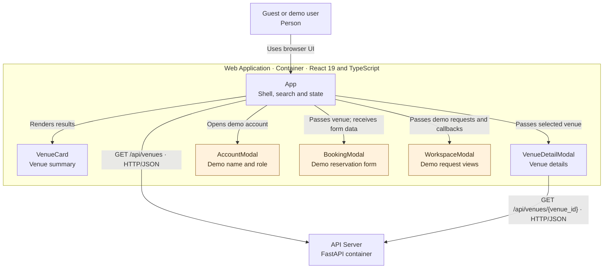

# DineVina Frontend Component Diagram
**Performed by:** Võ Mỹ Ngọc | **Reviewed by:** Pending (assigned to Hoàng Cao Phong) | **Edited by:** Võ Mỹ Ngọc

C4 Level 3 for the **Web Application** container in Kiên's Level 2 draft. This diagram reflects the frontend at research branch commit `4072ede`. F3 discovery and venue detail use HTTP APIs. The existing reservation and workspace views use React state and sample data.

## 1. Component diagram
**Performed by:** Võ Mỹ Ngọc | **Reviewed by:** Pending (assigned to Hoàng Cao Phong) | **Edited by:** Võ Mỹ Ngọc

The amber components use local demo state. `frontend/src/main.tsx` mounts `App` in React Strict Mode. Every component inside the boundary is defined in `frontend/src/App.tsx`. The API Server is the external container from the Level 2 view.

## 2. Component responsibilities
**Performed by:** Võ Mỹ Ngọc | **Reviewed by:** Pending (assigned to Hoàng Cao Phong) | **Edited by:** Võ Mỹ Ngọc

| Component | Responsibility and relationships |
| --- | --- |
| `App` | Owns the active search controls and result state. Builds query parameters, calls the venue list API, maps summaries and applies additional display filters. Handles card actions and selects which modal to open. Owns the in-memory user, reservations, event requests and notifications. |
| `VenueCard` | Renders a venue summary received from `App`. Sends detail and booking actions through callbacks supplied by `App`. |
| `VenueDetailModal` | Receives the selected venue and fetches full details for its string ID. Displays venue facts and tabs, keeps the search summary when detail loading fails and can invoke the booking callback. |
| `AccountModal` | Collects the demo user name and role or requests sign-out by calling callbacks from `App`. |
| `BookingModal` | Holds form input locally and sends the date, time, party size and note to `App`. `App` adds a local pending entry and notification. |
| `WorkspaceModal` | Presents local request data by role. Sends status, review and event actions to `App` through callbacks. |

## 3. Container communication
**Performed by:** Võ Mỹ Ngọc | **Reviewed by:** Pending (assigned to Hoàng Cao Phong) | **Edited by:** Võ Mỹ Ngọc

Browser requests are same-origin HTTP with JSON responses. In Compose, Nginx serves the static app at host port 8080 and proxies `/api/` to `http://api:8000`. In development, Vite proxies `/api` to `http://127.0.0.1:8000`. The browser communicates with the API Server through these proxies. The API Server owns database access.

Code references are `frontend/src/main.tsx`, `frontend/src/App.tsx`, `frontend/package.json`, `frontend/vite.config.ts`, `frontend/nginx.conf`, `Dockerfile.web` and `compose.yaml` at `4072ede`. The container names follow Kiên's Level 2 draft on `origin/research/PA4_Kien` at `ccc6c81`.

## 4. Submission consistency check
**Performed by:** Võ Mỹ Ngọc | **Reviewed by:** Pending (assigned to Hoàng Cao Phong) | **Edited by:** Võ Mỹ Ngọc

Update this diagram against the integrated submission commit. Use the shipped component names and verify the actual F5 and F7 API calls, state ownership, and customer, partner and administrator screens. Coordinate with the Level 2 and backend Level 3 diagrams so both sides show the same interfaces. The F5 reference endpoints and current integration gap are recorded in the [Customer Specification](UC-Customer.md).
