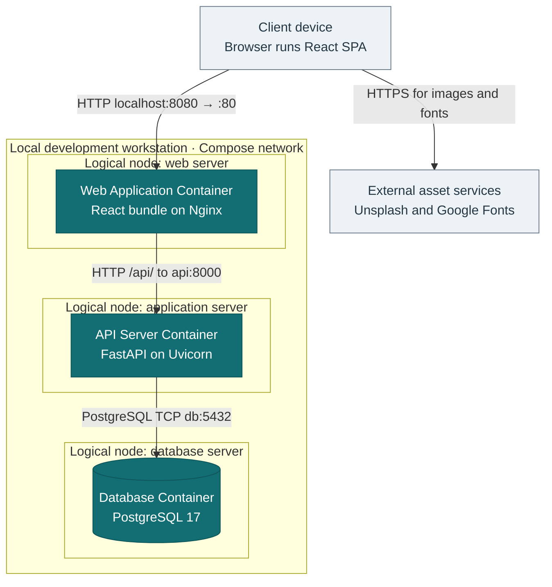

# DineVina PA4 | Deployment
**Performed by:** Hoàng Cao Phong | **Reviewed by:** Võ Mỹ Ngọc | **Edited by:** Hoàng Cao Phong

## Reference deployment and container mapping
**Performed by:** Hoàng Cao Phong | **Reviewed by:** Võ Mỹ Ngọc | **Edited by:** Hoàng Cao Phong

The local Compose topology comes from `research/Phong` at `4cd84a0f425723a43bc80965d9fd161605fdba05`. Web Application Container, API Server Container and Database Container map to `web`, `api` and `db`. These names follow [Kiên's Level 2 handoff at `ccc6c81`](https://github.com/HoangCaoPhong/DineVina/blob/ccc6c81e97e24fc4e35503b379578fb4d7e265fc/docs/weekly-reports/PA4_Week6-7/Kien/C4-Architecture-L2-L3.md#3-shared-container--interface-handoff-for-ng%E1%BB%8Dc--phong). The local Compose files use HTTP at the web entry point. Update the deployment and [context](System-Context.md) together when the submission environment is confirmed. [PA4 §D](../../../PAs/PA4/PA4-2026.pdf) · [Trello #51](https://trello.com/c/05GpYlcR)

| Node | Hardware or service | Hosted container and responsibilities | Communication |
| --- | --- | --- | --- |
| Client device | Desktop or mobile browser | Runs the downloaded Web App and sends same-origin API requests. | HTTP to the published web port. HTTPS to external asset hosts. |
| Web server | Local workstation, Compose service `web` | Nginx serves the Vite build from `/usr/share/nginx/html` and proxies API requests. | Host `8080` to Nginx `80`. HTTP proxy to `api:8000`. |
| Application server | Same workstation, separate Compose service `api` | API Server Container on Uvicorn creates and seeds F3 tables and serves health and discovery requests. | HTTP port `8000`, also published directly for local checks. SQLAlchemy with psycopg2 connects via `DATABASE_URL` over TCP to the database. |
| Database server | Same workstation, separate Compose service `db` | Database Container on `postgres:17-alpine`, storing data in the `postgres_data` named volume. | TCP `5432` on the Compose network. |
| Asset hosting | Unsplash and Google Fonts endpoints | Supplies linked images, CSS and font resources. | HTTPS requests from the browser. |

The API health check requests `/api/health`. Compose starts the web service after the API reports healthy. The database also defines a `pg_isready` check. Inspect the deployment sources for commands and configuration. [Compose](../../../../compose.yaml) · [Web image](../../../../Dockerfile.web) · [API image](../../../../Dockerfile.api) · [Nginx](../../../../frontend/nginx.conf)

## Development alternative and runtime checks
**Performed by:** Hoàng Cao Phong | **Reviewed by:** Võ Mỹ Ngọc | **Edited by:** Hoàng Cao Phong

For development outside Compose, Vite on port `5173` proxies to Uvicorn at `127.0.0.1:8000`. The default database in this mode is `dinevina_f3.db`, accessed in-process by SQLAlchemy. This topology uses a local file in place of the PostgreSQL process and TCP link. [Vite proxy](../../../../frontend/vite.config.ts) · [Database configuration](../../../../backend/app/database.py)

On 27 November 2026 (ICT), both images built from a clean export of the recorded commit. A manual Podman run reproduced the Compose network with aliases `api` and `db`, a fresh PostgreSQL volume and loopback-only host ports `18080` for web and `18090` for API. The diagram shows the repository's Compose port mappings.

| Check | Observed result |
| --- | --- |
| Nginx → API health | `GET /api/health` through web port `18080` returned HTTP 200 and `{"status":"ok"}`. |
| Browser → Nginx → API | Headless Chrome received HTTP 200 for the venue list. Clicking the first detail button loaded `v-hcmc-005` and returned three dishes. |
| API → Database | PostgreSQL 17.12 held 11 venues and 21 dishes after startup seeding. The list API returned 8 approved venues in total. |
| Browser → asset services | Observed requests to `images.unsplash.com`, `fonts.googleapis.com` and `fonts.gstatic.com`. |
| Automated checks | Ruff passed. Pytest reported 25 passed and 2 skipped optional live Supabase tests. |

Recheck the submission revision's API entry point, ports, data store and cloud dependencies after F5 and F7 integration. The separate remote `dev` tip `4072ede` contains a conditional Supabase startup hook and a status route. The local deployment above uses the source from `research/Phong`. [Remote source snapshot](https://github.com/HoangCaoPhong/DineVina/blob/4072ede69581cf6025b3b310b44ac736cdd05c81/backend/app/main.py)
