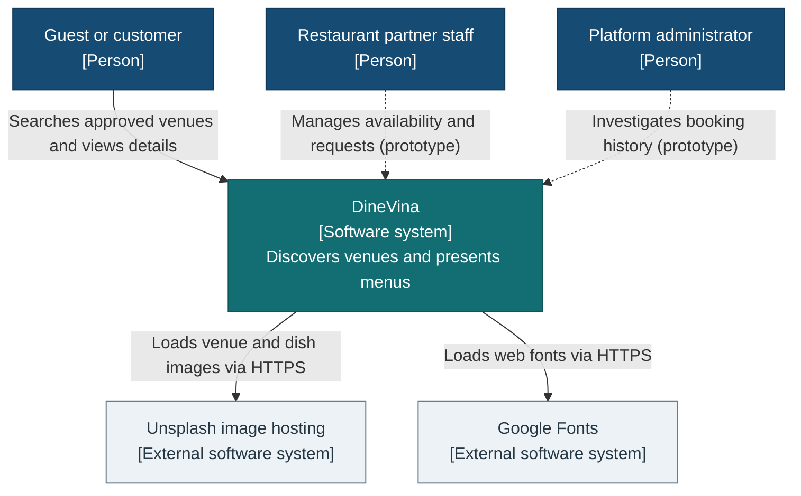

# DineVina PA4 | System context and technology stack
**Performed by:** Hoàng Cao Phong | **Reviewed by:** Võ Mỹ Ngọc | **Edited by:** Hoàng Cao Phong

## Scope and revision
**Performed by:** Hoàng Cao Phong | **Reviewed by:** Võ Mỹ Ngọc | **Edited by:** Hoàng Cao Phong

DineVina is Group 08's browser-based marketplace for restaurant discovery, table reservation requests and event inquiries. The [PA3 Vision](../../../PAs/PA3/fin/PA3-Group08/Vision.md#5-product-features-and-functional-requirements) carries forward the nine functional groups from PA1. This document describes the implementation visible on `research/Phong` at `4cd84a0f425723a43bc80965d9fd161605fdba05`. On this revision, F3 is the integrated feature. PA4 targets full-stack F5 and F7. Update this snapshot when the final integrated revision is available. [PA4 §B](../../../PAs/PA4/PA4-2026.pdf) · [Trello #49](https://trello.com/c/LuMf0ose)

## C4 Level 1 system context
**Performed by:** Hoàng Cao Phong | **Reviewed by:** Võ Mỹ Ngọc | **Edited by:** Hoàng Cao Phong

- **Guest or customer.** Anyone can query approved venues and open a listing. The API supports venue and dish keyword matching, district, cuisine, budget, capacity and amenity filters, sorting and pagination. The browser submits list and detail requests. The detail view includes contact, menu and displayed slot information.
- **Restaurant partner staff.** The intended role manages listings and availability and handles reservation and event queues. The current partner view demonstrates interactions using in-memory frontend state.
- **Platform administrator.** The intended role reviews listings and investigates request histories. The current UI demonstrates an administrator view. The public API filters on seeded venue approval status.
- **External systems.** The browser fetches Unsplash image URLs and Google Fonts resources. These calls provide presentation assets. Discovery queries use DineVina's database and a bundled seed fixture. The Supabase lookup in the test suite is an optional fixture comparison, outside the request path.

Solid arrows show implemented interactions. Dashed arrows show prototype role interactions. Evidence comes from the [React client](../../../../frontend/src/App.tsx), [stylesheet](../../../../frontend/src/style.css), [FastAPI routes](../../../../backend/app/main.py), [fixture](../../../../backend/app/fixtures/f3_venues_fixture.json) and [tests](../../../../backend/tests/test_f3_discovery.py).

## Technology stack
**Performed by:** Hoàng Cao Phong | **Reviewed by:** Võ Mỹ Ngọc | **Edited by:** Hoàng Cao Phong

| Area | Technologies and responsibilities | Source |
| --- | --- | --- |
| Web client | React 19 and TypeScript 5.9 in a responsive single-page app. Vite builds the bundle and proxies `/api` during development. The client uses the browser Fetch API and receives JSON. | [Dependencies](../../../../frontend/package.json), [Vite config](../../../../frontend/vite.config.ts), [React client](../../../../frontend/src/App.tsx) |
| API and validation | Python, FastAPI, Uvicorn and Pydantic schemas. The API provides health, approved-venue search, filter metadata and menu-bearing venue detail. | [Python manifest](../../../../pyproject.toml), [routes](../../../../backend/app/main.py), [schemas](../../../../backend/app/schemas.py) |
| Persistence | SQLAlchemy ORM with psycopg2 for the configured PostgreSQL service. Without `DATABASE_URL`, the backend uses a local SQLite file. Startup creates the F3 tables and seeds venues and dishes from JSON. | [DB configuration](../../../../backend/app/database.py), [models](../../../../backend/app/models.py), [seed](../../../../backend/app/seed.py) |
| Serving and networking | Nginx serves the Web Application Container and forwards same-origin `/api/` HTTP traffic to the API Server under Compose. | [Web Dockerfile](../../../../Dockerfile.web), [Nginx config](../../../../frontend/nginx.conf), [deployment](Deployment.md) |
| Accounts and integrations | The client uses React state to demonstrate roles. External runtime requests supply Unsplash images and Google Fonts assets (DM Sans and Playfair Display). | [React client](../../../../frontend/src/App.tsx), [stylesheet](../../../../frontend/src/style.css) |

## Feature coverage from PA1 through PA4
**Performed by:** Hoàng Cao Phong | **Reviewed by:** Võ Mỹ Ngọc | **Edited by:** Hoàng Cao Phong

| Group | Status at the documented revision |
| --- | --- |
| F1 Accounts and Profiles | Prototype account and role interactions in React. Persistent profiles and backend authentication are pending. |
| F2 Restaurant Onboarding | F3 enforces approved-only public reads. Onboarding, review and moderation workflows are pending. |
| F3 Restaurant Discovery and Venue Details | Browser, API and database code are present. The API supports sorting and pagination, while the UI requests one result page at a time and exposes a subset of API controls. |
| F4 Menu Management and Viewing | Venue detail reads and presents seeded dishes. Partner menu maintenance is pending. |
| F5 Table Reservation Requests | PA4 target. The booking UI, history and status actions are prototypes. Displayed slots come from seeded venue metadata. Persistent submissions, capacity checks and verified role-specific flows require integration. |
| F6 Event Inquiries and Proposals | The inquiry UI uses local state. Persistent event queues and proposal workflow are pending. |
| F7 Availability and Partner Dashboard | PA4 target. The partner dashboard is a prototype. Persistent hours, blocked slots, capacity and their integration with reservation lookups require verification. |
| F8 Promotions and Editorial Content | Discovery can display seeded offer text and promotional UI. Submission, moderation and eligibility workflows are pending. |
| F9 Intelligent Assistance | Assistant demo UI is present. The explainable recommender and optional RAG and OCR slices are pending. |

Reconcile this table and the context edges with the integrated frontend, API, data stores and dependencies before producing the final PDF. Use the [F5 API card](https://trello.com/c/mvVUcIcP), [F7 delivery card](https://trello.com/c/PXyxjXir) and [integration verification card](https://trello.com/c/HgJWgFM5) to locate evidence for each PA4 workflow.
