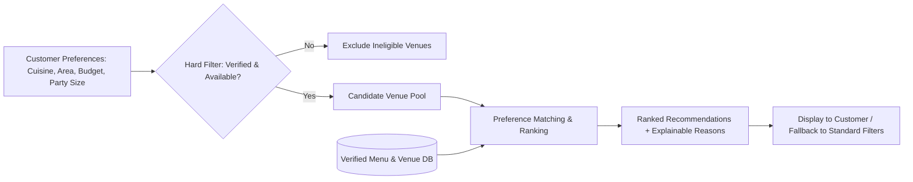
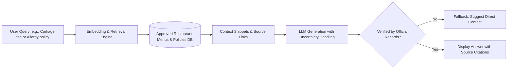
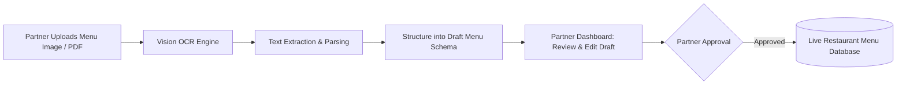
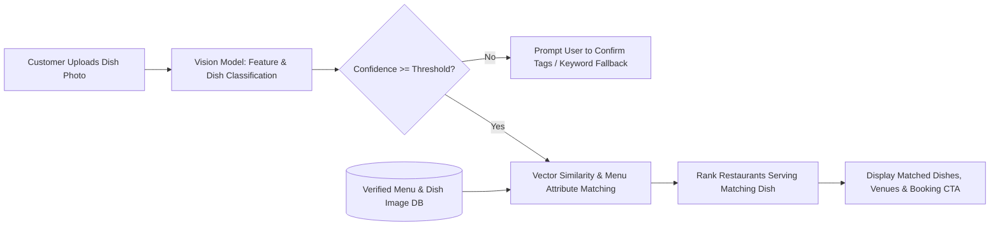

### 3.4. AI Features and Staged Delivery
*Performed by: Trương Khánh Duy (AI Engineer) | Reviewed by: Hoàng Cao Phong (Scrum Master) | Edited by: Võ Mỹ Ngọc (Product Owner)*

To fulfill the requirement of incorporating meaningful AI capabilities that provide real, practical value to end-users, DineVina implements a staged AI roadmap consisting of four distinct features across customer discovery, conversational support, and partner operations. These features are designed to enhance decision-making, bridge visual inspiration with instant table booking, streamline partner workflows, and maintain strict data accuracy without relying on simplistic keyword auto-suggestions.

#### 1. Explainable Restaurant Recommendation (Core Sprint Feature)

* **Description & Practical Value:** Customers often struggle to filter through dozens of options when planning group dinners or specific occasions. This feature takes natural user preferences (cuisine, geographic area, price range, group size, and occasion type) and matches them against verified restaurant attributes. Crucially, instead of acting as a black box, the system generates transparent, human-readable explanations for each recommendation (e.g., *"Recommended because it matches your preferred European cuisine, fits your 250k–500k budget, and has available seating for 8 guests at 19:00"*). This significantly reduces decision fatigue and builds user trust.
* **Architecture & Evaluation:** The system applies a hard-filtering pipeline to eliminate unavailable or unverified venues, followed by a preference-matching and ranking mechanism over the candidate pool. Performance is evaluated using a small labeled set of realistic test queries to measure ranking quality and minimize bad recommendations. If AI suggestions do not align with user needs, customers can seamlessly fall back to standard manual filters.
* **Architecture and Workflow:**

#### 2. Retrieval-Based Menu & Policy Assistant (Future Expansion Slice)

* **Description & Practical Value:** Users frequently have specific questions regarding restaurant policies (e.g., *"Do they accommodate severe peanut allergies?"* or *"What is the corkage fee for birthday cakes?"*). This conversational assistant uses Retrieval-Augmented Generation (RAG) to query approved restaurant documents, menus, and policy records directly. It provides precise answers complete with source links back to the official menu or venue profile.
* **Safety & Guardrails:** To prevent hallucinations (fabricated facts), the assistant includes strict uncertainty handling: if an answer cannot be verified from the approved records, it refuses to guess and prompts the user to contact the restaurant directly. Generated responses must never be published without human review.
* **Retrieval and Guardrail Workflow:**

#### 3. AI-Powered Menu Digitization / OCR (Partner Workflow Enhancement)

* **Description & Practical Value:** Restaurant partners often struggle with manually inputting dozens of dishes, descriptions, and prices into the platform when onboarding. This feature allows partners to upload an image or PDF scan of their physical menu. The OCR and vision-language model parses the text, extracts dish names, categories, and pricing, and structures them into an editable draft form in the partner dashboard.
* **Workflow & Data Safety:** The AI output serves purely as a preliminary draft. Partners must review, edit, and approve each item before it goes live on the platform, ensuring no inaccurate pricing or unverified dishes are published to customers.
* **Partner Digitization Workflow:**

#### 4. Visual Dish Search & Restaurant Matcher (Customer Discovery Enhancement)

* **Description & Practical Value:** Diners frequently encounter appealing food photos on social media or in everyday life without knowing the exact dish name or where it is served locally. This feature allows customers to upload or snap a photo of a dish to instantly discover verified restaurants on DineVina that offer the same or closely related menu items. Each matched venue card displays the identified dish from its approved menu, pricing, current table availability, and a direct reservation action.
* **Architecture, Confidence Thresholds & Fallback:** A computer vision and multimodal embedding model extracts visual features and classifies dish labels from the uploaded photo. The system then executes a similarity search against indexed dish photos and verified menu descriptions in the database. If image quality is poor or recognition confidence falls below a strict threshold, the system prompts the user to confirm suggested dish tags or seamlessly falls back to category-based keyword search.
* **Visual Search Workflow:**

