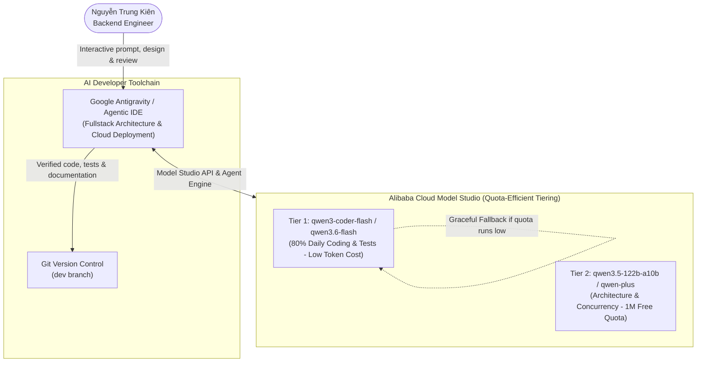

# AI Coding Tools and Account Confirmation — PA1

**Performed by:** Nguyễn Trung Kiên (Backend Engineer; 24127068)  
**Reviewed by:** Hoàng Cao Phong (Scrum Master)  
**Edited by:** Pending confirmation  

**Status snapshot:** 17 October 2026  
**Linked Trello Task:** `[PA1] AI Coding Account – Kien`

---

## 1. Overview and Objectives

In accordance with the course requirements for AI-Integrated Software Engineering (PA1), this document confirms the individual AI coding accounts, foundation models ("các con model dự kiến dùng"), and developer toolchain configured by **Nguyễn Trung Kiên (Backend Engineer)** for the DineVina project.

To guarantee project sustainability and prevent disruption from quota exhaustion, the setup applies a **pragmatic, tiered model strategy**: prioritizing lightweight, high-efficiency models ("Flash" & "Coder" series) for daily development, while reserving mid-tier models with verified free quota for complex architectural reasoning. All development adheres strictly to the **Human-in-the-loop** principle: the engineer directs prompt context, verifies all generated code, enforces test coverage, and ensures that no API keys or credentials enter version control.

---

## 2. Configured Foundation Models and Provider Accounts

From the verified roster of **141 available models** on Alibaba Cloud Model Studio, the following balanced, quota-efficient models have been selected to optimize cost, speed, and reliability:

| # | Model Code / Identifier | Tier & Category | Allocation / Quota | Role & Practical Value in DineVina |
|---|-------------------------|-----------------|--------------------|------------------------------------|
| 1 | **`qwen3.5-122b-a10b`** | **Mid-Tier (MoE)** | 1M free tokens (Valid to 2027/01/14) | **Primary Anchor:** Sẵn 1M free quota; dùng cho thiết kế kiến trúc ban đầu và sinh cấu trúc dữ liệu. |
| 2 | **`qwen3-coder-flash`** | **Lightweight Coder** | High-throughput Free Tier | **Daily Workhorse:** Model gọn nhẹ, độ trễ thấp; tối ưu cho sinh code FastAPI, Pydantic schemas và test boilerplate. |
| 3 | **`qwen3.6-flash`** / `qwen3.5-flash` | **Lightweight General** | High-throughput Free Tier | **Quick Refactoring:** Soạn thảo tài liệu kỹ thuật, format dữ liệu và sửa lỗi cú pháp nhanh với chi phí token tối thiểu. |
| 4 | **`qwen-plus`** / `qwen3.7-plus` | **Balanced Mid-Tier** | Standard Tier | **Complex Logic Backup:** Hỗ trợ xử lý ràng buộc đặt bàn (concurrency & cancellation cutoff) khi cần suy luận sâu hơn. |
| 5 | **`deepseek-v4.1-flash`** | **Lightweight Logic** | Free Tier | **Algorithm & Edge Cases:** Bản Flash gọn nhẹ hỗ trợ kiểm tra test cases biên và logic trạng thái đơn đặt chỗ. |
| 6 | **`text-embedding-v4`** | **Embedding Service** | Standard API Quota | **Semantic Matching:** Sinh vector nhúng cho tìm kiếm nhà hàng và đối chiếu sở thích ẩm thực. |

### Quota-Conscious Tiered Strategy & Fallback Policy
* **Tier 1 (Daily Workhorse — Siêu tiết kiệm token):** 80% công việc lập trình thường nhật, viết unit tests và refactor code sử dụng các model nhẹ như `qwen3-coder-flash` và `qwen3.6-flash`. Các model này tiêu thụ rất ít token, tốc độ phản hồi tức thì và không lo cạn kiệt quota.
* **Tier 2 (Mid-Tier Reasoning — Tầm trung):** Dùng `qwen3.5-122b-a10b` (tận dụng gói 1.000.000 tokens miễn phí) hoặc `qwen-plus` cho các bài toán kiến trúc dữ liệu và xử lý tranh chấp bàn.
* **Graceful Degradation (Cơ chế hạ cấp linh hoạt):** Nếu hạn ngạch Tier 2 cạn, quy trình phát triển tự động chuyển dịch 100% về các model Tier 1 (Flash/Coder) mà không làm gián đoạn tiến độ của nhóm.

### Account Verification Status
* **Personal Account Registration:** Confirmed on Alibaba Cloud Model Studio (Quota verified: 141 models accessible).
* **Environment Configuration:** API key exported locally via environment variables (`DASHSCOPE_API_KEY` / `OPENAI_API_BASE`).
* **Secret Protection:** No API keys are written to repository files, shell configuration scripts, or Trello cards.

---

## 3. Coding Toolchain ("Các con công cụ dự kiến dùng")

### 3.1. Primary Developer Environment: Google Antigravity (Agentic Coding IDE)
* **Description:** An autonomous, agentic coding environment equipped with tool-use capabilities, terminal execution, and browser validation.
* **Role in Backend Development:**
  * **Architecture Planning:** Structuring FastAPI backend endpoints for 10 Functional Groups (`backend/app/main.py`).
  * **In-Memory Simulation Store:** Generating simulation stores (`app/store.py`, `app/seed_data.py`) for rapid prototype testing without external database dependencies.
  * **Automated Test Generation:** Designing test suites (`backend/tests/test_reservations.py`, `backend/tests/test_health.py`) achieving 8/8 passing tests under `pytest`.
  * **DevOps & Cloud Deployment:** Configuring remote deployment on Google Cloud VM (Nginx reverse proxy, systemd services, Let's Encrypt SSL on `https://dinevina-demo.duckdns.org/`).

---

## 4. Staged Adoption Across Project Sprints

| Sprint / Stage | Target Deliverables | Selected AI Model / Tool | Expected Practical Value |
|:---------------|:--------------------|:-------------------------|:-------------------------|
| **PA1** *(Current)* | Functional groups report, interactive prototype demo | Antigravity + `qwen3.5-122b-a10b` | Rapid prototype validation, live HTTPS deployment on GCP, weekly documentation. |
| **PA2** | Database schema, Docker Compose, Spec Kit initialization | Antigravity + `qwen3-coder-flash` / `qwen-plus` | Automated generation of SQLAlchemy models, Alembic migrations, PostgreSQL integration tests. |
| **PA3 – PA4** | Core business logic: reservations, capacity locking, cutoff rules | Antigravity + `qwen3-coder-flash` / `deepseek-v4.1-flash` | Implementation of business logic, edge-case validation (preventing double-booking and invalid cancellations). |
| **PA5** | Performance tuning, security review, OpenAPI documentation | Antigravity + `qwen3.6-flash` | Static analysis, vulnerability auditing, comprehensive documentation cleanup. |

---

## 5. Security, Secrets Management, and Guardrails

1. **Credential Isolation:**
   - Model API keys are held strictly in local environment variables.
   - `.gitignore` is updated to include temporary files (`.aider*` and credential patterns) to prevent accidental exposure.
2. **Review Policy (Zero Blind Acceptance):**
   - Every line of AI-generated code is reviewed and executed locally with automated tests (`pytest`) before submitting a Pull Request.
3. **Repository Compliance:**
   - All commits are pushed to feature branches created from `dev`, following conventional commit standards (`docs:`, `feat:`, `fix:`), requiring code review before merging into `dev`.
