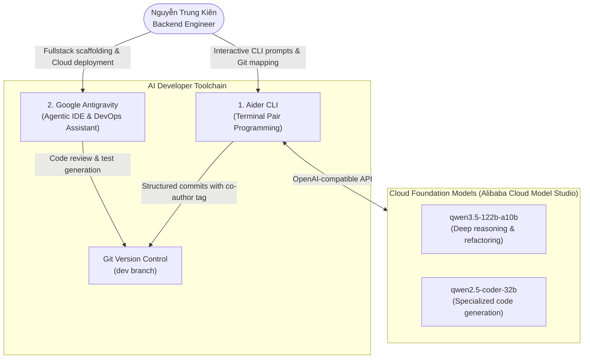

# AI Coding Tools and Account Confirmation — PA1

**Performed by:** Nguyễn Trung Kiên (Backend Engineer; 24127068)  
**Reviewed by:** Hoàng Cao Phong (Scrum Master)  
**Edited by:** Pending confirmation  

**Status snapshot:** 17 October 2026  
**Linked Trello Task:** `[PA1] AI Coding Account – Kien`

---

## 1. Overview and Objectives

In accordance with the course requirements for AI-Integrated Software Engineering (PA1), this document confirms the individual AI coding accounts, foundation models ("các con AI"), and toolchain configured by **Nguyễn Trung Kiên (Backend Engineer)** for the DineVina project.

The objective of this setup is to establish an efficient, reproducible, and secure pair-programming workflow across all project phases (PA1 to PA5). All AI-assisted development adheres strictly to the **Human-in-the-loop** principle: the engineer directs prompt context, verifies all generated code, enforces test coverage, and ensures that no API keys, credentials, or proprietary secrets enter version control.

---

## 2. Configured Foundation Models and Provider Accounts

From the verified roster of **141 available models** on Alibaba Cloud Model Studio, the following top-tier foundation models ("các con model dự kiến dùng") have been benchmarked and selected for DineVina's backend engineering workflow:

| # | Model Code / Identifier | Model Family & Architecture | Primary Specialization | Role & Practical Value in DineVina |
|---|-------------------------|----------------------------|------------------------|------------------------------------|
| 1 | **`qwen3.5-122b-a10b`** | Alibaba Qwen (MoE 122B) | General / MoE Reasoning | **Primary Account Anchor:** 1M free quota active; high-throughput architectural drafting and data modeling. |
| 2 | **`kimi-k2.7-code`** | Moonshot Kimi Code Engine | Specialized Code Generation | **Core Pair Programming:** Deep code understanding, syntax correctness for FastAPI endpoints, Pydantic schemas. |
| 3 | **`deepseek-v4-pro`** / `deepseek-v4.1-flash` | DeepSeek V4 Architecture | Algorithmic & Logic Reasoning | **Concurrency & State Machines:** Designing reservation transaction locking (`FOR UPDATE`), cutoff enforcement, and test fixtures. |
| 4 | **`qwen3.8-max`** / `qwen3.7-max` | Qwen 3.8 Flagship Series | Frontier Reasoning & System Design | **Architecture & Security:** Multi-tenant partner permission auditing, database schema constraints, and edge-case diagnosis. |
| 5 | **`qwen3-coder-flash`** | Qwen 3 Coder Series | Low-latency Code Editing | **Terminal CLI Assistant:** High-speed pair programming with Aider CLI for rapid refactoring and Git diffs. |
| 6 | **`text-embedding-v4`** & `qwen3-rerank` | Embedding & Rerank Engine | Semantic Vector Search | **Data Retrieval:** Powering semantic discovery matching and restaurant recommendation ranking. |

### Account Verification Status
* **Personal Account Registration:** Confirmed on Alibaba Cloud Model Studio (Quota verified: 141 models accessible).
* **Environment Configuration:** API key exported locally via environment variables (`DASHSCOPE_API_KEY` / `OPENAI_API_BASE`).
* **Secret Protection:** No API keys are written to repository files, shell configuration scripts, or Trello cards.

---

## 3. Coding Toolchain ("Các con công cụ dự kiến dùng")

### 3.1. Tool 1: Aider CLI (Terminal-Based Pair Programming)
* **Description:** An open-source, terminal-based AI pair-programming tool that edits code in the local repository and automatically manages Git commits.
* **Integration:** Connects to Alibaba Cloud Model Studio using OpenAI-compatible base URLs with `qwen3.5-122b-a10b` or `qwen-max`.
* **Workflow:**
  1. Aider analyzes the repository map (`git repo map`) to understand existing project structure.
  2. The engineer issues targeted prompts for file editing or test generation.
  3. Aider applies multi-file diffs and creates standard Git commits with an attribution trailer.
* **PA1 Practical Evidence:**
  * **Commit Hash:** `0e0852d3bdc59e261e40fcc7cfdc496f63e1f6ba`
  * **Commit Author:** `Nguyễn Trung Kiên <ntkien2418@clc.fitus.edu.vn>`
  * **Bot Signature:** `Co-authored-by: aider (openai/qwen-max) <aider@aider.chat>`
  * **Scope:** Assisted in drafting and updating the repository Pull Request Template (`.github/pull_request_template.md`).
  * **Git Hygiene:** Local history and input tracking files (`.aider*`) are strictly ignored via `.gitignore` to prevent repository clutter and leak of session context.

### 3.2. Tool 2: Google Antigravity (Agentic Coding IDE)
* **Description:** An autonomous, agentic coding environment equipped with tool-use capabilities, terminal execution, and browser validation.
* **Role in Backend Development:**
  * Scaffolding FastAPI backend endpoints for 10 Functional Groups (`backend/app/main.py`).
  * Generating in-memory simulation stores (`app/store.py`, `app/seed_data.py`) for rapid prototype testing without external database dependencies.
  * Writing test suites (`backend/tests/test_reservations.py`, `backend/tests/test_health.py`) achieving 8/8 passing tests under `pytest`.
  * Configuring remote deployment on Google Cloud VM (Nginx reverse proxy, systemd services, Let's Encrypt SSL on `https://dinevina-demo.duckdns.org/`).

---

## 4. Staged Adoption Across Project Sprints

| Sprint / Stage | Target Deliverables | Selected AI Model / Tool | Expected Practical Value |
|:---------------|:--------------------|:-------------------------|:-------------------------|
| **PA1** *(Current)* | Functional groups report, interactive prototype demo | Aider + Antigravity (`qwen-max`, Gemini) | Rapid prototype validation, live HTTPS deployment on GCP, weekly documentation. |
| **PA2** | Database schema, Docker Compose, Spec Kit initialization | Antigravity + `qwen3.5-122b-a10b` | Automated generation of SQLAlchemy models, Alembic migrations, PostgreSQL integration tests. |
| **PA3 – PA4** | Core business logic: reservations, capacity locking, cutoff rules | Aider CLI + `qwen2.5-coder` | Pair-programming unit tests, edge-case validation (preventing double-booking and invalid cancellations). |
| **PA5** | Performance tuning, security review, OpenAPI documentation | Antigravity + Aider | Static analysis, vulnerability auditing, comprehensive documentation cleanup. |

---

## 5. Security, Secrets Management, and Guardrails

1. **Credential Isolation:**
   - Model API keys are held strictly in local environment variables.
   - `.gitignore` is updated to include `.aider*` and credential patterns to avoid accidental exposure.
2. **Review Policy (Zero Blind Acceptance):**
   - Every line of AI-generated code is reviewed and executed locally with automated tests (`pytest`) before submitting a Pull Request.
3. **Repository Compliance:**
   - All commits are pushed to feature branches created from `dev`, following conventional commit standards (`docs:`, `feat:`, `fix:`), requiring code review before merging into `dev`.
