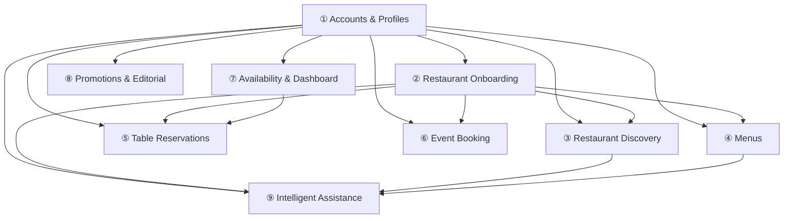
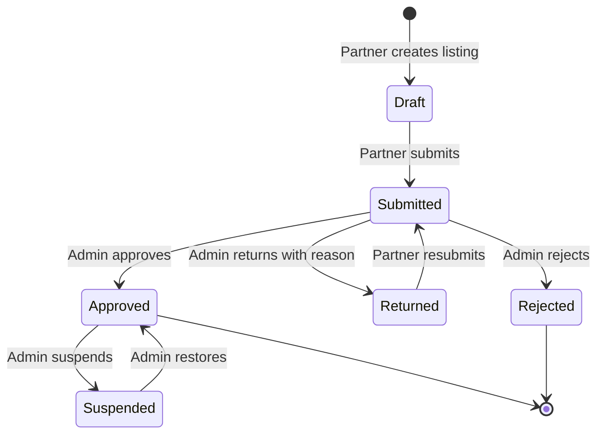
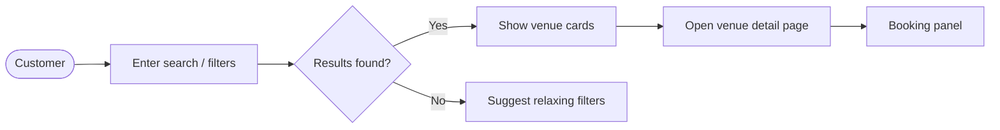
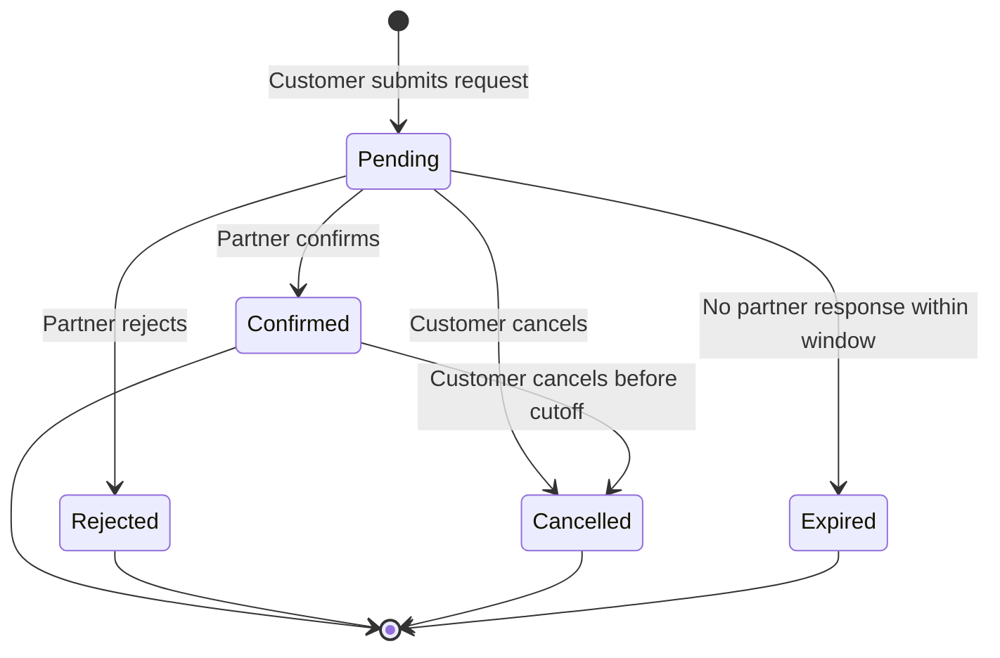
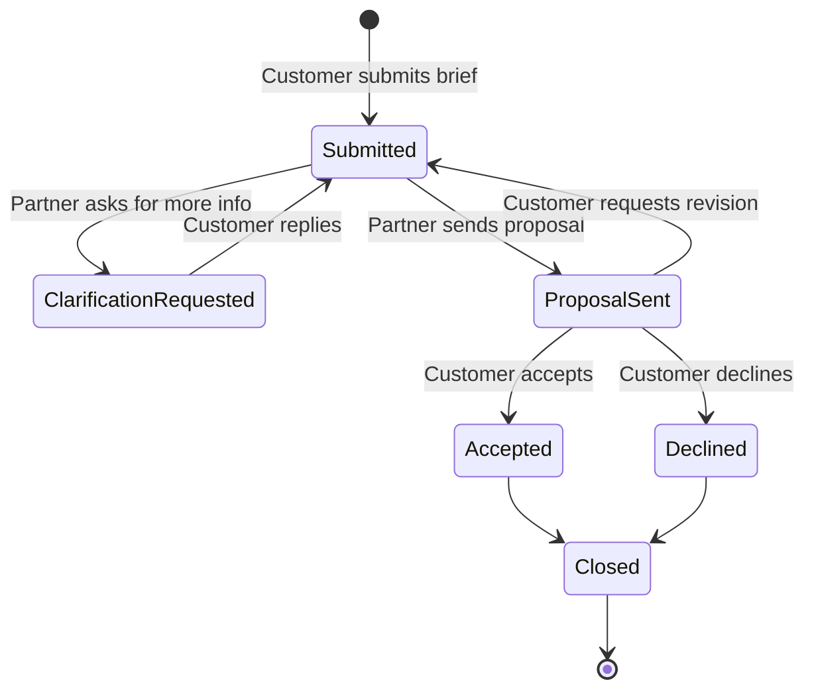
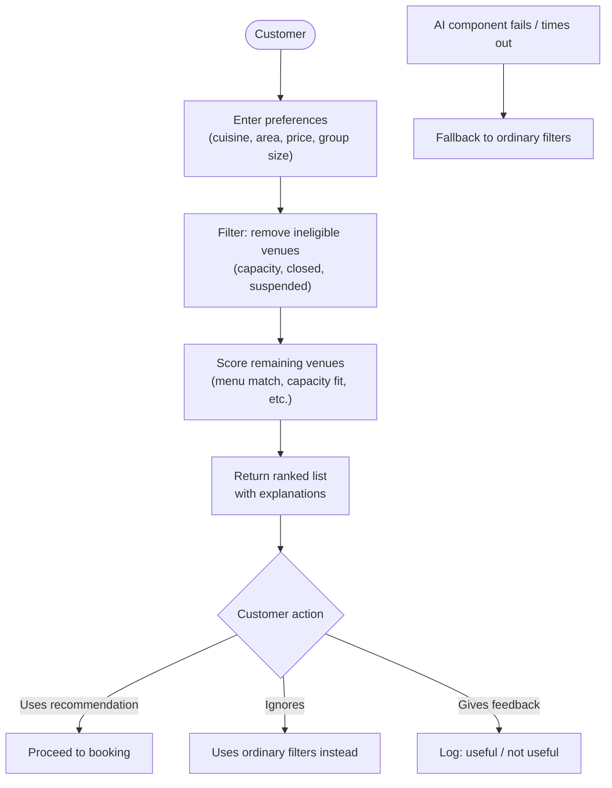

# 3.3. Nine Functional Groups

**Project:** DineVina – Smart Restaurant Reservation and Event Booking System (Group 8)  
**Author:** Nguyen Trung Kien (24127068), Backend Engineer  
**Planned stack:** React with TypeScript, FastAPI, PostgreSQL, Docker Compose  

> Everything below is a plan; the repository currently has only a health endpoint.

---

## Introduction

DineVina serves three actors: **Customer**, **Restaurant Partner**, and **Administrator**. The nine groups cover the journey from account creation to a confirmed table or an event request. Payment processing and restaurant accounting are out of scope, and no native mobile application is included.

---

## Overview

| # | Functional Group | Main Actors | Stage |
|---|-----------------|-------------|-------|
| 1 | Accounts and profiles | Customer, Partner, Admin | Release 1 |
| 2 | Restaurant onboarding | Partner, Admin | Release 1 |
| 3 | Restaurant discovery | Customer | Release 1 |
| 4 | Menus | Partner, Customer | Release 1 |
| 5 | Table reservations | Customer, Partner | Release 1 |
| 6 | Event booking | Customer, Partner | Release 2 |
| 7 | Availability and partner dashboard | Partner | Release 1 (basic), Release 2 (full) |
| 8 | Promotions and editorial | Partner, Admin, Customer | Release 2 |
| 9 | Intelligent assistance | Customer, Admin | Release 3 |

### Group Dependencies



> **Conventions for proposed APIs:** Endpoints are proposals to confirm with the frontend. Every protected endpoint checks role and ownership. All errors use one shared format. List endpoints are paginated.

---

## 1. Accounts and Profiles

**Purpose:** Identify every user and keep customer actions separate from restaurant management and administration.

### Main Functions

- Register, sign in, sign out, and reset a forgotten password by email.
- View and edit profile: name, phone, avatar; partners also keep a contact person.
- Optional customer preferences (cuisine, area, price, usual party size), stored with consent and reused by group 9.
- Change password; delete account on request.

### Proposed API

```
POST   /auth/register
POST   /auth/login
POST   /auth/logout
POST   /auth/password-reset
GET    /me
PATCH  /me
DELETE /me
GET    /me/preferences
PUT    /me/preferences
```

### Data Schema

| Table | Columns |
|-------|---------|
| `users` | `id`, `email` (unique), `password_hash`, `role` (customer / partner / admin), `status`, `created_at` |
| `profiles` | `user_id`, `full_name`, `phone`, `avatar_url` |
| `preferences` | `user_id`, `cuisines`, `area`, `price_range`, `party_size`, `consent_at` |

### Business Rules

- Three roles; a customer cannot open partner or administrator functions.
- Passwords are stored only as salted hashes; tokens expire.
- A partner can manage venues only after a listing is approved in group 2.
- Credentials and tokens never appear in Git or logs.

### Acceptance Criteria

- A new customer registers, signs in and sees only customer navigation.
- A customer token on a partner or admin endpoint returns `403`.
- A duplicate email is rejected with a clear error.
- A profile update is returned by the next `GET /me`.

---

## 2. Restaurant Onboarding

**Purpose:** Ensure customers see a curated, attributable venue record rather than unreviewed data.

### Main Functions

- Partner submits a venue form: name, address and district, cuisine, price range, opening hours, contact details, description, images.
- Partner saves a draft, submits it, and edits or resubmits after a return.
- Administrator reviews a queue, then approves, returns with a written reason, or rejects.
- Administrator can suspend or restore a published venue.
- Every decision is kept in a review history.

### Venue Status Flow



### Proposed API

```
POST   /partner/venues
PATCH  /partner/venues/{id}
POST   /partner/venues/{id}/submit
GET    /admin/venues?status=submitted
POST   /admin/venues/{id}/approve
POST   /admin/venues/{id}/return
POST   /admin/venues/{id}/reject
POST   /admin/venues/{id}/suspend
POST   /admin/venues/{id}/restore
```

### Data Schema

| Table | Columns |
|-------|---------|
| `venues` | `id`, `owner_id`, `name`, `address`, `district`, `cuisine`, `price_range`, `description`, `contact`, `status` |
| `venue_images` | `id`, `venue_id`, `url`, `position` |
| `venue_reviews` | `id`, `venue_id`, `admin_id`, `decision`, `reason`, `decided_at` |

### Business Rules

- Listing states: `Draft` → `Submitted` → `Approved` / `Returned` / `Rejected`; `Approved` can become `Suspended` and back.
- Only **Approved** venues appear in discovery.
- Required fields and image type and size are validated before submission.
- A returned listing shows the administrator's reason to the partner.

### Acceptance Criteria

- A venue missing a required field cannot be submitted.
- After approval the venue is searchable; after suspension it disappears from search while reservation history is kept.
- Each decision appears in the history with actor and time.

---

## 3. Restaurant Discovery

**Purpose:** Help a customer build and compare a shortlist before booking.

### Main Functions

- Search by restaurant name or area.
- Filter by cuisine, price range, amenities (e.g. parking, private room, outdoor seating) and, where capacity data exists, suitability for the party size.
- Sort by relevance or price.
- Result cards show photo, name, cuisine, price level, district and a booking shortcut.
- Venue detail page shows photos, description, address, opening hours, amenities, menu and the booking panel.
- An empty result suggests relaxing filters.

### Discovery Flow



### Proposed API

```
GET /venues?q=&district=&cuisine=&price=&amenities=&party_size=&sort=&page=
GET /venues/{id}
```

### Data

- Reads: `venues`, `venue_images`, `opening_hours`, `capacity_rules`; amenity tags stored on the venue.
- Indexes on `name`, `district`, and `cuisine` to keep search fast.

### Business Rules

- Only **Approved**, non-suspended venues are returned.
- Filters from different categories combine with `AND`.
- Displayed information comes only from the partner-maintained record.

### Acceptance Criteria

- A search by cuisine and district returns only matching venues.
- A suspended venue never appears.
- The venue page opens from a result card and shows the booking panel without extra navigation.

---

## 4. Menus

**Purpose:** Let customers judge whether a venue suits them before reserving, and give group 9 verified menu data.

### Main Functions

- Partner creates, edits, reorders and removes categories and dishes: name, description, price, image, dietary tags, availability.
- Partner marks a dish temporarily unavailable without deleting it.
- Customer browses the menu by category on the venue page.
- Each menu keeps a last-updated time.

### Proposed API

```
GET    /venues/{id}/menu
POST   /partner/venues/{id}/menu/categories
POST   /partner/venues/{id}/menu/dishes
PATCH  /partner/menu/dishes/{dish_id}
DELETE /partner/menu/dishes/{dish_id}
```

### Data Schema

| Table | Columns |
|-------|---------|
| `menu_categories` | `id`, `venue_id`, `name`, `position` |
| `dishes` | `id`, `category_id`, `name`, `description`, `price_vnd`, `image_url`, `dietary_tags`, `available`, `updated_at` |

### Business Rules

- Prices are shown in VND as guidance only, because ordering and payment are out of scope.
- Only the owning partner can edit its menu.
- Unavailable dishes stay visible with a clear label.

### Acceptance Criteria

- A dish saved by a partner appears on the public venue page.
- A dish marked unavailable shows an *unavailable* label.
- A partner cannot modify another partner's menu (`403`).

---

## 5. Table Reservations

**Purpose:** Provide a clear request and confirmation flow so a request is never mistaken for a confirmed table.

### Main Functions

- Customer creates a request: venue, date, time, party size, optional note.
- Customer lists reservations, opens one, sees its status history, and cancels before a cutoff time.
- Partner lists incoming requests, then confirms or rejects with an optional reason.
- Both sides see the same status; an email is sent on each status change.

### Reservation Status Flow



### Reservation Lifecycle


### Proposed API

```
POST   /reservations
GET    /reservations
GET    /reservations/{id}
POST   /reservations/{id}/cancel
GET    /partner/reservations
POST   /partner/reservations/{id}/confirm
POST   /partner/reservations/{id}/reject
```

### Data Schema

| Table | Columns |
|-------|---------|
| `reservations` | `id`, `customer_id`, `venue_id`, `reserved_at`, `party_size`, `note`, `status`, `created_at`, `updated_at` |
| `reservation_status_history` | `id`, `reservation_id`, `from_status`, `to_status`, `actor_id`, `reason`, `changed_at` |

### Business Rules

- Accept a request only if the venue is approved, open at that time, and the party size fits the remaining capacity from group 7.
- A customer cannot hold two overlapping reservations.
- Every status change writes a history row with actor and time, in the same transaction as the update.
- Only the owning partner can confirm or reject; only the owning customer can cancel.
- Capacity check and insert run in one transaction to avoid double booking.

### Error Codes

| Code | Cause |
|------|-------|
| `400` | Invalid date/time, time in the past, invalid party size |
| `403` | Wrong role or owner |
| `404` | Unknown venue or reservation |
| `409` | Closed or blocked slot, no capacity, overlapping reservation, invalid status transition |

### Acceptance Criteria

- A submitted request starts as `Pending`.
- A request outside opening hours or for a blocked slot is refused with a clear message.
- After confirmation or cancellation both views show the same final status and history.
- An invalid transition (e.g. confirming a `Cancelled` request) is refused.

### Tests

- Unit tests for transition rules.
- API tests for each error code.
- A concurrency test with two requests competing for the last seats.

---

## 6. Event Booking

**Purpose:** Handle group occasions that need negotiation rather than a simple table, in one visible thread.

### Main Functions

- Customer submits an event brief: occasion, headcount, date and time, budget range, special needs, contact preference.
- Partner sends a proposal (price, menu package, conditions) or asks for clarification.
- Both sides exchange messages in the event thread.
- Customer accepts, declines or asks for a revision.

### Event Status Flow



### Proposed API

```
POST   /events
GET    /events
GET    /events/{id}
POST   /events/{id}/messages
POST   /partner/events/{id}/proposal
POST   /partner/events/{id}/clarify
POST   /events/{id}/accept
POST   /events/{id}/decline
```

### Data Schema

| Table | Columns |
|-------|---------|
| `event_requests` | `id`, `customer_id`, `venue_id`, `occasion`, `headcount`, `event_at`, `budget_min`, `budget_max`, `needs`, `status` |
| `event_messages` | `id`, `event_id`, `sender_id`, `body`, `created_at` |
| `event_proposals` | `id`, `event_id`, `price`, `package`, `conditions`, `created_at` |

### Business Rules

- Status flow: `Submitted` → `Clarification Requested` → `Proposal Sent` → `Accepted` / `Declined` → `Closed`.
- Only venues that enable event hosting receive briefs.
- An accepted proposal records the agreed terms; no payment or deposit is processed.
- Messages and proposals stay attached to the event and cannot be deleted.

### Acceptance Criteria

- A brief without headcount or date cannot be submitted.
- A partner proposal appears in the customer's thread and can be accepted or declined.
- Final status and agreed terms stay visible to both sides after closing.

---

## 7. Availability and Partner Dashboard

**Purpose:** Keep promises realistic by giving partners control over opening hours and capacity, and one place to handle incoming work.

### Main Functions

- Set weekly opening hours, closing days and holidays.
- Set capacity per time slot and block unavailable slots.
- Dashboard lists pending reservations, today's confirmed bookings, new event leads and recent status changes, with quick confirm, reject and reply actions.
- Basic counters: requests received, confirmed, cancelled.

### Slot Management Flow


### Proposed API

```
GET    /partner/venues/{id}/availability
PUT    /partner/venues/{id}/opening-hours
PUT    /partner/venues/{id}/capacity
POST   /partner/venues/{id}/blocked-slots
DELETE /partner/venues/{id}/blocked-slots/{slot_id}
GET    /partner/dashboard
```

### Data Schema

| Table | Columns |
|-------|---------|
| `opening_hours` | `venue_id`, `weekday`, `open_time`, `close_time` |
| `closures` | `venue_id`, `date`, `reason` |
| `capacity_rules` | `venue_id`, `slot`, `seats` |
| `blocked_slots` | `id`, `venue_id`, `start_at`, `end_at`, `reason` |

### Business Rules

- Reservation checks (group 5) always use the latest settings.
- A capacity change affects only new requests.
- Blocking a slot does not cancel confirmed reservations automatically; the API returns the affected reservations so the partner can handle them.
- Only the owning partner and administrators can change these settings.

### Acceptance Criteria

- A blocked slot returns `409` when a customer tries to book it.
- Changing capacity does not alter existing confirmed reservations.
- Dashboard counts match the reservation and event data.

---

## 8. Promotions and Editorial

**Purpose:** Let partners present time-bound value and short venue stories while the platform controls quality.

### Main Functions

- Partner creates a promotion: title, description, start and end date, eligibility (days, time, minimum party size).
- Partner publishes short editorial content, such as a venue story or seasonal feature, with images.
- Administrator reviews content against platform rules and can hide or remove it.
- Customer sees active promotions on cards and venue pages.

### Proposed API

```
GET    /venues/{id}/promotions
GET    /promotions?active=true
POST   /partner/promotions
PATCH  /partner/promotions/{id}
POST   /partner/editorial
POST   /admin/content/{id}/hide
```

### Data Schema

| Table | Columns |
|-------|---------|
| `promotions` | `id`, `venue_id`, `title`, `description`, `starts_at`, `ends_at`, `conditions`, `status` |
| `editorial_posts` | `id`, `venue_id`, `title`, `body`, `images`, `status`, `moderation_reason` |

### Business Rules

- Promotions expire automatically at the end date.
- Conditions and expiry are shown wherever an offer appears.
- Content that breaks platform rules is removed with a recorded reason.
- Promotions are informational and are not applied through online payment.

### Acceptance Criteria

- An expired promotion no longer appears as active.
- Every displayed offer shows its conditions and end date.
- Administrator-hidden content disappears from public pages but stays in the partner's list with the reason.

---

## 9. Intelligent Assistance

**Purpose:** Reduce search effort with explainable recommendations, without replacing ordinary filters.

### Main Functions (Staged)

| Stage | Name | Description |
|-------|------|-------------|
| **A** | Recommender | Customer enters cuisine, area, price and group size; system removes ineligible venues, scores the rest and shows ranked results with reasons (menu match, suitable capacity). Customer can mark a suggestion as useful or not. |
| **B** | Retrieval-based assistant *(future)* | Answers questions from approved menu and policy records, with source links and a clear statement when uncertain. |
| **C** | Menu OCR *(future)* | Creates editable draft menu items for partner review. |

### Stage A Recommendation Flow



### Proposed API

```
POST /recommendations         (preferences in, ranked venues with reasons out)
POST /recommendations/{id}/feedback
```

> The backend calls the AI component and falls back to ordinary filters if it fails or times out.

### Data Schema

| Table | Columns |
|-------|---------|
| `recommendation_logs` | `id`, `user_id` (optional), `query`, `result_ids`, `created_at` — kept to a minimum and free of credentials |
| `recommendation_feedback` | `recommendation_id`, `venue_id`, `useful` |

### Business Rules

- Only verified, approved venue attributes are used for ranking and explanations.
- Generated content is never published without human review.
- Stored preferences need customer consent.
- The feature is not claimed to outperform existing products until it is evaluated.

### Acceptance Criteria

- Each recommendation shows at least one reason that matches a real venue attribute.
- Venues that fail hard constraints (e.g. capacity) never appear in the ranked list.
- On a small labeled set of realistic queries the team can report ranking quality and the number of bad suggestions.

---

## Cross-Cutting Backend Work (Kien)

- One error format and shared role and ownership dependencies for all endpoints.
- Database migrations for every table above, plus seed data for local development.
- Pagination on list endpoints.
- Connect the frontend and the AI component through the backend API.
- Keep credentials, tokens and customer data out of Git.

---

## Scope

| Category | Items |
|----------|-------|
| **Release 1** | Groups 1–5 and the basic part of group 7 |
| **Release 2** | Event booking (6), full dashboard (7), promotions and editorial (8) |
| **Release 3** | Intelligent assistance (9) |
| **Out of scope** | Online payment, deposits, full restaurant accounting, native mobile applications |

---

## Open Questions for the Team

1. Response window before a `Pending` reservation expires, and the cancellation cutoff.
2. Whether capacity is counted in **seats** or in **tables**.
3. Whether the first release includes event briefs or leaves them to Release 2.