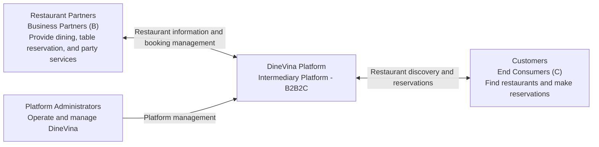

### 3. Project proposal
## 3.1. Idea and Value

DineVina is a web-based restaurant reservation and party management platform operating under a **Business-to-Business-to-Consumer (B2B2C) model**, connecting small and medium-sized restaurants (SMEs) with customers through a centralized system.

Under this model, DineVina acts as an intermediary platform rather than a direct food or event service provider. Restaurant partners provide dining and party services, while DineVina supports restaurant discovery, reservations, and booking management between restaurants and customers.

Customers can search for restaurants based on location, guest capacity, budget, party type, menu, and availability. They can explore menus and party packages, make table reservations, or submit party booking requests through the platform.

For restaurant partners, DineVina provides a centralized workspace to manage restaurant information, menus, booking requests, customer records, and availability. Restaurants remain responsible for managing their services and confirming customer bookings.

The initial development will focus on restaurant discovery and standard table reservations. Party booking management and AI-assisted recommendations will be implemented in subsequent development stages within the project's scope.

## 3.2. Target Users and Environment

Following the B2B2C model, DineVina connects restaurant businesses with end customers through a shared web platform. The system supports three main user roles, each with distinct responsibilities.

**1. Customers (C - End Consumers)**

Customers are individuals or groups looking for restaurants for regular dining or special occasions. They are the end users of the dining and party services provided by restaurant partners.

Through DineVina, customers can search and compare restaurants, view menus and party packages, check availability, and submit table reservations or party booking requests.

**2. Restaurant Partners (B - Business Partners)**

Restaurant partners are small and medium-sized restaurants that provide dining and party services to customers through DineVina.

They can register their restaurants, manage restaurant profiles, menus and party packages, update availability, manage customer information, and process booking requests.

Restaurant partners are responsible for providing the actual services and managing reservations received through the platform.

**3. Platform Administrators (DineVina Management)**

Platform administrators represent the DineVina platform operator. Their responsibilities focus on platform administration rather than directly providing restaurant services.

They review restaurant registration requests and manage restaurant information on the platform to support its operation.

**User Environment**

DineVina will operate as a responsive web application accessible through desktop and mobile browsers. All three user roles will access the same platform through interfaces appropriate to their respective responsibilities.

The system is planned to use React for frontend development and FastAPI for backend development. Other technologies will be determined during the development process based on the project's requirements.
