

<strong>VIETNAM NATIONAL UNIVERSITY HO CHI MINH CITY UNIVERSITY OF SCIENCE</strong>

<strong>FACULTY OF INFORMATION TECHNOLOGY INTRODUCTION TO SOFTWARE ENGINEERING</strong>

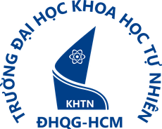

<h1 style="font-size: 18pt;">PA1 REPORT</h1>
<h2 style="font-size: 27pt;">DineVina</h2>

<em>Smart Restaurant Reservation and Event Booking System</em>

<strong>Project team: Group 08</strong> 
Hoàng Cao Phong · Võ Mỹ Ngọc · Lương Thiện Nhân 
Nguyễn Trung Kiên · Trương Khánh Duy

Ho Chi Minh City, 17 October 2026

## 1. Group registration

**Performed by:** Hoàng Cao Phong | **Reviewed by:** Võ Mỹ Ngọc | **Edited by:** Hoàng Cao Phong

The repository and the reviewed Week 1 roster identify Group 08, the project name DineVina, and Hoàng Cao Phong as group leader. The official course form link is marked “to be announced” in the PA1 brief; a submitted-form receipt is not included in the available evidence. The roster is the team's registration record, while official submission confirmation remains a separate artifact.

| Student ID | Member | University email |
| --- | --- | --- |
| 24127486 | Hoàng Cao Phong | hcphong2425@clc.fitus.edu.vn |
| 24127294 | Võ Mỹ Ngọc | vmngoc2433@clc.fitus.edu.vn |
| 24127475 | Lương Thiện Nhân | ltnhan2433@clc.fitus.edu.vn |
| 24127068 | Nguyễn Trung Kiên | ntkien2418@clc.fitus.edu.vn |
| 24127160 | Trương Khánh Duy | tkduy2414@clc.fitus.edu.vn |

## 2. Project proposal

**Performed by:** Võ Mỹ Ngọc | **Reviewed by:** Hoàng Cao Phong | **Edited by:** Võ Mỹ Ngọc

### 2.1. Idea, value, and boundaries

**Performed by:** Võ Mỹ Ngọc | **Reviewed by:** Hoàng Cao Phong | **Edited by:** Võ Mỹ Ngọc

DineVina is a proposed **responsive web marketplace for restaurant discovery, table reservations, and event inquiries**. It uses a B2B2C model: restaurant partners provide dining services and manage requests, customers find a suitable place and request a booking, and the DineVina platform connects both sides. The customer benefit is a clearer path from search to a visible booking state; the partner benefit is one place to present verified venue information and respond to demand.

The platform is not intended to be a complete restaurant POS, inventory, accounting, or payment system. Its partner workspace supports the marketplace workflow. This boundary follows the 16 October product clarification and Ngọc's proposal. An ordinary booking is a request until a partner confirms it. Event inquiries need a separate negotiation path.

### 2.2. Actors and environment

**Performed by:** Võ Mỹ Ngọc | **Reviewed by:** Hoàng Cao Phong | **Edited by:** Võ Mỹ Ngọc

**Customers** browse restaurants, compare menus and suitability, and submit table or event requests. **Restaurant partners** register venues, maintain menus and availability, and accept or decline incoming requests. A **platform administrator** reviews listings and moderates records. All three actors use role-specific views in a responsive web application on desktop or mobile browsers. Native mobile apps are outside the current plan. The current scaffold uses React/TypeScript and FastAPI, with PostgreSQL configured for future use.

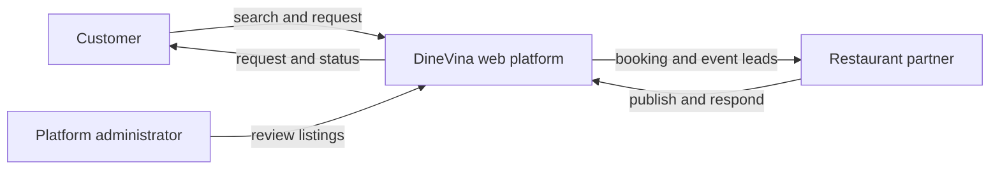

### 2.3. Nine functional groups

**Performed by:** Nguyễn Trung Kiên | **Reviewed by:** Trương Khánh Duy | **Edited by:** Nguyễn Trung Kiên

The reviewed proposal fixes **nine** groups for PA1, within the required 8–10. Kiên's detailed working document explores eleven candidate groups. Notifications are supporting behavior across bookings and events; ratings and reviews are deferred from the nine-group PA1 scope.

1. **Accounts and profiles.** Customers and partners create accounts and maintain contact and preference information. Role-aware access keeps customer, partner, and administrator actions separate.
2. **Restaurant onboarding.** A partner submits venue identity, location, cuisine, photos, and contact details. An administrator approves or returns the listing so discovery uses attributable restaurant data.
3. **Discovery and venue details.** Customers search and filter by location, cuisine, budget, capacity, and amenities, then inspect a venue. These filters shorten the route to a suitable dining or event option.
4. **Menus.** Partners maintain approved dishes, descriptions, and prices; customers view them before requesting a table. This reduces uncertainty about budget and suitability.
5. **Table reservations.** Customers choose date, time, and party size and submit a request; partners confirm or reject it. Both sides see status history and cancellation rules so “requested” is not confused with “confirmed.”
6. **Event inquiries and proposals.** Customers submit an occasion, headcount, date, budget, and needs. Partners can clarify, propose terms, and track the response in one thread.
7. **Availability and partner dashboard.** Partners maintain hours, capacity, and blocked slots while viewing incoming requests. Capacity controls reduce conflicting promises and give staff a useful daily queue.
8. **Promotions and editorial content.** Partners submit time-bound offers and venue content under platform rules; customers see eligibility and expiry. This adds discovery value without requiring payment or full merchant accounting.
9. **Intelligent assistance.** Customers receive restaurant recommendations matched to their stated preferences and verified venue attributes, with visible reasons. A later source-grounded assistant may answer menu or policy questions after data quality is established.

### 2.4. AI value and delivery plan

**Performed by:** Trương Khánh Duy | **Reviewed by:** Hoàng Cao Phong | **Edited by:** Trương Khánh Duy

The meaningful first AI capability is an **explainable restaurant recommender**. It removes venues that are unapproved or cannot meet the requested party/date, ranks remaining venues using cuisine, location, budget, occasion, and menu attributes, and explains each suggestion. A small labeled set of realistic queries should measure relevant top results, unsuitable recommendations, and coverage. Customers keep ordinary filters as a fallback. Preferences require consent and the output must not state an unverified venue fact as certain. This is proposed, not implemented in the current scaffold.

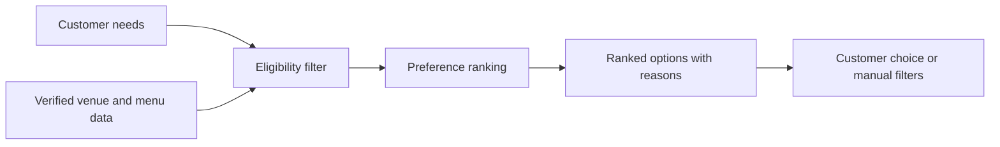

Duy also proposes a retrieval-based menu/policy assistant, menu OCR into partner-reviewed drafts, and visual dish search. They remain later candidate slices. None should be described as a delivered feature or as an independent PA1 requirement.

## 3. Existing app survey

**Performed by:** Lương Thiện Nhân | **Reviewed by:** Nguyễn Trung Kiên | **Edited by:** Lương Thiện Nhân

### 3.1. Method and PasGo evidence

**Performed by:** Lương Thiện Nhân | **Reviewed by:** Nguyễn Trung Kiên | **Edited by:** Lương Thiện Nhân

PasGo is a Vietnamese comparison for discovery, restaurant detail, table booking, and group consultation. The captured sequence below shows the home page, search, venue details, booking form, consultation chat, and a confirmation/verification view. These are interface observations, not proof of a completed real reservation. The team should adopt visible venue criteria, clear party/date/time input, and explicit booking conditions.

*Figure 1. PasGo home page: entry into venue discovery.*

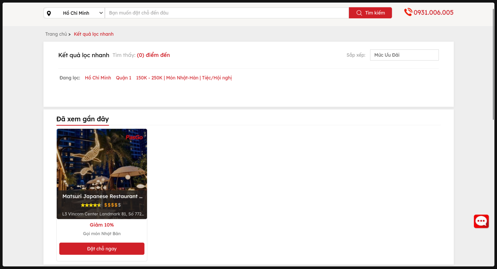

*Figure 2. PasGo search: narrowing restaurant choices.*

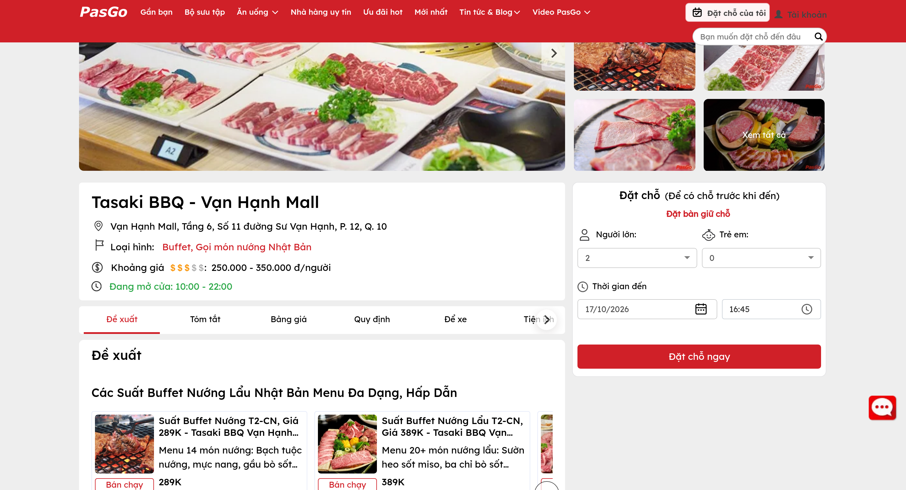

*Figure 3. PasGo venue details: information used before requesting a table.*

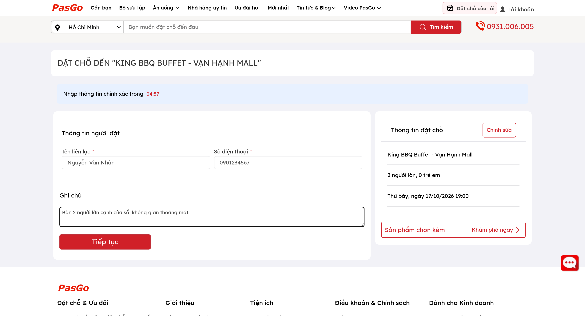

*Figure 4. PasGo booking form: party and visit details.*

*Figure 5. PasGo consultation: a human-assisted path for complex bookings.*

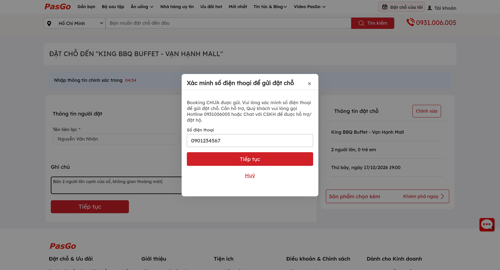

*Figure 6. PasGo confirmation view; no booking was submitted for this survey.*

### 3.2. Eatigo evidence

**Performed by:** Lương Thiện Nhân | **Reviewed by:** Nguyễn Trung Kiên | **Edited by:** Lương Thiện Nhân

Eatigo is a regional comparison for date/time search and time-linked dining discounts. The five screenshots below come from Nhân's [Week 1 survey on the `dev` branch](https://github.com/HoangCaoPhong/DineVina/tree/dev/docs/weekly-reports/Week1/Nhan-ExistingAppSurvey), added through [PR #9](https://github.com/HoangCaoPhong/DineVina/pull/9). They show a **Pattaya, Thailand** browsing session: home search, results filters and half-hour discount badges, a venue's time choices, the login gate after selecting a slot, and venue conditions. The visible “AI Summary” on the venue page is interface text, not proof of how Eatigo implements AI. No account was created or reservation submitted for this survey. These captures do not establish Vietnam market coverage or an event-inquiry workflow. The [capture provenance](evidence/survey/Eatigo-Capture-Provenance.md) records the exact source commit and limits of the evidence.

*Figure 7. Eatigo home: date, time, party size, and venue search precede the listings.*

*Figure 8. Eatigo results: filters and discount percentages attached to visible time slots.*

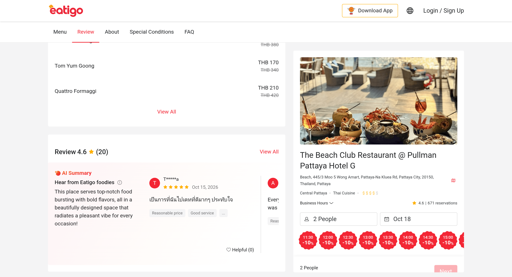

*Figure 9. Eatigo venue: party/date inputs and time-linked offers; an “AI Summary” label is visible in the review panel.*

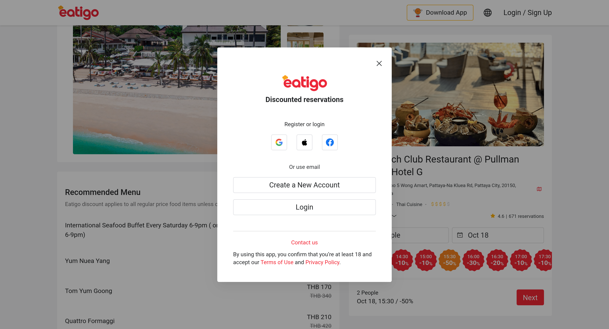

*Figure 10. Eatigo booking entry: selecting a slot opens a sign-in or registration gate; no booking confirmation is shown.*

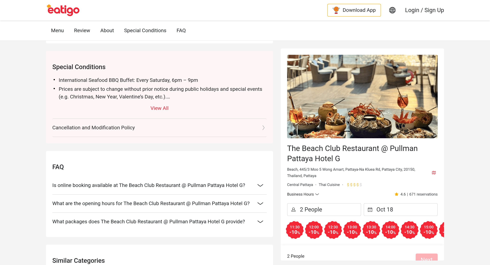

*Figure 11. Eatigo venue conditions: offer rules and cancellation information are available before a reservation.*

### 3.3. Comparison and design response

**Performed by:** Lương Thiện Nhân | **Reviewed by:** Nguyễn Trung Kiên | **Edited by:** Lương Thiện Nhân

| Question | PasGo observation | Eatigo observation | DineVina response |
| --- | --- | --- | --- |
| How does a diner narrow choices? | Local venue and amenity search | Date/time, cuisine, price, discount search | Combine fit-to-party and venue criteria. |
| How is a booking started? | Form and optional consultation path | Time-linked venue choice followed by a sign-in gate in the captured session | Show request versus confirmation state. |
| How are group events handled? | Human-assisted consultation appears in captured UI | Not shown in captured screens | Use a structured event brief and partner proposal. |
| How is offer value shown? | Venue and promotion context | Discount by time slot, with venue conditions accessible nearby | Display exact eligibility and expiry. |

Both products make venue search and reservation entry visible. DineVina's proposed difference is a traceable booking state, a structured event conversation, and later explainable recommendations grounded in partner-verified data. Survey claims beyond the captured interfaces are in Nhân's working analysis and should be rechecked against current product pages before external presentation.

## 4. Team contract

**Performed by:** Võ Mỹ Ngọc | **Reviewed by:** Hoàng Cao Phong | **Edited by:** Võ Mỹ Ngọc

### 4.1. Roles and shared engineering responsibility

**Performed by:** Võ Mỹ Ngọc | **Reviewed by:** Hoàng Cao Phong | **Edited by:** Võ Mỹ Ngọc

All five members share delivery across requirements, implementation, review, testing, and documentation. Phong is the group leader and Scrum Master; Ngọc is the Product Owner. The roles below assign primary engineering focus while cross-team work and peer review remain expected. Ngọc's team contract records approval by all five members on 16 October 2026; no separate signed approval image is included in this package.

| Member | Scrum / engineering role | Primary responsibility |
| --- | --- | --- |
| Hoàng Cao Phong | Scrum Master; MLOps engineer | Coordinate the sprint and Trello process; design and integrate restaurant recommendations. |
| Võ Mỹ Ngọc | Product Owner; Frontend engineer | Prioritize the backlog; write requirements and acceptance criteria; lead UX, UI, and frontend work. |
| Lương Thiện Nhân | Data Engineer | Define restaurant and menu data; structure, clean, and check AI input quality. |
| Nguyễn Trung Kiên | Backend Engineer | Design the API, database, authentication, and booking workflow; connect frontend and AI services. |
| Trương Khánh Duy | AI Engineer | Experiment with recommendations; evaluate relevance, explanations, and failure cases. |

### 4.2. Communication, schedule, and decisions

**Performed by:** Võ Mỹ Ngọc | **Reviewed by:** Hoàng Cao Phong | **Edited by:** Võ Mỹ Ngọc

The team uses Zalo for regular communication, Trello for tasks, GitHub for code/documents, and Moodle for course submission. Members check messages regularly, acknowledge important project messages within one working day, announce absence or blockers early, and record significant decisions. The PA1 Planning and first Scrum check-in began at **21:30 on 9 October**; the second Scrum check-in and Review began at **21:30 on 16 October**, with all five members present at both sessions. For later weeks, the group plans a fixed **Sunday 21:30** meeting slot, adjusted when a course deadline requires it. A task has exactly **one accountable Trello owner**, plus a reviewer who does not perform that task. Larger collaborative work is split into separately owned tasks.

The team seeks consensus; if it fails, at least three of five members decide by majority vote. The Product Owner coordinates priority proposals, and the group approves major scope or architecture changes. Unresolved interpersonal disputes go from direct discussion to a group discussion facilitated by the leader, then to the TA/instructor if needed.

### 4.3. Quality, accountability, and review

**Performed by:** Võ Mỹ Ngọc | **Reviewed by:** Hoàng Cao Phong | **Edited by:** Võ Mỹ Ngọc

Members work on branches, link changes to Trello tasks, request another member's review, test relevant behavior, and maintain English Markdown and useful Mermaid diagrams. The repository must remain private; credentials and customer data do not belong in Git. A task advances from To Do to In Progress, In Review, and Done only when its real work and review warrant it; actual creation, assignment, and completion dates must be preserved. Missed deadlines are reported with a revised plan. Contribution is judged from delivered/reviewed work, meeting participation, and documentation, not commit count alone. Repeated underperformance is discussed privately, followed by a corrective plan and TA escalation if unresolved. The contract is reviewed at each sprint review; amendments need a recorded group decision.

## 5. Development tools and Scrum evidence

**Performed by:** Hoàng Cao Phong | **Reviewed by:** Võ Mỹ Ngọc | **Edited by:** Hoàng Cao Phong

### 5.1. Tools and repository

**Performed by:** Hoàng Cao Phong | **Reviewed by:** Võ Mỹ Ngọc | **Edited by:** Hoàng Cao Phong

The [DineVina Trello board](https://trello.com/b/cE6KYEGR/dinevina-group-08-scrum-board) replaces the obsolete Jira snapshot in the older `docs/ans` draft. At the earlier 17 October board capture, nine completed cards were in **Done**, ten in **Sprint To Do**, one AI-account card in **In Review**, and five future cards in **Product Backlog**. Each PA1 card has one accountable owner; the confirmed reviewer is a different member under the team's review rotation. The [board evidence register](evidence/Trello-Board-Audit.md) links every card and notes the subsequent meeting-record update; the screenshots retain the earlier board state. Actual timestamps remain in Trello activity; the report does not backdate work to the 9 October meeting.

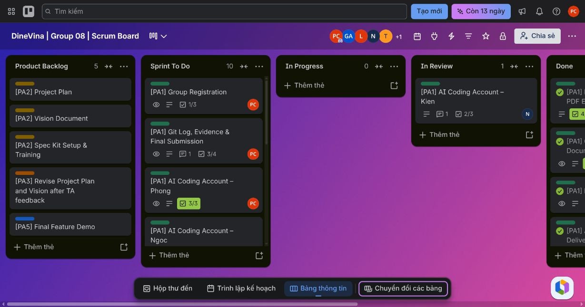

*Figure 12. Trello board overview on 17 October: Product Backlog 5, Sprint To Do 10, In Review 1, and Done 9.*

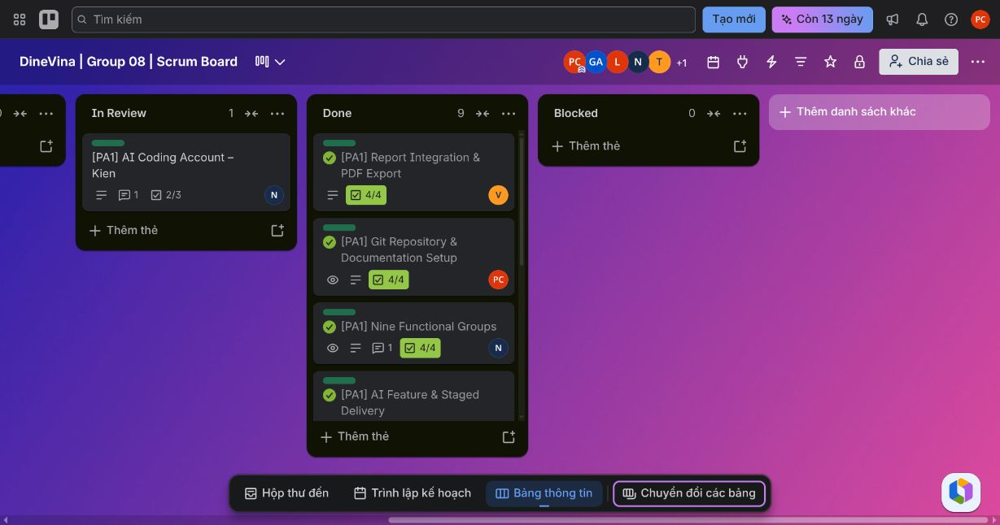

*Figure 13. Done list after the reviewed PA1 deliverables and report export were completed.*

GitHub holds the [public DineVina repository](https://github.com/HoangCaoPhong/DineVina). This local compilation is on `research/PA1_final`; the [exported Git log](evidence/git-log.txt) is a snapshot from this checkout. A read-only remote check on 17 October found `main` at `c1abac9` and `dev` at `c806950`. The Eatigo screenshots from [PR #9](https://github.com/HoangCaoPhong/DineVina/pull/9) are in `dev` but not yet in `main`; their inclusion here does not imply a `main` promotion. The checked-out `main` source includes a React/TypeScript frontend, FastAPI backend, Docker Compose and PostgreSQL configuration, and GitHub Actions workflow definitions. Its frontend is informational and its implemented API behavior is the `/api/health` endpoint. A workflow file or configured database is not evidence of an executed remote run or finished product feature. Spec Kit begins from PA2 under the brief.

### 5.2. GitHub collaboration and branch promotion

**Performed by:** Hoàng Cao Phong | **Reviewed by:** Võ Mỹ Ngọc | **Edited by:** Hoàng Cao Phong

The team uses a **simplified Gitflow-style branching workflow**. Each member develops an assigned task on a separate branch (for example, `research/Project-proposal`, `Nhan_Week1_Survey`, or `kd_w1_aifeature`) and opens a pull request (PR) to the integration branch, `dev`. The assigned peer reviews the change, checks the task's acceptance criteria and relevant build/test results, and requests corrections when needed. Once the task is ready, its PR is merged into `dev`. The team checks the combined work there; when the intended set of changes is ready, a second PR promotes `dev` to the stable `main` branch. `main` is the reference for a reviewed milestone, while ongoing work continues from `dev`. This is *Gitflow-inspired* rather than full Gitflow because the team has not established separate release and hotfix branches.

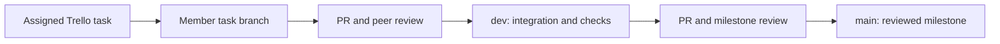

The repository provides a concrete sequence: [PR #7](https://github.com/HoangCaoPhong/DineVina/pull/7) merged `research/Project-proposal` into `dev`, and [PR #8](https://github.com/HoangCaoPhong/DineVina/pull/8) then merged `dev` into `main` on 17 October 2026. [PR #2](https://github.com/HoangCaoPhong/DineVina/pull/2) and [PR #5](https://github.com/HoangCaoPhong/DineVina/pull/5) also show member task branches entering `dev`; [PR #6](https://github.com/HoangCaoPhong/DineVina/pull/6) shows an earlier `dev` to `main` promotion. These merged PRs demonstrate the branch path, but a merge or passing automated checks alone does not prove a human review occurred on every PR. The team's PA1 document review is recorded separately in the attribution lines and Trello audit.

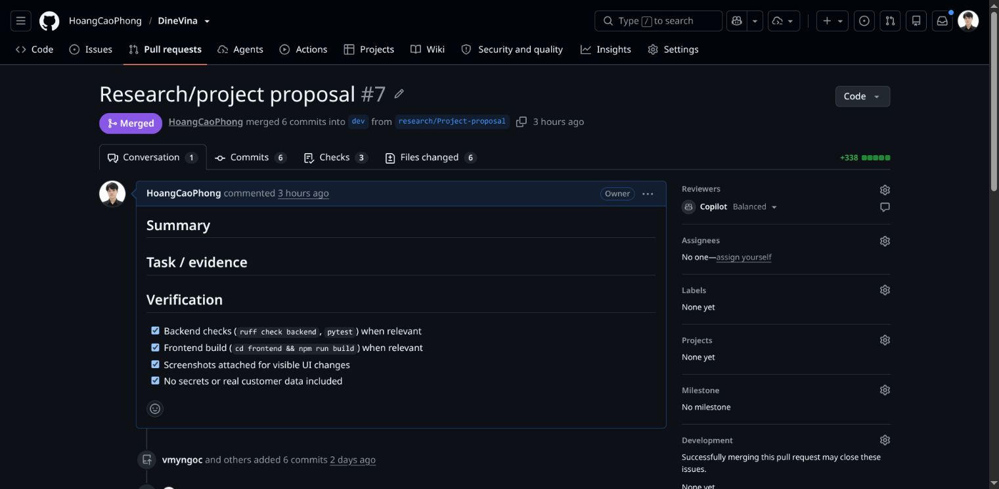

*Figure 14. Task branch to integration branch: PR #7, captured 17 October 2026.*

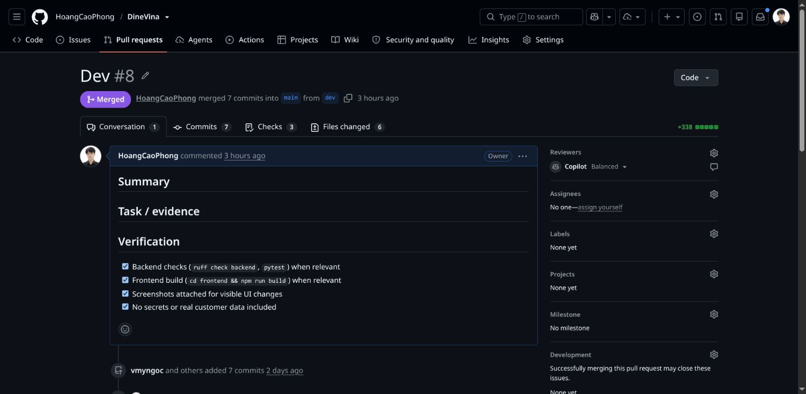

*Figure 15. Integration branch to stable branch: PR #8, captured 17 October 2026.*

The [GitHub Contributors graph](https://github.com/HoangCaoPhong/DineVina/graphs/contributors?from=07%2F11%2F2026) gives a complementary view of commits visible on `main`. The group-supplied crop below shows the five team accounts: Kiên, Ngọc, Phong, Nhân, and Duy. This is a selected portion of the graph, not its complete contributor list. GitHub excludes merge commits from this view, and commit totals are not used as a measure of individual performance. The history also contains one earlier exception to the preferred route: [PR #3](https://github.com/HoangCaoPhong/DineVina/pull/3) merged Kiên's task branch directly into `main` on 16 October. The route above is the team's documented integration practice, not a claim that every historical PR followed it. At inspection, `dev` had changes newer than the last `main` promotion; the report does not claim that all work on `dev` has reached `main`.

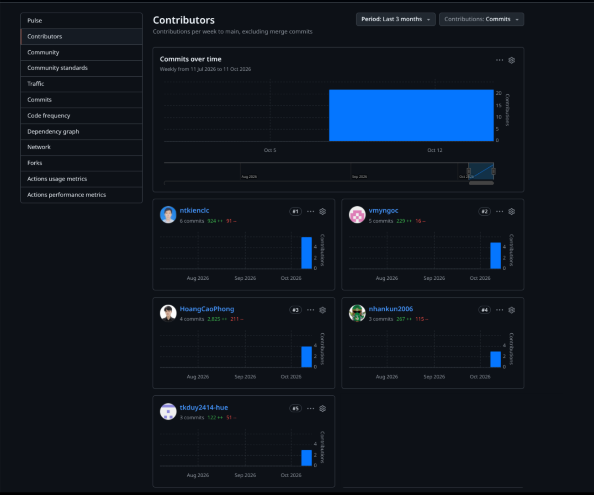

*Figure 16. Group-supplied crop of the Contributors view, 17 October 2026. It shows five team accounts; GitHub counts weekly commits to `main` and excludes merge commits. The crop is not the complete contributor list.*

### 5.3. Meeting and account evidence

**Performed by:** Hoàng Cao Phong | **Reviewed by:** Võ Mỹ Ngọc | **Edited by:** Hoàng Cao Phong

The cleaned [meeting records](meeting-minutes/README.md) document two completed PA1 group sessions at **21:30 on 9 and 16 October**, each with all five members present. The [ceremony log](meeting-minutes/PA1-ceremony-log.md) maps their agendas to the required Planning, two Scrum check-ins, and Review. The original Notion text is brief; the meeting times, attendance, and completed status were supplied by the team for this record on 17 October, while the work outputs are cross-checked against the Week 1 drafts. The minutes do not claim to be a verbatim transcript or a call recording. AI coding account cards exist for all five members: Phong's checklist is 3/3, Kiên's is 2/3 and in review, and the other three show no checked items in the inspected board. The newer `dev` branch contains [Kiên's written AI-tool and account confirmation](https://github.com/HoangCaoPhong/DineVina/blob/dev/docs/weekly-reports/Week1/Kien_FunctionalGroups/AICoding_Kien.md), but this is a self-report, not independent account evidence. No account screenshots for all five members are included in this package. The course requires each member's real account evidence, without publishing credentials.

### 5.4. Submission traceability

**Performed by:** Hoàng Cao Phong | **Reviewed by:** Võ Mỹ Ngọc | **Edited by:** Hoàng Cao Phong

| PA1 requirement | Evidence in this package | Remaining verification |
| --- | --- | --- |
| Group registration | Roster and leader in Section 1 | Official form receipt and member identity check. |
| Project proposal | Reviewed web scope, three actors, nine groups, and meaningful AI in Section 2 | Record any later TA feedback if received. |
| Existing app survey | Reviewed PasGo/Eatigo comparison and eleven captioned screenshots in Section 3; the five Eatigo files are traceable to `dev`/PR #9 | Recheck third-party product behavior before a later presentation. |
| Team contract | Reviewed roles and governance areas in Section 4; Ngọc's source records all five approvals | Attach a separate sign-off only if the course asks for one. |
| Scrum/task process | Trello links, reviewed document cards in Done, board audit, two dated minutes and the completed four-ceremony log | Preserve any later call artifacts and verify task dates against Trello activity. |
| Git and AI account evidence | Repository link, exported Git log, branch/PR workflow and three GitHub screenshots in Section 5.2; five account cards | Account screenshots/confirmation for each member; final Git log after final changes. |
| Submission format | English Markdown, rendered PDF, and course ZIP in `fin_PA1` | Moodle submission receipt remains to be added. |

## References

**Performed by:** Hoàng Cao Phong | **Reviewed by:** Võ Mỹ Ngọc | **Edited by:** Hoàng Cao Phong

1. [DineVina Trello Scrum board](https://trello.com/b/cE6KYEGR/dinevina-group-08-scrum-board), inspected 17 October 2026.
2. [PasGo](https://pasgo.vn/) and [Eatigo](https://eatigo.com/en), interface screenshots captured in the source materials; observation limits stated in Section 3.
3. [DineVina GitHub pull requests](https://github.com/HoangCaoPhong/DineVina/pulls?q=is%3Apr+state%3Aclosed) and [Contributors graph](https://github.com/HoangCaoPhong/DineVina/graphs/contributors?from=07%2F11%2F2026), inspected 17 October 2026.
4. [Atlassian, *Gitflow Workflow*](https://www.atlassian.com/en/git/tutorials/comparing-workflows/gitflow-workflow), consulted for branch-model terminology; DineVina uses a simplified variant.
