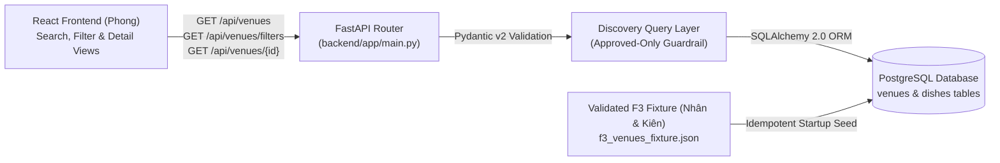

# Implementation Plan: Functional Group F3 — Restaurant Discovery and Venue Details

**Performed by:** Nguyễn Trung Kiên | **Reviewed by:** Trương Khánh Duy | **Edited by:** Nguyễn Trung Kiên

**Feature Branch**: `002-f3-venue-discovery`  
**Created**: 2026-11-12  
**Status**: Completed & Verified  
**Specification Reference**: `src/specs/002-f3-venue-discovery/spec.md`  

---

## 1. Technical Context & Stack Architecture

* **Backend Framework**: FastAPI (`0.143.0`) on Python 3.12+ / 3.13+
* **Database & ORM**: PostgreSQL 17 (`postgres:17-alpine` in `compose.yaml`) accessed via SQLAlchemy 2.0 ORM (`sqlalchemy==2.0.44`, `psycopg2-binary==2.9.11`). Supports `DATABASE_URL` environment variable injection with automatic fallback to local SQLite (`sqlite:///./dinevina_f3.db`) for zero-daemon local/CI test runs.
* **Schema & Validation**: Pydantic v2 strict response envelopes and query parameter validators.
* **Fixture Pipeline**: Validated JSON fixture (`backend/app/fixtures/f3_venues_fixture.json`) coordinated with Lương Thiện Nhân's F3 data contract, automatically seeded idempotently on service startup.
* **Frontend Consumer**: React 18 + TypeScript + Vite (`frontend/src/`) developed by Hoàng Cao Phong.

---

## 2. Layered Backend Architecture

### Module Breakdown
1. `backend/app/database.py`: Configures SQLAlchemy `engine`, `SessionLocal`, `Base`, and `get_db` FastAPI dependency. Handles PostgreSQL connection pooling and SQLite test compatibility.
2. `backend/app/models.py`: Defines relational tables:
   * `venues`: `id`, `name`, `slug`, `tagline`, `description`, `address`, `district`, `city`, `cuisine`, `price_range`, `min_budget_vnd`, `max_budget_vnd`, `max_capacity`, `rating`, `review_count`, `cover_image`, `gallery_images`, `amenities`, `opening_hours`, `contact_phone`, `cancellation_policy`, `available_slots`, `status`, `is_sample`, `sample_label`.
   * `dishes`: `id`, `venue_id` (FK), `category_name`, `name`, `description`, `price_vnd`, `image_url`, `dietary_tags`, `is_signature`, `is_available`.
3. `backend/app/schemas.py`: Defines Pydantic v2 models (`DishOut`, `MenuCategoryOut`, `VenueSummaryOut`, `VenueDetailOut`, `FilterOptionsOut`, `VenueListResponse`).
4. `backend/app/fixtures/f3_venues_fixture.json` & `backend/app/seed.py`: Loads 8 approved HCMC venues (with 32+ authentic dishes) and 3 unapproved venues (`pending`, `returned`, `rejected`) into the database idempotently.
5. `backend/app/main.py`: Implements F3 REST endpoints (`/api/health`, `/api/venues`, `/api/venues/filters`, `/api/venues/{venue_id}`) with CORS and structured error handling.
6. `backend/tests/test_f3_discovery.py`: Comprehensive `pytest` suite verifying all positive, negative, boundary, and security/moderation invariants.

---

## 3. REST API Contract Summary

| Method | Path | Description | Success Code | Error Codes |
|:---:|:---|:---|:---:|:---:|
| `GET` | `/api/health` | Service & database connectivity health check with approved venue count | `200 OK` | `503` |
| `GET` | `/api/venues` | Search, filter, sort, and paginate approved venues (`q`, `district`, `cuisine`, `min_budget`, `max_budget`, `party_size`, `amenity`, `sort`, `page`, `page_size`) | `200 OK` | `422` |
| `GET` | `/api/venues/filters` | Retrieve available filter facets (`districts`, `cuisines`, `amenities`, budget & capacity bounds) from approved venues | `200 OK` | — |
| `GET` | `/api/venues/{venue_id}` | Retrieve full details, operating hours, amenities, slots, and categorized menu for a single approved venue (by ID or slug) | `200 OK` | `404` |
