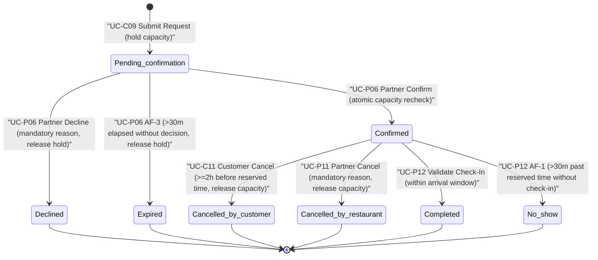

# Feature Specification: Table Reservation Requests & Lifecycle (Functional Group F5)

**Performed by:** Nguyễn Trung Kiên | **Reviewed by:** Trương Khánh Duy | **Edited by:** Nguyễn Trung Kiên

**Feature Branch:** `003-f5-table-reservation` (`research/PA4_Kien`)  
**PA4 Target:** Section E (`F5 - Table Reservation Requests`) & PA3 F5/Use-Case Alignment  
**Functional Requirements Realized:** `FR-5.1` – `FR-5.10`, `FR-7.3`  
**Use Cases Covered:** `UC-C08`, `UC-C09`, `UC-C10`, `UC-C11`, `UC-P06`, `UC-P11`, `UC-P12`, `UC-A04`

---

## 1. Scope & Business Invariants

**Performed by:** Nguyễn Trung Kiên | **Reviewed by:** Trương Khánh Duy | **Edited by:** Nguyễn Trung Kiên

1. **Public Discovery Separation (`UC-C08`, `FR-5.1`):** Guests and signed-in Customers may inspect bookable 30-minute time slots and remaining capacity for any administrator-approved venue (`status == 'approved'`) without authentication. Unapproved venues (`pending`, `returned`, `rejected`, `suspended`) return `404 Not Found`.
2. **Customer-Initiated Request Lifecycle (`UC-C09`, `FR-5.2`):** Only signed-in Customers can create reservation requests, and only for themselves (using their profile contact identity, date, 30-minute time slot, party size within `1..50` and `<= venue.max_capacity`, and optional special requests). Newly created requests start strictly in **`Pending confirmation`** and are never treated as confirmed bookings until Partner Staff explicitly confirms them.
3. **Atomic Capacity & Concurrency Safety (`FR-7.3`, `REL-01`):** Slot availability checks (`UC-C08`), capacity holds on request creation (`UC-C09`), capacity rechecks on partner confirmation (`UC-P06`), and capacity releases on cancellation/decline/expiry execute inside atomic database transactions so no slot is ever confirmed beyond configured capacity even under 20+ overlapping concurrent requests.
4. **30-Minute Partner Response Window & Expiry (`FR-5.3`, `FR-5.6`, `UC-P06`):** Partner Staff may confirm or decline (with a mandatory reason) a `Pending confirmation` request within 30 minutes of creation. If 30 minutes elapse without a partner decision, the request transitions to **`Expired`** (`confirmed_by_deadline` passed), held capacity is released, and Partner Confirm/Decline actions are rejected.
5. **Cancellation Rules & 2-Hour Cutoff (`FR-5.5`, `FR-5.8`, `UC-C11`, `UC-P11`):**
   * **Customer Cancellation (`UC-C11`):** A customer may cancel their own `Confirmed` reservation with a mandatory cancellation reason **at least 2 hours (120 minutes)** before the reserved date-time, transitioning it to **`Cancelled by customer`** and releasing slot capacity. Requests inside the 2-hour cutoff are rejected (`409` / `422`) and the response includes the venue hotline (`contact_phone`).
   * **Operational Partner Cancellation (`UC-P11`):** Partner Staff owning the venue may cancel an exceptional `Confirmed` reservation with a mandatory operational reason, transitioning it to **`Cancelled by restaurant`**, releasing slot capacity, and notifying the customer.
6. **Attendance & No-Show Tracking (`FR-5.9`, `FR-5.10`, `UC-P12`):** Partner Staff can validate check-in for a `Confirmed` reservation within the arrival check-in window, transitioning it to **`Completed`**. If the customer does not arrive within the 30-minute grace period after the reserved time, the booking transitions (explicitly or via lazy/scheduled check) to **`No-show`**.
7. **Immutable Status History & Support Investigation (`FR-5.4`, `FR-5.7`, `REL-02`, `UC-C10`, `UC-A04`):** Every state creation and transition appends an immutable entry containing `from_state`, `to_state`, `actor_id`, `actor_role`, `reason`, and ISO 8601 timestamp (`Asia/Ho_Chi_Minh` / UTC). Customers inspect their own history (`UC-C10`); Administrators inspect cross-venue reservation histories by ID or customer/venue filter during support investigations (`UC-A04`).
8. **Role & Ownership Enforcement (`SEC-01`, `SEC-04`):** Customer endpoints scope to the signed-in customer's ID; Partner endpoints scope strictly to venues owned/staffed by the partner; Admin support lookup requires the `administrator` role (`403 Forbidden` otherwise).

---

## 2. Reservation State Machine

**Performed by:** Nguyễn Trung Kiên | **Reviewed by:** Trương Khánh Duy | **Edited by:** Nguyễn Trung Kiên

---

## 3. User Scenarios & Given–When–Then Acceptance Criteria

**Performed by:** Nguyễn Trung Kiên | **Reviewed by:** Trương Khánh Duy | **Edited by:** Nguyễn Trung Kiên

### `US-F5-01`: Check Slot Availability (`UC-C08`, `FR-5.1`, `FR-7.3`)
* **Independent Test:** `GET /api/venues/{venue_id}/availability?date=YYYY-MM-DD&party_size=4`
* **Acceptance Scenarios:**
  1. **Given** an approved venue with open 30-minute slots on a future date and remaining capacity $\ge 4$, **When** a guest queries availability for `party_size=4`, **Then** HTTP `200 OK` returns each slot's time, `status` (`Available` or `Sold out`), `remaining_capacity`, and blocked status.
  2. **Given** a past date or `party_size` outside `1..50` or exceeding `venue.max_capacity`, **When** a guest queries availability, **Then** HTTP `422 Unprocessable Entity` returns a structured validation error (`STD-01`).
  3. **Given** an unapproved or missing `venue_id`, **When** a guest queries availability, **Then** HTTP `404 Not Found` is returned.

### `US-F5-02`: Submit & Track Table Reservation Requests (`UC-C09`, `UC-C10`, `FR-5.2`, `FR-5.4`)
* **Independent Test:** `POST /api/reservations` and `GET /api/reservations` / `GET /api/reservations/{reservation_id}`
* **Acceptance Scenarios:**
  1. **Given** a signed-in Customer and an available slot, **When** `POST /api/reservations` is submitted with valid date, 30-minute slot, `party_size`, and optional `idempotency_key`, **Then** a persistent record is created in state `Pending confirmation` with a 30-minute `response_deadline`, held slot capacity is recorded, and the first immutable status history entry is created.
  2. **Given** repeated network retries carrying the same `idempotency_key` (`UC-C09` A6), **When** `POST /api/reservations` is received again, **Then** the existing reservation summary is returned without creating a duplicate row or double-holding capacity.
  3. **Given** insufficient remaining capacity (including concurrent submissions), **When** `POST /api/reservations` runs, **Then** HTTP `409 Conflict` is returned with nearby $\pm 30$-minute available slot suggestions (`UC-C09` A4).
  4. **Given** a signed-in Customer viewing their reservations, **When** calling `GET /api/reservations` or `GET /api/reservations/{id}`, **Then** only that customer's records are returned alongside chronological status history, `response_deadline`, and `cancellation_deadline`.

### `US-F5-03`: Customer Cancellation with 2-Hour Cutoff (`UC-C11`, `FR-5.5`)
* **Independent Test:** `POST /api/reservations/{reservation_id}/cancel`
* **Acceptance Scenarios:**
  1. **Given** a `Confirmed` reservation belonging to the customer with $> 2$ hours remaining before reserved date-time, **When** the customer submits a non-empty cancellation reason, **Then** state changes to `Cancelled by customer`, slot capacity is released, and history appends the actor, reason, and timestamp.
  2. **Given** less than 2 hours remain before reserved date-time (`UC-C11` A1), **When** cancellation is attempted, **Then** HTTP `409 Conflict` (or `422`) rejects cancellation, keeps state `Confirmed`, and returns `venue_hotline` in the response payload.
  3. **Given** a reservation already in a terminal state (`Completed`, `Expired`, `Cancelled by restaurant`), **When** customer cancellation is attempted, **Then** HTTP `409 Conflict` is returned (`REL-01`).

### `US-F5-04`: Partner Reservation Decisions, Operational Cancel & Attendance (`UC-P06`, `UC-P11`, `UC-P12`, `FR-5.3`, `FR-5.6`, `FR-5.8`, `FR-5.9`, `FR-5.10`)
* **Independent Test:** Partner endpoints under `/api/partner/reservations/{reservation_id}/...`
* **Acceptance Scenarios:**
  1. **Given** a `Pending confirmation` reservation within the 30-minute response window and sufficient slot capacity, **When** owning Partner Staff confirms it, **Then** state atomically transitions to `Confirmed` with audit entry; if the 30-minute window has elapsed, lazy/scheduled expiry sets state to `Expired` and rejects confirmation (`409 Conflict`).
  2. **Given** a `Pending confirmation` reservation declined by owning Partner Staff, **When** no decline reason is supplied, **Then** HTTP `422` rejects the call; with a valid reason, state becomes `Declined` and held capacity is released.
  3. **Given** a `Confirmed` reservation canceled operationally by Partner Staff (`UC-P11`) with a mandatory reason, **Then** state becomes `Cancelled by restaurant` and capacity is released.
  4. **Given** a `Confirmed` reservation, **When** Partner Staff checks the guest in within the arrival window, state becomes `Completed`; **When** 30 minutes pass after reserved time without check-in (`UC-P12` A1), state becomes `No-show`.

### `US-F5-05`: Administrator Support Investigation (`UC-A04`, `FR-5.7`)
* **Independent Test:** `GET /api/admin/reservations/support` and `GET /api/admin/reservations/{reservation_id}`
* **Acceptance Scenarios:**
  1. **Given** an authenticated Administrator, **When** querying by reservation ID, customer, or venue, **Then** the reservation summary and full chronological status history (`from_state`, `to_state`, `actor_id`, `actor_role`, `reason`, `created_at`) are returned read-only.
  2. **Given** a Customer or Partner Staff token calling the admin endpoint, **Then** HTTP `403 Forbidden` is returned.

---

## 4. Non-Functional & Error Contract Constraints

**Performed by:** Nguyễn Trung Kiên | **Reviewed by:** Trương Khánh Duy | **Edited by:** Nguyễn Trung Kiên

* **Latency (`PERF-02`):** Slot booking submission and partner decision endpoints target `p95 <= 500 ms` under relational locking.
* **No Silent Fallback (`REL-03`):** When PostgreSQL/database persistence fails, mutations abort cleanly via transaction rollback and return `503 Service Unavailable`—never writing silently to a secondary in-memory store.
* **Standard Error Envelope (`STD-01`):** Error responses return structured fields (`code`, `message`, `request_id`, plus optional context such as `suggested_slots` or `venue_hotline`).
