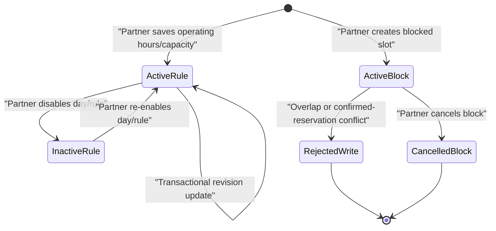

# Feature Specification: Availability & Partner Dashboard (Functional Group F7)

**Performed by:** Lương Thiện Nhân | **Reviewed by:** Nguyễn Trung Kiên | **Edited by:** Lương Thiện Nhân

**Feature Branch:** `004-f7-availability-partner-dashboard` (`research/PA4_Nhan` for artifacts; `feat/PA4_F7_Nhan` for implementation)  
**PA4 Target:** Section E (`F7 - Availability and Partner Dashboard`)  
**Functional Requirements Realized:** `FR-7.1`, `FR-7.2`, `FR-7.3`  
**Use Cases Covered:** `UC-P04`, `UC-P05`; supporting contract for `UC-C08` and atomic integration with `UC-P06`

---

## 1. Scope & Business Invariants

**Performed by:** Lương Thiện Nhân | **Reviewed by:** Nguyễn Trung Kiên | **Edited by:** Lương Thiện Nhân

1. **Persistent availability configuration (`UC-P04`, `FR-7.1`):** Partner Staff can maintain weekly operating hours, default booking capacity per 30-minute slot, and blocked date/time ranges for each owned venue. All values are persisted in the relational database and survive API/browser restarts.
2. **Ownership and role enforcement (`SEC-01`, `SEC-04`):** Partner availability and dashboard endpoints require role `partner_staff`. The target `venue_id` must be present in the actor's authorized venue scope. In the PA4 demo implementation this scope is carried by the `X-Partner-Venues` header until the shared authentication service is integrated.
3. **Approved-venue public availability (`UC-C08`, `FR-7.3`):** Guests and customers can read calculated slot availability only for approved venues. Unapproved, suspended, missing, or otherwise unpublished venues return `404` from the public availability endpoint.
4. **Deterministic slot calculation:** Availability slots are generated in 30-minute granularity from active weekly operating hours using `Asia/Ho_Chi_Minh` time. A slot is unavailable when it is in the past, overlaps an active blocked range, or does not have enough remaining capacity for the requested party size.
5. **Active capacity holds:** Only reservations in `Pending confirmation` (not beyond their response deadline) and `Confirmed` consume capacity. Terminal states (`Declined`, `Expired`, `Cancelled by customer`, `Cancelled by restaurant`, `Completed`, `No-show`) do not consume capacity.
6. **No negative capacity (`FR-7.3`):** Remaining capacity is never negative. Availability settings mutations validate active future holds so a partner cannot reduce capacity below seats already held in any future slot.
7. **Blocked-slot safety:** Active blocked ranges for the same venue/date cannot overlap. Creating a block that overlaps a future `Confirmed` reservation is rejected with `409 BLOCKED_SLOT_CONFLICT`; affected pending reservations may be reported as warnings but are never silently cancelled.
8. **Transactional mutation:** Availability settings and blocked-slot mutations validate and write inside one database transaction. Failures roll back completely; no partial operating-hour/capacity revision is stored.
9. **Partner dashboard persistence (`UC-P05`, `FR-7.2`):** Dashboard cards and queues are derived from persisted reservation and event-inquiry rows, not browser-local demo state. The dashboard is a read model and does not implement F5 decision actions or full F6 proposal workflows.
10. **Pagination and operational privacy (`PERF-04`, `PRIV-01`):** Queue endpoints default to 20 items per page and cap `page_size` at 50. Partner Staff only sees records for authorized venues; customer contact data is limited to operational need.

---

## 2. Actor & Permission Contract

**Performed by:** Lương Thiện Nhân | **Reviewed by:** Nguyễn Trung Kiên | **Edited by:** Lương Thiện Nhân

| Actor | Allowed F7 behavior | Denied behavior |
| --- | --- | --- |
| Guest / Customer | Read public calculated availability for approved venues (`GET /api/venues/{venue_id}/availability`) | Mutate availability or read partner dashboard |
| Partner Staff | Read/update availability settings, create/cancel blocked slots, and read dashboard for owned venues | Access another venue, mutate reservations/events from dashboard, or bypass validation |
| Administrator | May inspect support data through separate admin use cases | No implicit write access to partner availability in F7 |
| System Scheduler / lazy expiry logic | Expire overdue `Pending confirmation` reservation holds when read | Change availability configuration |

Demo headers:

| Header | Example | Meaning |
| --- | --- | --- |
| `X-User-Id` | `partner-001` | Authenticated actor identifier |
| `X-User-Role` | `partner_staff` | Actor role |
| `X-Partner-Venues` | `v-hcmc-001,v-hcmc-002` | Authorized venue scope |

---

## 3. Data Entities & State Model

**Performed by:** Lương Thiện Nhân | **Reviewed by:** Nguyễn Trung Kiên | **Edited by:** Lương Thiện Nhân

### 3.1 Availability entities owned by F7

| Entity | Important fields | Invariants |
| --- | --- | --- |
| `venue_availability_settings` | `venue_id` (PK/FK), `default_slot_capacity`, `slot_granularity_minutes`, `revision`, `updated_by`, `updated_at` | Capacity is `1..venue.max_capacity`; granularity is fixed to 30 minutes for PA4; revision increments once per successful settings update. |
| `venue_operating_hours` | `id` (PK), `venue_id` (FK), `day_of_week` (`0=Monday..6=Sunday`), `open_time`, `close_time`, `is_active`, timestamps | One row per `(venue_id, day_of_week)`; active rows require `open_time < close_time`; inactive rows do not generate slots. |
| `venue_blocked_slots` | `id` (PK), `venue_id` (FK), `blocked_date`, `start_time`, `end_time`, `reason`, `status`, actor/timestamp fields | `start_time < end_time`; active rows for the same venue/date cannot overlap; cancellation sets `status='Cancelled'` rather than deleting audit evidence. |

### 3.2 Read-model dependencies

| Entity | Owner | F7 usage |
| --- | --- | --- |
| `venues` | F2/F3 | Validates approved public venues, maximum capacity, venue name/hotline, and display metadata. |
| `reservations` | F5 shared schema | Supplies active capacity holds and reservation rows for the dashboard queue. F7 does not implement decision endpoints. |
| `reservation_status_history` | F5 shared schema | Supplies audit timestamps/reasons when integrated; not mutated by dashboard reads except the shared lazy-expiry rule. |
| `event_inquiries` | F6 shared/forward-compatible queue projection | Supplies persisted event-inquiry rows for the partner dashboard. Full clarification/proposal behavior remains outside F7. |

### 3.3 Availability/block state diagram



---

## 4. API Contract

**Performed by:** Lương Thiện Nhân | **Reviewed by:** Nguyễn Trung Kiên | **Edited by:** Lương Thiện Nhân

| Endpoint | Method | Actor | Query / Body | Response and errors |
| --- | :---: | --- | --- | --- |
| `/api/venues/{venue_id}/availability` | `GET` | Guest+ | `date=YYYY-MM-DD&party_size=1..50` | `200` with `venue_id`, `date`, `party_size`, `slot_granularity_minutes`, and `slots[]` (`time`, `status`, `remaining_capacity`, `total_capacity`, `is_blocked`, `discount_percent`). `404` venue unavailable; `422` invalid/past date or party size. |
| `/api/partner/venues/{venue_id}/availability-settings` | `GET` | Partner Staff | Headers only | `200` with venue metadata, `default_slot_capacity`, `slot_granularity_minutes`, `revision`, `operating_hours[]`, and `blocked_slots[]`. `401` missing actor; `403` wrong role/venue scope; `404` venue missing. |
| `/api/partner/venues/{venue_id}/availability-settings` | `PUT` | Partner Staff | `{default_slot_capacity, operating_hours[], expected_revision?}` | `200` with updated settings/revision. `422 VALIDATION_FAILED`; `409 STALE_AVAILABILITY_REVISION` or `CAPACITY_CONFLICT`; `403` ownership failure. |
| `/api/partner/venues/{venue_id}/blocked-slots` | `POST` | Partner Staff | `{blocked_date,start_time,end_time,reason}` | `201` with created active block and `affected_pending_reservation_ids` warning list. `409 BLOCKED_SLOT_OVERLAP` or `BLOCKED_SLOT_CONFLICT`; `422` invalid date/time/reason. |
| `/api/partner/venues/{venue_id}/blocked-slots/{blocked_slot_id}` | `DELETE` | Partner Staff | Path IDs | `200` with block transitioned to `Cancelled`; repeated cancellation is idempotent and returns current row. `404` missing block; `403` ownership failure. |
| `/api/partner/venues/{venue_id}/dashboard` | `GET` | Partner Staff | `date?`, `reservation_status?`, `event_status?`, `page=1`, `page_size=20` | `200` with `summary`, `reservation_queue`, `event_queue`, and `generated_at`. `403` ownership failure; `422` invalid filters/pagination. |

### 4.1 Slot status values

| Status | Meaning |
| --- | --- |
| `Available` | Slot is in the future, not blocked, and `remaining_capacity >= party_size`. |
| `Sold out` | Slot is in the future and not blocked, but remaining capacity is insufficient. |
| `Blocked` | Slot overlaps an active blocked range. |
| `Past` | Slot start is not in the future for the requested date. |
| `Closed` | No active operating-hours rule generates slots for that date; in this case `slots[]` is empty and `closed_reason` explains the closure. |

### 4.2 Dashboard response shape

```json
{
  "venue_id": "v-hcmc-001",
  "venue_name": "Nhà Hàng Việt Xưa Sài Gòn",
  "generated_at": "2026-11-27T19:00:00+07:00",
  "summary": {
    "pending_reservations": 2,
    "confirmed_today": 3,
    "open_event_inquiries": 1,
    "seats_reserved_today": 18,
    "active_blocked_slots_next_7_days": 1,
    "nearest_response_deadline": "2026-11-27T19:30:00+07:00"
  },
  "reservation_queue": {
    "total": 2,
    "page": 1,
    "page_size": 20,
    "items": []
  },
  "event_queue": {
    "total": 1,
    "page": 1,
    "page_size": 20,
    "items": []
  }
}
```

---

## 5. User Scenarios & Given–When–Then Acceptance Criteria

**Performed by:** Lương Thiện Nhân | **Reviewed by:** Nguyễn Trung Kiên | **Edited by:** Lương Thiện Nhân

### `US-F7-01`: Read and update availability settings (`UC-P04`, `FR-7.1`)

* **Independent test:** `GET` then `PUT /api/partner/venues/{venue_id}/availability-settings` with partner headers.
* **Acceptance scenarios:**
  1. **Given** an owned approved venue with seeded settings, **When** Partner Staff reads settings, **Then** HTTP `200` returns weekly operating hours, capacity, revision, and blocked slots.
  2. **Given** valid changed operating hours and capacity, **When** Partner Staff saves settings, **Then** HTTP `200` increments `revision`, persists every row, and a repeated `GET` returns the same values.
  3. **Given** an invalid close time or capacity, **When** Partner Staff saves settings, **Then** HTTP `422` returns a structured validation error and the previous revision remains unchanged.
  4. **Given** an `expected_revision` that does not match the persisted revision, **When** Partner Staff saves settings, **Then** HTTP `409 STALE_AVAILABILITY_REVISION` is returned and no write occurs.

### `US-F7-02`: Enforce role and venue ownership (`SEC-04`)

* **Independent test:** call partner endpoints without headers, with customer role, and with another venue scope.
* **Acceptance scenarios:**
  1. **Given** no actor headers, **When** reading settings or dashboard, **Then** HTTP `401 AUTH_REQUIRED` is returned.
  2. **Given** role `customer`, **When** reading settings or dashboard, **Then** HTTP `403 FORBIDDEN_ROLE` is returned.
  3. **Given** role `partner_staff` without the target venue in `X-Partner-Venues`, **When** mutating or reading partner data, **Then** HTTP `403 FORBIDDEN_VENUE` is returned.

### `US-F7-03`: Calculate public slot availability (`UC-C08`, `FR-7.3`)

* **Independent test:** `GET /api/venues/{venue_id}/availability?date=<future>&party_size=4`.
* **Acceptance scenarios:**
  1. **Given** an active operating-hours rule, **When** a guest queries a future date, **Then** HTTP `200` returns 30-minute slots within open/close time.
  2. **Given** active reservations consuming seats at a slot, **When** availability is calculated, **Then** `remaining_capacity` equals configured capacity minus non-expired pending/confirmed seats and is never negative.
  3. **Given** a party size larger than remaining capacity, **When** availability is calculated, **Then** that slot status is `Sold out`.
  4. **Given** an unapproved venue, **When** availability is queried, **Then** HTTP `404` is returned.
  5. **Given** an inactive weekday rule, **When** availability is queried, **Then** HTTP `200` returns an empty `slots[]` and a machine-readable closed reason.

### `US-F7-04`: Manage blocked slots (`UC-P04`, `FR-7.1`)

* **Independent test:** create, query, overlap, conflict, and cancel blocked slots.
* **Acceptance scenarios:**
  1. **Given** a valid future blocked range, **When** Partner Staff creates it, **Then** HTTP `201` persists the row and later public availability marks overlapping slots as `Blocked`.
  2. **Given** an overlapping active blocked range, **When** Partner Staff creates another block, **Then** HTTP `409 BLOCKED_SLOT_OVERLAP` is returned.
  3. **Given** a future `Confirmed` reservation overlapping the requested range, **When** Partner Staff creates the block, **Then** HTTP `409 BLOCKED_SLOT_CONFLICT` includes affected reservation IDs.
  4. **Given** an active block, **When** Partner Staff cancels it, **Then** the row status becomes `Cancelled`, audit fields are preserved, and later public availability no longer marks the slot as blocked.

### `US-F7-05`: Protect capacity invariants (`FR-7.3`)

* **Independent test:** seed/create active reservations, then reduce capacity or inspect heavily occupied slots.
* **Acceptance scenarios:**
  1. **Given** active future reservations holding more seats than a proposed new capacity in any slot, **When** Partner Staff saves that lower capacity, **Then** HTTP `409 CAPACITY_CONFLICT` is returned and no settings write occurs.
  2. **Given** simultaneous reads while a settings write is committed, **When** availability is calculated, **Then** each response is based on one consistent revision and never mixes partial operating-hour rows.
  3. **Given** occupied seats greater than a previously configured capacity because of legacy data, **When** availability is calculated, **Then** remaining capacity is clamped at zero rather than negative.

### `US-F7-06`: View partner dashboard (`UC-P05`, `FR-7.2`)

* **Independent test:** `GET /api/partner/venues/{venue_id}/dashboard` with filters.
* **Acceptance scenarios:**
  1. **Given** seeded pending/confirmed reservations and open event inquiries, **When** Partner Staff opens the dashboard, **Then** HTTP `200` returns correct summary counts, reservation queue rows, event queue rows, and `generated_at`.
  2. **Given** no rows matching a valid filter, **When** the dashboard is queried, **Then** HTTP `200` returns empty queue arrays and zero/filter-appropriate summary counts rather than an error.
  3. **Given** `page_size` above 50 or a malformed date, **When** the dashboard is queried, **Then** HTTP `422` is returned.
  4. **Given** another venue's data exists, **When** Partner Staff queries an owned venue dashboard, **Then** no rows from the other venue are exposed.

---

## 6. Non-functional Requirements

**Performed by:** Lương Thiện Nhân | **Reviewed by:** Nguyễn Trung Kiên | **Edited by:** Lương Thiện Nhân

| ID | Requirement |
| --- | --- |
| `PERF-02` | Availability settings mutation and single-day slot calculation target `p95 <= 500 ms` under normal demo load. |
| `PERF-04` | Dashboard queues default to 20 and cap at 50 rows per page. |
| `REL-01` | Mutations are transactional and illegal state transitions are rejected. |
| `REL-02` | Block cancellation and availability revision metadata preserve audit evidence. |
| `SEC-01` | API traffic is designed for HTTPS deployment. |
| `SEC-04` | Role and ownership checks are enforced server-side on every partner endpoint. |
| `PRIV-01` | Customer contact details are exposed only in operational partner queues and never in public availability responses. |
| `PLAT-01` | React screens remain usable at 360 px and 1280 px viewport widths. |
| `A11Y-01` | Forms have visible labels, keyboard-operable controls, and non-color-only status text. |
| `STD-02` | Business dates/times use `Asia/Ho_Chi_Minh`; API timestamps use ISO 8601 with timezone. |

---

## 7. Out of Scope / Integration Boundaries

**Performed by:** Lương Thiện Nhân | **Reviewed by:** Nguyễn Trung Kiên | **Edited by:** Lương Thiện Nhân

* Customer reservation submission, partner confirm/decline, cancellation, check-in, and no-show actions are F5 scope. F7 only consumes the shared reservation schema/capacity states and displays rows.
* Event clarification, proposal generation, proposal acceptance, and event confirmation are F6 scope. F7 only displays a persisted event-inquiry queue projection.
* Production authentication, password storage, and account registration are F1 scope. F7 uses the agreed PA4 header-based actor contract for demo/test isolation.
* Payment, deposits, no-show fees, and notification-provider integration are outside PA4 F7.
